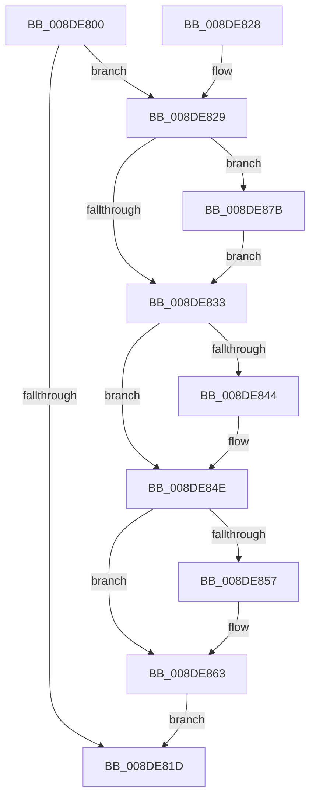

# PiDqQueryRelease

- RVA: `0x008DE800`–`0x008DE890` (길이 `144` bytes)
- VA: `0x00000001408DE800`
- 실행 섹션: `PAGE`
- PDB 이름 있음: `예`; PDB Function 태그: `아니요`
- unwind 정보 RVA: `0x00085B14`
- 디코드: `39`개 명령, `144/144` bytes 표시
- 미해석 바이트: `0` (있으면 어셈블리에 `.byte`로 보존)

> 이 문서는 커널 이미지의 기계어와 PDB 기호를 분석해 생성했습니다. 4번과 5번은 함수 원형과 자료형을 바이너리 사용 방식에서 추정한 C 해석이며 원본 소스 복구 결과는 아닙니다.

## 1. Dependencies

- 직접 호출 지점: **6**; 고유 호출 대상: **5**
- 직접 호출자로 확인된 함수: **3**
- RIP 상대 이미지 참조: **3**

### Outgoing calls
- `0x008DE836` → [PiDqQueryFreeActiveData](PiDqQueryFreeActiveData_function_008DE4FC.md) (function, `0x008DE4FC`)
- `0x008DE849` → [ExFreePoolWithTag](../../poolcode/B8/ExFreePoolWithTag_function_00B82870.md) (function, `0x00B82870`)
- `0x008DE857` → `msrpc.sys!MesHandleFree` (import, 간접 대상; import `msrpc.sys!MesHandleFree`)
- `0x008DE867` → [SeReleaseSubjectContext](../86/SeReleaseSubjectContext_function_0086B710.md) (function, `0x0086B710`)
- `0x008DE874` → [ExFreePoolWithTag](../../poolcode/B8/ExFreePoolWithTag_function_00B82870.md) (function, `0x00B82870`)
- `0x008DE889` → [McTemplateK0p_EtwWriteTransfer](../../text/4D/McTemplateK0p_EtwWriteTransfer_function_004D2F24.md) (function, `0x004D2F24`)

### Direct callers
- [PiDqObjectManagerUnregisterQuery](PiDqObjectManagerUnregisterQuery_function_008DC820.md) at `0x008DC86C`
- [PiDqDispatch](PiDqDispatch_function_008DC8A0.md) at `0x008DC9DF`
- [PiDqObjectManagerServiceActionQueue](PiDqObjectManagerServiceActionQueue_function_008DD640.md) at `0x008DD880`

### Static image references
- `0x008DE829` → RVA `0x00EF012A` (`.data`; read)
- `0x008DE857` → RVA `0x001516E0` (`msrpc.sys!MesHandleFree (IAT)`; read)
- `0x008DE87F` → RVA `0x000271A0` (`.rdata`; read)

## 2. Other-region calls and transfers

- 다른 실행 섹션으로 향하는 call: **3**
  - `0x008DE849` → [ExFreePoolWithTag](../../poolcode/B8/ExFreePoolWithTag_function_00B82870.md) (`PAGE` → `POOLCODE`)
  - `0x008DE874` → [ExFreePoolWithTag](../../poolcode/B8/ExFreePoolWithTag_function_00B82870.md) (`PAGE` → `POOLCODE`)
  - `0x008DE889` → [McTemplateK0p_EtwWriteTransfer](../../text/4D/McTemplateK0p_EtwWriteTransfer_function_004D2F24.md) (`PAGE` → `.text`)
- 별도 외부 분기/꼬리 이동을 확인하지 못했습니다.

## 3. Assembly (complete function range)

```asm
008DE800  48 89 5C 24 10                  mov qword ptr [rsp + 0x10], rbx
008DE805  57                              push rdi
008DE806  48 83 EC 20                     sub rsp, 0x20
008DE80A  48 8B D9                        mov rbx, rcx
008DE80D  83 C8 FF                        or eax, 0xffffffff
008DE810  F0 0F C1 81 D4 00 00 00         lock xadd dword ptr [rcx + 0xd4], eax
008DE818  83 F8 01                        cmp eax, 1
008DE81B  74 0C                           je 0x1408de829
008DE81D  48 8B 5C 24 38                  mov rbx, qword ptr [rsp + 0x38]
008DE822  48 83 C4 20                     add rsp, 0x20
008DE826  5F                              pop rdi
008DE827  C3                              ret
008DE828  CC                              int3
008DE829  8A 05 FB 18 61 00               mov al, byte ptr [rip + 0x6118fb]
008DE82F  84 C0                           test al, al
008DE831  78 48                           js 0x1408de87b
008DE833  48 8B CB                        mov rcx, rbx
008DE836  E8 C1 FC FF FF                  call 0x1408de4fc
008DE83B  48 8B 4B 18                     mov rcx, qword ptr [rbx + 0x18]
008DE83F  48 85 C9                        test rcx, rcx
008DE842  74 0A                           je 0x1408de84e
008DE844  BA 6B 72 70 63                  mov edx, 0x6370726b
008DE849  E8 22 40 2A 00                  call 0x140b82870
008DE84E  48 8B 4B 10                     mov rcx, qword ptr [rbx + 0x10]
008DE852  48 85 C9                        test rcx, rcx
008DE855  74 0C                           je 0x1408de863
008DE857  48 FF 15 82 2E 87 FF            call qword ptr [rip - 0x78d17e]
008DE85E  0F 1F 44 00 00                  nop dword ptr [rax + rax]
008DE863  48 8D 4B 20                     lea rcx, [rbx + 0x20]
008DE867  E8 A4 CE F8 FF                  call 0x14086b710
008DE86C  BA 50 6E 70 58                  mov edx, 0x58706e50
008DE871  48 8B CB                        mov rcx, rbx
008DE874  E8 F7 3F 2A 00                  call 0x140b82870
008DE879  EB A2                           jmp 0x1408de81d
008DE87B  4C 8B 41 18                     mov r8, qword ptr [rcx + 0x18]
008DE87F  48 8D 15 1A 89 74 FF            lea rdx, [rip - 0x8b76e6]
008DE886  4C 8B CB                        mov r9, rbx
008DE889  E8 96 46 BF FF                  call 0x1404d2f24
008DE88E  EB A3                           jmp 0x1408de833
```

## 4. C-style interpretation (structured pseudocode)

```c
__int64 __fastcall PiDqQueryRelease(__int64 a1)
{
    __int64 result;
    __int64 v_rsp;
    unsigned __int64 v_stack_p10;

    v_stack_p10 = v_rbx;
    v_rsp = (v_rsp) - (32);
    result = (unsigned int)((result) | (0xFFFFFFFFULL));
    if (((unsigned int)(result)) == 1) goto loc_008DE829;
loc_008DE81D:
    v_rsp = (v_rsp) + (32);
    return result;
loc_008DE829:
    if (sign_flag) goto loc_008DE87B;
loc_008DE833:
    result = PiDqQueryFreeActiveData(v_stack_p10, a2, a3, a4);
    if (*(unsigned __int64 *)(v_stack_p10 + 24) != 0) {
        a2 = 0x6370726BULL;
        result = ExFreePoolWithTag(*(unsigned __int64 *)(v_stack_p10 + 24), a2, a3, a4);
    }
    if (*(unsigned __int64 *)(v_stack_p10 + 16) != 0) {
        result = msrpc_sys_MesHandleFree(*(unsigned __int64 *)(v_stack_p10 + 16), a2, a3, a4);
    }
    result = SeReleaseSubjectContext(v_stack_p10 + 32, a2, a3, a4);
    result = ExFreePoolWithTag(v_stack_p10, (unsigned int)(0x58706E50ULL), a3, a4);
    goto loc_008DE81D;
loc_008DE87B:
    result = McTemplateK0p_EtwWriteTransfer(v_stack_p10, v_rip - 9139942, *(unsigned __int64 *)(v_stack_p10 + 24), v_stack_p10);
    goto loc_008DE833;
}
```

## 5. (Beta) C Style

```c
int64_t PiDqQueryRelease(void *Arg1)
{
    uint8_t *arg1 = (uint8_t *)Arg1;

    int64_t result;
    int64_t local_rsp;
    uint64_t v_stack_p10;

    v_stack_p10 = local_rbx;
    local_rsp = (local_rsp) - (32);
    result = (uint32_t)((result) | (0xFFFFFFFFULL));
    if (((uint32_t)(result)) == 1) goto loc_008DE829;
loc_008DE81D:
    local_rsp = (local_rsp) + (32);
    return result;
loc_008DE829:
    if (sign_flag) goto loc_008DE87B;
loc_008DE833:
    result = PiDqQueryFreeActiveData(v_stack_p10, a2, a3, a4);
    if (*(uint64_t *)(v_stack_p10 + 0x18) != 0) {
        a2 = 0x6370726BULL;
        result = ExFreePoolWithTag(*(uint64_t *)(v_stack_p10 + 0x18), a2, a3, a4);
    }
    if (*(uint64_t *)(v_stack_p10 + 0x10) != 0) {
        result = kernel_indirect_call(*(uint64_t *)(v_stack_p10 + 0x10), a2, a3, a4);
    }
    result = SeReleaseSubjectContext(v_stack_p10 + 32, a2, a3, a4);
    result = ExFreePoolWithTag(v_stack_p10, (uint32_t)(0x58706E50ULL), a3, a4);
    goto loc_008DE81D;
loc_008DE87B:
    result = McTemplateK0p_EtwWriteTransfer(v_stack_p10, v_rip - 9139942, *(uint64_t *)(v_stack_p10 + 0x18), v_stack_p10);
    goto loc_008DE833;
}
```

### 관측된 메모리 오프셋

구조체 형식이 확인되지 않은 접근은 인자 기준의 오프셋으로만 기록했습니다.

| 기준 인자 | 오프셋 표현 | 폭 (bit) | 접근 |
|---|---:|---:|---|
| `Arg1` | `+ 0x10` | `64` | `R` |
| `Arg1` | `+ 0x18` | `64` | `R` |
| `Arg1` | `+ 0x20` | `64` | `R` |
| `Arg1` | `+ 0xD4` | `32` | `R/W` |

## 6. Execution-region graph

[열기: 2D/3D 그래프와 함수 탐색 컨트롤 패널](../../../control-panel.html?section=page&rva=0x008DE800&view=graph)

- 2D 그래프는 위에서 아래로 흐르고, 3D 그래프는 빈 공간을 드래그해 회전합니다. Shift+드래그는 이동, 휠은 확대·축소, 함수 노드 선택은 대상 보고서 이동입니다.

### Static fallback


