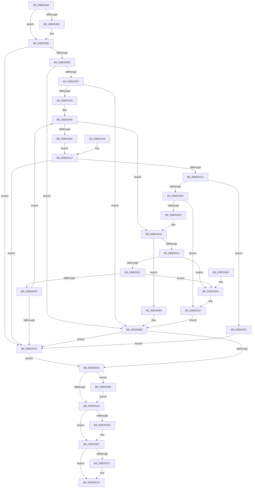

# PiDqQuerySerializeActionQueue

- RVA: `0x008DD340`–`0x008DD635` (길이 `757` bytes)
- VA: `0x00000001408DD340`
- 실행 섹션: `PAGE`
- PDB 이름 있음: `예`; PDB Function 태그: `아니요`
- unwind 정보 RVA: `0x00085A3C`
- 디코드: `178`개 명령, `757/757` bytes 표시
- 미해석 바이트: `0` (있으면 어셈블리에 `.byte`로 보존)

> 이 문서는 커널 이미지의 기계어와 PDB 기호를 분석해 생성했습니다. 4번과 5번은 함수 원형과 자료형을 바이너리 사용 방식에서 추정한 C 해석이며 원본 소스 복구 결과는 아닙니다.

## 1. Dependencies

- 직접 호출 지점: **20**; 고유 호출 대상: **12**
- 직접 호출자로 확인된 함수: **2**
- RIP 상대 이미지 참조: **9**

### Outgoing calls
- `0x008DD383` → [PiDqQueryLock](PiDqQueryLock_function_008DDA0C.md) (function, `0x008DDA0C`)
- `0x008DD392` → [PiDqQueryUnlock](PiDqQueryUnlock_function_008DDA6C.md) (function, `0x008DDA6C`)
- `0x008DD39F` → [PiDqQueryGetObjectManager](PiDqQueryGetObjectManager_function_008DD2D8.md) (function, `0x008DD2D8`)
- `0x008DD3AA` → [PiDqObjectManagerEnumerateAndRegisterQuery](PiDqObjectManagerEnumerateAndRegisterQuery_function_008DCF74.md) (function, `0x008DCF74`)
- `0x008DD3D1` → `msrpc.sys!MesEncodeIncrementalHandleCreate` (import, 간접 대상; import `msrpc.sys!MesEncodeIncrementalHandleCreate`)
- `0x008DD40A` → `msrpc.sys!MesIncrementalHandleReset` (import, 간접 대상; import `msrpc.sys!MesIncrementalHandleReset`)
- `0x008DD435` → [PiDqQueryLock](PiDqQueryLock_function_008DDA0C.md) (function, `0x008DDA0C`)
- `0x008DD459` → [PiDqQueryUnlock](PiDqQueryUnlock_function_008DDA6C.md) (function, `0x008DDA6C`)
- `0x008DD49B` → `msrpc.sys!NdrMesTypeEncode3` (import, 간접 대상; import `msrpc.sys!NdrMesTypeEncode3`)
- `0x008DD4F0` → [PiDqActionDataFree](PiDqActionDataFree_function_008DE4A8.md) (function, `0x008DE4A8`)
- `0x008DD500` → [PiDqQueryLock](PiDqQueryLock_function_008DDA0C.md) (function, `0x008DDA0C`)
- `0x008DD53C` → [PiDqQueryUnlock](PiDqQueryUnlock_function_008DDA6C.md) (function, `0x008DDA6C`)
- `0x008DD554` → [PiDqActionDataCreate](PiDqActionDataCreate_function_008DE1F0.md) (function, `0x008DE1F0`)
- `0x008DD55E` → [PiDqQueryActionQueueEntryFree](PiDqQueryActionQueueEntryFree_function_008DE1B0.md) (function, `0x008DE1B0`)
- `0x008DD589` → [PiDqQueryUnlock](PiDqQueryUnlock_function_008DDA6C.md) (function, `0x008DDA6C`)
- `0x008DD5B2` → [ExFreePoolWithTag](../../poolcode/B8/ExFreePoolWithTag_function_00B82870.md) (function, `0x00B82870`)
- `0x008DD5C1` → `msrpc.sys!MesHandleFree` (import, 간접 대상; import `msrpc.sys!MesHandleFree`)
- `0x008DD5EA` → [PiDqQueryLock](PiDqQueryLock_function_008DDA0C.md) (function, `0x008DDA0C`)
- `0x008DD606` → [PiDqQueryUnlock](PiDqQueryUnlock_function_008DDA6C.md) (function, `0x008DDA6C`)
- `0x008DD62B` → [PiDqActionDataFree](PiDqActionDataFree_function_008DE4A8.md) (function, `0x008DE4A8`)

### Direct callers
- [PiDqIrpQueryGetResult](PiDqIrpQueryGetResult_function_008DBF28.md) at `0x008DC036`
- [PiDqIrpQueryCreate](PiDqIrpQueryCreate_function_008DCC04.md) at `0x008DCE01`

### Static image references
- `0x008DD3BE` → RVA `0x00A39E00` (`PiDqSerializationWrite`; read)
- `0x008DD3C5` → RVA `0x00A2C9A0` (`PiDqSerializationAlloc`; read)
- `0x008DD3D1` → RVA `0x001516E8` (`msrpc.sys!MesEncodeIncrementalHandleCreate (IAT)`; read)
- `0x008DD40A` → RVA `0x001516F0` (`msrpc.sys!MesIncrementalHandleReset (IAT)`; read)
- `0x008DD481` → RVA `0x00E07000` (`.data`; read)
- `0x008DD488` → RVA `0x00001610` (`.rdata`; read)
- `0x008DD48F` → RVA `0x00011440` (`.rdata`; read)
- `0x008DD49B` → RVA `0x00151708` (`msrpc.sys!NdrMesTypeEncode3 (IAT)`; read)
- `0x008DD5C1` → RVA `0x001516E0` (`msrpc.sys!MesHandleFree (IAT)`; read)

## 2. Other-region calls and transfers

- 다른 실행 섹션으로 향하는 call: **1**
  - `0x008DD5B2` → [ExFreePoolWithTag](../../poolcode/B8/ExFreePoolWithTag_function_00B82870.md) (`PAGE` → `POOLCODE`)
- 별도 외부 분기/꼬리 이동을 확인하지 못했습니다.

## 3. Assembly (complete function range)

```asm
008DD340  48 8B C4                        mov rax, rsp
008DD343  4C 89 48 20                     mov qword ptr [rax + 0x20], r9
008DD347  48 89 48 08                     mov qword ptr [rax + 8], rcx
008DD34B  53                              push rbx
008DD34C  56                              push rsi
008DD34D  57                              push rdi
008DD34E  41 54                           push r12
008DD350  41 55                           push r13
008DD352  41 56                           push r14
008DD354  41 57                           push r15
008DD356  48 83 EC 60                     sub rsp, 0x60
008DD35A  4D 8B E9                        mov r13, r9
008DD35D  4C 8B F1                        mov r14, rcx
008DD360  33 FF                           xor edi, edi
008DD362  8B F7                           mov esi, edi
008DD364  48 89 78 98                     mov qword ptr [rax - 0x68], rdi
008DD368  48 89 78 10                     mov qword ptr [rax + 0x10], rdi
008DD36C  48 89 78 C0                     mov qword ptr [rax - 0x40], rdi
008DD370  48 89 50 A8                     mov qword ptr [rax - 0x58], rdx
008DD374  44 89 40 B0                     mov dword ptr [rax - 0x50], r8d
008DD378  C7 40 B4 10 00 00 00            mov dword ptr [rax - 0x4c], 0x10
008DD37F  48 89 78 B8                     mov qword ptr [rax - 0x48], rdi
008DD383  E8 84 06 00 00                  call 0x1408dda0c
008DD388  41 8B 9E D8 00 00 00            mov ebx, dword ptr [r14 + 0xd8]
008DD38F  49 8B CE                        mov rcx, r14
008DD392  E8 D5 06 00 00                  call 0x1408dda6c
008DD397  F6 C3 20                        test bl, 0x20
008DD39A  75 15                           jne 0x1408dd3b1
008DD39C  49 8B CE                        mov rcx, r14
008DD39F  E8 34 FF FF FF                  call 0x1408dd2d8
008DD3A4  48 8B C8                        mov rcx, rax
008DD3A7  49 8B D6                        mov rdx, r14
008DD3AA  E8 C5 FB FF FF                  call 0x1408dcf74
008DD3AF  8B F0                           mov esi, eax
008DD3B1  85 F6                           test esi, esi
008DD3B3  0F 88 BD 01 00 00               js 0x1408dd576
008DD3B9  4C 8D 4C 24 30                  lea r9, [rsp + 0x30]
008DD3BE  4C 8D 05 3B CA 15 00            lea r8, [rip + 0x15ca3b]
008DD3C5  48 8D 15 D4 F5 14 00            lea rdx, [rip + 0x14f5d4]
008DD3CC  48 8D 4C 24 40                  lea rcx, [rsp + 0x40]
008DD3D1  48 FF 15 10 43 87 FF            call qword ptr [rip - 0x78bcf0]
008DD3D8  0F 1F 44 00 00                  nop dword ptr [rax + rax]
008DD3DD  8B F0                           mov esi, eax
008DD3DF  85 C0                           test eax, eax
008DD3E1  0F 88 A7 01 00 00               js 0x1408dd58e
008DD3E7  41 8B 86 D8 00 00 00            mov eax, dword ptr [r14 + 0xd8]
008DD3EE  83 E0 02                        and eax, 2
008DD3F1  89 44 24 28                     mov dword ptr [rsp + 0x28], eax
008DD3F5  48 89 7C 24 20                  mov qword ptr [rsp + 0x20], rdi
008DD3FA  45 33 C9                        xor r9d, r9d
008DD3FD  45 33 C0                        xor r8d, r8d
008DD400  48 8D 54 24 40                  lea rdx, [rsp + 0x40]
008DD405  48 8B 4C 24 30                  mov rcx, qword ptr [rsp + 0x30]
008DD40A  48 FF 15 DF 42 87 FF            call qword ptr [rip - 0x78bd21]
008DD411  0F 1F 44 00 00                  nop dword ptr [rax + rax]
008DD416  8B F0                           mov esi, eax
008DD418  85 C0                           test eax, eax
008DD41A  0F 88 6E 01 00 00               js 0x1408dd58e
008DD420  8B 44 24 4C                     mov eax, dword ptr [rsp + 0x4c]
008DD424  41 89 45 00                     mov dword ptr [r13], eax
008DD428  48 8B 84 24 C0 00 00 00         mov rax, qword ptr [rsp + 0xc0]
008DD430  89 38                           mov dword ptr [rax], edi
008DD432  49 8B CE                        mov rcx, r14
008DD435  E8 D2 05 00 00                  call 0x1408dda0c
008DD43A  4D 8D A6 B8 00 00 00            lea r12, [r14 + 0xb8]
008DD441  4C 89 64 24 38                  mov qword ptr [rsp + 0x38], r12
008DD446  49 8B 04 24                     mov rax, qword ptr [r12]
008DD44A  48 89 84 24 A8 00 00 00         mov qword ptr [rsp + 0xa8], rax
008DD452  49 89 3C 24                     mov qword ptr [r12], rdi
008DD456  49 8B CE                        mov rcx, r14
008DD459  E8 0E 06 00 00                  call 0x1408dda6c
008DD45E  48 39 BC 24 A8 00 00 00         cmp qword ptr [rsp + 0xa8], rdi
008DD466  0F 84 91 00 00 00               je 0x1408dd4fd
008DD46C  48 8D 84 24 A8 00 00 00         lea rax, [rsp + 0xa8]
008DD474  48 89 44 24 28                  mov qword ptr [rsp + 0x28], rax
008DD479  C7 44 24 20 01 00 00 00         mov dword ptr [rsp + 0x20], 1
008DD481  4C 8D 0D 78 9B 52 00            lea r9, [rip + 0x529b78]
008DD488  4C 8D 05 81 41 72 FF            lea r8, [rip - 0x8dbe7f]
008DD48F  48 8D 15 AA 3F 73 FF            lea rdx, [rip - 0x8cc056]
008DD496  48 8B 4C 24 30                  mov rcx, qword ptr [rsp + 0x30]
008DD49B  48 FF 15 66 42 87 FF            call qword ptr [rip - 0x78bd9a]
008DD4A2  0F 1F 44 00 00                  nop dword ptr [rax + rax]
008DD4A7  EB 19                           jmp 0x1408dd4c2
008DD4A9  8B F0                           mov esi, eax
008DD4AB  33 FF                           xor edi, edi
008DD4AD  4C 8B AC 24 B8 00 00 00         mov r13, qword ptr [rsp + 0xb8]
008DD4B5  4C 8B B4 24 A0 00 00 00         mov r14, qword ptr [rsp + 0xa0]
008DD4BD  4C 8B 64 24 38                  mov r12, qword ptr [rsp + 0x38]
008DD4C2  85 F6                           test esi, esi
008DD4C4  0F 88 AC 00 00 00               js 0x1408dd576
008DD4CA  40 38 7C 24 5D                  cmp byte ptr [rsp + 0x5d], dil
008DD4CF  0F 85 4C 01 00 00               jne 0x1408dd621
008DD4D5  40 38 7C 24 5C                  cmp byte ptr [rsp + 0x5c], dil
008DD4DA  0F 85 07 01 00 00               jne 0x1408dd5e7
008DD4E0  8B 44 24 4C                     mov eax, dword ptr [rsp + 0x4c]
008DD4E4  41 89 45 00                     mov dword ptr [r13], eax
008DD4E8  48 8B 8C 24 A8 00 00 00         mov rcx, qword ptr [rsp + 0xa8]
008DD4F0  E8 B3 0F 00 00                  call 0x1408de4a8
008DD4F5  48 89 BC 24 A8 00 00 00         mov qword ptr [rsp + 0xa8], rdi
008DD4FD  49 8B CE                        mov rcx, r14
008DD500  E8 07 05 00 00                  call 0x1408dda0c
008DD505  49 8D 86 C0 00 00 00            lea rax, [r14 + 0xc0]
008DD50C  4C 8B 38                        mov r15, qword ptr [rax]
008DD50F  4C 3B F8                        cmp r15, rax
008DD512  74 72                           je 0x1408dd586
008DD514  49 8B 0F                        mov rcx, qword ptr [r15]
008DD517  49 39 47 08                     cmp qword ptr [r15 + 8], rax
008DD51B  0F 85 BF 00 00 00               jne 0x1408dd5e0
008DD521  4C 39 79 08                     cmp qword ptr [rcx + 8], r15
008DD525  0F 85 B5 00 00 00               jne 0x1408dd5e0
008DD52B  48 89 08                        mov qword ptr [rax], rcx
008DD52E  48 89 41 08                     mov qword ptr [rcx + 8], rax
008DD532  41 FF 8E D0 00 00 00            dec dword ptr [r14 + 0xd0]
008DD539  49 8B CE                        mov rcx, r14
008DD53C  E8 2B 05 00 00                  call 0x1408dda6c
008DD541  49 8D 56 20                     lea rdx, [r14 + 0x20]
008DD545  4C 8D 8C 24 A8 00 00 00         lea r9, [rsp + 0xa8]
008DD54D  4D 8B C7                        mov r8, r15
008DD550  49 8B 4E 18                     mov rcx, qword ptr [r14 + 0x18]
008DD554  E8 97 0C 00 00                  call 0x1408de1f0
008DD559  8B D8                           mov ebx, eax
008DD55B  49 8B CF                        mov rcx, r15
008DD55E  E8 4D 0C 00 00                  call 0x1408de1b0
008DD563  8B F7                           mov esi, edi
008DD565  81 FB 34 00 00 C0               cmp ebx, 0xc0000034
008DD56B  0F 45 F3                        cmovne esi, ebx
008DD56E  85 F6                           test esi, esi
008DD570  0F 89 E8 FE FF FF               jns 0x1408dd45e
008DD576  41 89 7D 00                     mov dword ptr [r13], edi
008DD57A  48 8B 84 24 C0 00 00 00         mov rax, qword ptr [rsp + 0xc0]
008DD582  89 38                           mov dword ptr [rax], edi
008DD584  EB 0C                           jmp 0x1408dd592
008DD586  49 8B CE                        mov rcx, r14
008DD589  E8 DE 04 00 00                  call 0x1408dda6c
008DD58E  85 F6                           test esi, esi
008DD590  78 E4                           js 0x1408dd576
008DD592  48 8B 8C 24 A8 00 00 00         mov rcx, qword ptr [rsp + 0xa8]
008DD59A  48 85 C9                        test rcx, rcx
008DD59D  0F 85 88 00 00 00               jne 0x1408dd62b
008DD5A3  48 8B 4C 24 50                  mov rcx, qword ptr [rsp + 0x50]
008DD5A8  48 85 C9                        test rcx, rcx
008DD5AB  74 0A                           je 0x1408dd5b7
008DD5AD  BA 50 6E 70 58                  mov edx, 0x58706e50
008DD5B2  E8 B9 52 2A 00                  call 0x140b82870
008DD5B7  48 8B 4C 24 30                  mov rcx, qword ptr [rsp + 0x30]
008DD5BC  48 85 C9                        test rcx, rcx
008DD5BF  74 0C                           je 0x1408dd5cd
008DD5C1  48 FF 15 18 41 87 FF            call qword ptr [rip - 0x78bee8]
008DD5C8  0F 1F 44 00 00                  nop dword ptr [rax + rax]
008DD5CD  8B C6                           mov eax, esi
008DD5CF  48 83 C4 60                     add rsp, 0x60
008DD5D3  41 5F                           pop r15
008DD5D5  41 5E                           pop r14
008DD5D7  41 5D                           pop r13
008DD5D9  41 5C                           pop r12
008DD5DB  5F                              pop rdi
008DD5DC  5E                              pop rsi
008DD5DD  5B                              pop rbx
008DD5DE  C3                              ret
008DD5DF  CC                              int3
008DD5E0  B9 03 00 00 00                  mov ecx, 3
008DD5E5  CD 29                           int 0x29
008DD5E7  49 8B CE                        mov rcx, r14
008DD5EA  E8 1D 04 00 00                  call 0x1408dda0c
008DD5EF  48 8B 84 24 A8 00 00 00         mov rax, qword ptr [rsp + 0xa8]
008DD5F7  49 89 04 24                     mov qword ptr [r12], rax
008DD5FB  48 89 BC 24 A8 00 00 00         mov qword ptr [rsp + 0xa8], rdi
008DD603  49 8B CE                        mov rcx, r14
008DD606  E8 61 04 00 00                  call 0x1408dda6c
008DD60B  8B 4C 24 58                     mov ecx, dword ptr [rsp + 0x58]
008DD60F  83 C1 10                        add ecx, 0x10
008DD612  48 8B 84 24 C0 00 00 00         mov rax, qword ptr [rsp + 0xc0]
008DD61A  89 08                           mov dword ptr [rax], ecx
008DD61C  E9 6D FF FF FF                  jmp 0x1408dd58e
008DD621  BE 05 00 00 C0                  mov esi, 0xc0000005
008DD626  E9 4B FF FF FF                  jmp 0x1408dd576
008DD62B  E8 78 0E 00 00                  call 0x1408de4a8
008DD630  E9 6E FF FF FF                  jmp 0x1408dd5a3
```

## 4. C-style interpretation (structured pseudocode)

```c
__int64 __fastcall PiDqQuerySerializeActionQueue(__int64 a1, __int64 a2, int a3, __int64 a4, __int64 a5)
{
    __int64 result;
    __int64 v_rdi;
    __int64 v_rsi;
    __int64 v_rsp;
    unsigned __int8 v_stack_m3B;
    unsigned __int8 v_stack_m3C;
    unsigned __int64 v_stack_m48;
    unsigned int v_stack_m4C;
    unsigned __int64 v_stack_m58;
    unsigned __int64 v_stack_m60;
    unsigned __int64 v_stack_m68;
    unsigned int v_stack_m70;
    unsigned __int64 v_stack_m78;
    unsigned __int64 v_stack_p10;
    unsigned __int64 v_stack_p20;
    unsigned int v_stack_p58;
    unsigned __int64 v_stack_p8;
    unsigned __int64 v_stack_pA8;

    *(unsigned __int64 *)(v_rsp + 32) = a4;
    *(unsigned __int64 *)(v_rsp + 8) = a1;
    v_rsp = (v_rsp) - (96);
    v_rdi = 0;
    *(unsigned __int64 *)(v_rsp - 104) = 0;
    *(unsigned __int64 *)(v_rsp + 16) = 0;
    *(unsigned __int64 *)(v_rsp - 64) = 0;
    *(unsigned __int64 *)(v_rsp - 88) = a2;
    *(unsigned int *)(v_rsp - 80) = a3;
    *(unsigned int *)(v_rsp - 76) = 16;
    *(unsigned __int64 *)(v_rsp - 72) = 0;
    result = PiDqQueryLock(a1, a2, a3, a4);
    result = PiDqQueryUnlock(a1, a2, a3, a4);
    v_rsi = 0;
    if ((((unsigned __int8)((unsigned int)(*(unsigned int *)(a1 + 216)))) & (32)) == 0) {
        a1 = a1;
        result = PiDqQueryGetObjectManager(a1, a2, a3, a4);
        a1 = result;
        a2 = a1;
        result = PiDqObjectManagerEnumerateAndRegisterQuery(a1, a2, a3, a4);
        v_rsi = (unsigned int)(result);
    }
    if (sign_flag) goto loc_008DD576;
    result = msrpc_sys_MesEncodeIncrementalHandleCreate(v_stack_m58, v_rip + 1373652, v_rip + 1428027, v_stack_m68);
    if (sign_flag) goto loc_008DD58E;
    result = (unsigned int)(((unsigned int)(*(unsigned int *)(a1 + 216))) & (2));
    v_stack_m70 = (unsigned int)(result);
    v_stack_m78 = 0;
    a4 = 0;
    a3 = 0;
    result = msrpc_sys_MesIncrementalHandleReset(v_stack_m68, v_stack_m58, a3, a4);
    if (sign_flag) goto loc_008DD58E;
    *(unsigned int *)(a4) = (unsigned int)((unsigned int)(v_stack_m4C));
    *(unsigned int *)(a5) = 0;
    result = PiDqQueryLock(a1, v_stack_m58, a3, a4);
    v_stack_m60 = a1 + 184;
    v_stack_p10 = *(unsigned __int64 *)(a1 + 184);
    *(unsigned __int64 *)(a1 + 184) = 0;
    result = PiDqQueryUnlock(a1, v_stack_m58, a3, a4);
loc_008DD45E:
    if (v_stack_p10 == 0) goto loc_008DD4FD;
    v_stack_m70 = v_stack_p10;
    v_stack_m78 = 1;
    result = msrpc_sys_NdrMesTypeEncode3(v_stack_m68, v_rip - 9224278, v_rip - 9289343, v_rip + 5413752);
    goto loc_008DD4C2;
loc_008DD4C2:
    if (sign_flag) goto loc_008DD576;
    if (v_stack_m3B != 0) goto loc_008DD621;
    if (v_stack_m3C != 0) goto loc_008DD5E7;
    *(unsigned int *)(a4) = (unsigned int)((unsigned int)(v_stack_m4C));
    result = PiDqActionDataFree(v_stack_p10, v_rip - 9224278, v_rip - 9289343, v_rip + 5413752);
    v_stack_p10 = 0;
loc_008DD4FD:
    result = PiDqQueryLock(a1, v_rip - 9224278, v_rip - 9289343, v_rip + 5413752);
    if ((*(unsigned __int64 *)(a1 + 192)) == (a1 + 192)) goto loc_008DD586;
    if ((*(unsigned __int64 *)(*(unsigned __int64 *)(a1 + 192) + 8)) != (a1 + 192)) goto loc_008DD5E0;
    if ((*(unsigned __int64 *)(*(unsigned __int64 *)(*(unsigned __int64 *)(a1 + 192)) + 8)) != (*(unsigned __int64 *)(a1 + 192))) goto loc_008DD5E0;
    *(unsigned __int64 *)(a1 + 192) = *(unsigned __int64 *)(*(unsigned __int64 *)(a1 + 192));
    *(unsigned __int64 *)(*(unsigned __int64 *)(*(unsigned __int64 *)(a1 + 192)) + 8) = a1 + 192;
    result = PiDqQueryUnlock(a1, v_rip - 9224278, v_rip - 9289343, v_rip + 5413752);
    result = PiDqActionDataCreate(*(unsigned __int64 *)(a1 + 24), a1 + 32, *(unsigned __int64 *)(a1 + 192), v_stack_p10);
    result = PiDqQueryActionQueueEntryFree(*(unsigned __int64 *)(a1 + 192), a1 + 32, *(unsigned __int64 *)(a1 + 192), v_stack_p10);
    v_rsi = 0;
    if (((unsigned int)((unsigned int)((unsigned int)(result)))) != 0xC0000034ULL) { v_rsi = (unsigned int)((unsigned int)((unsigned int)(result))); }
    if (!sign_flag) goto loc_008DD45E;
loc_008DD576:
    *(unsigned int *)(a4) = 0;
    *(unsigned int *)(a5) = 0;
    goto loc_008DD592;
loc_008DD586:
    result = PiDqQueryUnlock(a1, a1 + 32, *(unsigned __int64 *)(a1 + 192), v_stack_p10);
loc_008DD58E:
    if (sign_flag) goto loc_008DD576;
loc_008DD592:
    if (v_stack_p10 != 0) goto loc_008DD62B;
loc_008DD5A3:
    if (v_stack_m48 != 0) {
        a2 = 0x58706E50ULL;
        result = ExFreePoolWithTag(v_stack_m48, a2, *(unsigned __int64 *)(a1 + 192), v_stack_p10);
    }
    if (v_stack_m68 != 0) {
        result = msrpc_sys_MesHandleFree(v_stack_m68, a2, *(unsigned __int64 *)(a1 + 192), v_stack_p10);
    }
    v_rsp = (v_rsp) + (96);
    return (unsigned int)((unsigned int)(v_rsi));
loc_008DD5E0:
loc_008DD5E7:
    result = PiDqQueryLock(a1, a2, *(unsigned __int64 *)(a1 + 192), v_stack_p10);
    *(unsigned __int64 *)(a1 + 184) = v_stack_pA8;
    v_stack_pA8 = 0;
    result = PiDqQueryUnlock(a1, a2, *(unsigned __int64 *)(a1 + 192), v_stack_p10);
    a1 = (unsigned int)(((unsigned int)(v_stack_p58)) + (16));
    *(unsigned int *)(a5) = (unsigned int)(a1);
    goto loc_008DD58E;
loc_008DD621:
    goto loc_008DD576;
loc_008DD62B:
    result = PiDqActionDataFree(a1, a2, *(unsigned __int64 *)(a1 + 192), v_stack_p10);
    goto loc_008DD5A3;
}
```

## 5. (Beta) C Style

```c
int64_t PiDqQuerySerializeActionQueue(void *Arg1, int64_t Arg2, int32_t Arg3, void *Arg4, void *Arg5)
{
    uint8_t *arg1 = (uint8_t *)Arg1;
    uint8_t *arg4 = (uint8_t *)Arg4;
    uint8_t *arg5 = (uint8_t *)Arg5;

    int64_t result;
    int64_t local_rdi;
    int64_t local_rsi;
    int64_t local_rsp;
    uint8_t v_stack_m3B;
    uint8_t v_stack_m3C;
    uint64_t v_stack_m48;
    uint32_t v_stack_m4C;
    uint64_t v_stack_m58;
    uint64_t v_stack_m60;
    uint64_t v_stack_m68;
    uint32_t v_stack_m70;
    uint64_t v_stack_m78;
    uint64_t v_stack_p10;
    uint64_t v_stack_p20;
    uint32_t v_stack_p58;
    uint64_t v_stack_p8;
    uint64_t v_stack_pA8;

    *(void **)(local_rsp + 0x20) = Arg4;
    *(void **)(local_rsp + 0x8) = Arg1;
    local_rsp = (local_rsp) - (96);
    local_rdi = 0;
    *(uint64_t *)(local_rsp - 0x68) = 0;
    *(uint64_t *)(local_rsp + 0x10) = 0;
    *(uint64_t *)(local_rsp - 0x40) = 0;
    *(uint64_t *)(local_rsp - 0x58) = Arg2;
    *(uint32_t *)(local_rsp - 0x50) = Arg3;
    *(uint32_t *)(local_rsp - 0x4C) = 16;
    *(uint64_t *)(local_rsp - 0x48) = 0;
    result = PiDqQueryLock(Arg1, Arg2, Arg3, Arg4);
    result = PiDqQueryUnlock(Arg1, Arg2, Arg3, Arg4);
    local_rsi = 0;
    if ((((uint8_t)((uint32_t)(*(uint32_t *)(arg1 + 0xD8)))) & (32)) == 0) {
        Arg1 = Arg1;
        result = PiDqQueryGetObjectManager(Arg1, Arg2, Arg3, Arg4);
        Arg1 = result;
        Arg2 = Arg1;
        result = PiDqObjectManagerEnumerateAndRegisterQuery(Arg1, Arg2, Arg3, Arg4);
        local_rsi = (uint32_t)(result);
    }
    if (sign_flag) goto loc_008DD576;
    result = kernel_indirect_call(v_stack_m58, v_rip + 1373652, v_rip + 1428027, v_stack_m68);
    if (sign_flag) goto loc_008DD58E;
    result = (uint32_t)(((uint32_t)(*(uint32_t *)(arg1 + 0xD8))) & (2));
    v_stack_m70 = (uint32_t)(result);
    v_stack_m78 = 0;
    Arg4 = 0;
    Arg3 = 0;
    result = kernel_indirect_call(v_stack_m68, v_stack_m58, Arg3, Arg4);
    if (sign_flag) goto loc_008DD58E;
    *(uint32_t *)(arg4) = (uint32_t)((uint32_t)(v_stack_m4C));
    *(uint32_t *)(arg5) = 0;
    result = PiDqQueryLock(Arg1, v_stack_m58, Arg3, Arg4);
    v_stack_m60 = Arg1 + 184;
    v_stack_p10 = *(uint64_t *)(arg1 + 0xB8);
    *(uint64_t *)(arg1 + 0xB8) = 0;
    result = PiDqQueryUnlock(Arg1, v_stack_m58, Arg3, Arg4);
loc_008DD45E:
    if (v_stack_p10 == 0) goto loc_008DD4FD;
    v_stack_m70 = v_stack_p10;
    v_stack_m78 = 1;
    result = kernel_indirect_call(v_stack_m68, v_rip - 9224278, v_rip - 9289343, v_rip + 5413752);
    goto loc_008DD4C2;
loc_008DD4C2:
    if (sign_flag) goto loc_008DD576;
    if (v_stack_m3B != 0) goto loc_008DD621;
    if (v_stack_m3C != 0) goto loc_008DD5E7;
    *(uint32_t *)(arg4) = (uint32_t)((uint32_t)(v_stack_m4C));
    result = PiDqActionDataFree(v_stack_p10, v_rip - 9224278, v_rip - 9289343, v_rip + 5413752);
    v_stack_p10 = 0;
loc_008DD4FD:
    result = PiDqQueryLock(Arg1, v_rip - 9224278, v_rip - 9289343, v_rip + 5413752);
    if ((*(uint64_t *)(arg1 + 0xC0)) == (Arg1 + 192)) goto loc_008DD586;
    if ((*(uint64_t *)(*(uint64_t *)(arg1 + 0xC0) + 0x8)) != (Arg1 + 192)) goto loc_008DD5E0;
    if ((*(uint64_t *)(*(uint64_t *)(*(uint64_t *)(arg1 + 0xC0)) + 0x8)) != (*(uint64_t *)(arg1 + 0xC0))) goto loc_008DD5E0;
    *(uint64_t *)(arg1 + 0xC0) = *(uint64_t *)(*(uint64_t *)(arg1 + 0xC0));
    *(void **)(*(uint64_t *)(*(uint64_t *)(arg1 + 0xC0)) + 0x8) = Arg1 + 192;
    result = PiDqQueryUnlock(Arg1, v_rip - 9224278, v_rip - 9289343, v_rip + 5413752);
    result = PiDqActionDataCreate(*(uint64_t *)(arg1 + 0x18), Arg1 + 32, *(uint64_t *)(arg1 + 0xC0), v_stack_p10);
    result = PiDqQueryActionQueueEntryFree(*(uint64_t *)(arg1 + 0xC0), Arg1 + 32, *(uint64_t *)(arg1 + 0xC0), v_stack_p10);
    local_rsi = 0;
    if (((uint32_t)((uint32_t)((uint32_t)(result)))) != 0xC0000034ULL) { local_rsi = (uint32_t)((uint32_t)((uint32_t)(result))); }
    if (!sign_flag) goto loc_008DD45E;
loc_008DD576:
    *(uint32_t *)(arg4) = 0;
    *(uint32_t *)(arg5) = 0;
    goto loc_008DD592;
loc_008DD586:
    result = PiDqQueryUnlock(Arg1, Arg1 + 32, *(uint64_t *)(arg1 + 0xC0), v_stack_p10);
loc_008DD58E:
    if (sign_flag) goto loc_008DD576;
loc_008DD592:
    if (v_stack_p10 != 0) goto loc_008DD62B;
loc_008DD5A3:
    if (v_stack_m48 != 0) {
        Arg2 = 0x58706E50ULL;
        result = ExFreePoolWithTag(v_stack_m48, Arg2, *(uint64_t *)(arg1 + 0xC0), v_stack_p10);
    }
    if (v_stack_m68 != 0) {
        result = kernel_indirect_call(v_stack_m68, Arg2, *(uint64_t *)(arg1 + 0xC0), v_stack_p10);
    }
    local_rsp = (local_rsp) + (96);
    return (uint32_t)((uint32_t)(local_rsi));
loc_008DD5E0:
loc_008DD5E7:
    result = PiDqQueryLock(Arg1, Arg2, *(uint64_t *)(arg1 + 0xC0), v_stack_p10);
    *(uint64_t *)(arg1 + 0xB8) = v_stack_pA8;
    v_stack_pA8 = 0;
    result = PiDqQueryUnlock(Arg1, Arg2, *(uint64_t *)(arg1 + 0xC0), v_stack_p10);
    Arg1 = (uint32_t)(((uint32_t)(v_stack_p58)) + (16));
    *(uint32_t *)(arg5) = (uint32_t)(Arg1);
    goto loc_008DD58E;
loc_008DD621:
    goto loc_008DD576;
loc_008DD62B:
    result = PiDqActionDataFree(Arg1, Arg2, *(uint64_t *)(arg1 + 0xC0), v_stack_p10);
    goto loc_008DD5A3;
}
```

### 관측된 메모리 오프셋

구조체 형식이 확인되지 않은 접근은 인자 기준의 오프셋으로만 기록했습니다.

| 기준 인자 | 오프셋 표현 | 폭 (bit) | 접근 |
|---|---:|---:|---|
| `Arg1` | `+ 0x0` | `64` | `R` |
| `Arg1` | `+ 0x0` | `64` | `W` |
| `Arg1` | `+ 0x18` | `64` | `R` |
| `Arg1` | `+ 0x20` | `64` | `R` |
| `Arg1` | `+ 0xB8` | `64` | `R` |
| `Arg1` | `+ 0xC0` | `64` | `R` |
| `Arg1` | `+ 0xD0` | `32` | `R/W` |
| `Arg1` | `+ 0xD8` | `32` | `R` |
| `Arg4` | `+ 0x0` | `32` | `W` |
| `Arg5` | `+ 0x0` | `32` | `W` |

## 6. Execution-region graph

[열기: 2D/3D 그래프와 함수 탐색 컨트롤 패널](../../../control-panel.html?section=page&rva=0x008DD340&view=graph)

- 2D 그래프는 위에서 아래로 흐르고, 3D 그래프는 빈 공간을 드래그해 회전합니다. Shift+드래그는 이동, 휠은 확대·축소, 함수 노드 선택은 대상 보고서 이동입니다.

### Static fallback


