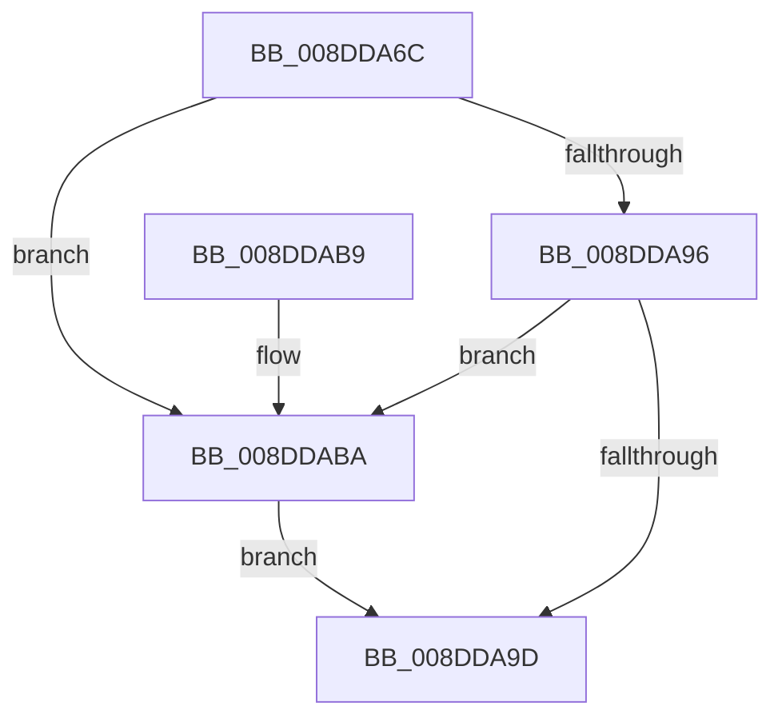

# PiDqQueryUnlock

- RVA: `0x008DDA6C`–`0x008DDAC4` (길이 `88` bytes)
- VA: `0x00000001408DDA6C`
- 실행 섹션: `PAGE`
- PDB 이름 있음: `예`; PDB Function 태그: `아니요`
- unwind 정보 RVA: `0x00064CA8`
- 디코드: `26`개 명령, `88/88` bytes 표시
- 미해석 바이트: `0` (있으면 어셈블리에 `.byte`로 보존)

> 이 문서는 커널 이미지의 기계어와 PDB 기호를 분석해 생성했습니다. 4번과 5번은 함수 원형과 자료형을 바이너리 사용 방식에서 추정한 C 해석이며 원본 소스 복구 결과는 아닙니다.

## 1. Dependencies

- 직접 호출 지점: **3**; 고유 호출 대상: **3**
- 직접 호출자로 확인된 함수: **9**
- RIP 상대 이미지 참조: **0**

### Outgoing calls
- `0x008DDAA0` → [KeAbPostRelease](../../text/2E/KeAbPostRelease_function_002E1600.md) (function, `0x002E1600`)
- `0x008DDAAE` → [KeLeaveCriticalRegionThread](../../text/25/KeLeaveCriticalRegionThread_function_0025EFF0.md) (function, `0x0025EFF0`)
- `0x008DDABD` → [ExfReleasePushLock](../../text/26/ExfReleasePushLock_function_002638D0.md) (function, `0x002638D0`)

### Direct callers
- [PiDqIrpCancel](../../text/5A/PiDqIrpCancel_function_005A7CA0.md) at `0x005A7CF8`
- [PiDqIrpQueryGetResult](PiDqIrpQueryGetResult_function_008DBF28.md) at `0x008DBFA9`
- [PiDqIrpQueryGetResult](PiDqIrpQueryGetResult_function_008DBF28.md) at `0x008DC096`
- [PiDqIrpQueryGetResult](PiDqIrpQueryGetResult_function_008DBF28.md) at `0x008DC0C2`
- [PiDqDispatch](PiDqDispatch_function_008DC8A0.md) at `0x008DC91C`
- [PiDqDispatch](PiDqDispatch_function_008DC8A0.md) at `0x008DC953`
- [PiDqIrpQueryCreate](PiDqIrpQueryCreate_function_008DCC04.md) at `0x008DCDD5`
- [PiDqIrpQueryCreate](PiDqIrpQueryCreate_function_008DCC04.md) at `0x008DCE54`
- [PiDqObjectManagerEnumerateAndRegisterQuery](PiDqObjectManagerEnumerateAndRegisterQuery_function_008DCF74.md) at `0x008DD09B`
- [PiDqObjectManagerEnumerateAndRegisterQuery](PiDqObjectManagerEnumerateAndRegisterQuery_function_008DCF74.md) at `0x008DD2A1`
- [PiDqQuerySerializeActionQueue](PiDqQuerySerializeActionQueue_function_008DD340.md) at `0x008DD392`
- [PiDqQuerySerializeActionQueue](PiDqQuerySerializeActionQueue_function_008DD340.md) at `0x008DD459`
- [PiDqQuerySerializeActionQueue](PiDqQuerySerializeActionQueue_function_008DD340.md) at `0x008DD53C`
- [PiDqQuerySerializeActionQueue](PiDqQuerySerializeActionQueue_function_008DD340.md) at `0x008DD589`
- [PiDqQuerySerializeActionQueue](PiDqQuerySerializeActionQueue_function_008DD340.md) at `0x008DD606`
- [PiDqObjectManagerServiceActionQueue](PiDqObjectManagerServiceActionQueue_function_008DD640.md) at `0x008DD917`
- [PiDqObjectManagerServiceActionQueue](PiDqObjectManagerServiceActionQueue_function_008DD640.md) at `0x008DD956`
- [PiDqQueryApplyObjectEvent](PiDqQueryApplyObjectEvent_function_008DDACC.md) at `0x008DDB43`
- [PiDqQueryApplyObjectEvent](PiDqQueryApplyObjectEvent_function_008DDACC.md) at `0x008DDD47`
- [PiDqQueryApplyObjectEvent](PiDqQueryApplyObjectEvent_function_008DDACC.md) at `0x008DDDA2`
- [PiDqQueryApplyObjectEvent](PiDqQueryApplyObjectEvent_function_008DDACC.md) at `0x008DDDD1`
- [PiDqQueryApplyObjectEvent](PiDqQueryApplyObjectEvent_function_008DDACC.md) at `0x008DE050`
- [PiDqQueryApplyObjectEvent](PiDqQueryApplyObjectEvent_function_008DDACC.md) at `0x008DE082`
- [sub_00B1CDEE](../B1/Unknown_function_00B1CDEE.md) at `0x00B1CE10`

### Static image references
- 디코드된 RIP-relative 메모리 참조가 없습니다.

## 2. Other-region calls and transfers

- 다른 실행 섹션으로 향하는 call: **3**
  - `0x008DDAA0` → [KeAbPostRelease](../../text/2E/KeAbPostRelease_function_002E1600.md) (`PAGE` → `.text`)
  - `0x008DDAAE` → [KeLeaveCriticalRegionThread](../../text/25/KeLeaveCriticalRegionThread_function_0025EFF0.md) (`PAGE` → `.text`)
  - `0x008DDABD` → [ExfReleasePushLock](../../text/26/ExfReleasePushLock_function_002638D0.md) (`PAGE` → `.text`)
- 별도 외부 분기/꼬리 이동을 확인하지 못했습니다.

## 3. Assembly (complete function range)

```asm
008DDA6C  40 53                           push rbx
008DDA6E  48 83 EC 20                     sub rsp, 0x20
008DDA72  48 8D 59 40                     lea rbx, [rcx + 0x40]
008DDA76  0F 0D 0B                        prefetchw byte ptr [rbx]
008DDA79  48 8B 03                        mov rax, qword ptr [rbx]
008DDA7C  45 33 C0                        xor r8d, r8d
008DDA7F  48 8B C8                        mov rcx, rax
008DDA82  48 83 E1 F0                     and rcx, 0xfffffffffffffff0
008DDA86  48 83 F9 10                     cmp rcx, 0x10
008DDA8A  48 8D 50 F0                     lea rdx, [rax - 0x10]
008DDA8E  49 0F 46 D0                     cmovbe rdx, r8
008DDA92  A8 02                           test al, 2
008DDA94  75 24                           jne 0x1408ddaba
008DDA96  F0 48 0F B1 13                  lock cmpxchg qword ptr [rbx], rdx
008DDA9B  75 1D                           jne 0x1408ddaba
008DDA9D  48 8B CB                        mov rcx, rbx
008DDAA0  E8 5B 3B A0 FF                  call 0x1402e1600
008DDAA5  65 48 8B 0C 25 88 01 00 00      mov rcx, qword ptr gs:[0x188]
008DDAAE  E8 3D 15 98 FF                  call 0x14025eff0
008DDAB3  48 83 C4 20                     add rsp, 0x20
008DDAB7  5B                              pop rbx
008DDAB8  C3                              ret
008DDAB9  CC                              int3
008DDABA  48 8B CB                        mov rcx, rbx
008DDABD  E8 0E 5E 98 FF                  call 0x1402638d0
008DDAC2  EB D9                           jmp 0x1408dda9d
```

## 4. C-style interpretation (structured pseudocode)

```c
__int64 __fastcall PiDqQueryUnlock(__int64 a1, __int64 a2, int a3)
{
    __int64 result;
    __int64 v_rsp;

    v_rsp = (v_rsp) - (32);
    a3 = 0;
    a1 = (*(unsigned __int64 *)(a1 + 64)) & (-16);
    a2 = *(unsigned __int64 *)(a1 + 64) - 16;
    if (a1 <= 16) { a2 = 0; }
    if ((((unsigned __int8)(*(unsigned __int64 *)(a1 + 64))) & (2)) != 0) goto loc_008DDABA;
    if ((((unsigned __int8)(*(unsigned __int64 *)(a1 + 64))) & (2)) != 0) goto loc_008DDABA;
loc_008DDA9D:
    result = KeAbPostRelease(a1 + 64, a2, a3, a4);
    result = KeLeaveCriticalRegionThread(*(unsigned __int64 *)(gs_base + (0 + 392)), a2, a3, a4);
    v_rsp = (v_rsp) + (32);
    return result;
loc_008DDABA:
    result = ExfReleasePushLock(a1 + 64, a2, a3, a4);
    goto loc_008DDA9D;
}
```

## 5. (Beta) C Style

```c
int64_t PiDqQueryUnlock(void *Arg1, int64_t Arg2, int32_t Arg3)
{
    uint8_t *arg1 = (uint8_t *)Arg1;

    int64_t result;
    int64_t local_rsp;

    local_rsp = (local_rsp) - (32);
    Arg3 = 0;
    Arg1 = (*(uint64_t *)(arg1 + 0x40)) & (-16);
    Arg2 = *(uint64_t *)(arg1 + 0x40) - 16;
    if (Arg1 <= 16) { Arg2 = 0; }
    if ((((uint8_t)(*(uint64_t *)(arg1 + 0x40))) & (2)) != 0) goto loc_008DDABA;
    if ((((uint8_t)(*(uint64_t *)(arg1 + 0x40))) & (2)) != 0) goto loc_008DDABA;
loc_008DDA9D:
    result = KeAbPostRelease(Arg1 + 64, Arg2, Arg3, a4);
    result = KeLeaveCriticalRegionThread(*(uint64_t *)(gs_base + (0 + 0x188)), Arg2, Arg3, a4);
    local_rsp = (local_rsp) + (32);
    return result;
loc_008DDABA:
    result = ExfReleasePushLock(Arg1 + 64, Arg2, Arg3, a4);
    goto loc_008DDA9D;
}
```

### 관측된 메모리 오프셋

구조체 형식이 확인되지 않은 접근은 인자 기준의 오프셋으로만 기록했습니다.

| 기준 인자 | 오프셋 표현 | 폭 (bit) | 접근 |
|---|---:|---:|---|
| `Arg1` | `+ 0x0` | `8` | `R` |
| `Arg1` | `+ 0x0` | `64` | `R` |
| `Arg1` | `+ 0x40` | `64` | `R` |

## 6. Execution-region graph

[열기: 2D/3D 그래프와 함수 탐색 컨트롤 패널](../../../control-panel.html?section=page&rva=0x008DDA6C&view=graph)

- 2D 그래프는 위에서 아래로 흐르고, 3D 그래프는 빈 공간을 드래그해 회전합니다. Shift+드래그는 이동, 휠은 확대·축소, 함수 노드 선택은 대상 보고서 이동입니다.

### Static fallback


