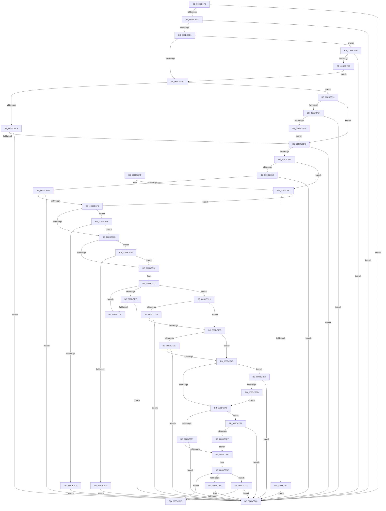

# PiDqQueryValidateQueryData

- RVA: `0x008DC67C`–`0x008DC817` (길이 `411` bytes)
- VA: `0x00000001408DC67C`
- 실행 섹션: `PAGE`
- PDB 이름 있음: `예`; PDB Function 태그: `아니요`
- unwind 정보 RVA: `0x0008594C`
- 디코드: `114`개 명령, `411/411` bytes 표시
- 미해석 바이트: `0` (있으면 어셈블리에 `.byte`로 보존)

> 이 문서는 커널 이미지의 기계어와 PDB 기호를 분석해 생성했습니다. 4번과 5번은 함수 원형과 자료형을 바이너리 사용 방식에서 추정한 C 해석이며 원본 소스 복구 결과는 아닙니다.

## 1. Dependencies

- 직접 호출 지점: **5**; 고유 호출 대상: **4**
- 직접 호출자로 확인된 함수: **1**
- RIP 상대 이미지 참조: **0**

### Outgoing calls
- `0x008DC6A4` → [PiDqGetPnpObjectType](PiDqGetPnpObjectType_function_008DF790.md) (function, `0x008DF790`)
- `0x008DC787` → [PnpValidateMultiSz](PnpValidateMultiSz_function_008DC56C.md) (function, `0x008DC56C`)
- `0x008DC7A6` → [PnpValidateMultiSz](PnpValidateMultiSz_function_008DC56C.md) (function, `0x008DC56C`)
- `0x008DC7B4` → [ValidFilter](ValidFilter_function_008DBDC8.md) (function, `0x008DBDC8`)
- `0x008DC803` → [PnpValidatePropertyData](../8F/PnpValidatePropertyData_function_008F7658.md) (function, `0x008F7658`)

### Direct callers
- [PiDqIrpQueryCreate](PiDqIrpQueryCreate_function_008DCC04.md) at `0x008DCD88`

### Static image references
- 디코드된 RIP-relative 메모리 참조가 없습니다.

## 2. Other-region calls and transfers

- 다른 실행 섹션으로 향하는 call: **0**
- 별도 외부 분기/꼬리 이동을 확인하지 못했습니다.

## 3. Assembly (complete function range)

```asm
008DC67C  48 89 5C 24 08                  mov qword ptr [rsp + 8], rbx
008DC681  48 89 6C 24 10                  mov qword ptr [rsp + 0x10], rbp
008DC686  48 89 74 24 18                  mov qword ptr [rsp + 0x18], rsi
008DC68B  57                              push rdi
008DC68C  48 83 EC 20                     sub rsp, 0x20
008DC690  48 8B D9                        mov rbx, rcx
008DC693  BD 0D 00 00 C0                  mov ebp, 0xc000000d
008DC698  48 85 C9                        test rcx, rcx
008DC69B  0F 84 C7 00 00 00               je 0x1408dc768
008DC6A1  8B 49 10                        mov ecx, dword ptr [rcx + 0x10]
008DC6A4  E8 E7 30 00 00                  call 0x1408df790
008DC6A9  85 C0                           test eax, eax
008DC6AB  0F 84 B7 00 00 00               je 0x1408dc768
008DC6B1  8B 43 28                        mov eax, dword ptr [rbx + 0x28]
008DC6B4  A8 02                           test al, 2
008DC6B6  0F 85 1A 01 00 00               jne 0x1408dc7d6
008DC6BC  8B 4B 14                        mov ecx, dword ptr [rbx + 0x14]
008DC6BF  83 E9 01                        sub ecx, 1
008DC6C2  0F 85 CE 00 00 00               jne 0x1408dc796
008DC6C8  48 83 7B 18 00                  cmp qword ptr [rbx + 0x18], 0
008DC6CD  0F 84 95 00 00 00               je 0x1408dc768
008DC6D3  8B 43 28                        mov eax, dword ptr [rbx + 0x28]
008DC6D6  A9 F8 FF FF FF                  test eax, 0xfffffff8
008DC6DB  0F 85 87 00 00 00               jne 0x1408dc768
008DC6E1  A8 04                           test al, 4
008DC6E3  0F 85 97 00 00 00               jne 0x1408dc780
008DC6E9  48 83 7B 38 00                  cmp qword ptr [rbx + 0x38], 0
008DC6EE  75 78                           jne 0x1408dc768
008DC6F0  83 7B 30 00                     cmp dword ptr [rbx + 0x30], 0
008DC6F4  75 72                           jne 0x1408dc768
008DC6F6  48 8B 53 48                     mov rdx, qword ptr [rbx + 0x48]
008DC6FA  48 85 D2                        test rdx, rdx
008DC6FD  0F 84 BC 00 00 00               je 0x1408dc7bf
008DC703  44 8B 43 40                     mov r8d, dword ptr [rbx + 0x40]
008DC707  45 85 C0                        test r8d, r8d
008DC70A  0F 84 BB 00 00 00               je 0x1408dc7cb
008DC710  33 C9                           xor ecx, ecx
008DC712  41 3B C8                        cmp ecx, r8d
008DC715  73 12                           jae 0x1408dc729
008DC717  8B C1                           mov eax, ecx
008DC719  48 C1 E0 05                     shl rax, 5
008DC71D  48 83 7C 10 18 00               cmp qword ptr [rax + rdx + 0x18], 0
008DC723  75 43                           jne 0x1408dc768
008DC725  FF C1                           inc ecx
008DC727  EB E9                           jmp 0x1408dc712
008DC729  48 8B 53 58                     mov rdx, qword ptr [rbx + 0x58]
008DC72D  48 85 D2                        test rdx, rdx
008DC730  75 05                           jne 0x1408dc737
008DC732  39 53 50                        cmp dword ptr [rbx + 0x50], edx
008DC735  75 31                           jne 0x1408dc768
008DC737  8B 4B 50                        mov ecx, dword ptr [rbx + 0x50]
008DC73A  85 C9                           test ecx, ecx
008DC73C  75 05                           jne 0x1408dc743
008DC73E  48 85 D2                        test rdx, rdx
008DC741  75 25                           jne 0x1408dc768
008DC743  48 85 D2                        test rdx, rdx
008DC746  75 6C                           jne 0x1408dc7b4
008DC748  48 83 7B 68 00                  cmp qword ptr [rbx + 0x68], 0
008DC74D  48 8D 73 60                     lea rsi, [rbx + 0x60]
008DC751  0F 85 8A 00 00 00               jne 0x1408dc7e1
008DC757  83 3E 00                        cmp dword ptr [rsi], 0
008DC75A  75 0C                           jne 0x1408dc768
008DC75C  33 FF                           xor edi, edi
008DC75E  3B 3E                           cmp edi, dword ptr [rsi]
008DC760  0F 82 86 00 00 00               jb 0x1408dc7ec
008DC766  33 ED                           xor ebp, ebp
008DC768  48 8B 5C 24 30                  mov rbx, qword ptr [rsp + 0x30]
008DC76D  8B C5                           mov eax, ebp
008DC76F  48 8B 6C 24 38                  mov rbp, qword ptr [rsp + 0x38]
008DC774  48 8B 74 24 40                  mov rsi, qword ptr [rsp + 0x40]
008DC779  48 83 C4 20                     add rsp, 0x20
008DC77D  5F                              pop rdi
008DC77E  C3                              ret
008DC77F  CC                              int3
008DC780  8B 53 30                        mov edx, dword ptr [rbx + 0x30]
008DC783  48 8B 4B 38                     mov rcx, qword ptr [rbx + 0x38]
008DC787  E8 E0 FD FF FF                  call 0x1408dc56c
008DC78C  85 C0                           test eax, eax
008DC78E  0F 89 62 FF FF FF               jns 0x1408dc6f6
008DC794  EB D2                           jmp 0x1408dc768
008DC796  83 F9 01                        cmp ecx, 1
008DC799  0F 85 34 FF FF FF               jne 0x1408dc6d3
008DC79F  8B 53 18                        mov edx, dword ptr [rbx + 0x18]
008DC7A2  48 8B 4B 20                     mov rcx, qword ptr [rbx + 0x20]
008DC7A6  E8 C1 FD FF FF                  call 0x1408dc56c
008DC7AB  85 C0                           test eax, eax
008DC7AD  78 B9                           js 0x1408dc768
008DC7AF  E9 1F FF FF FF                  jmp 0x1408dc6d3
008DC7B4  E8 0F F6 FF FF                  call 0x1408dbdc8
008DC7B9  85 C0                           test eax, eax
008DC7BB  74 AB                           je 0x1408dc768
008DC7BD  EB 89                           jmp 0x1408dc748
008DC7BF  83 7B 40 00                     cmp dword ptr [rbx + 0x40], 0
008DC7C3  0F 84 3A FF FF FF               je 0x1408dc703
008DC7C9  EB 9D                           jmp 0x1408dc768
008DC7CB  48 85 D2                        test rdx, rdx
008DC7CE  0F 84 3C FF FF FF               je 0x1408dc710
008DC7D4  EB 92                           jmp 0x1408dc768
008DC7D6  83 7B 40 00                     cmp dword ptr [rbx + 0x40], 0
008DC7DA  77 8C                           ja 0x1408dc768
008DC7DC  E9 DB FE FF FF                  jmp 0x1408dc6bc
008DC7E1  83 7B 60 00                     cmp dword ptr [rbx + 0x60], 0
008DC7E5  74 81                           je 0x1408dc768
008DC7E7  E9 70 FF FF FF                  jmp 0x1408dc75c
008DC7EC  48 8B 4B 68                     mov rcx, qword ptr [rbx + 0x68]
008DC7F0  4C 8D 0C BF                     lea r9, [rdi + rdi*4]
008DC7F4  46 8B 44 C9 14                  mov r8d, dword ptr [rcx + r9*8 + 0x14]
008DC7F9  42 8B 54 C9 18                  mov edx, dword ptr [rcx + r9*8 + 0x18]
008DC7FE  4A 8B 4C C9 20                  mov rcx, qword ptr [rcx + r9*8 + 0x20]
008DC803  E8 50 AE 01 00                  call 0x1408f7658
008DC808  85 C0                           test eax, eax
008DC80A  0F 88 58 FF FF FF               js 0x1408dc768
008DC810  FF C7                           inc edi
008DC812  E9 47 FF FF FF                  jmp 0x1408dc75e
```

## 4. C-style interpretation (structured pseudocode)

```c
__int64 __fastcall PiDqQueryValidateQueryData(__int64 a1)
{
    __int64 result;
    __int64 v_rbp;
    __int64 v_rdi;
    __int64 v_rsp;
    unsigned __int64 v_stack_p10;
    unsigned __int64 v_stack_p18;
    unsigned __int64 v_stack_p8;

    v_stack_p8 = v_rbx;
    v_stack_p10 = v_rbp;
    v_stack_p18 = v_rsi;
    v_rsp = (v_rsp) - (32);
    if (a1 == 0) goto loc_008DC768;
    result = PiDqGetPnpObjectType((unsigned int)(*(unsigned int *)(a1 + 16)), a2, a3, a4);
    if ((unsigned int)(result) == 0) goto loc_008DC768;
    if ((((unsigned __int8)((unsigned int)(*(unsigned int *)(a1 + 40)))) & (2)) != 0) goto loc_008DC7D6;
loc_008DC6BC:
    a1 = (unsigned int)(((unsigned int)(*(unsigned int *)(a1 + 20))) - (1));
    if (condition_is_not_equal) goto loc_008DC796;
    if ((*(unsigned __int64 *)(a1 + 24)) == 0) goto loc_008DC768;
loc_008DC6D3:
    if ((((unsigned int)((unsigned int)(*(unsigned int *)(a1 + 40)))) & (0xFFFFFFF8ULL)) != 0) goto loc_008DC768;
    if ((((unsigned __int8)((unsigned int)(*(unsigned int *)(a1 + 40)))) & (4)) != 0) goto loc_008DC780;
    if ((*(unsigned __int64 *)(a1 + 56)) != 0) goto loc_008DC768;
    if ((*(unsigned int *)(a1 + 48)) != 0) goto loc_008DC768;
loc_008DC6F6:
    if (*(unsigned __int64 *)(a1 + 72) == 0) goto loc_008DC7BF;
loc_008DC703:
    if ((unsigned int)((unsigned int)(*(unsigned int *)(a1 + 64))) == 0) goto loc_008DC7CB;
loc_008DC710:
    a1 = 0;
loc_008DC712:
    if (0 >= ((unsigned int)((unsigned int)(*(unsigned int *)(a1 + 64))))) goto loc_008DC729;
    result = (0) << (5);
    if ((*(unsigned __int64 *)(result + *(unsigned __int64 *)(a1 + 72) * 1 + 24)) != 0) goto loc_008DC768;
    a1 = (unsigned int)((a1) + 1);
    goto loc_008DC712;
loc_008DC729:
    if (*(unsigned __int64 *)(a1 + 88) != 0) goto loc_008DC737;
    if ((*(unsigned int *)(a1 + 80)) != ((unsigned int)(*(unsigned __int64 *)(a1 + 88)))) goto loc_008DC768;
loc_008DC737:
    if ((unsigned int)((unsigned int)(*(unsigned int *)(a1 + 80))) != 0) goto loc_008DC743;
    if (*(unsigned __int64 *)(a1 + 88) != 0) goto loc_008DC768;
loc_008DC743:
    if (*(unsigned __int64 *)(a1 + 88) != 0) goto loc_008DC7B4;
loc_008DC748:
    if ((*(unsigned __int64 *)(a1 + 104)) != 0) goto loc_008DC7E1;
    if ((*(unsigned int *)(a1 + 96)) != 0) goto loc_008DC768;
loc_008DC75C:
    v_rdi = 0;
loc_008DC75E:
    if (0 < (*(unsigned int *)(a1 + 96))) goto loc_008DC7EC;
    v_rbp = 0;
loc_008DC768:
    v_rsp = (v_rsp) + (32);
    return 0;
loc_008DC780:
    result = PnpValidateMultiSz(*(unsigned __int64 *)(v_stack_p8 + 56), (unsigned int)(*(unsigned int *)(v_stack_p8 + 48)), (unsigned int)(*(unsigned int *)(a1 + 64)), a4);
    if (!sign_flag) goto loc_008DC6F6;
    goto loc_008DC768;
loc_008DC796:
    if (((unsigned int)(*(unsigned __int64 *)(v_stack_p8 + 56))) != 1) goto loc_008DC6D3;
    result = PnpValidateMultiSz(*(unsigned __int64 *)(v_stack_p8 + 32), (unsigned int)(*(unsigned int *)(v_stack_p8 + 24)), (unsigned int)(*(unsigned int *)(a1 + 64)), a4);
    if (sign_flag) goto loc_008DC768;
    goto loc_008DC6D3;
loc_008DC7B4:
    result = ValidFilter(*(unsigned __int64 *)(v_stack_p8 + 32), (unsigned int)(*(unsigned int *)(v_stack_p8 + 24)), (unsigned int)(*(unsigned int *)(a1 + 64)), a4);
    if ((unsigned int)(result) == 0) goto loc_008DC768;
    goto loc_008DC748;
loc_008DC7BF:
    if ((*(unsigned int *)(v_stack_p8 + 64)) == 0) goto loc_008DC703;
    goto loc_008DC768;
loc_008DC7CB:
    if ((unsigned int)(*(unsigned int *)(v_stack_p8 + 24)) == 0) goto loc_008DC710;
    goto loc_008DC768;
loc_008DC7D6:
    if ((*(unsigned int *)(v_stack_p8 + 64)) > 0) goto loc_008DC768;
    goto loc_008DC6BC;
loc_008DC7E1:
    if ((*(unsigned int *)(v_stack_p8 + 96)) == 0) goto loc_008DC768;
    goto loc_008DC75C;
loc_008DC7EC:
    result = PnpValidatePropertyData(*(unsigned __int64 *)(*(unsigned __int64 *)(v_stack_p8 + 104) + v_rdi + v_rdi * 4 * 8 + 32), (unsigned int)(*(unsigned int *)(*(unsigned __int64 *)(v_stack_p8 + 104) + v_rdi + v_rdi * 4 * 8 + 24)), (unsigned int)(*(unsigned int *)(*(unsigned __int64 *)(v_stack_p8 + 104) + v_rdi + v_rdi * 4 * 8 + 20)), v_rdi + v_rdi * 4);
    if (sign_flag) goto loc_008DC768;
    v_rdi = (unsigned int)((v_rdi) + 1);
    goto loc_008DC75E;
}
```

## 5. (Beta) C Style

```c
int64_t PiDqQueryValidateQueryData(void *Arg1)
{
    uint8_t *arg1 = (uint8_t *)Arg1;

    int64_t result;
    int64_t local_rbp;
    int64_t local_rdi;
    int64_t local_rsp;
    uint64_t v_stack_p10;
    uint64_t v_stack_p18;
    uint64_t v_stack_p8;

    v_stack_p8 = local_rbx;
    v_stack_p10 = local_rbp;
    v_stack_p18 = local_rsi;
    local_rsp = (local_rsp) - (32);
    if (Arg1 == NULL) goto loc_008DC768;
    result = PiDqGetPnpObjectType((uint32_t)(*(uint32_t *)(arg1 + 0x10)), a2, a3, a4);
    if ((uint32_t)(result) == 0) goto loc_008DC768;
    if ((((uint8_t)((uint32_t)(*(uint32_t *)(arg1 + 0x28)))) & (2)) != 0) goto loc_008DC7D6;
loc_008DC6BC:
    Arg1 = (uint32_t)(((uint32_t)(*(uint32_t *)(arg1 + 0x14))) - (1));
    if (condition_is_not_equal) goto loc_008DC796;
    if ((*(uint64_t *)(arg1 + 0x18)) == 0) goto loc_008DC768;
loc_008DC6D3:
    if ((((uint32_t)((uint32_t)(*(uint32_t *)(arg1 + 0x28)))) & (0xFFFFFFF8ULL)) != 0) goto loc_008DC768;
    if ((((uint8_t)((uint32_t)(*(uint32_t *)(arg1 + 0x28)))) & (4)) != 0) goto loc_008DC780;
    if ((*(uint64_t *)(arg1 + 0x38)) != 0) goto loc_008DC768;
    if ((*(uint32_t *)(arg1 + 0x30)) != 0) goto loc_008DC768;
loc_008DC6F6:
    if (*(uint64_t *)(arg1 + 0x48) == 0) goto loc_008DC7BF;
loc_008DC703:
    if ((uint32_t)((uint32_t)(*(uint32_t *)(arg1 + 0x40))) == 0) goto loc_008DC7CB;
loc_008DC710:
    Arg1 = 0;
loc_008DC712:
    if (0 >= ((uint32_t)((uint32_t)(*(uint32_t *)(arg1 + 0x40))))) goto loc_008DC729;
    result = (0) << (5);
    if ((*(uint64_t *)(result + *(uint64_t *)(arg1 + 0x48) * 1 + 0x18)) != 0) goto loc_008DC768;
    Arg1 = (uint32_t)((Arg1) + 1);
    goto loc_008DC712;
loc_008DC729:
    if (*(uint64_t *)(arg1 + 0x58) != 0) goto loc_008DC737;
    if ((*(uint32_t *)(arg1 + 0x50)) != ((uint32_t)(*(uint64_t *)(arg1 + 0x58)))) goto loc_008DC768;
loc_008DC737:
    if ((uint32_t)((uint32_t)(*(uint32_t *)(arg1 + 0x50))) != 0) goto loc_008DC743;
    if (*(uint64_t *)(arg1 + 0x58) != 0) goto loc_008DC768;
loc_008DC743:
    if (*(uint64_t *)(arg1 + 0x58) != 0) goto loc_008DC7B4;
loc_008DC748:
    if ((*(uint64_t *)(arg1 + 0x68)) != 0) goto loc_008DC7E1;
    if ((*(uint32_t *)(arg1 + 0x60)) != 0) goto loc_008DC768;
loc_008DC75C:
    local_rdi = 0;
loc_008DC75E:
    if (0 < (*(uint32_t *)(arg1 + 0x60))) goto loc_008DC7EC;
    local_rbp = 0;
loc_008DC768:
    local_rsp = (local_rsp) + (32);
    return 0;
loc_008DC780:
    result = PnpValidateMultiSz(*(uint64_t *)(v_stack_p8 + 0x38), (uint32_t)(*(uint32_t *)(v_stack_p8 + 0x30)), (uint32_t)(*(uint32_t *)(arg1 + 0x40)), a4);
    if (!sign_flag) goto loc_008DC6F6;
    goto loc_008DC768;
loc_008DC796:
    if (((uint32_t)(*(uint64_t *)(v_stack_p8 + 0x38))) != 1) goto loc_008DC6D3;
    result = PnpValidateMultiSz(*(uint64_t *)(v_stack_p8 + 0x20), (uint32_t)(*(uint32_t *)(v_stack_p8 + 0x18)), (uint32_t)(*(uint32_t *)(arg1 + 0x40)), a4);
    if (sign_flag) goto loc_008DC768;
    goto loc_008DC6D3;
loc_008DC7B4:
    result = ValidFilter(*(uint64_t *)(v_stack_p8 + 0x20), (uint32_t)(*(uint32_t *)(v_stack_p8 + 0x18)), (uint32_t)(*(uint32_t *)(arg1 + 0x40)), a4);
    if ((uint32_t)(result) == 0) goto loc_008DC768;
    goto loc_008DC748;
loc_008DC7BF:
    if ((*(uint32_t *)(v_stack_p8 + 0x40)) == 0) goto loc_008DC703;
    goto loc_008DC768;
loc_008DC7CB:
    if ((uint32_t)(*(uint32_t *)(v_stack_p8 + 0x18)) == 0) goto loc_008DC710;
    goto loc_008DC768;
loc_008DC7D6:
    if ((*(uint32_t *)(v_stack_p8 + 0x40)) > 0) goto loc_008DC768;
    goto loc_008DC6BC;
loc_008DC7E1:
    if ((*(uint32_t *)(v_stack_p8 + 0x60)) == 0) goto loc_008DC768;
    goto loc_008DC75C;
loc_008DC7EC:
    result = PnpValidatePropertyData(*(uint64_t *)(*(uint64_t *)(v_stack_p8 + 0x68) + local_rdi + local_rdi * 4 * 8 + 0x20), (uint32_t)(*(uint32_t *)(*(uint64_t *)(v_stack_p8 + 0x68) + local_rdi + local_rdi * 4 * 8 + 0x18)), (uint32_t)(*(uint32_t *)(*(uint64_t *)(v_stack_p8 + 0x68) + local_rdi + local_rdi * 4 * 8 + 0x14)), local_rdi + local_rdi * 4);
    if (sign_flag) goto loc_008DC768;
    local_rdi = (uint32_t)((local_rdi) + 1);
    goto loc_008DC75E;
}
```

### 관측된 메모리 오프셋

구조체 형식이 확인되지 않은 접근은 인자 기준의 오프셋으로만 기록했습니다.

| 기준 인자 | 오프셋 표현 | 폭 (bit) | 접근 |
|---|---:|---:|---|
| `Arg1` | `+ 0x0` | `32` | `R` |
| `Arg1` | `+ 0x14` | `32` | `R` |
| `Arg1` | `+ 0x18` | `32` | `R` |
| `Arg1` | `+ 0x18` | `64` | `R` |
| `Arg1` | `+ 0x20` | `64` | `R` |
| `Arg1` | `+ 0x28` | `32` | `R` |
| `Arg1` | `+ 0x30` | `32` | `R` |
| `Arg1` | `+ 0x38` | `64` | `R` |
| `Arg1` | `+ 0x40` | `32` | `R` |
| `Arg1` | `+ 0x48` | `64` | `R` |
| `Arg1` | `+ 0x50` | `32` | `R` |
| `Arg1` | `+ 0x58` | `64` | `R` |
| `Arg1` | `+ 0x60` | `32` | `R` |
| `Arg1` | `+ 0x60` | `64` | `R` |
| `Arg1` | `+ 0x68` | `64` | `R` |

## 6. Execution-region graph

[열기: 2D/3D 그래프와 함수 탐색 컨트롤 패널](../../../control-panel.html?section=page&rva=0x008DC67C&view=graph)

- 2D 그래프는 위에서 아래로 흐르고, 3D 그래프는 빈 공간을 드래그해 회전합니다. Shift+드래그는 이동, 휠은 확대·축소, 함수 노드 선택은 대상 보고서 이동입니다.

### Static fallback


