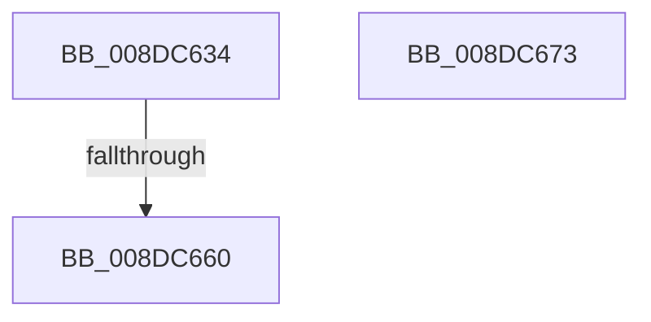

# PiDqTraceQueryCreate

- RVA: `0x008DC634`–`0x008DC674` (길이 `64` bytes)
- VA: `0x00000001408DC634`
- 실행 섹션: `PAGE`
- PDB 이름 있음: `예`; PDB Function 태그: `예`
- unwind 정보 RVA: `0x00085920`
- 디코드: `28`개 명령, `64/64` bytes 표시
- 미해석 바이트: `0` (있으면 어셈블리에 `.byte`로 보존)

> 이 문서는 커널 이미지의 기계어와 PDB 기호를 분석해 생성했습니다. 4번과 5번은 함수 원형과 자료형을 바이너리 사용 방식에서 추정한 C 해석이며 원본 소스 복구 결과는 아닙니다.

## 1. Dependencies

- 직접 호출 지점: **0**; 고유 호출 대상: **0**
- 직접 호출자로 확인된 함수: **1**
- RIP 상대 이미지 참조: **1**

### Outgoing calls
- 직접 디코드된 call 명령이 없습니다.

### Direct callers
- [PiDqIrpQueryCreate](PiDqIrpQueryCreate_function_008DCC04.md) at `0x008DCDCA`

### Static image references
- `0x008DC64C` → RVA `0x00EF012A` (`.data`; read)

## 2. Other-region calls and transfers

- 다른 실행 섹션으로 향하는 call: **0**
- call이 아닌 외부 분기/꼬리 이동: **1**
  - `0x008DC65A` → [sub_00B1C93A](../B1/Unknown_function_00B1C93A.md) (`tail-transfer`)

## 3. Assembly (complete function range)

```asm
008DC634  48 89 4C 24 08                  mov qword ptr [rsp + 8], rcx
008DC639  55                              push rbp
008DC63A  53                              push rbx
008DC63B  56                              push rsi
008DC63C  57                              push rdi
008DC63D  41 54                           push r12
008DC63F  41 55                           push r13
008DC641  41 56                           push r14
008DC643  41 57                           push r15
008DC645  48 8B EC                        mov rbp, rsp
008DC648  48 83 EC 78                     sub rsp, 0x78
008DC64C  8A 05 D8 3A 61 00               mov al, byte ptr [rip + 0x613ad8]
008DC652  45 33 F6                        xor r14d, r14d
008DC655  41 8B DE                        mov ebx, r14d
008DC658  84 C0                           test al, al
008DC65A  0F 88 DA 02 24 00               js 0x140b1c93a
008DC660  8B C3                           mov eax, ebx
008DC662  48 83 C4 78                     add rsp, 0x78
008DC666  41 5F                           pop r15
008DC668  41 5E                           pop r14
008DC66A  41 5D                           pop r13
008DC66C  41 5C                           pop r12
008DC66E  5F                              pop rdi
008DC66F  5E                              pop rsi
008DC670  5B                              pop rbx
008DC671  5D                              pop rbp
008DC672  C3                              ret
008DC673  CC                              int3
```

## 4. C-style interpretation (structured pseudocode)

```c
__int64 __fastcall PiDqTraceQueryCreate(__int64 a1)
{
    __int64 v_r14;
    __int64 v_rsp;
    unsigned __int64 v_stack_p8;

    v_stack_p8 = a1;
    v_rsp = (v_rsp) - (120);
    v_r14 = 0;
    v_rsp = (v_rsp) + (120);
    return 0;
}
```

## 5. (Beta) C Style

```c
int64_t PiDqTraceQueryCreate(int64_t Arg1)
{
    int64_t local_r14;
    int64_t local_rsp;
    uint64_t v_stack_p8;

    v_stack_p8 = Arg1;
    local_rsp = (local_rsp) - (120);
    local_r14 = 0;
    local_rsp = (local_rsp) + (120);
    return 0;
}
```

## 6. Execution-region graph

[열기: 2D/3D 그래프와 함수 탐색 컨트롤 패널](../../../control-panel.html?section=page&rva=0x008DC634&view=graph)

- 2D 그래프는 위에서 아래로 흐르고, 3D 그래프는 빈 공간을 드래그해 회전합니다. Shift+드래그는 이동, 휠은 확대·축소, 함수 노드 선택은 대상 보고서 이동입니다.

### Static fallback


