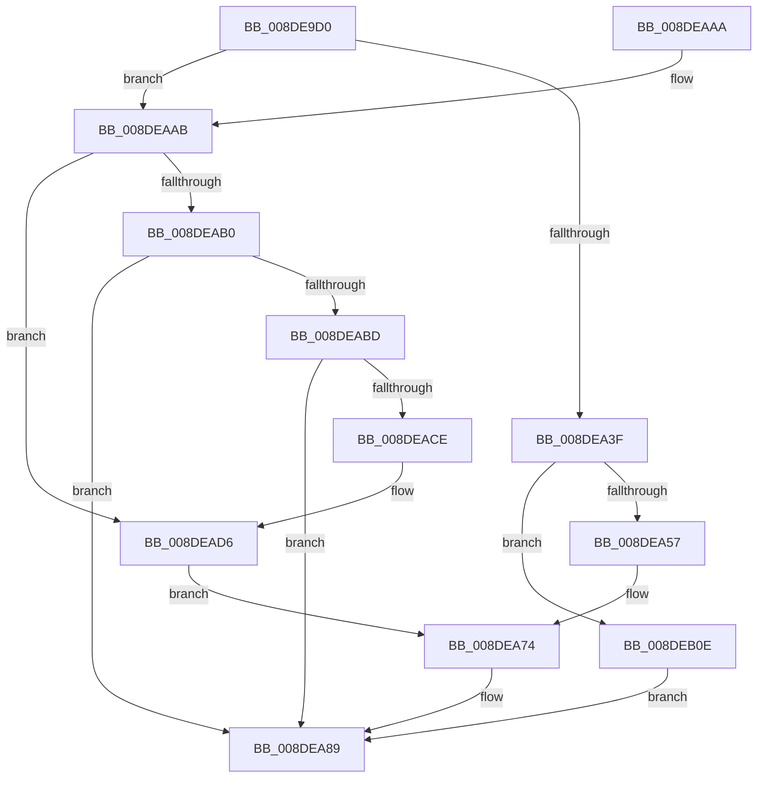

# PiPnpRtlGetFilteredDeviceInterfaceList

- RVA: `0x008DE9D0`–`0x008DEB2D` (길이 `349` bytes)
- VA: `0x00000001408DE9D0`
- 실행 섹션: `PAGE`
- PDB 이름 있음: `예`; PDB Function 태그: `아니요`
- unwind 정보 RVA: `0x00085B40`
- 디코드: `88`개 명령, `349/349` bytes 표시
- 미해석 바이트: `0` (있으면 어셈블리에 `.byte`로 보존)

> 이 문서는 커널 이미지의 기계어와 PDB 기호를 분석해 생성했습니다. 4번과 5번은 함수 원형과 자료형을 바이너리 사용 방식에서 추정한 C 해석이며 원본 소스 복구 결과는 아닙니다.

## 1. Dependencies

- 직접 호출 지점: **5**; 고유 호출 대상: **5**
- 직접 호출자로 확인된 함수: **1**
- RIP 상대 이미지 참조: **2**

### Outgoing calls
- `0x008DEA84` → [PiDmGetObjectConstraintList](PiDmGetObjectConstraintList_function_008DF2F4.md) (function, `0x008DF2F4`)
- `0x008DEA90` → [_security_check_cookie](../../text/6A/_security_check_cookie_function_006AC640.md) (function, `0x006AC640`)
- `0x008DEAB4` → [RtlInitUnicodeStringEx](../../text/46/RtlInitUnicodeStringEx_function_00463960.md) (function, `0x00463960`)
- `0x008DEAC5` → [RtlGUIDFromString](../8F/RtlGUIDFromString_function_008F1EF0.md) (function, `0x008F1EF0`)
- `0x008DEB23` → [PiDmGetCmObjectListFromCache](../8F/PiDmGetCmObjectListFromCache_function_008FEE14.md) (function, `0x008FEE14`)

### Direct callers
- [PiPnpRtlCmActionCallback](../8E/PiPnpRtlCmActionCallback_function_008EF110.md) at `0x008EF2B6`

### Static image references
- `0x008DE9E7` → RVA `0x00E0A740` (`.data`; read)
- `0x008DEA5B` → RVA `0x008E4FC0` (`PiPnpRtlInterfaceFilterCallback`; read)

## 2. Other-region calls and transfers

- 다른 실행 섹션으로 향하는 call: **2**
  - `0x008DEA90` → [_security_check_cookie](../../text/6A/_security_check_cookie_function_006AC640.md) (`PAGE` → `.text`)
  - `0x008DEAB4` → [RtlInitUnicodeStringEx](../../text/46/RtlInitUnicodeStringEx_function_00463960.md) (`PAGE` → `.text`)
- 별도 외부 분기/꼬리 이동을 확인하지 못했습니다.

## 3. Assembly (complete function range)

```asm
008DE9D0  4C 8B DC                        mov r11, rsp
008DE9D3  49 89 5B 10                     mov qword ptr [r11 + 0x10], rbx
008DE9D7  49 89 73 18                     mov qword ptr [r11 + 0x18], rsi
008DE9DB  55                              push rbp
008DE9DC  49 8D 6B A1                     lea rbp, [r11 - 0x5f]
008DE9E0  48 81 EC A0 00 00 00            sub rsp, 0xa0
008DE9E7  48 8B 05 52 BD 52 00            mov rax, qword ptr [rip + 0x52bd52]
008DE9EE  48 33 C4                        xor rax, rsp
008DE9F1  48 89 45 47                     mov qword ptr [rbp + 0x47], rax
008DE9F5  48 8B D9                        mov rbx, rcx
008DE9F8  0F 57 C9                        xorps xmm1, xmm1
008DE9FB  66 0F 7E C8                     movd eax, xmm1
008DE9FF  BE 01 00 00 00                  mov esi, 1
008DEA04  40 84 71 20                     test byte ptr [rcx + 0x20], sil
008DEA08  0F 57 C0                        xorps xmm0, xmm0
008DEA0B  0F 11 4D 1F                     movups xmmword ptr [rbp + 0x1f], xmm1
008DEA0F  48 8B 53 10                     mov rdx, qword ptr [rbx + 0x10]
008DEA13  0F B6 C8                        movzx ecx, al
008DEA16  48 8B 43 28                     mov rax, qword ptr [rbx + 0x28]
008DEA1A  0F 45 CE                        cmovne ecx, esi
008DEA1D  48 83 7B 18 00                  cmp qword ptr [rbx + 0x18], 0
008DEA22  48 89 45 27                     mov qword ptr [rbp + 0x27], rax
008DEA26  48 8B 43 30                     mov rax, qword ptr [rbx + 0x30]
008DEA2A  48 89 45 2F                     mov qword ptr [rbp + 0x2f], rax
008DEA2E  0F 11 45 37                     movups xmmword ptr [rbp + 0x37], xmm0
008DEA32  88 4D 1F                        mov byte ptr [rbp + 0x1f], cl
008DEA35  0F 11 4D 0F                     movups xmmword ptr [rbp + 0xf], xmm1
008DEA39  0F 11 45 F7                     movups xmmword ptr [rbp - 9], xmm0
008DEA3D  75 6C                           jne 0x1408deaab
008DEA3F  48 8B 43 48                     mov rax, qword ptr [rbx + 0x48]
008DEA43  4C 8D 45 0F                     lea r8, [rbp + 0xf]
008DEA47  8B 4B 40                        mov ecx, dword ptr [rbx + 0x40]
008DEA4A  4C 8B 4B 38                     mov r9, qword ptr [rbx + 0x38]
008DEA4E  48 85 D2                        test rdx, rdx
008DEA51  0F 84 B7 00 00 00               je 0x1408deb0e
008DEA57  83 65 0B 00                     and dword ptr [rbp + 0xb], 0
008DEA5B  4C 8D 15 5E 65 00 00            lea r10, [rip + 0x655e]
008DEA62  49 89 43 88                     mov qword ptr [r11 - 0x78], rax
008DEA66  89 4C 24 28                     mov dword ptr [rsp + 0x28], ecx
008DEA6A  33 C9                           xor ecx, ecx
008DEA6C  4C 89 55 F7                     mov qword ptr [rbp - 9], r10
008DEA70  4C 89 45 FF                     mov qword ptr [rbp - 1], r8
008DEA74  4C 89 4C 24 20                  mov qword ptr [rsp + 0x20], r9
008DEA79  4C 8D 4D F7                     lea r9, [rbp - 9]
008DEA7D  C7 45 07 03 00 00 00            mov dword ptr [rbp + 7], 3
008DEA84  E8 6B 08 00 00                  call 0x1408df2f4
008DEA89  48 8B 4D 47                     mov rcx, qword ptr [rbp + 0x47]
008DEA8D  48 33 CC                        xor rcx, rsp
008DEA90  E8 AB DB DC FF                  call 0x1406ac640
008DEA95  4C 8D 9C 24 A0 00 00 00         lea r11, [rsp + 0xa0]
008DEA9D  49 8B 5B 18                     mov rbx, qword ptr [r11 + 0x18]
008DEAA1  49 8B 73 20                     mov rsi, qword ptr [r11 + 0x20]
008DEAA5  49 8B E3                        mov rsp, r11
008DEAA8  5D                              pop rbp
008DEAA9  C3                              ret
008DEAAA  CC                              int3
008DEAAB  48 85 D2                        test rdx, rdx
008DEAAE  74 26                           je 0x1408dead6
008DEAB0  48 8D 4D F7                     lea rcx, [rbp - 9]
008DEAB4  E8 A7 4E B8 FF                  call 0x140463960
008DEAB9  85 C0                           test eax, eax
008DEABB  78 CC                           js 0x1408dea89
008DEABD  48 8D 55 37                     lea rdx, [rbp + 0x37]
008DEAC1  48 8D 4D F7                     lea rcx, [rbp - 9]
008DEAC5  E8 26 34 01 00                  call 0x1408f1ef0
008DEACA  85 C0                           test eax, eax
008DEACC  78 BB                           js 0x1408dea89
008DEACE  48 8D 45 37                     lea rax, [rbp + 0x37]
008DEAD2  48 89 45 0F                     mov qword ptr [rbp + 0xf], rax
008DEAD6  48 8B 43 48                     mov rax, qword ptr [rbx + 0x48]
008DEADA  4C 8D 15 DF 64 00 00            lea r10, [rip + 0x64df]
008DEAE1  44 8B 43 40                     mov r8d, dword ptr [rbx + 0x40]
008DEAE5  8B CE                           mov ecx, esi
008DEAE7  4C 8B 4B 38                     mov r9, qword ptr [rbx + 0x38]
008DEAEB  48 8B 53 18                     mov rdx, qword ptr [rbx + 0x18]
008DEAEF  83 65 0B 00                     and dword ptr [rbp + 0xb], 0
008DEAF3  4C 89 55 F7                     mov qword ptr [rbp - 9], r10
008DEAF7  4C 8D 55 0F                     lea r10, [rbp + 0xf]
008DEAFB  48 89 44 24 30                  mov qword ptr [rsp + 0x30], rax
008DEB00  4C 89 55 FF                     mov qword ptr [rbp - 1], r10
008DEB04  44 89 44 24 28                  mov dword ptr [rsp + 0x28], r8d
008DEB09  E9 66 FF FF FF                  jmp 0x1408dea74
008DEB0E  48 89 44 24 28                  mov qword ptr [rsp + 0x28], rax
008DEB13  48 8D 15 A6 64 00 00            lea rdx, [rip + 0x64a6]
008DEB1A  89 4C 24 20                     mov dword ptr [rsp + 0x20], ecx
008DEB1E  B9 03 00 00 00                  mov ecx, 3
008DEB23  E8 EC 02 02 00                  call 0x1408fee14
008DEB28  E9 5C FF FF FF                  jmp 0x1408dea89
```

## 4. C-style interpretation (structured pseudocode)

```c
__int64 __fastcall PiPnpRtlGetFilteredDeviceInterfaceList(__int64 a1)
{
    __int64 result;
    __int64 v_rsp;
    unsigned __int64 v_stack_m70;
    unsigned int v_stack_m78;
    unsigned __int64 v_stack_m8;
    unsigned int v_stack_m80;
    unsigned __int64 v_stack_m88;

    *(unsigned __int64 *)(v_rsp + 16) = v_rbx;
    *(unsigned __int64 *)(v_rsp + 24) = v_rsi;
    v_rsp = (v_rsp) - (160);
    result = (*(unsigned __int64 *)(v_rip + 5422418)) ^ (v_rsp);
    *(unsigned __int64 *)(v_rsp - 95 + 71) = result;
    *(unsigned __int64 *)(v_rsp - 95 + 31) = v_xmm1;
    a1 = (unsigned __int8)(result);
    if (((*(unsigned __int8 *)(a1 + 32)) & (1)) != 0) { a1 = 1; }
    *(unsigned __int64 *)(v_rsp - 95 + 39) = *(unsigned __int64 *)(a1 + 40);
    *(unsigned __int64 *)(v_rsp - 95 + 47) = *(unsigned __int64 *)(a1 + 48);
    *(unsigned __int64 *)(v_rsp - 95 + 55) = v_xmm0;
    *(unsigned __int8 *)(v_rsp - 95 + 31) = (unsigned __int8)(a1);
    *(unsigned __int64 *)(v_rsp - 95 + 15) = v_xmm1;
    *(unsigned __int64 *)(v_rsp - 95 - 9) = v_xmm0;
    if ((*(unsigned __int64 *)(a1 + 24)) != 0) goto loc_008DEAAB;
    if (*(unsigned __int64 *)(a1 + 16) == 0) goto loc_008DEB0E;
    *(unsigned __int64 *)(v_rsp - 120) = *(unsigned __int64 *)(a1 + 72);
    v_stack_m80 = (unsigned int)((unsigned int)(*(unsigned int *)(a1 + 64)));
    a1 = 0;
    *(unsigned __int64 *)(v_rsp - 95 - 9) = v_rip + 25950;
    *(unsigned __int64 *)(v_rsp - 95 - 1) = v_rsp - 95 + 15;
loc_008DEA74:
    v_stack_m88 = *(unsigned __int64 *)(a1 + 56);
    *(unsigned int *)(v_rsp - 95 + 7) = 3;
    result = PiDmGetObjectConstraintList(a1, *(unsigned __int64 *)(a1 + 16), v_rsp - 95 + 15, v_rsp - 95 - 9);
loc_008DEA89:
    a1 = (*(unsigned __int64 *)(v_rsp - 95 + 71)) ^ (v_rsp);
    result = _security_check_cookie(a1, *(unsigned __int64 *)(a1 + 16), v_rsp - 95 + 15, v_rsp - 95 - 9);
    return result;
loc_008DEAAB:
    if (*(unsigned __int64 *)(a1 + 16) == 0) goto loc_008DEAD6;
    result = RtlInitUnicodeStringEx(v_rsp - 95 - 9, *(unsigned __int64 *)(a1 + 16), v_rsp - 95 + 15, v_rsp - 95 - 9);
    if (sign_flag) goto loc_008DEA89;
    result = RtlGUIDFromString(v_rsp - 95 - 9, v_rsp - 95 + 55, v_rsp - 95 + 15, v_rsp - 95 - 9);
    if (sign_flag) goto loc_008DEA89;
    *(unsigned __int64 *)(v_rsp - 95 + 15) = v_rsp - 95 + 55;
loc_008DEAD6:
    *(unsigned __int64 *)(v_rsp - 95 - 9) = v_rip + 25823;
    v_stack_m70 = *(unsigned __int64 *)(*(unsigned __int64 *)(v_stack_m8 + 24) + 72);
    *(unsigned __int64 *)(v_rsp - 95 - 1) = v_rsp - 95 + 15;
    v_stack_m78 = (unsigned int)((unsigned int)(*(unsigned int *)(*(unsigned __int64 *)(v_stack_m8 + 24) + 64)));
    goto loc_008DEA74;
loc_008DEB0E:
    v_stack_m78 = *(unsigned __int64 *)(*(unsigned __int64 *)(v_stack_m8 + 24) + 72);
    v_stack_m80 = (unsigned int)((unsigned int)((unsigned int)(*(unsigned __int64 *)(v_stack_m8 + 32))));
    result = PiDmGetCmObjectListFromCache(3, v_rip + 25766, (unsigned int)(*(unsigned int *)(*(unsigned __int64 *)(v_stack_m8 + 24) + 64)), *(unsigned __int64 *)(*(unsigned __int64 *)(v_stack_m8 + 24) + 56));
    goto loc_008DEA89;
}
```

## 5. (Beta) C Style

```c
int64_t PiPnpRtlGetFilteredDeviceInterfaceList(void *Arg1)
{
    uint8_t *arg1 = (uint8_t *)Arg1;

    int64_t result;
    int64_t local_rsp;
    uint64_t v_stack_m70;
    uint32_t v_stack_m78;
    uint64_t v_stack_m8;
    uint32_t v_stack_m80;
    uint64_t v_stack_m88;

    *(uint64_t *)(local_rsp + 0x10) = local_rbx;
    *(uint64_t *)(local_rsp + 0x18) = local_rsi;
    local_rsp = (local_rsp) - (160);
    result = (*(uint64_t *)(v_rip + 0x52BD52)) ^ (local_rsp);
    *(uint64_t *)(local_rsp - 0x5F + 0x47) = result;
    *(uint64_t *)(local_rsp - 0x5F + 0x1F) = v_xmm1;
    Arg1 = (uint8_t)(result);
    if (((*(uint8_t *)(arg1 + 0x20)) & (1)) != 0) { Arg1 = 1; }
    *(uint64_t *)(local_rsp - 0x5F + 0x27) = *(uint64_t *)(arg1 + 0x28);
    *(uint64_t *)(local_rsp - 0x5F + 0x2F) = *(uint64_t *)(arg1 + 0x30);
    *(uint64_t *)(local_rsp - 0x5F + 0x37) = v_xmm0;
    *(uint8_t *)(local_rsp - 0x5F + 0x1F) = (uint8_t)(Arg1);
    *(uint64_t *)(local_rsp - 0x5F + 0xF) = v_xmm1;
    *(uint64_t *)(local_rsp - 0x5F - 0x9) = v_xmm0;
    if ((*(uint64_t *)(arg1 + 0x18)) != 0) goto loc_008DEAAB;
    if (*(uint64_t *)(arg1 + 0x10) == 0) goto loc_008DEB0E;
    *(uint64_t *)(local_rsp - 0x78) = *(uint64_t *)(arg1 + 0x48);
    v_stack_m80 = (uint32_t)((uint32_t)(*(uint32_t *)(arg1 + 0x40)));
    Arg1 = 0;
    *(uint64_t *)(local_rsp - 0x5F - 0x9) = v_rip + 25950;
    *(uint64_t *)(local_rsp - 0x5F - 0x1) = local_rsp - 95 + 15;
loc_008DEA74:
    v_stack_m88 = *(uint64_t *)(arg1 + 0x38);
    *(uint32_t *)(local_rsp - 0x5F + 0x7) = 3;
    result = PiDmGetObjectConstraintList(Arg1, *(uint64_t *)(arg1 + 0x10), local_rsp - 95 + 15, local_rsp - 95 - 9);
loc_008DEA89:
    Arg1 = (*(uint64_t *)(local_rsp - 0x5F + 0x47)) ^ (local_rsp);
    result = _security_check_cookie(Arg1, *(uint64_t *)(arg1 + 0x10), local_rsp - 95 + 15, local_rsp - 95 - 9);
    return result;
loc_008DEAAB:
    if (*(uint64_t *)(arg1 + 0x10) == 0) goto loc_008DEAD6;
    result = RtlInitUnicodeStringEx(local_rsp - 95 - 9, *(uint64_t *)(arg1 + 0x10), local_rsp - 95 + 15, local_rsp - 95 - 9);
    if (sign_flag) goto loc_008DEA89;
    result = RtlGUIDFromString(local_rsp - 95 - 9, local_rsp - 95 + 55, local_rsp - 95 + 15, local_rsp - 95 - 9);
    if (sign_flag) goto loc_008DEA89;
    *(uint64_t *)(local_rsp - 0x5F + 0xF) = local_rsp - 95 + 55;
loc_008DEAD6:
    *(uint64_t *)(local_rsp - 0x5F - 0x9) = v_rip + 25823;
    v_stack_m70 = *(uint64_t *)(*(uint64_t *)(v_stack_m8 + 0x18) + 0x48);
    *(uint64_t *)(local_rsp - 0x5F - 0x1) = local_rsp - 95 + 15;
    v_stack_m78 = (uint32_t)((uint32_t)(*(uint32_t *)(*(uint64_t *)(v_stack_m8 + 0x18) + 0x40)));
    goto loc_008DEA74;
loc_008DEB0E:
    v_stack_m78 = *(uint64_t *)(*(uint64_t *)(v_stack_m8 + 0x18) + 0x48);
    v_stack_m80 = (uint32_t)((uint32_t)((uint32_t)(*(uint64_t *)(v_stack_m8 + 0x20))));
    result = PiDmGetCmObjectListFromCache(3, v_rip + 25766, (uint32_t)(*(uint32_t *)(*(uint64_t *)(v_stack_m8 + 0x18) + 0x40)), *(uint64_t *)(*(uint64_t *)(v_stack_m8 + 0x18) + 0x38));
    goto loc_008DEA89;
}
```

### 관측된 메모리 오프셋

구조체 형식이 확인되지 않은 접근은 인자 기준의 오프셋으로만 기록했습니다.

| 기준 인자 | 오프셋 표현 | 폭 (bit) | 접근 |
|---|---:|---:|---|
| `Arg1` | `+ 0x10` | `64` | `R` |
| `Arg1` | `+ 0x18` | `64` | `R` |
| `Arg1` | `+ 0x20` | `8` | `R` |
| `Arg1` | `+ 0x28` | `64` | `R` |
| `Arg1` | `+ 0x30` | `64` | `R` |
| `Arg1` | `+ 0x38` | `64` | `R` |
| `Arg1` | `+ 0x40` | `32` | `R` |
| `Arg1` | `+ 0x48` | `64` | `R` |

## 6. Execution-region graph

[열기: 2D/3D 그래프와 함수 탐색 컨트롤 패널](../../../control-panel.html?section=page&rva=0x008DE9D0&view=graph)

- 2D 그래프는 위에서 아래로 흐르고, 3D 그래프는 빈 공간을 드래그해 회전합니다. Shift+드래그는 이동, 휠은 확대·축소, 함수 노드 선택은 대상 보고서 이동입니다.

### Static fallback


