# PiPnpRtlObjectEventCreate

- RVA: `0x008DF7E0`–`0x008DFACE` (길이 `750` bytes)
- VA: `0x00000001408DF7E0`
- 실행 섹션: `PAGE`
- PDB 이름 있음: `예`; PDB Function 태그: `아니요`
- unwind 정보 RVA: `0x00085C08`
- 디코드: `201`개 명령, `750/750` bytes 표시
- 미해석 바이트: `0` (있으면 어셈블리에 `.byte`로 보존)

> 이 문서는 커널 이미지의 기계어와 PDB 기호를 분석해 생성했습니다. 4번과 5번은 함수 원형과 자료형을 바이너리 사용 방식에서 추정한 C 해석이며 원본 소스 복구 결과는 아닙니다.

## 1. Dependencies

- 직접 호출 지점: **10**; 고유 호출 대상: **9**
- 직접 호출자로 확인된 함수: **2**
- RIP 상대 이미지 참조: **1**

### Outgoing calls
- `0x008DF826` → [memset](../../text/6C/memset_function_006C6C40.md) (function, `0x006C6C40`)
- `0x008DF83A` → [memset](../../text/6C/memset_function_006C6C40.md) (function, `0x006C6C40`)
- `0x008DF8C1` → [PsGetCurrentServerSiloGlobals](../../text/2F/PsGetCurrentServerSiloGlobals_function_002FE1F0.md) (function, `0x002FE1F0`)
- `0x008DF92E` → [RtlLookupElementGenericTableFullAvl](../../text/3E/RtlLookupElementGenericTableFullAvl_function_003EF460.md) (function, `0x003EF460`)
- `0x008DF94D` → [_security_check_cookie](../../text/6A/_security_check_cookie_function_006AC640.md) (function, `0x006AC640`)
- `0x008DF9B2` → [PiDmGetObject](PiDmGetObject_function_008DFAE0.md) (function, `0x008DFAE0`)
- `0x008DF9DA` → [ExAllocatePool2](../../poolcode/B8/ExAllocatePool2_function_00B820F0.md) (function, `0x00B820F0`)
- `0x008DFA48` → [RtlInsertElementGenericTableFullAvl](../../text/3E/RtlInsertElementGenericTableFullAvl_function_003EED00.md) (function, `0x003EED00`)
- `0x008DFA86` → [PiPnpRtlObjectEventRelease](../8E/PiPnpRtlObjectEventRelease_function_008E6E24.md) (function, `0x008E6E24`)
- `0x008DFAA7` → [PiDmObjectRelease](../8E/PiDmObjectRelease_function_008E4F70.md) (function, `0x008E4F70`)

### Direct callers
- [PiPnpRtlEnsureObjectCached](../72/PiPnpRtlEnsureObjectCached_function_0072F928.md) at `0x0072F9D8`
- [PiPnpRtlObjectEventWorker](../8F/PiPnpRtlObjectEventWorker_function_008F8630.md) at `0x008F86B3`

### Static image references
- `0x008DF7FC` → RVA `0x00E0A740` (`.data`; read)

## 2. Other-region calls and transfers

- 다른 실행 섹션으로 향하는 call: **7**
  - `0x008DF826` → [memset](../../text/6C/memset_function_006C6C40.md) (`PAGE` → `.text`)
  - `0x008DF83A` → [memset](../../text/6C/memset_function_006C6C40.md) (`PAGE` → `.text`)
  - `0x008DF8C1` → [PsGetCurrentServerSiloGlobals](../../text/2F/PsGetCurrentServerSiloGlobals_function_002FE1F0.md) (`PAGE` → `.text`)
  - `0x008DF92E` → [RtlLookupElementGenericTableFullAvl](../../text/3E/RtlLookupElementGenericTableFullAvl_function_003EF460.md) (`PAGE` → `.text`)
  - `0x008DF94D` → [_security_check_cookie](../../text/6A/_security_check_cookie_function_006AC640.md) (`PAGE` → `.text`)
  - `0x008DF9DA` → [ExAllocatePool2](../../poolcode/B8/ExAllocatePool2_function_00B820F0.md) (`PAGE` → `POOLCODE`)
  - `0x008DFA48` → [RtlInsertElementGenericTableFullAvl](../../text/3E/RtlInsertElementGenericTableFullAvl_function_003EED00.md) (`PAGE` → `.text`)
- 별도 외부 분기/꼬리 이동을 확인하지 못했습니다.

## 3. Assembly (complete function range)

```asm
008DF7E0  48 89 5C 24 10                  mov qword ptr [rsp + 0x10], rbx
008DF7E5  55                              push rbp
008DF7E6  56                              push rsi
008DF7E7  57                              push rdi
008DF7E8  41 54                           push r12
008DF7EA  41 55                           push r13
008DF7EC  41 56                           push r14
008DF7EE  41 57                           push r15
008DF7F0  48 8D 6C 24 D0                  lea rbp, [rsp - 0x30]
008DF7F5  48 81 EC 30 01 00 00            sub rsp, 0x130
008DF7FC  48 8B 05 3D AF 52 00            mov rax, qword ptr [rip + 0x52af3d]
008DF803  48 33 C4                        xor rax, rsp
008DF806  48 89 45 20                     mov qword ptr [rbp + 0x20], rax
008DF80A  33 DB                           xor ebx, ebx
008DF80C  49 8B F0                        mov rsi, r8
008DF80F  44 8B E2                        mov r12d, edx
008DF812  48 89 5D B0                     mov qword ptr [rbp - 0x50], rbx
008DF816  4C 8B F9                        mov r15, rcx
008DF819  33 D2                           xor edx, edx
008DF81B  48 8D 4D B8                     lea rcx, [rbp - 0x48]
008DF81F  4D 8B E9                        mov r13, r9
008DF822  44 8D 43 68                     lea r8d, [rbx + 0x68]
008DF826  E8 15 74 DE FF                  call 0x1406c6c40
008DF82B  33 D2                           xor edx, edx
008DF82D  89 5C 24 60                     mov dword ptr [rsp + 0x60], ebx
008DF831  44 8D 43 4C                     lea r8d, [rbx + 0x4c]
008DF835  48 8D 4C 24 64                  lea rcx, [rsp + 0x64]
008DF83A  E8 01 74 DE FF                  call 0x1406c6c40
008DF83F  48 89 5C 24 50                  mov qword ptr [rsp + 0x50], rbx
008DF844  48 8D 44 24 60                  lea rax, [rsp + 0x60]
008DF849  48 89 44 24 58                  mov qword ptr [rsp + 0x58], rax
008DF84E  0F 57 C0                        xorps xmm0, xmm0
008DF851  89 5C 24 30                     mov dword ptr [rsp + 0x30], ebx
008DF855  44 8B F3                        mov r14d, ebx
008DF858  48 89 5C 24 38                  mov qword ptr [rsp + 0x38], rbx
008DF85D  8B FB                           mov edi, ebx
008DF85F  49 89 5D 00                     mov qword ptr [r13], rbx
008DF863  4C 89 7D C0                     mov qword ptr [rbp - 0x40], r15
008DF867  44 89 65 CC                     mov dword ptr [rbp - 0x34], r12d
008DF86B  0F 11 44 24 40                  movups xmmword ptr [rsp + 0x40], xmm0
008DF870  4D 85 FF                        test r15, r15
008DF873  0F 84 38 02 00 00               je 0x1408dfab1
008DF879  BA FF 7F 00 00                  mov edx, 0x7fff
008DF87E  49 8B C7                        mov rax, r15
008DF881  8B CA                           mov ecx, edx
008DF883  66 39 18                        cmp word ptr [rax], bx
008DF886  74 0A                           je 0x1408df892
008DF888  48 83 C0 02                     add rax, 2
008DF88C  48 83 E9 01                     sub rcx, 1
008DF890  75 F1                           jne 0x1408df883
008DF892  48 85 C9                        test rcx, rcx
008DF895  BF 0D 00 00 C0                  mov edi, 0xc000000d
008DF89A  0F 45 FB                        cmovne edi, ebx
008DF89D  0F 84 0E 02 00 00               je 0x1408dfab1
008DF8A3  48 2B D1                        sub rdx, rcx
008DF8A6  4D 8B D7                        mov r10, r15
008DF8A9  66 03 D2                        add dx, dx
008DF8AC  85 FF                           test edi, edi
008DF8AE  0F 88 D9 01 00 00               js 0x1408dfa8d
008DF8B4  41 83 FC 03                     cmp r12d, 3
008DF8B8  0F 84 A4 01 00 00               je 0x1408dfa62
008DF8BE  44 8B CB                        mov r9d, ebx
008DF8C1  E8 2A E9 A1 FF                  call 0x1402fe1f0
008DF8C6  44 0F B7 DA                     movzx r11d, dx
008DF8CA  41 D1 EB                        shr r11d, 1
008DF8CD  48 8B 98 B0 04 00 00            mov rbx, qword ptr [rax + 0x4b0]
008DF8D4  74 35                           je 0x1408df90b
008DF8D6  BF C0 00 00 00                  mov edi, 0xc0
008DF8DB  0F 1F 44 00 00                  nop dword ptr [rax + rax]
008DF8E0  41 0F B7 02                     movzx eax, word ptr [r10]
008DF8E4  4D 8D 52 02                     lea r10, [r10 + 2]
008DF8E8  41 FF CB                        dec r11d
008DF8EB  83 F8 61                        cmp eax, 0x61
008DF8EE  72 09                           jb 0x1408df8f9
008DF8F0  83 F8 7A                        cmp eax, 0x7a
008DF8F3  77 79                           ja 0x1408df96e
008DF8F5  66 83 E8 20                     sub ax, 0x20
008DF8F9  45 69 C9 3F 00 01 00            imul r9d, r9d, 0x1003f
008DF900  0F B7 C8                        movzx ecx, ax
008DF903  44 03 C9                        add r9d, ecx
008DF906  45 85 DB                        test r11d, r11d
008DF909  75 D5                           jne 0x1408df8e0
008DF90B  44 89 4D C8                     mov dword ptr [rbp - 0x38], r9d
008DF90F  48 8D 45 B0                     lea rax, [rbp - 0x50]
008DF913  41 8B FE                        mov edi, r14d
008DF916  4C 8D 4C 24 30                  lea r9, [rsp + 0x30]
008DF91B  48 89 44 24 68                  mov qword ptr [rsp + 0x68], rax
008DF920  4C 8D 44 24 50                  lea r8, [rsp + 0x50]
008DF925  48 8D 54 24 58                  lea rdx, [rsp + 0x58]
008DF92A  48 8D 4E 18                     lea rcx, [rsi + 0x18]
008DF92E  E8 2D FB B0 FF                  call 0x1403ef460
008DF933  48 85 C0                        test rax, rax
008DF936  74 6C                           je 0x1408df9a4
008DF938  48 8B 18                        mov rbx, qword ptr [rax]
008DF93B  48 85 DB                        test rbx, rbx
008DF93E  74 67                           je 0x1408df9a7
008DF940  49 89 5D 00                     mov qword ptr [r13], rbx
008DF944  8B C7                           mov eax, edi
008DF946  48 8B 4D 20                     mov rcx, qword ptr [rbp + 0x20]
008DF94A  48 33 CC                        xor rcx, rsp
008DF94D  E8 EE CC DC FF                  call 0x1406ac640
008DF952  48 8B 9C 24 78 01 00 00         mov rbx, qword ptr [rsp + 0x178]
008DF95A  48 81 C4 30 01 00 00            add rsp, 0x130
008DF961  41 5F                           pop r15
008DF963  41 5E                           pop r14
008DF965  41 5D                           pop r13
008DF967  41 5C                           pop r12
008DF969  5F                              pop rdi
008DF96A  5E                              pop rsi
008DF96B  5D                              pop rbp
008DF96C  C3                              ret
008DF96D  CC                              int3
008DF96E  48 85 DB                        test rbx, rbx
008DF971  74 86                           je 0x1408df8f9
008DF973  66 3B C7                        cmp ax, di
008DF976  72 81                           jb 0x1408df8f9
008DF978  48 8B C8                        mov rcx, rax
008DF97B  44 8B C0                        mov r8d, eax
008DF97E  48 C1 E9 08                     shr rcx, 8
008DF982  41 83 E0 0F                     and r8d, 0xf
008DF986  0F B7 14 4B                     movzx edx, word ptr [rbx + rcx*2]
008DF98A  8B C8                           mov ecx, eax
008DF98C  C1 E9 04                        shr ecx, 4
008DF98F  83 E1 0F                        and ecx, 0xf
008DF992  03 D1                           add edx, ecx
008DF994  0F B7 14 53                     movzx edx, word ptr [rbx + rdx*2]
008DF998  41 03 D0                        add edx, r8d
008DF99B  66 03 04 53                     add ax, word ptr [rbx + rdx*2]
008DF99F  E9 55 FF FF FF                  jmp 0x1408df8f9
008DF9A4  49 8B DE                        mov rbx, r14
008DF9A7  4C 8D 44 24 38                  lea r8, [rsp + 0x38]
008DF9AC  49 8B D7                        mov rdx, r15
008DF9AF  41 8B CC                        mov ecx, r12d
008DF9B2  E8 29 01 00 00                  call 0x1408dfae0
008DF9B7  8B F8                           mov edi, eax
008DF9B9  3D 34 00 00 C0                  cmp eax, 0xc0000034
008DF9BE  0F 84 CF 00 00 00               je 0x1408dfa93
008DF9C4  85 C0                           test eax, eax
008DF9C6  0F 88 AD 00 00 00               js 0x1408dfa79
008DF9CC  BA F0 00 00 00                  mov edx, 0xf0
008DF9D1  41 B8 50 6E 70 41               mov r8d, 0x41706e50
008DF9D7  8D 4A 10                        lea ecx, [rdx + 0x10]
008DF9DA  E8 11 27 2A 00                  call 0x140b820f0
008DF9DF  48 89 44 24 40                  mov qword ptr [rsp + 0x40], rax
008DF9E4  48 8B D8                        mov rbx, rax
008DF9E7  48 85 C0                        test rax, rax
008DF9EA  0F 84 D7 00 00 00               je 0x1408dfac7
008DF9F0  4C 89 30                        mov qword ptr [rax], r14
008DF9F3  48 8D 54 24 40                  lea rdx, [rsp + 0x40]
008DF9F8  4C 89 70 10                     mov qword ptr [rax + 0x10], r14
008DF9FC  48 8D 4E 18                     lea rcx, [rsi + 0x18]
008DFA00  4C 89 70 18                     mov qword ptr [rax + 0x18], r14
008DFA04  45 33 C9                        xor r9d, r9d
008DFA07  4C 89 70 20                     mov qword ptr [rax + 0x20], r14
008DFA0B  4C 89 70 28                     mov qword ptr [rax + 0x28], r14
008DFA0F  4C 89 70 30                     mov qword ptr [rax + 0x30], r14
008DFA13  4C 89 70 38                     mov qword ptr [rax + 0x38], r14
008DFA17  45 8D 41 08                     lea r8d, [r9 + 8]
008DFA1B  4C 89 70 40                     mov qword ptr [rax + 0x40], r14
008DFA1F  48 C7 40 48 05 00 00 00         mov qword ptr [rax + 0x48], 5
008DFA27  C7 00 01 00 00 00               mov dword ptr [rax], 1
008DFA2D  48 8B 44 24 38                  mov rax, qword ptr [rsp + 0x38]
008DFA32  48 89 43 08                     mov qword ptr [rbx + 8], rax
008DFA36  8B 44 24 30                     mov eax, dword ptr [rsp + 0x30]
008DFA3A  89 44 24 28                     mov dword ptr [rsp + 0x28], eax
008DFA3E  48 8B 44 24 50                  mov rax, qword ptr [rsp + 0x50]
008DFA43  48 89 44 24 20                  mov qword ptr [rsp + 0x20], rax
008DFA48  E8 B3 F2 B0 FF                  call 0x1403eed00
008DFA4D  48 8B 5C 24 40                  mov rbx, qword ptr [rsp + 0x40]
008DFA52  48 85 C0                        test rax, rax
008DFA55  0F 85 E5 FE FF FF               jne 0x1408df940
008DFA5B  BF 9A 00 00 C0                  mov edi, 0xc000009a
008DFA60  EB 1C                           jmp 0x1408dfa7e
008DFA62  66 83 FA 08                     cmp dx, 8
008DFA66  76 58                           jbe 0x1408dfac0
008DFA68  B8 F8 FF 00 00                  mov eax, 0xfff8
008DFA6D  66 03 D0                        add dx, ax
008DFA70  49 83 C2 08                     add r10, 8
008DFA74  E9 45 FE FF FF                  jmp 0x1408df8be
008DFA79  4C 8B 74 24 38                  mov r14, qword ptr [rsp + 0x38]
008DFA7E  48 85 DB                        test rbx, rbx
008DFA81  74 08                           je 0x1408dfa8b
008DFA83  48 8B CB                        mov rcx, rbx
008DFA86  E8 99 73 00 00                  call 0x1408e6e24
008DFA8B  33 DB                           xor ebx, ebx
008DFA8D  49 89 5D 00                     mov qword ptr [r13], rbx
008DFA91  EB 08                           jmp 0x1408dfa9b
008DFA93  41 8B FE                        mov edi, r14d
008DFA96  4C 8B 74 24 38                  mov r14, qword ptr [rsp + 0x38]
008DFA9B  4D 85 F6                        test r14, r14
008DFA9E  0F 84 A0 FE FF FF               je 0x1408df944
008DFAA4  49 8B CE                        mov rcx, r14
008DFAA7  E8 C4 54 00 00                  call 0x1408e4f70
008DFAAC  E9 93 FE FF FF                  jmp 0x1408df944
008DFAB1  0F B7 54 24 40                  movzx edx, word ptr [rsp + 0x40]
008DFAB6  4C 8B 54 24 48                  mov r10, qword ptr [rsp + 0x48]
008DFABB  E9 EC FD FF FF                  jmp 0x1408df8ac
008DFAC0  BF 34 00 00 C0                  mov edi, 0xc0000034
008DFAC5  EB C6                           jmp 0x1408dfa8d
008DFAC7  BF 9A 00 00 C0                  mov edi, 0xc000009a
008DFACC  EB AB                           jmp 0x1408dfa79
```

## 4. C-style interpretation (structured pseudocode)

```c
__int64 __fastcall PiPnpRtlObjectEventCreate(__int64 a1, int a2, __int64 a3, __int64 a4)
{
    __int64 result;
    __int64 v_r10;
    __int64 v_r11;
    __int64 v_rbx;
    __int64 v_rdi;
    __int64 v_rsp;
    unsigned __int64 v_stack_m100;
    unsigned __int64 v_stack_m104;
    unsigned int v_stack_m108;
    unsigned __int64 v_stack_m110;
    unsigned __int64 v_stack_m118;
    unsigned __int64 v_stack_m128;
    unsigned __int64 v_stack_m130;
    unsigned int v_stack_m138;
    unsigned __int64 v_stack_m48;
    unsigned __int64 v_stack_m68;
    unsigned int v_stack_m9C;
    unsigned int v_stack_mA0;
    unsigned __int64 v_stack_mA8;
    unsigned __int64 v_stack_mB0;
    unsigned __int64 v_stack_mB8;
    unsigned __int64 v_stack_p10;
    unsigned __int64 v_stack_p20;
    unsigned int v_stack_p28;
    unsigned int v_stack_p30;
    unsigned __int64 v_stack_p38;
    unsigned __int64 v_stack_p40;
    unsigned __int64 v_stack_p48;
    unsigned __int64 v_stack_p50;

    v_stack_p10 = v_rbx;
    v_rsp = (v_rsp) - (304);
    result = (*(unsigned __int64 *)(v_rip + 5418813)) ^ (v_rsp);
    v_stack_m48 = result;
    v_rbx = 0;
    v_stack_mB8 = 0;
    a2 = 0;
    result = memset(v_stack_mB0, a2, v_rbx + 104, a4);
    a2 = 0;
    v_stack_m108 = 0;
    result = memset(v_stack_m104, a2, v_rbx + 76, a4);
    v_stack_m118 = 0;
    v_stack_m110 = v_stack_m108;
    v_stack_m138 = 0;
    v_stack_m130 = 0;
    *(unsigned __int64 *)(a4) = 0;
    v_stack_mA8 = a1;
    v_stack_m9C = (unsigned int)((unsigned int)(a2));
    v_stack_m128 = v_xmm0;
    if (a1 == 0) goto loc_008DFAB1;
loc_008DF883:
    if ((*(unsigned __int16 *)(a1)) == 0) goto loc_008DF892;
    result = (a1) + (2);
    a1 = ((unsigned int)((unsigned int)((unsigned int)(0x7FFFULL)))) - (1);
    if (condition_is_not_equal) goto loc_008DF883;
loc_008DF892:
    v_rdi = (unsigned int)(0xC000000DULL);
    if (a1 != 0) { v_rdi = 0; }
    if (a1 == 0) goto loc_008DFAB1;
    a2 = ((unsigned int)(0x7FFFULL)) - (a1);
    a2 = (unsigned __int16)((a2) + ((unsigned __int16)(a2)));
loc_008DF8AC:
    if (sign_flag) goto loc_008DFA8D;
    if (((unsigned int)((unsigned int)(a2))) == 3) goto loc_008DFA62;
loc_008DF8BE:
    result = PsGetCurrentServerSiloGlobals(a1, a2, v_rbx + 76, 0);
    v_r11 = (unsigned int)(((unsigned __int16)(a2)) >> (1));
    if (condition_is_equal) goto loc_008DF90B;
loc_008DF8E0:
    v_r11 = (unsigned int)((v_r11) - 1);
    if (((unsigned int)(*(unsigned __int16 *)(a1))) < 97) goto loc_008DF8F9;
    if (((unsigned int)(*(unsigned __int16 *)(a1))) > 122) goto loc_008DF96E;
    result = (unsigned __int16)((*(unsigned __int16 *)(a1)) - (32));
loc_008DF8F9:
    a4 = (unsigned int)((0) * (0));
    a4 = (unsigned int)((a4) + ((unsigned int)((unsigned __int16)(result))));
    if ((unsigned int)(v_r11) != 0) goto loc_008DF8E0;
loc_008DF90B:
    v_stack_mA0 = (unsigned int)(a4);
    v_stack_m100 = v_stack_mB8;
    result = RtlLookupElementGenericTableFullAvl(a3 + 24, v_stack_m110, v_stack_m118, v_stack_m138);
    if (result == 0) goto loc_008DF9A4;
    if (*(unsigned __int64 *)(result) == 0) goto loc_008DF9A7;
loc_008DF940:
    *(unsigned __int64 *)(a4) = *(unsigned __int64 *)(result);
loc_008DF944:
    a1 = (v_stack_m48) ^ (v_rsp);
    result = _security_check_cookie(a1, v_stack_m110, v_stack_m118, v_stack_m138);
    v_rsp = (v_rsp) + (304);
    return result;
loc_008DF96E:
    if (v_stack_p10 == 0) goto loc_008DF8F9;
    if (((unsigned __int16)(result)) < 0) goto loc_008DF8F9;
    a1 = (result) >> (8);
    a3 = (unsigned int)(((unsigned int)((unsigned int)(result))) & (15));
    a1 = (unsigned int)(((unsigned int)((unsigned int)(result))) >> (4));
    a1 = (unsigned int)((a1) & (15));
    a2 = (unsigned int)((*(unsigned __int16 *)(v_stack_p10 + a1 * 2)) + ((unsigned int)(a1)));
    a2 = (unsigned int)((*(unsigned __int16 *)(v_stack_p10 + a2 * 2)) + ((unsigned int)(a3)));
    result = (unsigned __int16)((result) + (*(unsigned __int16 *)(v_stack_p10 + a2 * 2)));
    goto loc_008DF8F9;
loc_008DF9A4:
loc_008DF9A7:
    result = PiDmGetObject((unsigned int)((unsigned int)((unsigned int)(a2))), a1, v_stack_p38, v_stack_m138);
    if (((unsigned int)(result)) == 0xC0000034ULL) goto loc_008DFA93;
    if (sign_flag) goto loc_008DFA79;
    result = ExAllocatePool2(240 + 16, 240, (unsigned int)(0x41706E50ULL), v_stack_m138);
    v_stack_p40 = result;
    if (result == 0) goto loc_008DFAC7;
    *(unsigned __int64 *)(result) = 0;
    *(unsigned __int64 *)(result + 16) = 0;
    *(unsigned __int64 *)(result + 24) = 0;
    a4 = 0;
    *(unsigned __int64 *)(result + 32) = 0;
    *(unsigned __int64 *)(result + 40) = 0;
    *(unsigned __int64 *)(result + 48) = 0;
    *(unsigned __int64 *)(result + 56) = 0;
    *(unsigned __int64 *)(result + 64) = 0;
    *(unsigned __int64 *)(result + 72) = 5;
    *(unsigned int *)(result) = 1;
    *(unsigned __int64 *)(result + 8) = v_stack_p38;
    v_stack_p28 = (unsigned int)((unsigned int)(v_stack_p30));
    v_stack_p20 = v_stack_p50;
    result = RtlInsertElementGenericTableFullAvl(a3 + 24, v_stack_p40, a4 + 8, a4);
    if (result != 0) goto loc_008DF940;
    goto loc_008DFA7E;
loc_008DFA62:
    if (((unsigned __int16)(v_stack_p40)) <= 8) goto loc_008DFAC0;
    a2 = (unsigned __int16)((v_stack_p40) + ((unsigned __int16)((unsigned int)(0xFFF8ULL))));
    v_r10 = (a1 + 2) + (8);
    goto loc_008DF8BE;
loc_008DFA79:
loc_008DFA7E:
    result = (unsigned int)(0xFFF8ULL);
    if (v_stack_p40 != 0) {
        a1 = v_stack_p40;
        result = PiPnpRtlObjectEventRelease(a1, a2, a4 + 8, a4);
    }
    v_rbx = 0;
loc_008DFA8D:
    *(unsigned __int64 *)(a4) = 0;
    goto loc_008DFA9B;
loc_008DFA93:
loc_008DFA9B:
    if (v_stack_p38 == 0) goto loc_008DF944;
    result = PiDmObjectRelease(v_stack_p38, a2, a4 + 8, a4);
    goto loc_008DF944;
loc_008DFAB1:
    goto loc_008DF8AC;
loc_008DFAC0:
    goto loc_008DFA8D;
loc_008DFAC7:
    goto loc_008DFA79;
}
```

## 5. (Beta) C Style

```c
int64_t PiPnpRtlObjectEventCreate(int64_t Arg1, int32_t Arg2, void *Arg3, void *Arg4)
{
    uint8_t *arg3 = (uint8_t *)Arg3;
    uint8_t *arg4 = (uint8_t *)Arg4;

    int64_t result;
    int64_t local_r10;
    int64_t local_r11;
    int64_t local_rbx;
    int64_t local_rdi;
    int64_t local_rsp;
    uint64_t v_stack_m100;
    uint64_t v_stack_m104;
    uint32_t v_stack_m108;
    uint64_t v_stack_m110;
    uint64_t v_stack_m118;
    uint64_t v_stack_m128;
    uint64_t v_stack_m130;
    uint32_t v_stack_m138;
    uint64_t v_stack_m48;
    uint64_t v_stack_m68;
    uint32_t v_stack_m9C;
    uint32_t v_stack_mA0;
    uint64_t v_stack_mA8;
    uint64_t v_stack_mB0;
    uint64_t v_stack_mB8;
    uint64_t v_stack_p10;
    uint64_t v_stack_p20;
    uint32_t v_stack_p28;
    uint32_t v_stack_p30;
    uint64_t v_stack_p38;
    uint64_t v_stack_p40;
    uint64_t v_stack_p48;
    uint64_t v_stack_p50;

    v_stack_p10 = local_rbx;
    local_rsp = (local_rsp) - (304);
    result = (*(uint64_t *)(v_rip + 0x52AF3D)) ^ (local_rsp);
    v_stack_m48 = result;
    local_rbx = 0;
    v_stack_mB8 = 0;
    Arg2 = 0;
    result = memset(v_stack_mB0, Arg2, local_rbx + 104, Arg4);
    Arg2 = 0;
    v_stack_m108 = 0;
    result = memset(v_stack_m104, Arg2, local_rbx + 76, Arg4);
    v_stack_m118 = 0;
    v_stack_m110 = v_stack_m108;
    v_stack_m138 = 0;
    v_stack_m130 = 0;
    *(uint64_t *)(arg4) = 0;
    v_stack_mA8 = Arg1;
    v_stack_m9C = (uint32_t)((uint32_t)(Arg2));
    v_stack_m128 = v_xmm0;
    if (Arg1 == 0) goto loc_008DFAB1;
loc_008DF883:
    if ((*(uint16_t *)(Arg1)) == 0) goto loc_008DF892;
    result = (Arg1) + (2);
    Arg1 = ((uint32_t)((uint32_t)((uint32_t)(0x7FFFULL)))) - (1);
    if (condition_is_not_equal) goto loc_008DF883;
loc_008DF892:
    local_rdi = (uint32_t)(0xC000000DULL);
    if (Arg1 != 0) { local_rdi = 0; }
    if (Arg1 == 0) goto loc_008DFAB1;
    Arg2 = ((uint32_t)(0x7FFFULL)) - (Arg1);
    Arg2 = (uint16_t)((Arg2) + ((uint16_t)(Arg2)));
loc_008DF8AC:
    if (sign_flag) goto loc_008DFA8D;
    if (((uint32_t)((uint32_t)(Arg2))) == 3) goto loc_008DFA62;
loc_008DF8BE:
    result = PsGetCurrentServerSiloGlobals(Arg1, Arg2, local_rbx + 76, 0);
    local_r11 = (uint32_t)(((uint16_t)(Arg2)) >> (1));
    if (condition_is_equal) goto loc_008DF90B;
loc_008DF8E0:
    local_r11 = (uint32_t)((local_r11) - 1);
    if (((uint32_t)(*(uint16_t *)(Arg1))) < 97) goto loc_008DF8F9;
    if (((uint32_t)(*(uint16_t *)(Arg1))) > 122) goto loc_008DF96E;
    result = (uint16_t)((*(uint16_t *)(Arg1)) - (32));
loc_008DF8F9:
    Arg4 = (uint32_t)((0) * (0));
    Arg4 = (uint32_t)((Arg4) + ((uint32_t)((uint16_t)(result))));
    if ((uint32_t)(local_r11) != 0) goto loc_008DF8E0;
loc_008DF90B:
    v_stack_mA0 = (uint32_t)(Arg4);
    v_stack_m100 = v_stack_mB8;
    result = RtlLookupElementGenericTableFullAvl(Arg3 + 24, v_stack_m110, v_stack_m118, v_stack_m138);
    if (result == 0) goto loc_008DF9A4;
    if (*(uint64_t *)(result) == 0) goto loc_008DF9A7;
loc_008DF940:
    *(uint64_t *)(arg4) = *(uint64_t *)(result);
loc_008DF944:
    Arg1 = (v_stack_m48) ^ (local_rsp);
    result = _security_check_cookie(Arg1, v_stack_m110, v_stack_m118, v_stack_m138);
    local_rsp = (local_rsp) + (304);
    return result;
loc_008DF96E:
    if (v_stack_p10 == 0) goto loc_008DF8F9;
    if (((uint16_t)(result)) < 0) goto loc_008DF8F9;
    Arg1 = (result) >> (8);
    Arg3 = (uint32_t)(((uint32_t)((uint32_t)(result))) & (15));
    Arg1 = (uint32_t)(((uint32_t)((uint32_t)(result))) >> (4));
    Arg1 = (uint32_t)((Arg1) & (15));
    Arg2 = (uint32_t)((*(uint16_t *)(v_stack_p10 + Arg1 * 2)) + ((uint32_t)(Arg1)));
    Arg2 = (uint32_t)((*(uint16_t *)(v_stack_p10 + Arg2 * 2)) + ((uint32_t)(Arg3)));
    result = (uint16_t)((result) + (*(uint16_t *)(v_stack_p10 + Arg2 * 2)));
    goto loc_008DF8F9;
loc_008DF9A4:
loc_008DF9A7:
    result = PiDmGetObject((uint32_t)((uint32_t)((uint32_t)(Arg2))), Arg1, v_stack_p38, v_stack_m138);
    if (((uint32_t)(result)) == 0xC0000034ULL) goto loc_008DFA93;
    if (sign_flag) goto loc_008DFA79;
    result = ExAllocatePool2(240 + 16, 240, (uint32_t)(0x41706E50ULL), v_stack_m138);
    v_stack_p40 = result;
    if (result == 0) goto loc_008DFAC7;
    *(uint64_t *)(result) = 0;
    *(uint64_t *)(result + 0x10) = 0;
    *(uint64_t *)(result + 0x18) = 0;
    Arg4 = 0;
    *(uint64_t *)(result + 0x20) = 0;
    *(uint64_t *)(result + 0x28) = 0;
    *(uint64_t *)(result + 0x30) = 0;
    *(uint64_t *)(result + 0x38) = 0;
    *(uint64_t *)(result + 0x40) = 0;
    *(uint64_t *)(result + 0x48) = 5;
    *(uint32_t *)(result) = 1;
    *(uint64_t *)(result + 0x8) = v_stack_p38;
    v_stack_p28 = (uint32_t)((uint32_t)(v_stack_p30));
    v_stack_p20 = v_stack_p50;
    result = RtlInsertElementGenericTableFullAvl(Arg3 + 24, v_stack_p40, Arg4 + 8, Arg4);
    if (result != 0) goto loc_008DF940;
    goto loc_008DFA7E;
loc_008DFA62:
    if (((uint16_t)(v_stack_p40)) <= 8) goto loc_008DFAC0;
    Arg2 = (uint16_t)((v_stack_p40) + ((uint16_t)((uint32_t)(0xFFF8ULL))));
    local_r10 = (Arg1 + 2) + (8);
    goto loc_008DF8BE;
loc_008DFA79:
loc_008DFA7E:
    result = (uint32_t)(0xFFF8ULL);
    if (v_stack_p40 != 0) {
        Arg1 = v_stack_p40;
        result = PiPnpRtlObjectEventRelease(Arg1, Arg2, Arg4 + 8, Arg4);
    }
    local_rbx = 0;
loc_008DFA8D:
    *(uint64_t *)(arg4) = 0;
    goto loc_008DFA9B;
loc_008DFA93:
loc_008DFA9B:
    if (v_stack_p38 == 0) goto loc_008DF944;
    result = PiDmObjectRelease(v_stack_p38, Arg2, Arg4 + 8, Arg4);
    goto loc_008DF944;
loc_008DFAB1:
    goto loc_008DF8AC;
loc_008DFAC0:
    goto loc_008DFA8D;
loc_008DFAC7:
    goto loc_008DFA79;
}
```

### 관측된 메모리 오프셋

구조체 형식이 확인되지 않은 접근은 인자 기준의 오프셋으로만 기록했습니다.

| 기준 인자 | 오프셋 표현 | 폭 (bit) | 접근 |
|---|---:|---:|---|
| `Arg3` | `+ 0x18` | `64` | `R` |
| `Arg4` | `+ 0x0` | `64` | `W` |

## 6. Execution-region graph

[열기: 2D/3D 그래프와 함수 탐색 컨트롤 패널](../../../control-panel.html?section=page&rva=0x008DF7E0&view=graph)

- 2D 그래프는 위에서 아래로 흐르고, 3D 그래프는 빈 공간을 드래그해 회전합니다. Shift+드래그는 이동, 휠은 확대·축소, 함수 노드 선택은 대상 보고서 이동입니다.

### Static fallback

```mermaid
flowchart TD
  bb_008DF7E0[BB_008DF7E0]
  bb_008DF879[BB_008DF879]
  bb_008DF883[BB_008DF883]
  bb_008DF888[BB_008DF888]
  bb_008DF892[BB_008DF892]
  bb_008DF8A3[BB_008DF8A3]
  bb_008DF8AC[BB_008DF8AC]
  bb_008DF8B4[BB_008DF8B4]
  bb_008DF8BE[BB_008DF8BE]
  bb_008DF8D6[BB_008DF8D6]
  bb_008DF8E0[BB_008DF8E0]
  bb_008DF8F0[BB_008DF8F0]
  bb_008DF8F5[BB_008DF8F5]
  bb_008DF8F9[BB_008DF8F9]
  bb_008DF90B[BB_008DF90B]
  bb_008DF938[BB_008DF938]
  bb_008DF940[BB_008DF940]
  bb_008DF944[BB_008DF944]
  bb_008DF96D[BB_008DF96D]
  bb_008DF96E[BB_008DF96E]
  bb_008DF973[BB_008DF973]
  bb_008DF978[BB_008DF978]
  bb_008DF9A4[BB_008DF9A4]
  bb_008DF9A7[BB_008DF9A7]
  bb_008DF9C4[BB_008DF9C4]
  bb_008DF9CC[BB_008DF9CC]
  bb_008DF9F0[BB_008DF9F0]
  bb_008DFA5B[BB_008DFA5B]
  bb_008DFA62[BB_008DFA62]
  bb_008DFA68[BB_008DFA68]
  bb_008DFA79[BB_008DFA79]
  bb_008DFA7E[BB_008DFA7E]
  bb_008DFA83[BB_008DFA83]
  bb_008DFA8B[BB_008DFA8B]
  bb_008DFA8D[BB_008DFA8D]
  bb_008DFA93[BB_008DFA93]
  bb_008DFA9B[BB_008DFA9B]
  bb_008DFAA4[BB_008DFAA4]
  bb_008DFAB1[BB_008DFAB1]
  bb_008DFAC0[BB_008DFAC0]
  bb_008DFAC7[BB_008DFAC7]
  bb_008DF7E0 -->|branch| bb_008DFAB1
  bb_008DF7E0 -->|fallthrough| bb_008DF879
  bb_008DF879 -->|flow| bb_008DF883
  bb_008DF883 -->|branch| bb_008DF892
  bb_008DF883 -->|fallthrough| bb_008DF888
  bb_008DF888 -->|branch| bb_008DF883
  bb_008DF888 -->|fallthrough| bb_008DF892
  bb_008DF892 -->|branch| bb_008DFAB1
  bb_008DF892 -->|fallthrough| bb_008DF8A3
  bb_008DF8A3 -->|flow| bb_008DF8AC
  bb_008DF8AC -->|branch| bb_008DFA8D
  bb_008DF8AC -->|fallthrough| bb_008DF8B4
  bb_008DF8B4 -->|branch| bb_008DFA62
  bb_008DF8B4 -->|fallthrough| bb_008DF8BE
  bb_008DF8BE -->|branch| bb_008DF90B
  bb_008DF8BE -->|fallthrough| bb_008DF8D6
  bb_008DF8D6 -->|flow| bb_008DF8E0
  bb_008DF8E0 -->|branch| bb_008DF8F9
  bb_008DF8E0 -->|fallthrough| bb_008DF8F0
  bb_008DF8F0 -->|branch| bb_008DF96E
  bb_008DF8F0 -->|fallthrough| bb_008DF8F5
  bb_008DF8F5 -->|flow| bb_008DF8F9
  bb_008DF8F9 -->|branch| bb_008DF8E0
  bb_008DF8F9 -->|fallthrough| bb_008DF90B
  bb_008DF90B -->|branch| bb_008DF9A4
  bb_008DF90B -->|fallthrough| bb_008DF938
  bb_008DF938 -->|branch| bb_008DF9A7
  bb_008DF938 -->|fallthrough| bb_008DF940
  bb_008DF940 -->|flow| bb_008DF944
  bb_008DF96D -->|flow| bb_008DF96E
  bb_008DF96E -->|branch| bb_008DF8F9
  bb_008DF96E -->|fallthrough| bb_008DF973
  bb_008DF973 -->|branch| bb_008DF8F9
  bb_008DF973 -->|fallthrough| bb_008DF978
  bb_008DF978 -->|branch| bb_008DF8F9
  bb_008DF9A4 -->|flow| bb_008DF9A7
  bb_008DF9A7 -->|branch| bb_008DFA93
  bb_008DF9A7 -->|fallthrough| bb_008DF9C4
  bb_008DF9C4 -->|branch| bb_008DFA79
  bb_008DF9C4 -->|fallthrough| bb_008DF9CC
  bb_008DF9CC -->|branch| bb_008DFAC7
  bb_008DF9CC -->|fallthrough| bb_008DF9F0
  bb_008DF9F0 -->|branch| bb_008DF940
  bb_008DF9F0 -->|fallthrough| bb_008DFA5B
  bb_008DFA5B -->|branch| bb_008DFA7E
  bb_008DFA62 -->|branch| bb_008DFAC0
  bb_008DFA62 -->|fallthrough| bb_008DFA68
  bb_008DFA68 -->|branch| bb_008DF8BE
  bb_008DFA79 -->|flow| bb_008DFA7E
  bb_008DFA7E -->|branch| bb_008DFA8B
  bb_008DFA7E -->|fallthrough| bb_008DFA83
  bb_008DFA83 -->|flow| bb_008DFA8B
  bb_008DFA8B -->|flow| bb_008DFA8D
  bb_008DFA8D -->|branch| bb_008DFA9B
  bb_008DFA93 -->|flow| bb_008DFA9B
  bb_008DFA9B -->|branch| bb_008DF944
  bb_008DFA9B -->|fallthrough| bb_008DFAA4
  bb_008DFAA4 -->|branch| bb_008DF944
  bb_008DFAB1 -->|branch| bb_008DF8AC
  bb_008DFAC0 -->|branch| bb_008DFA8D
  bb_008DFAC7 -->|branch| bb_008DFA79
```


