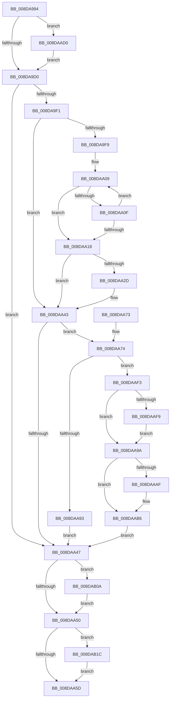

# PiSwBusRelationAdd

- RVA: `0x008DA994`–`0x008DAB43` (길이 `431` bytes)
- VA: `0x00000001408DA994`
- 실행 섹션: `PAGE`
- PDB 이름 있음: `예`; PDB Function 태그: `아니요`
- unwind 정보 RVA: `0x000857BC`
- 디코드: `118`개 명령, `431/431` bytes 표시
- 미해석 바이트: `0` (있으면 어셈블리에 `.byte`로 보존)

> 이 문서는 커널 이미지의 기계어와 PDB 기호를 분석해 생성했습니다. 4번과 5번은 함수 원형과 자료형을 바이너리 사용 방식에서 추정한 C 해석이며 원본 소스 복구 결과는 아닙니다.

## 1. Dependencies

- 직접 호출 지점: **5**; 고유 호출 대상: **5**
- 직접 호출자로 확인된 함수: **3**
- RIP 상대 이미지 참조: **4**

### Outgoing calls
- `0x008DA9E2` → [PnpAllocatePWSTR](PnpAllocatePWSTR_function_008DE620.md) (function, `0x008DE620`)
- `0x008DAA89` → [RtlInsertElementGenericTableAvl](../../text/3E/RtlInsertElementGenericTableAvl_function_003EE510.md) (function, `0x003EE510`)
- `0x008DAAE9` → [McTemplateK0zzz_EtwWriteTransfer](../../text/5A/McTemplateK0zzz_EtwWriteTransfer_function_005A96BC.md) (function, `0x005A96BC`)
- `0x008DAB12` → [ExFreePoolWithTag](../../poolcode/B8/ExFreePoolWithTag_function_00B82870.md) (function, `0x00B82870`)
- `0x008DAB39` → [McTemplateK0zzzd_EtwWriteTransfer](../../text/5A/McTemplateK0zzzd_EtwWriteTransfer_function_005A97D4.md) (function, `0x005A97D4`)

### Direct callers
- [PiSwIrpStartCreateWorker](PiSwIrpStartCreateWorker_function_008DB398.md) at `0x008DB5D7`
- [PiSwProcessRemove](../94/PiSwProcessRemove_function_0094E3B8.md) at `0x0094E58C`
- [sub_00B1C4F6](../B1/Unknown_function_00B1C4F6.md) at `0x00B1C828`

### Static image references
- `0x008DA9AD` → RVA `0x00EF012C` (`.data`; read)
- `0x008DAA82` → RVA `0x00F8ABA0` (`.data`; read)
- `0x008DAAD8` → RVA `0x00027100` (`.rdata`; read)
- `0x008DAB20` → RVA `0x00027230` (`.rdata`; read)

## 2. Other-region calls and transfers

- 다른 실행 섹션으로 향하는 call: **4**
  - `0x008DAA89` → [RtlInsertElementGenericTableAvl](../../text/3E/RtlInsertElementGenericTableAvl_function_003EE510.md) (`PAGE` → `.text`)
  - `0x008DAAE9` → [McTemplateK0zzz_EtwWriteTransfer](../../text/5A/McTemplateK0zzz_EtwWriteTransfer_function_005A96BC.md) (`PAGE` → `.text`)
  - `0x008DAB12` → [ExFreePoolWithTag](../../poolcode/B8/ExFreePoolWithTag_function_00B82870.md) (`PAGE` → `POOLCODE`)
  - `0x008DAB39` → [McTemplateK0zzzd_EtwWriteTransfer](../../text/5A/McTemplateK0zzzd_EtwWriteTransfer_function_005A97D4.md) (`PAGE` → `.text`)
- 별도 외부 분기/꼬리 이동을 확인하지 못했습니다.

## 3. Assembly (complete function range)

```asm
008DA994  48 89 5C 24 08                  mov qword ptr [rsp + 8], rbx
008DA999  55                              push rbp
008DA99A  56                              push rsi
008DA99B  57                              push rdi
008DA99C  41 56                           push r14
008DA99E  41 57                           push r15
008DA9A0  48 8B EC                        mov rbp, rsp
008DA9A3  48 83 EC 60                     sub rsp, 0x60
008DA9A7  45 33 FF                        xor r15d, r15d
008DA9AA  0F 57 C0                        xorps xmm0, xmm0
008DA9AD  F6 05 78 57 61 00 40            test byte ptr [rip + 0x615778], 0x40
008DA9B4  48 8B FA                        mov rdi, rdx
008DA9B7  4C 8B F1                        mov r14, rcx
008DA9BA  4C 89 7D 48                     mov qword ptr [rbp + 0x48], r15
008DA9BE  0F 11 45 E0                     movups xmmword ptr [rbp - 0x20], xmm0
008DA9C2  44 88 7D 40                     mov byte ptr [rbp + 0x40], r15b
008DA9C6  0F 11 45 F0                     movups xmmword ptr [rbp - 0x10], xmm0
008DA9CA  0F 85 00 01 00 00               jne 0x1408daad0
008DA9D0  4C 8D 4D 48                     lea r9, [rbp + 0x48]
008DA9D4  BA C8 00 00 00                  mov edx, 0xc8
008DA9D9  41 B8 50 6E 70 57               mov r8d, 0x57706e50
008DA9DF  49 8B CE                        mov rcx, r14
008DA9E2  E8 39 3C 00 00                  call 0x1408de620
008DA9E7  48 8B 75 48                     mov rsi, qword ptr [rbp + 0x48]
008DA9EB  8B D8                           mov ebx, eax
008DA9ED  85 C0                           test eax, eax
008DA9EF  78 56                           js 0x1408daa47
008DA9F1  41 8B DF                        mov ebx, r15d
008DA9F4  48 85 F6                        test rsi, rsi
008DA9F7  74 4A                           je 0x1408daa43
008DA9F9  BA FF 7F 00 00                  mov edx, 0x7fff
008DA9FE  48 8B C6                        mov rax, rsi
008DAA01  8B CA                           mov ecx, edx
008DAA03  41 B8 02 00 00 00               mov r8d, 2
008DAA09  66 44 39 38                     cmp word ptr [rax], r15w
008DAA0D  74 09                           je 0x1408daa18
008DAA0F  49 03 C0                        add rax, r8
008DAA12  48 83 E9 01                     sub rcx, 1
008DAA16  75 F1                           jne 0x1408daa09
008DAA18  48 8B C1                        mov rax, rcx
008DAA1B  48 F7 D8                        neg rax
008DAA1E  1B DB                           sbb ebx, ebx
008DAA20  F7 D3                           not ebx
008DAA22  81 E3 0D 00 00 C0               and ebx, 0xc000000d
008DAA28  48 85 C9                        test rcx, rcx
008DAA2B  74 16                           je 0x1408daa43
008DAA2D  48 2B D1                        sub rdx, rcx
008DAA30  48 89 75 E8                     mov qword ptr [rbp - 0x18], rsi
008DAA34  66 03 D2                        add dx, dx
008DAA37  66 89 55 E0                     mov word ptr [rbp - 0x20], dx
008DAA3B  66 41 03 D0                     add dx, r8w
008DAA3F  66 89 55 E2                     mov word ptr [rbp - 0x1e], dx
008DAA43  85 DB                           test ebx, ebx
008DAA45  79 2D                           jns 0x1408daa74
008DAA47  48 85 F6                        test rsi, rsi
008DAA4A  0F 85 BA 00 00 00               jne 0x1408dab0a
008DAA50  F6 05 D5 56 61 00 40            test byte ptr [rip + 0x6156d5], 0x40
008DAA57  0F 85 BF 00 00 00               jne 0x1408dab1c
008DAA5D  8B C3                           mov eax, ebx
008DAA5F  48 8B 9C 24 90 00 00 00         mov rbx, qword ptr [rsp + 0x90]
008DAA67  48 83 C4 60                     add rsp, 0x60
008DAA6B  41 5F                           pop r15
008DAA6D  41 5E                           pop r14
008DAA6F  5F                              pop rdi
008DAA70  5E                              pop rsi
008DAA71  5D                              pop rbp
008DAA72  C3                              ret
008DAA73  CC                              int3
008DAA74  4C 8D 4D 40                     lea r9, [rbp + 0x40]
008DAA78  41 B8 20 00 00 00               mov r8d, 0x20
008DAA7E  48 8D 55 E0                     lea rdx, [rbp - 0x20]
008DAA82  48 8D 0D 17 01 6B 00            lea rcx, [rip + 0x6b0117]
008DAA89  E8 82 3A B1 FF                  call 0x1403ee510
008DAA8E  48 85 C0                        test rax, rax
008DAA91  75 60                           jne 0x1408daaf3
008DAA93  BB 9A 00 00 C0                  mov ebx, 0xc000009a
008DAA98  EB AD                           jmp 0x1408daa47
008DAA9A  48 89 47 70                     mov qword ptr [rdi + 0x70], rax
008DAA9E  48 8D 4F 60                     lea rcx, [rdi + 0x60]
008DAAA2  48 8B 50 18                     mov rdx, qword ptr [rax + 0x18]
008DAAA6  48 83 C0 10                     add rax, 0x10
008DAAAA  48 39 02                        cmp qword ptr [rdx], rax
008DAAAD  74 07                           je 0x1408daab6
008DAAAF  B9 03 00 00 00                  mov ecx, 3
008DAAB4  CD 29                           int 0x29
008DAAB6  48 89 01                        mov qword ptr [rcx], rax
008DAAB9  48 89 51 08                     mov qword ptr [rcx + 8], rdx
008DAABD  48 89 0A                        mov qword ptr [rdx], rcx
008DAAC0  48 89 48 08                     mov qword ptr [rax + 8], rcx
008DAAC4  F0 FF 07                        lock inc dword ptr [rdi]
008DAAC7  48 8B 75 48                     mov rsi, qword ptr [rbp + 0x48]
008DAACB  E9 77 FF FF FF                  jmp 0x1408daa47
008DAAD0  48 8B 42 10                     mov rax, qword ptr [rdx + 0x10]
008DAAD4  4C 8B 4A 08                     mov r9, qword ptr [rdx + 8]
008DAAD8  48 8D 15 21 C6 74 FF            lea rdx, [rip - 0x8b39df]
008DAADF  4C 89 74 24 28                  mov qword ptr [rsp + 0x28], r14
008DAAE4  48 89 44 24 20                  mov qword ptr [rsp + 0x20], rax
008DAAE9  E8 CE EB CC FF                  call 0x1405a96bc
008DAAEE  E9 DD FE FF FF                  jmp 0x1408da9d0
008DAAF3  44 38 7D 40                     cmp byte ptr [rbp + 0x40], r15b
008DAAF7  74 A1                           je 0x1408daa9a
008DAAF9  48 8D 48 10                     lea rcx, [rax + 0x10]
008DAAFD  4C 89 7D 48                     mov qword ptr [rbp + 0x48], r15
008DAB01  48 89 48 18                     mov qword ptr [rax + 0x18], rcx
008DAB05  48 89 09                        mov qword ptr [rcx], rcx
008DAB08  EB 90                           jmp 0x1408daa9a
008DAB0A  BA 50 6E 70 57                  mov edx, 0x57706e50
008DAB0F  48 8B CE                        mov rcx, rsi
008DAB12  E8 59 7D 2A 00                  call 0x140b82870
008DAB17  E9 34 FF FF FF                  jmp 0x1408daa50
008DAB1C  48 8B 47 10                     mov rax, qword ptr [rdi + 0x10]
008DAB20  48 8D 15 09 C7 74 FF            lea rdx, [rip - 0x8b38f7]
008DAB27  4C 8B 4F 08                     mov r9, qword ptr [rdi + 8]
008DAB2B  89 5C 24 30                     mov dword ptr [rsp + 0x30], ebx
008DAB2F  4C 89 74 24 28                  mov qword ptr [rsp + 0x28], r14
008DAB34  48 89 44 24 20                  mov qword ptr [rsp + 0x20], rax
008DAB39  E8 96 EC CC FF                  call 0x1405a97d4
008DAB3E  E9 1A FF FF FF                  jmp 0x1408daa5d
```

## 4. C-style interpretation (structured pseudocode)

```c
__int64 __fastcall PiSwBusRelationAdd(__int64 a1, __int64 a2)
{
    __int64 result;
    __int64 v_r15;
    __int64 v_rbx;
    __int64 v_rsp;
    unsigned __int64 v_stack_m38;
    unsigned __int64 v_stack_m40;
    unsigned __int16 v_stack_m46;
    unsigned __int64 v_stack_m48;
    unsigned __int8 v_stack_p18;
    unsigned __int64 v_stack_p20;
    unsigned __int64 v_stack_p28;
    unsigned int v_stack_p30;
    unsigned __int64 v_stack_p8;

    v_stack_p8 = v_rbx;
    v_rsp = (v_rsp) - (96);
    v_r15 = 0;
    v_stack_p20 = 0;
    v_stack_m48 = v_xmm0;
    v_stack_p18 = 0;
    v_stack_m38 = v_xmm0;
    if (((*(unsigned __int8 *)(v_rip + 6379384)) & (64)) != 0) goto loc_008DAAD0;
loc_008DA9D0:
    result = PnpAllocatePWSTR(a1, 200, (unsigned int)(0x57706E50ULL), v_stack_p20);
    if (sign_flag) goto loc_008DAA47;
    if (v_stack_p20 == 0) goto loc_008DAA43;
loc_008DAA09:
    if ((*(unsigned __int16 *)(v_stack_p20)) == 0) goto loc_008DAA18;
    result = (v_stack_p20) + (2);
    a1 = ((unsigned int)((unsigned int)((unsigned int)(0x7FFFULL)))) - (1);
    if (condition_is_not_equal) goto loc_008DAA09;
loc_008DAA18:
    result = -(a1);
    v_rbx = (unsigned int)(~(0));
    v_rbx = (unsigned int)((v_rbx) & (0xC000000DULL));
    if (a1 != 0) {
        a2 = ((unsigned int)(0x7FFFULL)) - (a1);
        v_stack_m40 = v_stack_p20;
        a2 = (unsigned __int16)((a2) + ((unsigned __int16)(a2)));
        v_stack_m48 = (unsigned __int16)(a2);
        a2 = (unsigned __int16)((a2) + (2));
        v_stack_m46 = (unsigned __int16)(a2);
    }
    if (!sign_flag) goto loc_008DAA74;
loc_008DAA47:
    if (v_stack_p20 != 0) goto loc_008DAB0A;
loc_008DAA50:
    if (((*(unsigned __int8 *)(v_rip + 6379221)) & (64)) != 0) goto loc_008DAB1C;
loc_008DAA5D:
    v_rsp = (v_rsp) + (96);
    return (unsigned int)((unsigned int)(v_rbx));
loc_008DAA74:
    result = RtlInsertElementGenericTableAvl(v_rip + 7012631, v_stack_m48, 32, v_stack_p18);
    if (result != 0) goto loc_008DAAF3;
    goto loc_008DAA47;
loc_008DAA9A:
    *(unsigned __int64 *)(a2 + 112) = result;
    result = (result) + (16);
    if ((*(unsigned __int64 *)(*(unsigned __int64 *)(result + 24))) != result) {
        a1 = 3;
    }
    *(unsigned __int64 *)(a1) = result;
    *(unsigned __int64 *)(a1 + 8) = *(unsigned __int64 *)(result + 24);
    *(unsigned __int64 *)(*(unsigned __int64 *)(result + 24)) = a1;
    *(unsigned __int64 *)(result + 8) = a1;
    goto loc_008DAA47;
loc_008DAAD0:
    v_stack_p28 = a1;
    v_stack_p20 = *(unsigned __int64 *)(*(unsigned __int64 *)(result + 24) + 16);
    result = McTemplateK0zzz_EtwWriteTransfer(a1, v_rip - 9124319, 32, *(unsigned __int64 *)(*(unsigned __int64 *)(result + 24) + 8));
    goto loc_008DA9D0;
loc_008DAAF3:
    if (v_stack_p18 == 0) goto loc_008DAA9A;
    v_stack_p20 = 0;
    *(unsigned __int64 *)(result + 24) = result + 16;
    *(unsigned __int64 *)(result + 16) = result + 16;
    goto loc_008DAA9A;
loc_008DAB0A:
    result = ExFreePoolWithTag(v_stack_p20, (unsigned int)(0x57706E50ULL), 32, *(unsigned __int64 *)(*(unsigned __int64 *)(result + 24) + 8));
    goto loc_008DAA50;
loc_008DAB1C:
    v_stack_p30 = (unsigned int)((unsigned int)(0xC000009AULL));
    v_stack_p28 = a1;
    v_stack_p20 = *(unsigned __int64 *)(a2 + 16);
    result = McTemplateK0zzzd_EtwWriteTransfer(v_stack_p20, v_rip - 9124087, 32, *(unsigned __int64 *)(a2 + 8));
    goto loc_008DAA5D;
}
```

## 5. (Beta) C Style

```c
int64_t PiSwBusRelationAdd(int64_t Arg1, void *Arg2)
{
    uint8_t *arg2 = (uint8_t *)Arg2;

    int64_t result;
    int64_t local_r15;
    int64_t local_rbx;
    int64_t local_rsp;
    uint64_t v_stack_m38;
    uint64_t v_stack_m40;
    uint16_t v_stack_m46;
    uint64_t v_stack_m48;
    uint8_t v_stack_p18;
    uint64_t v_stack_p20;
    uint64_t v_stack_p28;
    uint32_t v_stack_p30;
    uint64_t v_stack_p8;

    v_stack_p8 = local_rbx;
    local_rsp = (local_rsp) - (96);
    local_r15 = 0;
    v_stack_p20 = 0;
    v_stack_m48 = v_xmm0;
    v_stack_p18 = 0;
    v_stack_m38 = v_xmm0;
    if (((*(uint8_t *)(v_rip + 0x615778)) & (64)) != 0) goto loc_008DAAD0;
loc_008DA9D0:
    result = PnpAllocatePWSTR(Arg1, 200, (uint32_t)(0x57706E50ULL), v_stack_p20);
    if (sign_flag) goto loc_008DAA47;
    if (v_stack_p20 == 0) goto loc_008DAA43;
loc_008DAA09:
    if ((*(uint16_t *)(v_stack_p20)) == 0) goto loc_008DAA18;
    result = (v_stack_p20) + (2);
    Arg1 = ((uint32_t)((uint32_t)((uint32_t)(0x7FFFULL)))) - (1);
    if (condition_is_not_equal) goto loc_008DAA09;
loc_008DAA18:
    result = -(Arg1);
    local_rbx = (uint32_t)(~(0));
    local_rbx = (uint32_t)((local_rbx) & (0xC000000DULL));
    if (Arg1 != 0) {
        Arg2 = ((uint32_t)(0x7FFFULL)) - (Arg1);
        v_stack_m40 = v_stack_p20;
        Arg2 = (uint16_t)((Arg2) + ((uint16_t)(Arg2)));
        v_stack_m48 = (uint16_t)(Arg2);
        Arg2 = (uint16_t)((Arg2) + (2));
        v_stack_m46 = (uint16_t)(Arg2);
    }
    if (!sign_flag) goto loc_008DAA74;
loc_008DAA47:
    if (v_stack_p20 != 0) goto loc_008DAB0A;
loc_008DAA50:
    if (((*(uint8_t *)(v_rip + 0x6156D5)) & (64)) != 0) goto loc_008DAB1C;
loc_008DAA5D:
    local_rsp = (local_rsp) + (96);
    return (uint32_t)((uint32_t)(local_rbx));
loc_008DAA74:
    result = RtlInsertElementGenericTableAvl(v_rip + 7012631, v_stack_m48, 32, v_stack_p18);
    if (result != 0) goto loc_008DAAF3;
    goto loc_008DAA47;
loc_008DAA9A:
    *(uint64_t *)(arg2 + 0x70) = result;
    result = (result) + (16);
    if ((*(uint64_t *)(*(uint64_t *)(result + 0x18))) != result) {
        Arg1 = 3;
    }
    *(uint64_t *)(Arg1) = result;
    *(uint64_t *)(Arg1 + 0x8) = *(uint64_t *)(result + 0x18);
    *(uint64_t *)(*(uint64_t *)(result + 0x18)) = Arg1;
    *(uint64_t *)(result + 0x8) = Arg1;
    goto loc_008DAA47;
loc_008DAAD0:
    v_stack_p28 = Arg1;
    v_stack_p20 = *(uint64_t *)(*(uint64_t *)(result + 0x18) + 0x10);
    result = McTemplateK0zzz_EtwWriteTransfer(Arg1, v_rip - 9124319, 32, *(uint64_t *)(*(uint64_t *)(result + 0x18) + 0x8));
    goto loc_008DA9D0;
loc_008DAAF3:
    if (v_stack_p18 == 0) goto loc_008DAA9A;
    v_stack_p20 = 0;
    *(uint64_t *)(result + 0x18) = result + 16;
    *(uint64_t *)(result + 0x10) = result + 16;
    goto loc_008DAA9A;
loc_008DAB0A:
    result = ExFreePoolWithTag(v_stack_p20, (uint32_t)(0x57706E50ULL), 32, *(uint64_t *)(*(uint64_t *)(result + 0x18) + 0x8));
    goto loc_008DAA50;
loc_008DAB1C:
    v_stack_p30 = (uint32_t)((uint32_t)(0xC000009AULL));
    v_stack_p28 = Arg1;
    v_stack_p20 = *(uint64_t *)(arg2 + 0x10);
    result = McTemplateK0zzzd_EtwWriteTransfer(v_stack_p20, v_rip - 9124087, 32, *(uint64_t *)(arg2 + 0x8));
    goto loc_008DAA5D;
}
```

### 관측된 메모리 오프셋

구조체 형식이 확인되지 않은 접근은 인자 기준의 오프셋으로만 기록했습니다.

| 기준 인자 | 오프셋 표현 | 폭 (bit) | 접근 |
|---|---:|---:|---|
| `Arg2` | `+ 0x0` | `32` | `R/W` |
| `Arg2` | `+ 0x8` | `64` | `R` |
| `Arg2` | `+ 0x10` | `64` | `R` |
| `Arg2` | `+ 0x60` | `64` | `R` |
| `Arg2` | `+ 0x70` | `64` | `W` |

## 6. Execution-region graph

[열기: 2D/3D 그래프와 함수 탐색 컨트롤 패널](../../../control-panel.html?section=page&rva=0x008DA994&view=graph)

- 2D 그래프는 위에서 아래로 흐르고, 3D 그래프는 빈 공간을 드래그해 회전합니다. Shift+드래그는 이동, 휠은 확대·축소, 함수 노드 선택은 대상 보고서 이동입니다.

### Static fallback


