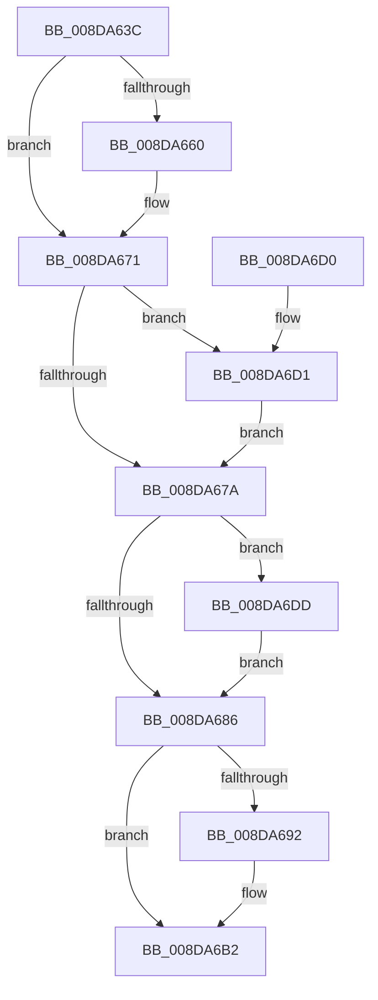

# PiSwDeviceFree

- RVA: `0x008DA63C`–`0x008DA6F1` (길이 `181` bytes)
- VA: `0x00000001408DA63C`
- 실행 섹션: `PAGE`
- PDB 이름 있음: `예`; PDB Function 태그: `아니요`
- unwind 정보 RVA: `0x00069370`
- 디코드: `43`개 명령, `181/181` bytes 표시
- 미해석 바이트: `0` (있으면 어셈블리에 `.byte`로 보존)

> 이 문서는 커널 이미지의 기계어와 PDB 기호를 분석해 생성했습니다. 4번과 5번은 함수 원형과 자료형을 바이너리 사용 방식에서 추정한 C 해석이며 원본 소스 복구 결과는 아닙니다.

## 1. Dependencies

- 직접 호출 지점: **8**; 고유 호출 대상: **7**
- 직접 호출자로 확인된 함수: **1**
- RIP 상대 이미지 참조: **0**

### Outgoing calls
- `0x008DA649` → [PiSwInstanceInfoFree](PiSwInstanceInfoFree_function_008DB0B4.md) (function, `0x008DB0B4`)
- `0x008DA652` → [PiSwPnPInfoFree](PiSwPnPInfoFree_function_008DA6F8.md) (function, `0x008DA6F8`)
- `0x008DA665` → [ExFreePoolWithTag](../../poolcode/B8/ExFreePoolWithTag_function_00B82870.md) (function, `0x00B82870`)
- `0x008DA69E` → [PnpFreeDevPropertyArray](PnpFreeDevPropertyArray_function_008DE78C.md) (function, `0x008DE78C`)
- `0x008DA6B9` → [PiSwFreeInterfaceList](PiSwFreeInterfaceList_function_008DAB4C.md) (function, `0x008DAB4C`)
- `0x008DA6C5` → [PiSwFreePdoAssociationsList](PiSwFreePdoAssociationsList_function_008DA5B8.md) (function, `0x008DA5B8`)
- `0x008DA6D1` → [PiSwQueuedCreateInfoFree](../94/PiSwQueuedCreateInfoFree_function_0094D92C.md) (function, `0x0094D92C`)
- `0x008DA6E2` → [ExFreePoolWithTag](../../poolcode/B8/ExFreePoolWithTag_function_00B82870.md) (function, `0x00B82870`)

### Direct callers
- [PiSwDeviceDereference](../94/PiSwDeviceDereference_function_0094E8A8.md) at `0x0094E8C4`

### Static image references
- 디코드된 RIP-relative 메모리 참조가 없습니다.

## 2. Other-region calls and transfers

- 다른 실행 섹션으로 향하는 call: **2**
  - `0x008DA665` → [ExFreePoolWithTag](../../poolcode/B8/ExFreePoolWithTag_function_00B82870.md) (`PAGE` → `POOLCODE`)
  - `0x008DA6E2` → [ExFreePoolWithTag](../../poolcode/B8/ExFreePoolWithTag_function_00B82870.md) (`PAGE` → `POOLCODE`)
- 별도 외부 분기/꼬리 이동을 확인하지 못했습니다.

## 3. Assembly (complete function range)

```asm
008DA63C  40 53                           push rbx
008DA63E  48 83 EC 20                     sub rsp, 0x20
008DA642  48 8B D9                        mov rbx, rcx
008DA645  48 83 C1 08                     add rcx, 8
008DA649  E8 66 0A 00 00                  call 0x1408db0b4
008DA64E  48 8D 4B 18                     lea rcx, [rbx + 0x18]
008DA652  E8 A1 00 00 00                  call 0x1408da6f8
008DA657  48 8B 4B 50                     mov rcx, qword ptr [rbx + 0x50]
008DA65B  48 85 C9                        test rcx, rcx
008DA65E  74 11                           je 0x1408da671
008DA660  BA 50 6E 70 57                  mov edx, 0x57706e50
008DA665  E8 06 82 2A 00                  call 0x140b82870
008DA66A  0F 57 C0                        xorps xmm0, xmm0
008DA66D  0F 11 43 48                     movups xmmword ptr [rbx + 0x48], xmm0
008DA671  48 8B 4B 58                     mov rcx, qword ptr [rbx + 0x58]
008DA675  48 85 C9                        test rcx, rcx
008DA678  75 57                           jne 0x1408da6d1
008DA67A  48 8B 8B 98 00 00 00            mov rcx, qword ptr [rbx + 0x98]
008DA681  48 85 C9                        test rcx, rcx
008DA684  75 57                           jne 0x1408da6dd
008DA686  48 8B 93 A8 00 00 00            mov rdx, qword ptr [rbx + 0xa8]
008DA68D  48 85 D2                        test rdx, rdx
008DA690  74 20                           je 0x1408da6b2
008DA692  8B 8B B0 00 00 00               mov ecx, dword ptr [rbx + 0xb0]
008DA698  41 B8 50 6E 70 57               mov r8d, 0x57706e50
008DA69E  E8 E9 40 00 00                  call 0x1408de78c
008DA6A3  48 83 A3 A8 00 00 00 00         and qword ptr [rbx + 0xa8], 0
008DA6AB  83 A3 B0 00 00 00 00            and dword ptr [rbx + 0xb0], 0
008DA6B2  48 8D 8B B8 00 00 00            lea rcx, [rbx + 0xb8]
008DA6B9  E8 8E 04 00 00                  call 0x1408dab4c
008DA6BE  48 8D 8B 80 00 00 00            lea rcx, [rbx + 0x80]
008DA6C5  E8 EE FE FF FF                  call 0x1408da5b8
008DA6CA  48 83 C4 20                     add rsp, 0x20
008DA6CE  5B                              pop rbx
008DA6CF  C3                              ret
008DA6D0  CC                              int3
008DA6D1  E8 56 32 07 00                  call 0x14094d92c
008DA6D6  48 83 63 58 00                  and qword ptr [rbx + 0x58], 0
008DA6DB  EB 9D                           jmp 0x1408da67a
008DA6DD  BA 50 6E 70 57                  mov edx, 0x57706e50
008DA6E2  E8 89 81 2A 00                  call 0x140b82870
008DA6E7  48 83 A3 98 00 00 00 00         and qword ptr [rbx + 0x98], 0
008DA6EF  EB 95                           jmp 0x1408da686
```

## 4. C-style interpretation (structured pseudocode)

```c
__int64 __fastcall PiSwDeviceFree(__int64 a1)
{
    __int64 result;
    __int64 v_rsp;

    v_rsp = (v_rsp) - (32);
    a1 = (a1) + (8);
    result = PiSwInstanceInfoFree(a1, a2, a3, a4);
    result = PiSwPnPInfoFree(a1 + 24, a2, a3, a4);
    if (*(unsigned __int64 *)(a1 + 80) != 0) {
        a2 = 0x57706E50ULL;
        result = ExFreePoolWithTag(*(unsigned __int64 *)(a1 + 80), a2, a3, a4);
        *(unsigned __int64 *)(a1 + 72) = v_xmm0;
    }
    if (*(unsigned __int64 *)(a1 + 88) != 0) goto loc_008DA6D1;
loc_008DA67A:
    if (*(unsigned __int64 *)(a1 + 152) != 0) goto loc_008DA6DD;
loc_008DA686:
    if (*(unsigned __int64 *)(a1 + 168) != 0) {
        a1 = *(unsigned int *)(a1 + 176);
        a3 = 0x57706E50ULL;
        result = PnpFreeDevPropertyArray(a1, *(unsigned __int64 *)(a1 + 168), a3, a4);
    }
    result = PiSwFreeInterfaceList(a1 + 184, *(unsigned __int64 *)(a1 + 168), a3, a4);
    result = PiSwFreePdoAssociationsList(a1 + 128, *(unsigned __int64 *)(a1 + 168), a3, a4);
    v_rsp = (v_rsp) + (32);
    return result;
loc_008DA6D1:
    result = PiSwQueuedCreateInfoFree(a1 + 128, *(unsigned __int64 *)(a1 + 168), a3, a4);
    goto loc_008DA67A;
loc_008DA6DD:
    result = ExFreePoolWithTag(a1 + 128, (unsigned int)(0x57706E50ULL), a3, a4);
    goto loc_008DA686;
}
```

## 5. (Beta) C Style

```c
int64_t PiSwDeviceFree(void *Arg1)
{
    uint8_t *arg1 = (uint8_t *)Arg1;

    int64_t result;
    int64_t local_rsp;

    local_rsp = (local_rsp) - (32);
    Arg1 = (Arg1) + (8);
    result = PiSwInstanceInfoFree(Arg1, a2, a3, a4);
    result = PiSwPnPInfoFree(Arg1 + 24, a2, a3, a4);
    if (*(uint64_t *)(arg1 + 0x50) != 0) {
        a2 = 0x57706E50ULL;
        result = ExFreePoolWithTag(*(uint64_t *)(arg1 + 0x50), a2, a3, a4);
        *(uint64_t *)(arg1 + 0x48) = v_xmm0;
    }
    if (*(uint64_t *)(arg1 + 0x58) != 0) goto loc_008DA6D1;
loc_008DA67A:
    if (*(uint64_t *)(arg1 + 0x98) != 0) goto loc_008DA6DD;
loc_008DA686:
    if (*(uint64_t *)(arg1 + 0xA8) != 0) {
        Arg1 = *(uint32_t *)(arg1 + 0xB0);
        a3 = 0x57706E50ULL;
        result = PnpFreeDevPropertyArray(Arg1, *(uint64_t *)(arg1 + 0xA8), a3, a4);
    }
    result = PiSwFreeInterfaceList(Arg1 + 184, *(uint64_t *)(arg1 + 0xA8), a3, a4);
    result = PiSwFreePdoAssociationsList(Arg1 + 128, *(uint64_t *)(arg1 + 0xA8), a3, a4);
    local_rsp = (local_rsp) + (32);
    return result;
loc_008DA6D1:
    result = PiSwQueuedCreateInfoFree(Arg1 + 128, *(uint64_t *)(arg1 + 0xA8), a3, a4);
    goto loc_008DA67A;
loc_008DA6DD:
    result = ExFreePoolWithTag(Arg1 + 128, (uint32_t)(0x57706E50ULL), a3, a4);
    goto loc_008DA686;
}
```

### 관측된 메모리 오프셋

구조체 형식이 확인되지 않은 접근은 인자 기준의 오프셋으로만 기록했습니다.

| 기준 인자 | 오프셋 표현 | 폭 (bit) | 접근 |
|---|---:|---:|---|
| `Arg1` | `+ 0x18` | `64` | `R` |
| `Arg1` | `+ 0x48` | `128` | `R` |
| `Arg1` | `+ 0x50` | `64` | `R` |
| `Arg1` | `+ 0x58` | `64` | `R` |
| `Arg1` | `+ 0x58` | `64` | `R/W` |
| `Arg1` | `+ 0x80` | `64` | `R` |
| `Arg1` | `+ 0x98` | `64` | `R` |
| `Arg1` | `+ 0x98` | `64` | `R/W` |
| `Arg1` | `+ 0xA8` | `64` | `R` |
| `Arg1` | `+ 0xA8` | `64` | `R/W` |
| `Arg1` | `+ 0xB0` | `32` | `R` |
| `Arg1` | `+ 0xB0` | `32` | `R/W` |
| `Arg1` | `+ 0xB8` | `64` | `R` |

## 6. Execution-region graph

[열기: 2D/3D 그래프와 함수 탐색 컨트롤 패널](../../../control-panel.html?section=page&rva=0x008DA63C&view=graph)

- 2D 그래프는 위에서 아래로 흐르고, 3D 그래프는 빈 공간을 드래그해 회전합니다. Shift+드래그는 이동, 휠은 확대·축소, 함수 노드 선택은 대상 보고서 이동입니다.

### Static fallback


