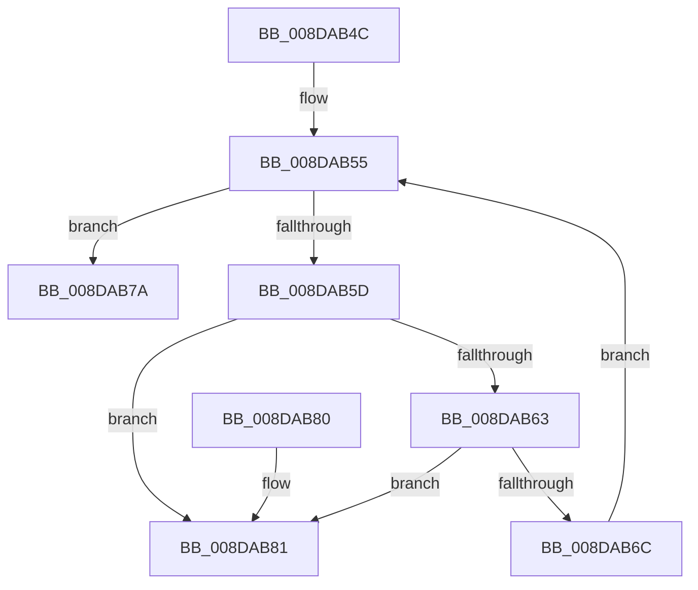

# PiSwFreeInterfaceList

- RVA: `0x008DAB4C`–`0x008DAB88` (길이 `60` bytes)
- VA: `0x00000001408DAB4C`
- 실행 섹션: `PAGE`
- PDB 이름 있음: `예`; PDB Function 태그: `아니요`
- unwind 정보 RVA: `0x0005DAC8`
- 디코드: `21`개 명령, `60/60` bytes 표시
- 미해석 바이트: `0` (있으면 어셈블리에 `.byte`로 보존)

> 이 문서는 커널 이미지의 기계어와 PDB 기호를 분석해 생성했습니다. 4번과 5번은 함수 원형과 자료형을 바이너리 사용 방식에서 추정한 C 해석이며 원본 소스 복구 결과는 아닙니다.

## 1. Dependencies

- 직접 호출 지점: **1**; 고유 호출 대상: **1**
- 직접 호출자로 확인된 함수: **3**
- RIP 상대 이미지 참조: **0**

### Outgoing calls
- `0x008DAB73` → [PiSwInterfaceFree](PiSwInterfaceFree_function_008DB064.md) (function, `0x008DB064`)

### Direct callers
- [PiSwDeviceFree](PiSwDeviceFree_function_008DA63C.md) at `0x008DA6B9`
- [PiSwProcessRemove](../94/PiSwProcessRemove_function_0094E3B8.md) at `0x0094E57C`
- [sub_00B1C4F6](../B1/Unknown_function_00B1C4F6.md) at `0x00B1C779`

### Static image references
- 디코드된 RIP-relative 메모리 참조가 없습니다.

## 2. Other-region calls and transfers

- 다른 실행 섹션으로 향하는 call: **0**
- 별도 외부 분기/꼬리 이동을 확인하지 못했습니다.

## 3. Assembly (complete function range)

```asm
008DAB4C  40 53                           push rbx
008DAB4E  48 83 EC 20                     sub rsp, 0x20
008DAB52  48 8B D9                        mov rbx, rcx
008DAB55  48 8B 0B                        mov rcx, qword ptr [rbx]
008DAB58  48 3B CB                        cmp rcx, rbx
008DAB5B  74 1D                           je 0x1408dab7a
008DAB5D  48 39 59 08                     cmp qword ptr [rcx + 8], rbx
008DAB61  75 1E                           jne 0x1408dab81
008DAB63  48 8B 01                        mov rax, qword ptr [rcx]
008DAB66  48 39 48 08                     cmp qword ptr [rax + 8], rcx
008DAB6A  75 15                           jne 0x1408dab81
008DAB6C  48 89 03                        mov qword ptr [rbx], rax
008DAB6F  48 89 58 08                     mov qword ptr [rax + 8], rbx
008DAB73  E8 EC 04 00 00                  call 0x1408db064
008DAB78  EB DB                           jmp 0x1408dab55
008DAB7A  48 83 C4 20                     add rsp, 0x20
008DAB7E  5B                              pop rbx
008DAB7F  C3                              ret
008DAB80  CC                              int3
008DAB81  B9 03 00 00 00                  mov ecx, 3
008DAB86  CD 29                           int 0x29
```

## 4. C-style interpretation (structured pseudocode)

```c
__int64 __fastcall PiSwFreeInterfaceList(__int64 a1)
{
    __int64 result;
    __int64 v_rsp;

    v_rsp = (v_rsp) - (32);
loc_008DAB55:
    if ((*(unsigned __int64 *)(a1)) == a1) goto loc_008DAB7A;
    if ((*(unsigned __int64 *)(*(unsigned __int64 *)(a1) + 8)) != a1) goto loc_008DAB81;
    if ((*(unsigned __int64 *)(*(unsigned __int64 *)(*(unsigned __int64 *)(a1)) + 8)) != (*(unsigned __int64 *)(a1))) goto loc_008DAB81;
    *(unsigned __int64 *)(a1) = *(unsigned __int64 *)(*(unsigned __int64 *)(a1));
    *(unsigned __int64 *)(*(unsigned __int64 *)(*(unsigned __int64 *)(a1)) + 8) = a1;
    result = PiSwInterfaceFree(*(unsigned __int64 *)(a1), a2, a3, a4);
    goto loc_008DAB55;
loc_008DAB7A:
    v_rsp = (v_rsp) + (32);
    return result;
loc_008DAB81:
    return result;
}
```

## 5. (Beta) C Style

```c
int64_t PiSwFreeInterfaceList(void *Arg1)
{
    uint8_t *arg1 = (uint8_t *)Arg1;

    int64_t result;
    int64_t local_rsp;

    local_rsp = (local_rsp) - (32);
loc_008DAB55:
    if ((*(uint64_t *)(arg1)) == Arg1) goto loc_008DAB7A;
    if ((*(uint64_t *)(*(uint64_t *)(arg1) + 0x8)) != Arg1) goto loc_008DAB81;
    if ((*(uint64_t *)(*(uint64_t *)(*(uint64_t *)(arg1)) + 0x8)) != (*(uint64_t *)(arg1))) goto loc_008DAB81;
    *(uint64_t *)(arg1) = *(uint64_t *)(*(uint64_t *)(arg1));
    *(void **)(*(uint64_t *)(*(uint64_t *)(arg1)) + 0x8) = Arg1;
    result = PiSwInterfaceFree(*(uint64_t *)(arg1), a2, a3, a4);
    goto loc_008DAB55;
loc_008DAB7A:
    local_rsp = (local_rsp) + (32);
    return result;
loc_008DAB81:
    return result;
}
```

### 관측된 메모리 오프셋

구조체 형식이 확인되지 않은 접근은 인자 기준의 오프셋으로만 기록했습니다.

| 기준 인자 | 오프셋 표현 | 폭 (bit) | 접근 |
|---|---:|---:|---|
| `Arg1` | `+ 0x0` | `64` | `R` |
| `Arg1` | `+ 0x0` | `64` | `W` |

## 6. Execution-region graph

[열기: 2D/3D 그래프와 함수 탐색 컨트롤 패널](../../../control-panel.html?section=page&rva=0x008DAB4C&view=graph)

- 2D 그래프는 위에서 아래로 흐르고, 3D 그래프는 빈 공간을 드래그해 회전합니다. Shift+드래그는 이동, 휠은 확대·축소, 함수 노드 선택은 대상 보고서 이동입니다.

### Static fallback


