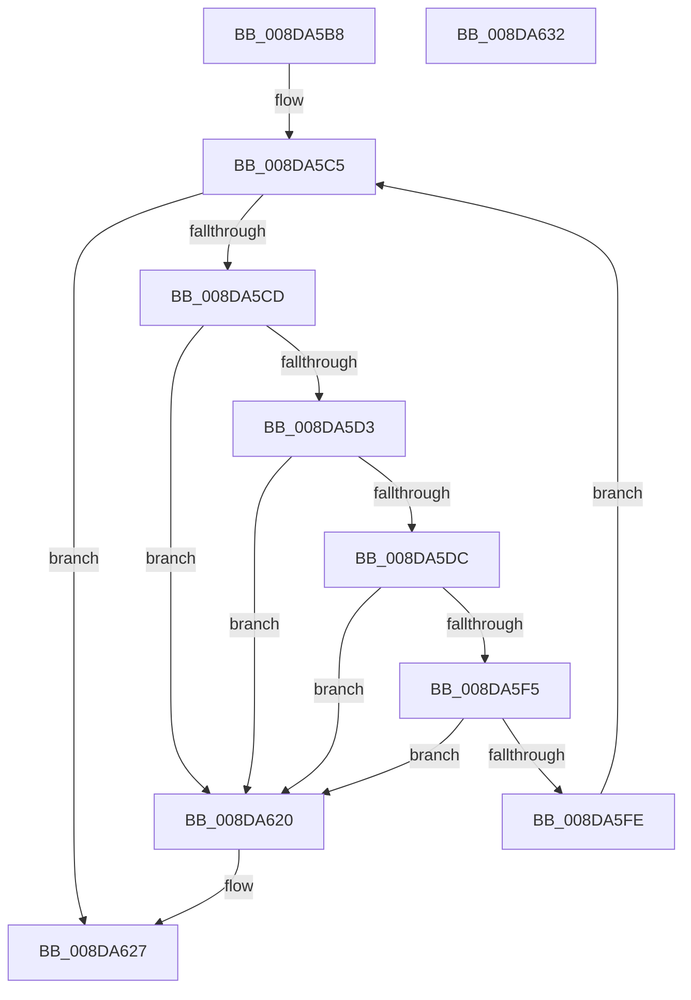

# PiSwFreePdoAssociationsList

- RVA: `0x008DA5B8`–`0x008DA633` (길이 `123` bytes)
- VA: `0x00000001408DA5B8`
- 실행 섹션: `PAGE`
- PDB 이름 있음: `예`; PDB Function 태그: `아니요`
- unwind 정보 RVA: `0x0005CAAC`
- 디코드: `37`개 명령, `123/123` bytes 표시
- 미해석 바이트: `0` (있으면 어셈블리에 `.byte`로 보존)

> 이 문서는 커널 이미지의 기계어와 PDB 기호를 분석해 생성했습니다. 4번과 5번은 함수 원형과 자료형을 바이너리 사용 방식에서 추정한 C 해석이며 원본 소스 복구 결과는 아닙니다.

## 1. Dependencies

- 직접 호출 지점: **4**; 고유 호출 대상: **4**
- 직접 호출자로 확인된 함수: **1**
- RIP 상대 이미지 참조: **1**

### Outgoing calls
- `0x008DA5E3` → [PiSwLock](../8F/PiSwLock_function_008F7D50.md) (function, `0x008F7D50`)
- `0x008DA60C` → [ExReleaseResourceLite](../../text/25/ExReleaseResourceLite_function_0025FA10.md) (function, `0x0025FA10`)
- `0x008DA611` → [KeLeaveCriticalRegion](../../text/25/KeLeaveCriticalRegion_function_0025D8B0.md) (function, `0x0025D8B0`)
- `0x008DA619` → [PiSwPdoAssociationFree](../AB/PiSwPdoAssociationFree_function_00AB45FC.md) (function, `0x00AB45FC`)

### Direct callers
- [PiSwDeviceFree](PiSwDeviceFree_function_008DA63C.md) at `0x008DA6C5`

### Static image references
- `0x008DA605` → RVA `0x00F8AB20` (`.data`; read)

## 2. Other-region calls and transfers

- 다른 실행 섹션으로 향하는 call: **2**
  - `0x008DA60C` → [ExReleaseResourceLite](../../text/25/ExReleaseResourceLite_function_0025FA10.md) (`PAGE` → `.text`)
  - `0x008DA611` → [KeLeaveCriticalRegion](../../text/25/KeLeaveCriticalRegion_function_0025D8B0.md) (`PAGE` → `.text`)
- 별도 외부 분기/꼬리 이동을 확인하지 못했습니다.

## 3. Assembly (complete function range)

```asm
008DA5B8  48 89 5C 24 08                  mov qword ptr [rsp + 8], rbx
008DA5BD  57                              push rdi
008DA5BE  48 83 EC 20                     sub rsp, 0x20
008DA5C2  48 8B F9                        mov rdi, rcx
008DA5C5  48 8B 1F                        mov rbx, qword ptr [rdi]
008DA5C8  48 3B DF                        cmp rbx, rdi
008DA5CB  74 5A                           je 0x1408da627
008DA5CD  48 39 7B 08                     cmp qword ptr [rbx + 8], rdi
008DA5D1  75 4D                           jne 0x1408da620
008DA5D3  48 8B 03                        mov rax, qword ptr [rbx]
008DA5D6  48 39 58 08                     cmp qword ptr [rax + 8], rbx
008DA5DA  75 44                           jne 0x1408da620
008DA5DC  48 89 07                        mov qword ptr [rdi], rax
008DA5DF  48 89 78 08                     mov qword ptr [rax + 8], rdi
008DA5E3  E8 68 D7 01 00                  call 0x1408f7d50
008DA5E8  48 8D 43 10                     lea rax, [rbx + 0x10]
008DA5EC  48 8B 10                        mov rdx, qword ptr [rax]
008DA5EF  48 39 42 08                     cmp qword ptr [rdx + 8], rax
008DA5F3  75 2B                           jne 0x1408da620
008DA5F5  48 8B 48 08                     mov rcx, qword ptr [rax + 8]
008DA5F9  48 39 01                        cmp qword ptr [rcx], rax
008DA5FC  75 22                           jne 0x1408da620
008DA5FE  48 89 11                        mov qword ptr [rcx], rdx
008DA601  48 89 4A 08                     mov qword ptr [rdx + 8], rcx
008DA605  48 8D 0D 14 05 6B 00            lea rcx, [rip + 0x6b0514]
008DA60C  E8 FF 53 98 FF                  call 0x14025fa10
008DA611  E8 9A 32 98 FF                  call 0x14025d8b0
008DA616  48 8B CB                        mov rcx, rbx
008DA619  E8 DE 9F 1D 00                  call 0x140ab45fc
008DA61E  EB A5                           jmp 0x1408da5c5
008DA620  B9 03 00 00 00                  mov ecx, 3
008DA625  CD 29                           int 0x29
008DA627  48 8B 5C 24 30                  mov rbx, qword ptr [rsp + 0x30]
008DA62C  48 83 C4 20                     add rsp, 0x20
008DA630  5F                              pop rdi
008DA631  C3                              ret
008DA632  CC                              int3
```

## 4. C-style interpretation (structured pseudocode)

```c
__int64 __fastcall PiSwFreePdoAssociationsList(__int64 a1)
{
    __int64 result;
    __int64 v_rsp;
    unsigned __int64 v_stack_p8;

    v_stack_p8 = v_rbx;
    v_rsp = (v_rsp) - (32);
loc_008DA5C5:
    if ((*(unsigned __int64 *)(a1)) == a1) goto loc_008DA627;
    if ((*(unsigned __int64 *)(*(unsigned __int64 *)(a1) + 8)) != a1) goto loc_008DA620;
    if ((*(unsigned __int64 *)(*(unsigned __int64 *)(*(unsigned __int64 *)(a1)) + 8)) != (*(unsigned __int64 *)(a1))) goto loc_008DA620;
    *(unsigned __int64 *)(a1) = *(unsigned __int64 *)(*(unsigned __int64 *)(a1));
    *(unsigned __int64 *)(*(unsigned __int64 *)(*(unsigned __int64 *)(a1)) + 8) = a1;
    result = PiSwLock(a1, a2, a3, a4);
    if ((*(unsigned __int64 *)(*(unsigned __int64 *)(*(unsigned __int64 *)(a1) + 16) + 8)) != (*(unsigned __int64 *)(a1) + 16)) goto loc_008DA620;
    if ((*(unsigned __int64 *)(*(unsigned __int64 *)(*(unsigned __int64 *)(a1) + 16 + 8))) != (*(unsigned __int64 *)(a1) + 16)) goto loc_008DA620;
    *(unsigned __int64 *)(*(unsigned __int64 *)(*(unsigned __int64 *)(a1) + 16 + 8)) = *(unsigned __int64 *)(*(unsigned __int64 *)(a1) + 16);
    *(unsigned __int64 *)(*(unsigned __int64 *)(*(unsigned __int64 *)(a1) + 16) + 8) = *(unsigned __int64 *)(*(unsigned __int64 *)(a1) + 16 + 8);
    result = ExReleaseResourceLite(v_rip + 7013652, *(unsigned __int64 *)(*(unsigned __int64 *)(a1) + 16), a3, a4);
    result = KeLeaveCriticalRegion(v_rip + 7013652, *(unsigned __int64 *)(*(unsigned __int64 *)(a1) + 16), a3, a4);
    result = PiSwPdoAssociationFree(*(unsigned __int64 *)(a1), *(unsigned __int64 *)(*(unsigned __int64 *)(a1) + 16), a3, a4);
    goto loc_008DA5C5;
loc_008DA620:
loc_008DA627:
    v_rsp = (v_rsp) + (32);
    return result;
}
```

## 5. (Beta) C Style

```c
int64_t PiSwFreePdoAssociationsList(void *Arg1)
{
    uint8_t *arg1 = (uint8_t *)Arg1;

    int64_t result;
    int64_t local_rsp;
    uint64_t v_stack_p8;

    v_stack_p8 = local_rbx;
    local_rsp = (local_rsp) - (32);
loc_008DA5C5:
    if ((*(uint64_t *)(arg1)) == Arg1) goto loc_008DA627;
    if ((*(uint64_t *)(*(uint64_t *)(arg1) + 0x8)) != Arg1) goto loc_008DA620;
    if ((*(uint64_t *)(*(uint64_t *)(*(uint64_t *)(arg1)) + 0x8)) != (*(uint64_t *)(arg1))) goto loc_008DA620;
    *(uint64_t *)(arg1) = *(uint64_t *)(*(uint64_t *)(arg1));
    *(void **)(*(uint64_t *)(*(uint64_t *)(arg1)) + 0x8) = Arg1;
    result = PiSwLock(Arg1, a2, a3, a4);
    if ((*(uint64_t *)(*(uint64_t *)(*(uint64_t *)(arg1) + 0x10) + 0x8)) != (*(uint64_t *)(arg1) + 16)) goto loc_008DA620;
    if ((*(uint64_t *)(*(uint64_t *)(*(uint64_t *)(arg1) + 0x10 + 0x8))) != (*(uint64_t *)(arg1) + 16)) goto loc_008DA620;
    *(uint64_t *)(*(uint64_t *)(*(uint64_t *)(arg1) + 0x10 + 0x8)) = *(uint64_t *)(*(uint64_t *)(arg1) + 0x10);
    *(uint64_t *)(*(uint64_t *)(*(uint64_t *)(arg1) + 0x10) + 0x8) = *(uint64_t *)(*(uint64_t *)(arg1) + 0x10 + 0x8);
    result = ExReleaseResourceLite(v_rip + 7013652, *(uint64_t *)(*(uint64_t *)(arg1) + 0x10), a3, a4);
    result = KeLeaveCriticalRegion(v_rip + 7013652, *(uint64_t *)(*(uint64_t *)(arg1) + 0x10), a3, a4);
    result = PiSwPdoAssociationFree(*(uint64_t *)(arg1), *(uint64_t *)(*(uint64_t *)(arg1) + 0x10), a3, a4);
    goto loc_008DA5C5;
loc_008DA620:
loc_008DA627:
    local_rsp = (local_rsp) + (32);
    return result;
}
```

### 관측된 메모리 오프셋

구조체 형식이 확인되지 않은 접근은 인자 기준의 오프셋으로만 기록했습니다.

| 기준 인자 | 오프셋 표현 | 폭 (bit) | 접근 |
|---|---:|---:|---|
| `Arg1` | `+ 0x0` | `64` | `R` |
| `Arg1` | `+ 0x0` | `64` | `W` |

## 6. Execution-region graph

[열기: 2D/3D 그래프와 함수 탐색 컨트롤 패널](../../../control-panel.html?section=page&rva=0x008DA5B8&view=graph)

- 2D 그래프는 위에서 아래로 흐르고, 3D 그래프는 빈 공간을 드래그해 회전합니다. Shift+드래그는 이동, 휠은 확대·축소, 함수 노드 선택은 대상 보고서 이동입니다.

### Static fallback


