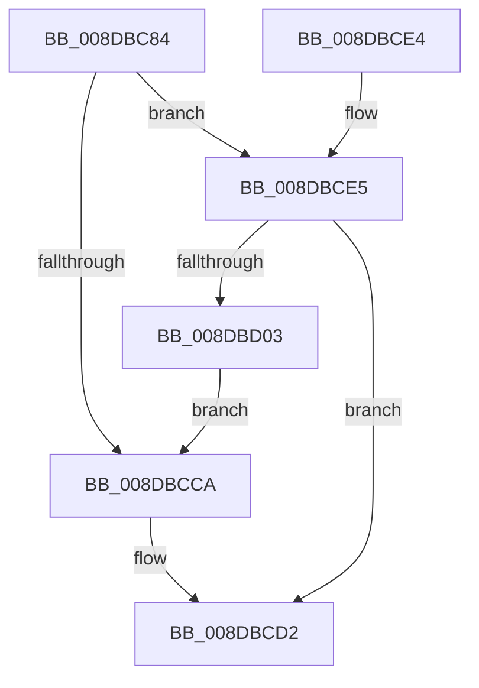

# PiSwInstanceInfoInit

- RVA: `0x008DBC84`–`0x008DBD05` (길이 `129` bytes)
- VA: `0x00000001408DBC84`
- 실행 섹션: `PAGE`
- PDB 이름 있음: `예`; PDB Function 태그: `아니요`
- unwind 정보 RVA: `0x00085864`
- 디코드: `37`개 명령, `129/129` bytes 표시
- 미해석 바이트: `0` (있으면 어셈블리에 `.byte`로 보존)

> 이 문서는 커널 이미지의 기계어와 PDB 기호를 분석해 생성했습니다. 4번과 5번은 함수 원형과 자료형을 바이너리 사용 방식에서 추정한 C 해석이며 원본 소스 복구 결과는 아닙니다.

## 1. Dependencies

- 직접 호출 지점: **3**; 고유 호출 대상: **3**
- 직접 호출자로 확인된 함수: **1**
- RIP 상대 이미지 참조: **1**

### Outgoing calls
- `0x008DBCBF` → [PnpConcatPWSTR](../99/PnpConcatPWSTR_function_00990A00.md) (function, `0x00990A00`)
- `0x008DBCCD` → [PiSwInstanceInfoFree](PiSwInstanceInfoFree_function_008DB0B4.md) (function, `0x008DB0B4`)
- `0x008DBCF8` → [PnpAllocatePWSTR](PnpAllocatePWSTR_function_008DE620.md) (function, `0x008DE620`)

### Direct callers
- [PiSwIrpStartCreateWorker](PiSwIrpStartCreateWorker_function_008DB398.md) at `0x008DB510`

### Static image references
- `0x008DBCA1` → RVA `0x0001C650` (`.rdata`; read)

## 2. Other-region calls and transfers

- 다른 실행 섹션으로 향하는 call: **0**
- 별도 외부 분기/꼬리 이동을 확인하지 못했습니다.

## 3. Assembly (complete function range)

```asm
008DBC84  4C 8B DC                        mov r11, rsp
008DBC87  49 89 5B 08                     mov qword ptr [r11 + 8], rbx
008DBC8B  49 89 73 10                     mov qword ptr [r11 + 0x10], rsi
008DBC8F  57                              push rdi
008DBC90  48 83 EC 30                     sub rsp, 0x30
008DBC94  48 8B 02                        mov rax, qword ptr [rdx]
008DBC97  48 8B F2                        mov rsi, rdx
008DBC9A  49 89 43 F0                     mov qword ptr [r11 - 0x10], rax
008DBC9E  48 8B F9                        mov rdi, rcx
008DBCA1  48 8D 05 A8 09 74 FF            lea rax, [rip - 0x8bf658]
008DBCA8  4C 8B C1                        mov r8, rcx
008DBCAB  41 B9 02 00 00 00               mov r9d, 2
008DBCB1  49 89 43 E8                     mov qword ptr [r11 - 0x18], rax
008DBCB5  BA 50 6E 70 57                  mov edx, 0x57706e50
008DBCBA  B9 C8 00 00 00                  mov ecx, 0xc8
008DBCBF  E8 3C 4D 0B 00                  call 0x140990a00
008DBCC4  8B D8                           mov ebx, eax
008DBCC6  85 C0                           test eax, eax
008DBCC8  79 1B                           jns 0x1408dbce5
008DBCCA  48 8B CF                        mov rcx, rdi
008DBCCD  E8 E2 F3 FF FF                  call 0x1408db0b4
008DBCD2  48 8B 74 24 48                  mov rsi, qword ptr [rsp + 0x48]
008DBCD7  8B C3                           mov eax, ebx
008DBCD9  48 8B 5C 24 40                  mov rbx, qword ptr [rsp + 0x40]
008DBCDE  48 83 C4 30                     add rsp, 0x30
008DBCE2  5F                              pop rdi
008DBCE3  C3                              ret
008DBCE4  CC                              int3
008DBCE5  48 8B 4E 10                     mov rcx, qword ptr [rsi + 0x10]
008DBCE9  4C 8D 4F 08                     lea r9, [rdi + 8]
008DBCED  BA C8 00 00 00                  mov edx, 0xc8
008DBCF2  41 B8 50 6E 70 57               mov r8d, 0x57706e50
008DBCF8  E8 23 29 00 00                  call 0x1408de620
008DBCFD  8B D8                           mov ebx, eax
008DBCFF  85 C0                           test eax, eax
008DBD01  79 CF                           jns 0x1408dbcd2
008DBD03  EB C5                           jmp 0x1408dbcca
```

## 4. C-style interpretation (structured pseudocode)

```c
__int64 __fastcall PiSwInstanceInfoInit(__int64 a1, __int64 a2)
{
    __int64 result;
    __int64 v_rsp;
    unsigned __int64 v_stack_p10;
    unsigned __int64 v_stack_p8;

    *(unsigned __int64 *)(v_rsp + 8) = v_rbx;
    *(unsigned __int64 *)(v_rsp + 16) = v_rsi;
    v_rsp = (v_rsp) - (48);
    *(unsigned __int64 *)(v_rsp - 16) = *(unsigned __int64 *)(a2);
    *(unsigned __int64 *)(v_rsp - 24) = v_rip - 9172568;
    result = PnpConcatPWSTR(200, (unsigned int)(0x57706E50ULL), a1, 2);
    if (!sign_flag) goto loc_008DBCE5;
loc_008DBCCA:
    result = PiSwInstanceInfoFree(a1, (unsigned int)(0x57706E50ULL), a1, 2);
loc_008DBCD2:
    v_rsp = (v_rsp) + (48);
    return (unsigned int)((unsigned int)((unsigned int)((unsigned int)(result))));
loc_008DBCE5:
    result = PnpAllocatePWSTR(*(unsigned __int64 *)(v_stack_p10 + 16), 200, (unsigned int)(0x57706E50ULL), a1 + 8);
    if (!sign_flag) goto loc_008DBCD2;
    goto loc_008DBCCA;
}
```

## 5. (Beta) C Style

```c
int64_t PiSwInstanceInfoInit(void *Arg1, void *Arg2)
{
    uint8_t *arg1 = (uint8_t *)Arg1;
    uint8_t *arg2 = (uint8_t *)Arg2;

    int64_t result;
    int64_t local_rsp;
    uint64_t v_stack_p10;
    uint64_t v_stack_p8;

    *(uint64_t *)(local_rsp + 0x8) = local_rbx;
    *(uint64_t *)(local_rsp + 0x10) = local_rsi;
    local_rsp = (local_rsp) - (48);
    *(uint64_t *)(local_rsp - 0x10) = *(uint64_t *)(arg2);
    *(uint64_t *)(local_rsp - 0x18) = v_rip - 9172568;
    result = PnpConcatPWSTR(200, (uint32_t)(0x57706E50ULL), Arg1, 2);
    if (!sign_flag) goto loc_008DBCE5;
loc_008DBCCA:
    result = PiSwInstanceInfoFree(Arg1, (uint32_t)(0x57706E50ULL), Arg1, 2);
loc_008DBCD2:
    local_rsp = (local_rsp) + (48);
    return (uint32_t)((uint32_t)((uint32_t)((uint32_t)(result))));
loc_008DBCE5:
    result = PnpAllocatePWSTR(*(uint64_t *)(v_stack_p10 + 0x10), 200, (uint32_t)(0x57706E50ULL), Arg1 + 8);
    if (!sign_flag) goto loc_008DBCD2;
    goto loc_008DBCCA;
}
```

### 관측된 메모리 오프셋

구조체 형식이 확인되지 않은 접근은 인자 기준의 오프셋으로만 기록했습니다.

| 기준 인자 | 오프셋 표현 | 폭 (bit) | 접근 |
|---|---:|---:|---|
| `Arg1` | `+ 0x8` | `64` | `R` |
| `Arg2` | `+ 0x0` | `64` | `R` |
| `Arg2` | `+ 0x10` | `64` | `R` |

## 6. Execution-region graph

[열기: 2D/3D 그래프와 함수 탐색 컨트롤 패널](../../../control-panel.html?section=page&rva=0x008DBC84&view=graph)

- 2D 그래프는 위에서 아래로 흐르고, 3D 그래프는 빈 공간을 드래그해 회전합니다. Shift+드래그는 이동, 휠은 확대·축소, 함수 노드 선택은 대상 보고서 이동입니다.

### Static fallback


