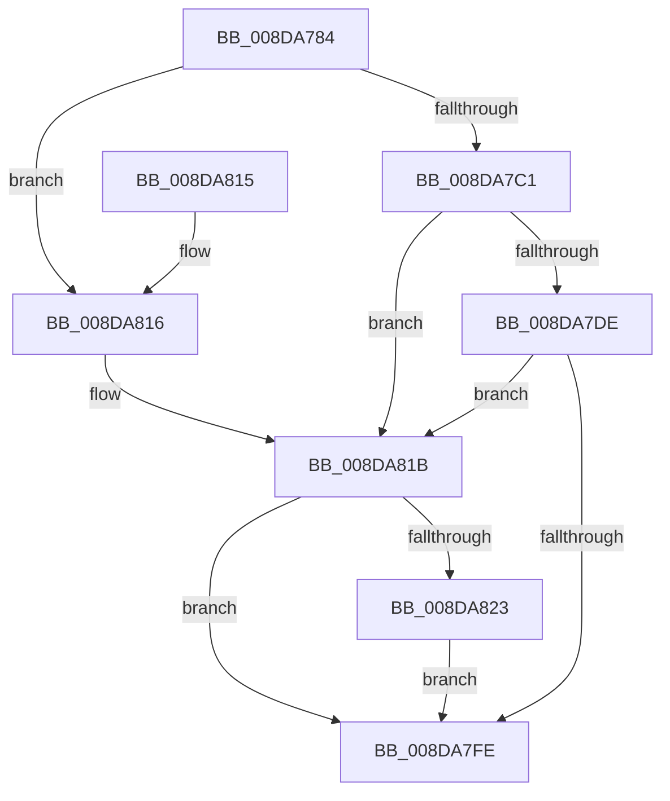

# PiSwInterfaceCreate

- RVA: `0x008DA784`–`0x008DA82E` (길이 `170` bytes)
- VA: `0x00000001408DA784`
- 실행 섹션: `PAGE`
- PDB 이름 있음: `예`; PDB Function 태그: `아니요`
- unwind 정보 RVA: `0x00085770`
- 디코드: `49`개 명령, `170/170` bytes 표시
- 미해석 바이트: `0` (있으면 어셈블리에 `.byte`로 보존)

> 이 문서는 커널 이미지의 기계어와 PDB 기호를 분석해 생성했습니다. 4번과 5번은 함수 원형과 자료형을 바이너리 사용 방식에서 추정한 C 해석이며 원본 소스 복구 결과는 아닙니다.

## 1. Dependencies

- 직접 호출 지점: **4**; 고유 호출 대상: **4**
- 직접 호출자로 확인된 함수: **2**
- RIP 상대 이미지 참조: **0**

### Outgoing calls
- `0x008DA7B4` → [ExAllocatePool2](../../poolcode/B8/ExAllocatePool2_function_00B820F0.md) (function, `0x00B820F0`)
- `0x008DA7D3` → [PnpAllocatePWSTR](PnpAllocatePWSTR_function_008DE620.md) (function, `0x008DE620`)
- `0x008DA7F3` → [PnpCopyDevPropertyArray](PnpCopyDevPropertyArray_function_008DB0F8.md) (function, `0x008DB0F8`)
- `0x008DA823` → [PiSwInterfaceFree](PiSwInterfaceFree_function_008DB064.md) (function, `0x008DB064`)

### Direct callers
- [PiSwCompleteCreate](PiSwCompleteCreate_function_008DAB90.md) at `0x008DAFEF`
- [PiSwIrpInterfaceRegister](../94/PiSwIrpInterfaceRegister_function_0094F01C.md) at `0x0094F361`

### Static image references
- 디코드된 RIP-relative 메모리 참조가 없습니다.

## 2. Other-region calls and transfers

- 다른 실행 섹션으로 향하는 call: **1**
  - `0x008DA7B4` → [ExAllocatePool2](../../poolcode/B8/ExAllocatePool2_function_00B820F0.md) (`PAGE` → `POOLCODE`)
- 별도 외부 분기/꼬리 이동을 확인하지 못했습니다.

## 3. Assembly (complete function range)

```asm
008DA784  48 89 5C 24 08                  mov qword ptr [rsp + 8], rbx
008DA789  48 89 6C 24 10                  mov qword ptr [rsp + 0x10], rbp
008DA78E  48 89 74 24 18                  mov qword ptr [rsp + 0x18], rsi
008DA793  57                              push rdi
008DA794  48 83 EC 30                     sub rsp, 0x30
008DA798  41 8B F0                        mov esi, r8d
008DA79B  48 8B EA                        mov rbp, rdx
008DA79E  48 8B D9                        mov rbx, rcx
008DA7A1  BA 28 00 00 00                  mov edx, 0x28
008DA7A6  B9 00 01 00 00                  mov ecx, 0x100
008DA7AB  41 B8 50 6E 70 57               mov r8d, 0x57706e50
008DA7B1  49 8B F9                        mov rdi, r9
008DA7B4  E8 37 79 2A 00                  call 0x140b820f0
008DA7B9  48 89 07                        mov qword ptr [rdi], rax
008DA7BC  48 85 C0                        test rax, rax
008DA7BF  74 55                           je 0x1408da816
008DA7C1  4C 8D 48 10                     lea r9, [rax + 0x10]
008DA7C5  BA FF FF FF 7F                  mov edx, 0x7fffffff
008DA7CA  41 B8 50 6E 70 57               mov r8d, 0x57706e50
008DA7D0  48 8B CB                        mov rcx, rbx
008DA7D3  E8 48 3E 00 00                  call 0x1408de620
008DA7D8  8B D8                           mov ebx, eax
008DA7DA  85 C0                           test eax, eax
008DA7DC  78 3D                           js 0x1408da81b
008DA7DE  4C 8B 0F                        mov r9, qword ptr [rdi]
008DA7E1  48 8B D5                        mov rdx, rbp
008DA7E4  8B CE                           mov ecx, esi
008DA7E6  49 8D 41 18                     lea rax, [r9 + 0x18]
008DA7EA  49 83 C1 20                     add r9, 0x20
008DA7EE  48 89 44 24 20                  mov qword ptr [rsp + 0x20], rax
008DA7F3  E8 00 09 00 00                  call 0x1408db0f8
008DA7F8  8B D8                           mov ebx, eax
008DA7FA  85 C0                           test eax, eax
008DA7FC  78 1D                           js 0x1408da81b
008DA7FE  48 8B 6C 24 48                  mov rbp, qword ptr [rsp + 0x48]
008DA803  8B C3                           mov eax, ebx
008DA805  48 8B 5C 24 40                  mov rbx, qword ptr [rsp + 0x40]
008DA80A  48 8B 74 24 50                  mov rsi, qword ptr [rsp + 0x50]
008DA80F  48 83 C4 30                     add rsp, 0x30
008DA813  5F                              pop rdi
008DA814  C3                              ret
008DA815  CC                              int3
008DA816  BB 9A 00 00 C0                  mov ebx, 0xc000009a
008DA81B  48 8B 0F                        mov rcx, qword ptr [rdi]
008DA81E  48 85 C9                        test rcx, rcx
008DA821  74 DB                           je 0x1408da7fe
008DA823  E8 3C 08 00 00                  call 0x1408db064
008DA828  48 83 27 00                     and qword ptr [rdi], 0
008DA82C  EB D0                           jmp 0x1408da7fe
```

## 4. C-style interpretation (structured pseudocode)

```c
__int64 __fastcall PiSwInterfaceCreate(__int64 a1, __int64 a2, int a3, __int64 a4)
{
    __int64 result;
    __int64 v_rsp;
    unsigned __int64 v_stack_m18;
    unsigned __int64 v_stack_p10;
    unsigned __int64 v_stack_p18;
    unsigned __int64 v_stack_p8;

    v_stack_p8 = v_rbx;
    v_stack_p10 = v_rbp;
    v_stack_p18 = v_rsi;
    v_rsp = (v_rsp) - (48);
    result = ExAllocatePool2(256, 40, (unsigned int)(0x57706E50ULL), a4);
    *(unsigned __int64 *)(a4) = result;
    if (result == 0) goto loc_008DA816;
    result = PnpAllocatePWSTR(a1, (unsigned int)(0x7FFFFFFFULL), (unsigned int)(0x57706E50ULL), result + 16);
    if (sign_flag) goto loc_008DA81B;
    a4 = (*(unsigned __int64 *)(a4)) + (32);
    v_stack_m18 = *(unsigned __int64 *)(a4) + 24;
    result = PnpCopyDevPropertyArray((unsigned int)((unsigned int)((unsigned int)(a3))), a2, (unsigned int)(0x57706E50ULL), a4);
    if (sign_flag) goto loc_008DA81B;
loc_008DA7FE:
    v_rsp = (v_rsp) + (48);
    return (unsigned int)((unsigned int)((unsigned int)((unsigned int)(result))));
loc_008DA816:
loc_008DA81B:
    if (*(unsigned __int64 *)(a4) == 0) goto loc_008DA7FE;
    result = PiSwInterfaceFree(*(unsigned __int64 *)(a4), a2, (unsigned int)(0x57706E50ULL), a4);
    goto loc_008DA7FE;
}
```

## 5. (Beta) C Style

```c
int64_t PiSwInterfaceCreate(int64_t Arg1, int64_t Arg2, int32_t Arg3, void *Arg4)
{
    uint8_t *arg4 = (uint8_t *)Arg4;

    int64_t result;
    int64_t local_rsp;
    uint64_t v_stack_m18;
    uint64_t v_stack_p10;
    uint64_t v_stack_p18;
    uint64_t v_stack_p8;

    v_stack_p8 = local_rbx;
    v_stack_p10 = local_rbp;
    v_stack_p18 = local_rsi;
    local_rsp = (local_rsp) - (48);
    result = ExAllocatePool2(256, 40, (uint32_t)(0x57706E50ULL), Arg4);
    *(uint64_t *)(arg4) = result;
    if (result == 0) goto loc_008DA816;
    result = PnpAllocatePWSTR(Arg1, (uint32_t)(0x7FFFFFFFULL), (uint32_t)(0x57706E50ULL), result + 16);
    if (sign_flag) goto loc_008DA81B;
    Arg4 = (*(uint64_t *)(arg4)) + (32);
    v_stack_m18 = *(uint64_t *)(arg4) + 24;
    result = PnpCopyDevPropertyArray((uint32_t)((uint32_t)((uint32_t)(Arg3))), Arg2, (uint32_t)(0x57706E50ULL), Arg4);
    if (sign_flag) goto loc_008DA81B;
loc_008DA7FE:
    local_rsp = (local_rsp) + (48);
    return (uint32_t)((uint32_t)((uint32_t)((uint32_t)(result))));
loc_008DA816:
loc_008DA81B:
    if (*(uint64_t *)(arg4) == 0) goto loc_008DA7FE;
    result = PiSwInterfaceFree(*(uint64_t *)(arg4), Arg2, (uint32_t)(0x57706E50ULL), Arg4);
    goto loc_008DA7FE;
}
```

### 관측된 메모리 오프셋

구조체 형식이 확인되지 않은 접근은 인자 기준의 오프셋으로만 기록했습니다.

| 기준 인자 | 오프셋 표현 | 폭 (bit) | 접근 |
|---|---:|---:|---|
| `Arg4` | `+ 0x0` | `64` | `R` |
| `Arg4` | `+ 0x0` | `64` | `R/W` |
| `Arg4` | `+ 0x0` | `64` | `W` |

## 6. Execution-region graph

[열기: 2D/3D 그래프와 함수 탐색 컨트롤 패널](../../../control-panel.html?section=page&rva=0x008DA784&view=graph)

- 2D 그래프는 위에서 아래로 흐르고, 3D 그래프는 빈 공간을 드래그해 회전합니다. Shift+드래그는 이동, 휠은 확대·축소, 함수 노드 선택은 대상 보고서 이동입니다.

### Static fallback


