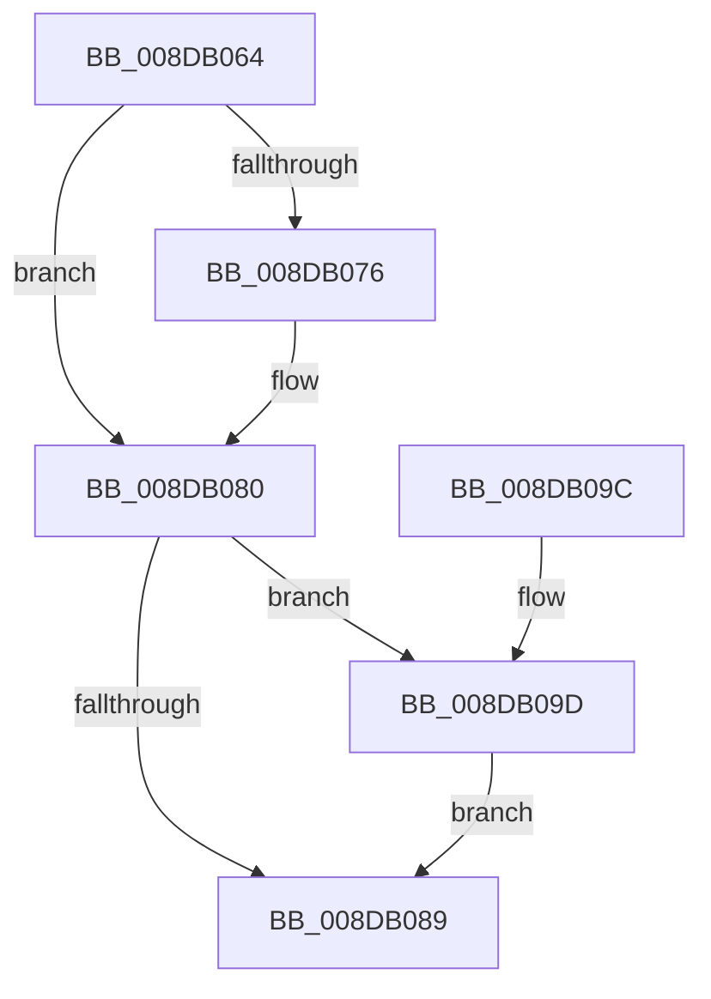

# PiSwInterfaceFree

- RVA: `0x008DB064`–`0x008DB0AD` (길이 `73` bytes)
- VA: `0x00000001408DB064`
- 실행 섹션: `PAGE`
- PDB 이름 있음: `예`; PDB Function 태그: `아니요`
- unwind 정보 RVA: `0x00070B1C`
- 디코드: `22`개 명령, `73/73` bytes 표시
- 미해석 바이트: `0` (있으면 어셈블리에 `.byte`로 보존)

> 이 문서는 커널 이미지의 기계어와 PDB 기호를 분석해 생성했습니다. 4번과 5번은 함수 원형과 자료형을 바이너리 사용 방식에서 추정한 C 해석이며 원본 소스 복구 결과는 아닙니다.

## 1. Dependencies

- 직접 호출 지점: **3**; 고유 호출 대상: **2**
- 직접 호출자로 확인된 함수: **4**
- RIP 상대 이미지 참조: **0**

### Outgoing calls
- `0x008DB07B` → [ExFreePoolWithTag](../../poolcode/B8/ExFreePoolWithTag_function_00B82870.md) (function, `0x00B82870`)
- `0x008DB091` → [ExFreePoolWithTag](../../poolcode/B8/ExFreePoolWithTag_function_00B82870.md) (function, `0x00B82870`)
- `0x008DB0A6` → [PnpFreeDevPropertyArray](PnpFreeDevPropertyArray_function_008DE78C.md) (function, `0x008DE78C`)

### Direct callers
- [PiSwInterfaceCreate](PiSwInterfaceCreate_function_008DA784.md) at `0x008DA823`
- [PiSwFreeInterfaceList](PiSwFreeInterfaceList_function_008DAB4C.md) at `0x008DAB73`
- [PiSwCompleteCreate](PiSwCompleteCreate_function_008DAB90.md) at `0x008DADD3`
- [PiSwIrpInterfaceRegister](../94/PiSwIrpInterfaceRegister_function_0094F01C.md) at `0x0094F42F`

### Static image references
- 디코드된 RIP-relative 메모리 참조가 없습니다.

## 2. Other-region calls and transfers

- 다른 실행 섹션으로 향하는 call: **2**
  - `0x008DB07B` → [ExFreePoolWithTag](../../poolcode/B8/ExFreePoolWithTag_function_00B82870.md) (`PAGE` → `POOLCODE`)
  - `0x008DB091` → [ExFreePoolWithTag](../../poolcode/B8/ExFreePoolWithTag_function_00B82870.md) (`PAGE` → `POOLCODE`)
- 별도 외부 분기/꼬리 이동을 확인하지 못했습니다.

## 3. Assembly (complete function range)

```asm
008DB064  40 53                           push rbx
008DB066  48 83 EC 20                     sub rsp, 0x20
008DB06A  48 8B D9                        mov rbx, rcx
008DB06D  48 8B 49 10                     mov rcx, qword ptr [rcx + 0x10]
008DB071  48 85 C9                        test rcx, rcx
008DB074  74 0A                           je 0x1408db080
008DB076  BA 50 6E 70 57                  mov edx, 0x57706e50
008DB07B  E8 F0 77 2A 00                  call 0x140b82870
008DB080  48 8B 53 18                     mov rdx, qword ptr [rbx + 0x18]
008DB084  48 85 D2                        test rdx, rdx
008DB087  75 14                           jne 0x1408db09d
008DB089  BA 50 6E 70 57                  mov edx, 0x57706e50
008DB08E  48 8B CB                        mov rcx, rbx
008DB091  E8 DA 77 2A 00                  call 0x140b82870
008DB096  48 83 C4 20                     add rsp, 0x20
008DB09A  5B                              pop rbx
008DB09B  C3                              ret
008DB09C  CC                              int3
008DB09D  8B 4B 20                        mov ecx, dword ptr [rbx + 0x20]
008DB0A0  41 B8 50 6E 70 57               mov r8d, 0x57706e50
008DB0A6  E8 E1 36 00 00                  call 0x1408de78c
008DB0AB  EB DC                           jmp 0x1408db089
```

## 4. C-style interpretation (structured pseudocode)

```c
__int64 __fastcall PiSwInterfaceFree(__int64 a1)
{
    __int64 result;
    __int64 v_rsp;

    v_rsp = (v_rsp) - (32);
    if (*(unsigned __int64 *)(a1 + 16) != 0) {
        a2 = 0x57706E50ULL;
        result = ExFreePoolWithTag(*(unsigned __int64 *)(a1 + 16), a2, a3, a4);
    }
    if (*(unsigned __int64 *)(a1 + 24) != 0) goto loc_008DB09D;
loc_008DB089:
    result = ExFreePoolWithTag(a1, (unsigned int)(0x57706E50ULL), a3, a4);
    v_rsp = (v_rsp) + (32);
    return result;
loc_008DB09D:
    result = PnpFreeDevPropertyArray((unsigned int)(*(unsigned int *)(a1 + 32)), (unsigned int)(0x57706E50ULL), (unsigned int)(0x57706E50ULL), a4);
    goto loc_008DB089;
}
```

## 5. (Beta) C Style

```c
int64_t PiSwInterfaceFree(void *Arg1)
{
    uint8_t *arg1 = (uint8_t *)Arg1;

    int64_t result;
    int64_t local_rsp;

    local_rsp = (local_rsp) - (32);
    if (*(uint64_t *)(arg1 + 0x10) != 0) {
        a2 = 0x57706E50ULL;
        result = ExFreePoolWithTag(*(uint64_t *)(arg1 + 0x10), a2, a3, a4);
    }
    if (*(uint64_t *)(arg1 + 0x18) != 0) goto loc_008DB09D;
loc_008DB089:
    result = ExFreePoolWithTag(Arg1, (uint32_t)(0x57706E50ULL), a3, a4);
    local_rsp = (local_rsp) + (32);
    return result;
loc_008DB09D:
    result = PnpFreeDevPropertyArray((uint32_t)(*(uint32_t *)(arg1 + 0x20)), (uint32_t)(0x57706E50ULL), (uint32_t)(0x57706E50ULL), a4);
    goto loc_008DB089;
}
```

### 관측된 메모리 오프셋

구조체 형식이 확인되지 않은 접근은 인자 기준의 오프셋으로만 기록했습니다.

| 기준 인자 | 오프셋 표현 | 폭 (bit) | 접근 |
|---|---:|---:|---|
| `Arg1` | `+ 0x10` | `64` | `R` |
| `Arg1` | `+ 0x18` | `64` | `R` |
| `Arg1` | `+ 0x20` | `32` | `R` |

## 6. Execution-region graph

[열기: 2D/3D 그래프와 함수 탐색 컨트롤 패널](../../../control-panel.html?section=page&rva=0x008DB064&view=graph)

- 2D 그래프는 위에서 아래로 흐르고, 3D 그래프는 빈 공간을 드래그해 회전합니다. Shift+드래그는 이동, 휠은 확대·축소, 함수 노드 선택은 대상 보고서 이동입니다.

### Static fallback


