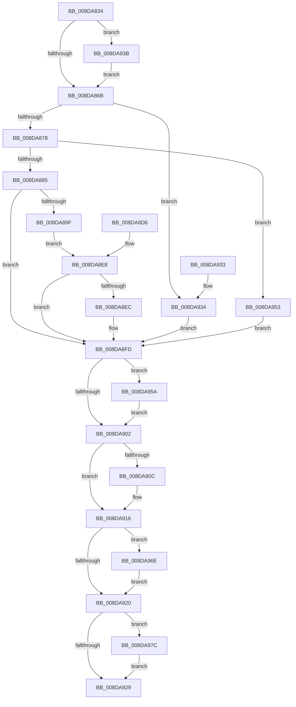

# PiSwIrpStartCreate

- RVA: `0x008DA834`–`0x008DA98D` (길이 `345` bytes)
- VA: `0x00000001408DA834`
- 실행 섹션: `PAGE`
- PDB 이름 있음: `예`; PDB Function 태그: `아니요`
- unwind 정보 RVA: `0x00085788`
- 디코드: `86`개 명령, `345/345` bytes 표시
- 미해석 바이트: `0` (있으면 어셈블리에 `.byte`로 보존)

> 이 문서는 커널 이미지의 기계어와 PDB 기호를 분석해 생성했습니다. 4번과 5번은 함수 원형과 자료형을 바이너리 사용 방식에서 추정한 C 해석이며 원본 소스 복구 결과는 아닙니다.

## 1. Dependencies

- 직접 호출 지점: **8**; 고유 호출 대상: **8**
- 직접 호출자로 확인된 함수: **1**
- RIP 상대 이미지 참조: **10**

### Outgoing calls
- `0x008DA88D` → `msrpc.sys!MesDecodeBufferHandleCreate` (import, 간접 대상; import `msrpc.sys!MesDecodeBufferHandleCreate`)
- `0x008DA8C8` → `msrpc.sys!NdrMesTypeDecode3` (import, 간접 대상; import `msrpc.sys!NdrMesTypeDecode3`)
- `0x008DA8F4` → [PiSwIrpStartCreateWorker](PiSwIrpStartCreateWorker_function_008DB398.md) (function, `0x008DB398`)
- `0x008DA911` → [ExFreePoolWithTag](../../poolcode/B8/ExFreePoolWithTag_function_00B82870.md) (function, `0x00B82870`)
- `0x008DA949` → [McTemplateK0_EtwWriteTransfer](../../text/59/McTemplateK0_EtwWriteTransfer_function_00596B24.md) (function, `0x00596B24`)
- `0x008DA967` → [IofCompleteRequest](../../text/29/IofCompleteRequest_function_0029B5C0.md) (function, `0x0029B5C0`)
- `0x008DA96E` → `msrpc.sys!MesHandleFree` (import, 간접 대상; import `msrpc.sys!MesHandleFree`)
- `0x008DA986` → [McTemplateK0d_EtwWriteTransfer](../../text/42/McTemplateK0d_EtwWriteTransfer_function_00423380.md) (function, `0x00423380`)

### Direct callers
- [PiSwDispatch](../73/PiSwDispatch_function_0073AA90.md) at `0x0073AB7A`

### Static image references
- `0x008DA85E` → RVA `0x00EF012C` (`.data`; read)
- `0x008DA88D` → RVA `0x00151700` (`msrpc.sys!MesDecodeBufferHandleCreate (IAT)`; read)
- `0x008DA8AE` → RVA `0x00E07010` (`.data`; read)
- `0x008DA8B5` → RVA `0x00B4B210` (`PAGE`; read)
- `0x008DA8BC` → RVA `0x00B4B1A0` (`PAGE`; read)
- `0x008DA8C8` → RVA `0x001516F8` (`msrpc.sys!NdrMesTypeDecode3 (IAT)`; read)
- `0x008DA93B` → RVA `0x000271C0` (`.rdata`; read)
- `0x008DA942` → RVA `0x00E06DA0` (`.data`; read)
- `0x008DA96E` → RVA `0x001516E0` (`msrpc.sys!MesHandleFree (IAT)`; read)
- `0x008DA97F` → RVA `0x00026EA0` (`.rdata`; read)

## 2. Other-region calls and transfers

- 다른 실행 섹션으로 향하는 call: **4**
  - `0x008DA911` → [ExFreePoolWithTag](../../poolcode/B8/ExFreePoolWithTag_function_00B82870.md) (`PAGE` → `POOLCODE`)
  - `0x008DA949` → [McTemplateK0_EtwWriteTransfer](../../text/59/McTemplateK0_EtwWriteTransfer_function_00596B24.md) (`PAGE` → `.text`)
  - `0x008DA967` → [IofCompleteRequest](../../text/29/IofCompleteRequest_function_0029B5C0.md) (`PAGE` → `.text`)
  - `0x008DA986` → [McTemplateK0d_EtwWriteTransfer](../../text/42/McTemplateK0d_EtwWriteTransfer_function_00423380.md) (`PAGE` → `.text`)
- 별도 외부 분기/꼬리 이동을 확인하지 못했습니다.

## 3. Assembly (complete function range)

```asm
008DA834  48 89 4C 24 08                  mov qword ptr [rsp + 8], rcx
008DA839  53                              push rbx
008DA83A  56                              push rsi
008DA83B  57                              push rdi
008DA83C  48 83 EC 30                     sub rsp, 0x30
008DA840  48 8B F1                        mov rsi, rcx
008DA843  48 8B 99 B8 00 00 00            mov rbx, qword ptr [rcx + 0xb8]
008DA84A  48 83 64 24 60 00               and qword ptr [rsp + 0x60], 0
008DA850  48 83 64 24 58 00               and qword ptr [rsp + 0x58], 0
008DA856  48 8B F9                        mov rdi, rcx
008DA859  48 89 4C 24 68                  mov qword ptr [rsp + 0x68], rcx
008DA85E  F6 05 C7 58 61 00 40            test byte ptr [rip + 0x6158c7], 0x40
008DA865  0F 85 D0 00 00 00               jne 0x1408da93b
008DA86B  48 8B 4E 18                     mov rcx, qword ptr [rsi + 0x18]
008DA86F  48 85 C9                        test rcx, rcx
008DA872  0F 84 BC 00 00 00               je 0x1408da934
008DA878  81 7B 08 C8 00 00 00            cmp dword ptr [rbx + 8], 0xc8
008DA87F  0F 82 CE 00 00 00               jb 0x1408da953
008DA885  4C 8D 44 24 60                  lea r8, [rsp + 0x60]
008DA88A  8B 53 10                        mov edx, dword ptr [rbx + 0x10]
008DA88D  48 FF 15 6C 6E 87 FF            call qword ptr [rip - 0x789194]
008DA894  0F 1F 44 00 00                  nop dword ptr [rax + rax]
008DA899  8B D8                           mov ebx, eax
008DA89B  85 C0                           test eax, eax
008DA89D  78 5E                           js 0x1408da8fd
008DA89F  48 8D 44 24 58                  lea rax, [rsp + 0x58]
008DA8A4  48 89 44 24 28                  mov qword ptr [rsp + 0x28], rax
008DA8A9  83 64 24 20 00                  and dword ptr [rsp + 0x20], 0
008DA8AE  4C 8D 0D 5B C7 52 00            lea r9, [rip + 0x52c75b]
008DA8B5  4C 8D 05 54 09 27 00            lea r8, [rip + 0x270954]
008DA8BC  48 8D 15 DD 08 27 00            lea rdx, [rip + 0x2708dd]
008DA8C3  48 8B 4C 24 60                  mov rcx, qword ptr [rsp + 0x60]
008DA8C8  48 FF 15 29 6E 87 FF            call qword ptr [rip - 0x7891d7]
008DA8CF  0F 1F 44 00 00                  nop dword ptr [rax + rax]
008DA8D4  EB 12                           jmp 0x1408da8e8
008DA8D6  8B D8                           mov ebx, eax
008DA8D8  48 83 64 24 58 00               and qword ptr [rsp + 0x58], 0
008DA8DE  48 8B 74 24 50                  mov rsi, qword ptr [rsp + 0x50]
008DA8E3  48 8B 7C 24 68                  mov rdi, qword ptr [rsp + 0x68]
008DA8E8  85 DB                           test ebx, ebx
008DA8EA  78 11                           js 0x1408da8fd
008DA8EC  48 8B D6                        mov rdx, rsi
008DA8EF  48 8B 4C 24 58                  mov rcx, qword ptr [rsp + 0x58]
008DA8F4  E8 9F 0A 00 00                  call 0x1408db398
008DA8F9  8B D8                           mov ebx, eax
008DA8FB  33 FF                           xor edi, edi
008DA8FD  48 85 FF                        test rdi, rdi
008DA900  75 58                           jne 0x1408da95a
008DA902  48 8B 4C 24 58                  mov rcx, qword ptr [rsp + 0x58]
008DA907  48 85 C9                        test rcx, rcx
008DA90A  74 0A                           je 0x1408da916
008DA90C  BA 6B 72 70 63                  mov edx, 0x6370726b
008DA911  E8 5A 7F 2A 00                  call 0x140b82870
008DA916  48 8B 4C 24 60                  mov rcx, qword ptr [rsp + 0x60]
008DA91B  48 85 C9                        test rcx, rcx
008DA91E  75 4E                           jne 0x1408da96e
008DA920  F6 05 05 58 61 00 40            test byte ptr [rip + 0x615805], 0x40
008DA927  75 53                           jne 0x1408da97c
008DA929  8B C3                           mov eax, ebx
008DA92B  48 83 C4 30                     add rsp, 0x30
008DA92F  5F                              pop rdi
008DA930  5E                              pop rsi
008DA931  5B                              pop rbx
008DA932  C3                              ret
008DA933  CC                              int3
008DA934  BB 0D 00 00 C0                  mov ebx, 0xc000000d
008DA939  EB C2                           jmp 0x1408da8fd
008DA93B  48 8D 15 7E C8 74 FF            lea rdx, [rip - 0x8b3782]
008DA942  48 8D 0D 57 C4 52 00            lea rcx, [rip + 0x52c457]
008DA949  E8 D6 C1 CB FF                  call 0x140596b24
008DA94E  E9 18 FF FF FF                  jmp 0x1408da86b
008DA953  BB 23 00 00 C0                  mov ebx, 0xc0000023
008DA958  EB A3                           jmp 0x1408da8fd
008DA95A  89 5F 30                        mov dword ptr [rdi + 0x30], ebx
008DA95D  48 83 67 38 00                  and qword ptr [rdi + 0x38], 0
008DA962  33 D2                           xor edx, edx
008DA964  48 8B CF                        mov rcx, rdi
008DA967  E8 54 0C 9C FF                  call 0x14029b5c0
008DA96C  EB 94                           jmp 0x1408da902
008DA96E  48 FF 15 6B 6D 87 FF            call qword ptr [rip - 0x789295]
008DA975  0F 1F 44 00 00                  nop dword ptr [rax + rax]
008DA97A  EB A4                           jmp 0x1408da920
008DA97C  44 8B CB                        mov r9d, ebx
008DA97F  48 8D 15 1A C5 74 FF            lea rdx, [rip - 0x8b3ae6]
008DA986  E8 F5 89 B4 FF                  call 0x140423380
008DA98B  EB 9C                           jmp 0x1408da929
```

## 4. C-style interpretation (structured pseudocode)

```c
__int64 __fastcall PiSwIrpStartCreate(__int64 a1)
{
    __int64 result;
    __int64 v_rbx;
    __int64 v_rdi;
    __int64 v_rsp;
    unsigned __int64 v_stack_m20;
    unsigned int v_stack_m28;
    unsigned __int64 v_stack_p10;
    unsigned __int64 v_stack_p18;
    unsigned __int64 v_stack_p20;
    unsigned __int64 v_stack_p8;

    v_stack_p8 = a1;
    v_rsp = (v_rsp) - (48);
    v_stack_p20 = a1;
    if (((*(unsigned __int8 *)(v_rip + 6379719)) & (64)) != 0) goto loc_008DA93B;
loc_008DA86B:
    if (*(unsigned __int64 *)(a1 + 24) == 0) goto loc_008DA934;
    if ((*(unsigned int *)(*(unsigned __int64 *)(a1 + 184) + 8)) < 200) goto loc_008DA953;
    result = msrpc_sys_MesDecodeBufferHandleCreate(*(unsigned __int64 *)(a1 + 24), (unsigned int)(*(unsigned int *)(*(unsigned __int64 *)(a1 + 184) + 16)), v_stack_p18, a4);
    if (sign_flag) goto loc_008DA8FD;
    v_stack_m20 = v_stack_p10;
    result = msrpc_sys_NdrMesTypeDecode3(v_stack_p18, v_rip + 2558173, v_rip + 2558292, v_rip + 5424987);
    goto loc_008DA8E8;
loc_008DA8E8:
    v_rbx = (unsigned int)((unsigned int)(result));
    v_rdi = a1;
    if (!(sign_flag)) {
        a2 = a1;
        a1 = v_stack_p10;
        result = PiSwIrpStartCreateWorker(a1, a2, v_rip + 2558292, v_rip + 5424987);
        v_rbx = (unsigned int)(result);
        v_rdi = 0;
    }
    if (0 != 0) goto loc_008DA95A;
loc_008DA902:
    if (v_stack_p10 != 0) {
        a2 = 0x6370726BULL;
        result = ExFreePoolWithTag(v_stack_p10, a2, v_rip + 2558292, v_rip + 5424987);
    }
    if (v_stack_p18 != 0) goto loc_008DA96E;
loc_008DA920:
    if (((*(unsigned __int8 *)(v_rip + 6379525)) & (64)) != 0) goto loc_008DA97C;
loc_008DA929:
    v_rsp = (v_rsp) + (48);
    return (unsigned int)((unsigned int)(v_rbx));
loc_008DA934:
    goto loc_008DA8FD;
loc_008DA93B:
    result = McTemplateK0_EtwWriteTransfer(v_rip + 5424215, v_rip - 9123714, v_rip + 2558292, v_rip + 5424987);
    goto loc_008DA86B;
loc_008DA953:
    goto loc_008DA8FD;
loc_008DA95A:
    *(unsigned int *)(v_rdi + 48) = (unsigned int)((unsigned int)(0xC0000023ULL));
    a2 = 0;
    result = IofCompleteRequest(0, a2, v_rip + 2558292, v_rip + 5424987);
    goto loc_008DA902;
loc_008DA96E:
    result = msrpc_sys_MesHandleFree(0, a2, v_rip + 2558292, v_rip + 5424987);
    goto loc_008DA920;
loc_008DA97C:
    result = McTemplateK0d_EtwWriteTransfer(0, v_rip - 9124582, v_rip + 2558292, (unsigned int)((unsigned int)((unsigned int)(0xC0000023ULL))));
    goto loc_008DA929;
}
```

## 5. (Beta) C Style

```c
int64_t PiSwIrpStartCreate(void *Arg1)
{
    uint8_t *arg1 = (uint8_t *)Arg1;

    int64_t result;
    int64_t local_rbx;
    int64_t local_rdi;
    int64_t local_rsp;
    uint64_t v_stack_m20;
    uint32_t v_stack_m28;
    uint64_t v_stack_p10;
    uint64_t v_stack_p18;
    uint64_t v_stack_p20;
    uint64_t v_stack_p8;

    v_stack_p8 = Arg1;
    local_rsp = (local_rsp) - (48);
    v_stack_p20 = Arg1;
    if (((*(uint8_t *)(v_rip + 0x6158C7)) & (64)) != 0) goto loc_008DA93B;
loc_008DA86B:
    if (*(uint64_t *)(arg1 + 0x18) == 0) goto loc_008DA934;
    if ((*(uint32_t *)(*(uint64_t *)(arg1 + 0xB8) + 0x8)) < 200) goto loc_008DA953;
    result = kernel_indirect_call(*(uint64_t *)(arg1 + 0x18), (uint32_t)(*(uint32_t *)(*(uint64_t *)(arg1 + 0xB8) + 0x10)), v_stack_p18, a4);
    if (sign_flag) goto loc_008DA8FD;
    v_stack_m20 = v_stack_p10;
    result = kernel_indirect_call(v_stack_p18, v_rip + 2558173, v_rip + 2558292, v_rip + 5424987);
    goto loc_008DA8E8;
loc_008DA8E8:
    local_rbx = (uint32_t)((uint32_t)(result));
    local_rdi = Arg1;
    if (!(sign_flag)) {
        a2 = Arg1;
        Arg1 = v_stack_p10;
        result = PiSwIrpStartCreateWorker(Arg1, a2, v_rip + 2558292, v_rip + 5424987);
        local_rbx = (uint32_t)(result);
        local_rdi = 0;
    }
    if (0 != 0) goto loc_008DA95A;
loc_008DA902:
    if (v_stack_p10 != 0) {
        a2 = 0x6370726BULL;
        result = ExFreePoolWithTag(v_stack_p10, a2, v_rip + 2558292, v_rip + 5424987);
    }
    if (v_stack_p18 != 0) goto loc_008DA96E;
loc_008DA920:
    if (((*(uint8_t *)(v_rip + 0x615805)) & (64)) != 0) goto loc_008DA97C;
loc_008DA929:
    local_rsp = (local_rsp) + (48);
    return (uint32_t)((uint32_t)(local_rbx));
loc_008DA934:
    goto loc_008DA8FD;
loc_008DA93B:
    result = McTemplateK0_EtwWriteTransfer(v_rip + 5424215, v_rip - 9123714, v_rip + 2558292, v_rip + 5424987);
    goto loc_008DA86B;
loc_008DA953:
    goto loc_008DA8FD;
loc_008DA95A:
    *(uint32_t *)(local_rdi + 0x30) = (uint32_t)((uint32_t)(0xC0000023ULL));
    a2 = 0;
    result = IofCompleteRequest(0, a2, v_rip + 2558292, v_rip + 5424987);
    goto loc_008DA902;
loc_008DA96E:
    result = kernel_indirect_call(0, a2, v_rip + 2558292, v_rip + 5424987);
    goto loc_008DA920;
loc_008DA97C:
    result = McTemplateK0d_EtwWriteTransfer(0, v_rip - 9124582, v_rip + 2558292, (uint32_t)((uint32_t)((uint32_t)(0xC0000023ULL))));
    goto loc_008DA929;
}
```

### 관측된 메모리 오프셋

구조체 형식이 확인되지 않은 접근은 인자 기준의 오프셋으로만 기록했습니다.

| 기준 인자 | 오프셋 표현 | 폭 (bit) | 접근 |
|---|---:|---:|---|
| `Arg1` | `+ 0x18` | `64` | `R` |
| `Arg1` | `+ 0xB8` | `64` | `R` |

## 6. Execution-region graph

[열기: 2D/3D 그래프와 함수 탐색 컨트롤 패널](../../../control-panel.html?section=page&rva=0x008DA834&view=graph)

- 2D 그래프는 위에서 아래로 흐르고, 3D 그래프는 빈 공간을 드래그해 회전합니다. Shift+드래그는 이동, 휠은 확대·축소, 함수 노드 선택은 대상 보고서 이동입니다.

### Static fallback


