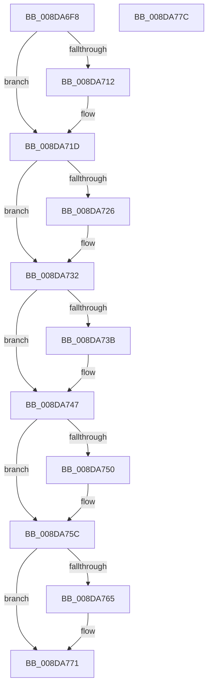

# PiSwPnPInfoFree

- RVA: `0x008DA6F8`–`0x008DA77D` (길이 `133` bytes)
- VA: `0x00000001408DA6F8`
- 실행 섹션: `PAGE`
- PDB 이름 있음: `예`; PDB Function 태그: `아니요`
- unwind 정보 RVA: `0x00085760`
- 디코드: `40`개 명령, `133/133` bytes 표시
- 미해석 바이트: `0` (있으면 어셈블리에 `.byte`로 보존)

> 이 문서는 커널 이미지의 기계어와 PDB 기호를 분석해 생성했습니다. 4번과 5번은 함수 원형과 자료형을 바이너리 사용 방식에서 추정한 C 해석이며 원본 소스 복구 결과는 아닙니다.

## 1. Dependencies

- 직접 호출 지점: **5**; 고유 호출 대상: **1**
- 직접 호출자로 확인된 함수: **4**
- RIP 상대 이미지 참조: **0**

### Outgoing calls
- `0x008DA714` → [ExFreePoolWithTag](../../poolcode/B8/ExFreePoolWithTag_function_00B82870.md) (function, `0x00B82870`)
- `0x008DA728` → [ExFreePoolWithTag](../../poolcode/B8/ExFreePoolWithTag_function_00B82870.md) (function, `0x00B82870`)
- `0x008DA73D` → [ExFreePoolWithTag](../../poolcode/B8/ExFreePoolWithTag_function_00B82870.md) (function, `0x00B82870`)
- `0x008DA752` → [ExFreePoolWithTag](../../poolcode/B8/ExFreePoolWithTag_function_00B82870.md) (function, `0x00B82870`)
- `0x008DA767` → [ExFreePoolWithTag](../../poolcode/B8/ExFreePoolWithTag_function_00B82870.md) (function, `0x00B82870`)

### Direct callers
- [PiSwDeviceFree](PiSwDeviceFree_function_008DA63C.md) at `0x008DA652`
- [PiSwQueuedCreateInfoFree](../94/PiSwQueuedCreateInfoFree_function_0094D92C.md) at `0x0094D94F`
- [PiSwProcessRemove](../94/PiSwProcessRemove_function_0094E3B8.md) at `0x0094E484`
- [sub_00B1C4F6](../B1/Unknown_function_00B1C4F6.md) at `0x00B1C701`

### Static image references
- 디코드된 RIP-relative 메모리 참조가 없습니다.

## 2. Other-region calls and transfers

- 다른 실행 섹션으로 향하는 call: **5**
  - `0x008DA714` → [ExFreePoolWithTag](../../poolcode/B8/ExFreePoolWithTag_function_00B82870.md) (`PAGE` → `POOLCODE`)
  - `0x008DA728` → [ExFreePoolWithTag](../../poolcode/B8/ExFreePoolWithTag_function_00B82870.md) (`PAGE` → `POOLCODE`)
  - `0x008DA73D` → [ExFreePoolWithTag](../../poolcode/B8/ExFreePoolWithTag_function_00B82870.md) (`PAGE` → `POOLCODE`)
  - `0x008DA752` → [ExFreePoolWithTag](../../poolcode/B8/ExFreePoolWithTag_function_00B82870.md) (`PAGE` → `POOLCODE`)
  - `0x008DA767` → [ExFreePoolWithTag](../../poolcode/B8/ExFreePoolWithTag_function_00B82870.md) (`PAGE` → `POOLCODE`)
- 별도 외부 분기/꼬리 이동을 확인하지 못했습니다.

## 3. Assembly (complete function range)

```asm
008DA6F8  48 89 5C 24 08                  mov qword ptr [rsp + 8], rbx
008DA6FD  56                              push rsi
008DA6FE  48 83 EC 20                     sub rsp, 0x20
008DA702  48 8B D9                        mov rbx, rcx
008DA705  BE 50 6E 70 57                  mov esi, 0x57706e50
008DA70A  48 8B 09                        mov rcx, qword ptr [rcx]
008DA70D  48 85 C9                        test rcx, rcx
008DA710  74 0B                           je 0x1408da71d
008DA712  8B D6                           mov edx, esi
008DA714  E8 57 81 2A 00                  call 0x140b82870
008DA719  48 83 23 00                     and qword ptr [rbx], 0
008DA71D  48 8B 4B 08                     mov rcx, qword ptr [rbx + 8]
008DA721  48 85 C9                        test rcx, rcx
008DA724  74 0C                           je 0x1408da732
008DA726  8B D6                           mov edx, esi
008DA728  E8 43 81 2A 00                  call 0x140b82870
008DA72D  48 83 63 08 00                  and qword ptr [rbx + 8], 0
008DA732  48 8B 4B 10                     mov rcx, qword ptr [rbx + 0x10]
008DA736  48 85 C9                        test rcx, rcx
008DA739  74 0C                           je 0x1408da747
008DA73B  8B D6                           mov edx, esi
008DA73D  E8 2E 81 2A 00                  call 0x140b82870
008DA742  48 83 63 10 00                  and qword ptr [rbx + 0x10], 0
008DA747  48 8B 4B 18                     mov rcx, qword ptr [rbx + 0x18]
008DA74B  48 85 C9                        test rcx, rcx
008DA74E  74 0C                           je 0x1408da75c
008DA750  8B D6                           mov edx, esi
008DA752  E8 19 81 2A 00                  call 0x140b82870
008DA757  48 83 63 18 00                  and qword ptr [rbx + 0x18], 0
008DA75C  48 8B 4B 20                     mov rcx, qword ptr [rbx + 0x20]
008DA760  48 85 C9                        test rcx, rcx
008DA763  74 0C                           je 0x1408da771
008DA765  8B D6                           mov edx, esi
008DA767  E8 04 81 2A 00                  call 0x140b82870
008DA76C  48 83 63 20 00                  and qword ptr [rbx + 0x20], 0
008DA771  48 8B 5C 24 30                  mov rbx, qword ptr [rsp + 0x30]
008DA776  48 83 C4 20                     add rsp, 0x20
008DA77A  5E                              pop rsi
008DA77B  C3                              ret
008DA77C  CC                              int3
```

## 4. C-style interpretation (structured pseudocode)

```c
__int64 __fastcall PiSwPnPInfoFree(__int64 a1)
{
    __int64 result;
    __int64 v_rsp;
    unsigned __int64 v_stack_p8;

    v_stack_p8 = v_rbx;
    v_rsp = (v_rsp) - (32);
    if (*(unsigned __int64 *)(a1) != 0) {
        a2 = (unsigned int)((unsigned int)(0x57706E50ULL));
        result = ExFreePoolWithTag(*(unsigned __int64 *)(a1), a2, a3, a4);
    }
    if (*(unsigned __int64 *)(a1 + 8) != 0) {
        a2 = (unsigned int)((unsigned int)(0x57706E50ULL));
        result = ExFreePoolWithTag(*(unsigned __int64 *)(a1 + 8), a2, a3, a4);
    }
    if (*(unsigned __int64 *)(a1 + 16) != 0) {
        a2 = (unsigned int)((unsigned int)(0x57706E50ULL));
        result = ExFreePoolWithTag(*(unsigned __int64 *)(a1 + 16), a2, a3, a4);
    }
    if (*(unsigned __int64 *)(a1 + 24) != 0) {
        a2 = (unsigned int)((unsigned int)(0x57706E50ULL));
        result = ExFreePoolWithTag(*(unsigned __int64 *)(a1 + 24), a2, a3, a4);
    }
    if (*(unsigned __int64 *)(a1 + 32) != 0) {
        a2 = (unsigned int)((unsigned int)(0x57706E50ULL));
        result = ExFreePoolWithTag(*(unsigned __int64 *)(a1 + 32), a2, a3, a4);
    }
    v_rsp = (v_rsp) + (32);
    return result;
}
```

## 5. (Beta) C Style

```c
int64_t PiSwPnPInfoFree(void *Arg1)
{
    uint8_t *arg1 = (uint8_t *)Arg1;

    int64_t result;
    int64_t local_rsp;
    uint64_t v_stack_p8;

    v_stack_p8 = local_rbx;
    local_rsp = (local_rsp) - (32);
    if (*(uint64_t *)(arg1) != 0) {
        a2 = (uint32_t)((uint32_t)(0x57706E50ULL));
        result = ExFreePoolWithTag(*(uint64_t *)(arg1), a2, a3, a4);
    }
    if (*(uint64_t *)(arg1 + 0x8) != 0) {
        a2 = (uint32_t)((uint32_t)(0x57706E50ULL));
        result = ExFreePoolWithTag(*(uint64_t *)(arg1 + 0x8), a2, a3, a4);
    }
    if (*(uint64_t *)(arg1 + 0x10) != 0) {
        a2 = (uint32_t)((uint32_t)(0x57706E50ULL));
        result = ExFreePoolWithTag(*(uint64_t *)(arg1 + 0x10), a2, a3, a4);
    }
    if (*(uint64_t *)(arg1 + 0x18) != 0) {
        a2 = (uint32_t)((uint32_t)(0x57706E50ULL));
        result = ExFreePoolWithTag(*(uint64_t *)(arg1 + 0x18), a2, a3, a4);
    }
    if (*(uint64_t *)(arg1 + 0x20) != 0) {
        a2 = (uint32_t)((uint32_t)(0x57706E50ULL));
        result = ExFreePoolWithTag(*(uint64_t *)(arg1 + 0x20), a2, a3, a4);
    }
    local_rsp = (local_rsp) + (32);
    return result;
}
```

### 관측된 메모리 오프셋

구조체 형식이 확인되지 않은 접근은 인자 기준의 오프셋으로만 기록했습니다.

| 기준 인자 | 오프셋 표현 | 폭 (bit) | 접근 |
|---|---:|---:|---|
| `Arg1` | `+ 0x0` | `64` | `R` |
| `Arg1` | `+ 0x0` | `64` | `R/W` |
| `Arg1` | `+ 0x8` | `64` | `R` |
| `Arg1` | `+ 0x8` | `64` | `R/W` |
| `Arg1` | `+ 0x10` | `64` | `R` |
| `Arg1` | `+ 0x10` | `64` | `R/W` |
| `Arg1` | `+ 0x18` | `64` | `R` |
| `Arg1` | `+ 0x18` | `64` | `R/W` |
| `Arg1` | `+ 0x20` | `64` | `R` |
| `Arg1` | `+ 0x20` | `64` | `R/W` |

## 6. Execution-region graph

[열기: 2D/3D 그래프와 함수 탐색 컨트롤 패널](../../../control-panel.html?section=page&rva=0x008DA6F8&view=graph)

- 2D 그래프는 위에서 아래로 흐르고, 3D 그래프는 빈 공간을 드래그해 회전합니다. Shift+드래그는 이동, 휠은 확대·축소, 함수 노드 선택은 대상 보고서 이동입니다.

### Static fallback


