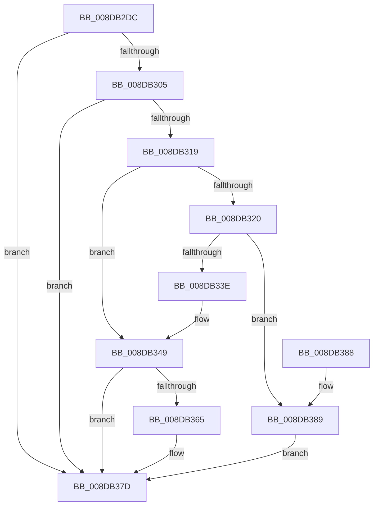

# PiSwPnPInfoInit

- RVA: `0x008DB2DC`–`0x008DB390` (길이 `180` bytes)
- VA: `0x00000001408DB2DC`
- 실행 섹션: `PAGE`
- PDB 이름 있음: `예`; PDB Function 태그: `아니요`
- unwind 정보 RVA: `0x0006CF28`
- 디코드: `50`개 명령, `180/180` bytes 표시
- 미해석 바이트: `0` (있으면 어셈블리에 `.byte`로 보존)

> 이 문서는 커널 이미지의 기계어와 PDB 기호를 분석해 생성했습니다. 4번과 5번은 함수 원형과 자료형을 바이너리 사용 방식에서 추정한 C 해석이며 원본 소스 복구 결과는 아닙니다.

## 1. Dependencies

- 직접 호출 지점: **5**; 고유 호출 대상: **3**
- 직접 호출자로 확인된 함수: **3**
- RIP 상대 이미지 참조: **0**

### Outgoing calls
- `0x008DB2FC` → [PnpAllocateMultiSZ](../94/PnpAllocateMultiSZ_function_0094E2B4.md) (function, `0x0094E2B4`)
- `0x008DB310` → [PnpAllocateMultiSZ](../94/PnpAllocateMultiSZ_function_0094E2B4.md) (function, `0x0094E2B4`)
- `0x008DB330` → [ExAllocatePool2](../../poolcode/B8/ExAllocatePool2_function_00B820F0.md) (function, `0x00B820F0`)
- `0x008DB35C` → [PnpAllocatePWSTR](PnpAllocatePWSTR_function_008DE620.md) (function, `0x008DE620`)
- `0x008DB378` → [PnpAllocatePWSTR](PnpAllocatePWSTR_function_008DE620.md) (function, `0x008DE620`)

### Direct callers
- [PiSwQueuedCreateInfoCreate](../73/PiSwQueuedCreateInfoCreate_function_0073B1BC.md) at `0x0073B223`
- [PiSwIrpStartCreateWorker](PiSwIrpStartCreateWorker_function_008DB398.md) at `0x008DB576`
- [sub_00B1C4F6](../B1/Unknown_function_00B1C4F6.md) at `0x00B1C789`

### Static image references
- 디코드된 RIP-relative 메모리 참조가 없습니다.

## 2. Other-region calls and transfers

- 다른 실행 섹션으로 향하는 call: **1**
  - `0x008DB330` → [ExAllocatePool2](../../poolcode/B8/ExAllocatePool2_function_00B820F0.md) (`PAGE` → `POOLCODE`)
- 별도 외부 분기/꼬리 이동을 확인하지 못했습니다.

## 3. Assembly (complete function range)

```asm
008DB2DC  48 89 5C 24 08                  mov qword ptr [rsp + 8], rbx
008DB2E1  57                              push rdi
008DB2E2  48 83 EC 20                     sub rsp, 0x20
008DB2E6  8B 42 40                        mov eax, dword ptr [rdx + 0x40]
008DB2E9  48 8B DA                        mov rbx, rdx
008DB2EC  89 41 28                        mov dword ptr [rcx + 0x28], eax
008DB2EF  48 8B F9                        mov rdi, rcx
008DB2F2  8B 52 18                        mov edx, dword ptr [rdx + 0x18]
008DB2F5  4C 8B C9                        mov r9, rcx
008DB2F8  48 8B 4B 20                     mov rcx, qword ptr [rbx + 0x20]
008DB2FC  E8 B3 2F 07 00                  call 0x14094e2b4
008DB301  85 C0                           test eax, eax
008DB303  78 78                           js 0x1408db37d
008DB305  8B 53 28                        mov edx, dword ptr [rbx + 0x28]
008DB308  4C 8D 4F 08                     lea r9, [rdi + 8]
008DB30C  48 8B 4B 30                     mov rcx, qword ptr [rbx + 0x30]
008DB310  E8 9F 2F 07 00                  call 0x14094e2b4
008DB315  85 C0                           test eax, eax
008DB317  78 64                           js 0x1408db37d
008DB319  48 83 7B 38 00                  cmp qword ptr [rbx + 0x38], 0
008DB31E  74 29                           je 0x1408db349
008DB320  BA 10 00 00 00                  mov edx, 0x10
008DB325  B9 00 01 00 00                  mov ecx, 0x100
008DB32A  41 B8 50 6E 70 57               mov r8d, 0x57706e50
008DB330  E8 BB 6D 2A 00                  call 0x140b820f0
008DB335  48 89 47 10                     mov qword ptr [rdi + 0x10], rax
008DB339  48 85 C0                        test rax, rax
008DB33C  74 4B                           je 0x1408db389
008DB33E  48 8B 4B 38                     mov rcx, qword ptr [rbx + 0x38]
008DB342  0F 10 01                        movups xmm0, xmmword ptr [rcx]
008DB345  F3 0F 7F 00                     movdqu xmmword ptr [rax], xmm0
008DB349  48 8B 4B 48                     mov rcx, qword ptr [rbx + 0x48]
008DB34D  4C 8D 4F 18                     lea r9, [rdi + 0x18]
008DB351  BA FF 7F 00 00                  mov edx, 0x7fff
008DB356  41 B8 50 6E 70 57               mov r8d, 0x57706e50
008DB35C  E8 BF 32 00 00                  call 0x1408de620
008DB361  85 C0                           test eax, eax
008DB363  78 18                           js 0x1408db37d
008DB365  48 8B 4B 50                     mov rcx, qword ptr [rbx + 0x50]
008DB369  4C 8D 4F 20                     lea r9, [rdi + 0x20]
008DB36D  BA FF 7F 00 00                  mov edx, 0x7fff
008DB372  41 B8 50 6E 70 57               mov r8d, 0x57706e50
008DB378  E8 A3 32 00 00                  call 0x1408de620
008DB37D  48 8B 5C 24 30                  mov rbx, qword ptr [rsp + 0x30]
008DB382  48 83 C4 20                     add rsp, 0x20
008DB386  5F                              pop rdi
008DB387  C3                              ret
008DB388  CC                              int3
008DB389  B8 9A 00 00 C0                  mov eax, 0xc000009a
008DB38E  EB ED                           jmp 0x1408db37d
```

## 4. C-style interpretation (structured pseudocode)

```c
__int64 __fastcall PiSwPnPInfoInit(__int64 a1, __int64 a2)
{
    __int64 result;
    __int64 v_rsp;
    unsigned __int64 v_stack_p8;

    v_stack_p8 = v_rbx;
    v_rsp = (v_rsp) - (32);
    *(unsigned int *)(a1 + 40) = (unsigned int)((unsigned int)(*(unsigned int *)(a2 + 64)));
    result = PnpAllocateMultiSZ(*(unsigned __int64 *)(a2 + 32), (unsigned int)(*(unsigned int *)(a2 + 24)), a3, a1);
    if (sign_flag) goto loc_008DB37D;
    result = PnpAllocateMultiSZ(*(unsigned __int64 *)(a2 + 48), (unsigned int)(*(unsigned int *)(a2 + 40)), a3, a1 + 8);
    if (sign_flag) goto loc_008DB37D;
    if ((*(unsigned __int64 *)(a2 + 56)) == 0) goto loc_008DB349;
    result = ExAllocatePool2(256, 16, (unsigned int)(0x57706E50ULL), a1 + 8);
    *(unsigned __int64 *)(a1 + 16) = result;
    if (result == 0) goto loc_008DB389;
    *(unsigned __int64 *)(result) = v_xmm0;
loc_008DB349:
    result = PnpAllocatePWSTR(*(unsigned __int64 *)(a2 + 72), (unsigned int)(0x7FFFULL), (unsigned int)(0x57706E50ULL), a1 + 24);
    if (!(sign_flag)) {
        a1 = *(unsigned __int64 *)(a2 + 80);
        a4 = a1 + 32;
        a2 = 0x7FFFULL;
        a3 = 0x57706E50ULL;
        result = PnpAllocatePWSTR(a1, a2, a3, a4);
    }
    v_rsp = (v_rsp) + (32);
    return result;
loc_008DB389:
    goto loc_008DB37D;
}
```

## 5. (Beta) C Style

```c
int64_t PiSwPnPInfoInit(void *Arg1, void *Arg2)
{
    uint8_t *arg1 = (uint8_t *)Arg1;
    uint8_t *arg2 = (uint8_t *)Arg2;

    int64_t result;
    int64_t local_rsp;
    uint64_t v_stack_p8;

    v_stack_p8 = local_rbx;
    local_rsp = (local_rsp) - (32);
    *(uint32_t *)(arg1 + 0x28) = (uint32_t)((uint32_t)(*(uint32_t *)(arg2 + 0x40)));
    result = PnpAllocateMultiSZ(*(uint64_t *)(arg2 + 0x20), (uint32_t)(*(uint32_t *)(arg2 + 0x18)), a3, Arg1);
    if (sign_flag) goto loc_008DB37D;
    result = PnpAllocateMultiSZ(*(uint64_t *)(arg2 + 0x30), (uint32_t)(*(uint32_t *)(arg2 + 0x28)), a3, Arg1 + 8);
    if (sign_flag) goto loc_008DB37D;
    if ((*(uint64_t *)(arg2 + 0x38)) == 0) goto loc_008DB349;
    result = ExAllocatePool2(256, 16, (uint32_t)(0x57706E50ULL), Arg1 + 8);
    *(uint64_t *)(arg1 + 0x10) = result;
    if (result == 0) goto loc_008DB389;
    *(uint64_t *)(result) = v_xmm0;
loc_008DB349:
    result = PnpAllocatePWSTR(*(uint64_t *)(arg2 + 0x48), (uint32_t)(0x7FFFULL), (uint32_t)(0x57706E50ULL), Arg1 + 24);
    if (!(sign_flag)) {
        Arg1 = *(uint64_t *)(arg2 + 0x50);
        a4 = Arg1 + 32;
        Arg2 = 0x7FFFULL;
        a3 = 0x57706E50ULL;
        result = PnpAllocatePWSTR(Arg1, Arg2, a3, a4);
    }
    local_rsp = (local_rsp) + (32);
    return result;
loc_008DB389:
    goto loc_008DB37D;
}
```

### 관측된 메모리 오프셋

구조체 형식이 확인되지 않은 접근은 인자 기준의 오프셋으로만 기록했습니다.

| 기준 인자 | 오프셋 표현 | 폭 (bit) | 접근 |
|---|---:|---:|---|
| `Arg1` | `+ 0x8` | `64` | `R` |
| `Arg1` | `+ 0x10` | `64` | `W` |
| `Arg1` | `+ 0x18` | `64` | `R` |
| `Arg1` | `+ 0x20` | `64` | `R` |
| `Arg1` | `+ 0x28` | `32` | `W` |
| `Arg2` | `+ 0x18` | `32` | `R` |
| `Arg2` | `+ 0x20` | `64` | `R` |
| `Arg2` | `+ 0x28` | `32` | `R` |
| `Arg2` | `+ 0x30` | `64` | `R` |
| `Arg2` | `+ 0x38` | `64` | `R` |
| `Arg2` | `+ 0x40` | `32` | `R` |
| `Arg2` | `+ 0x48` | `64` | `R` |
| `Arg2` | `+ 0x50` | `64` | `R` |

## 6. Execution-region graph

[열기: 2D/3D 그래프와 함수 탐색 컨트롤 패널](../../../control-panel.html?section=page&rva=0x008DB2DC&view=graph)

- 2D 그래프는 위에서 아래로 흐르고, 3D 그래프는 빈 공간을 드래그해 회전합니다. Shift+드래그는 이동, 휠은 확대·축소, 함수 노드 선택은 대상 보고서 이동입니다.

### Static fallback


