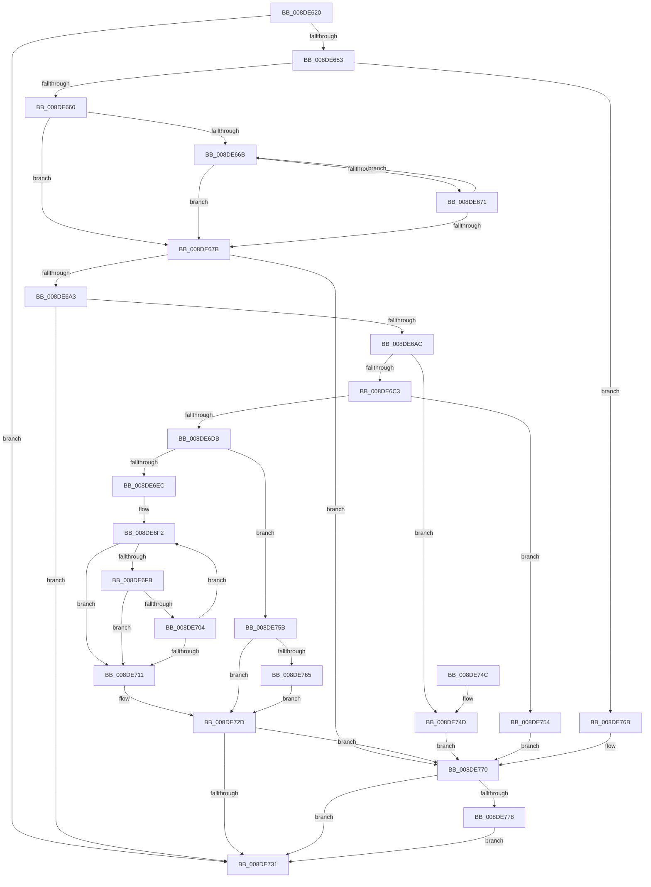

# PnpAllocatePWSTR

- RVA: `0x008DE620`–`0x008DE784` (길이 `356` bytes)
- VA: `0x00000001408DE620`
- 실행 섹션: `PAGE`
- PDB 이름 있음: `예`; PDB Function 태그: `아니요`
- unwind 정보 RVA: `0x00085AF8`
- 디코드: `107`개 명령, `356/356` bytes 표시
- 미해석 바이트: `0` (있으면 어셈블리에 `.byte`로 보존)

> 이 문서는 커널 이미지의 기계어와 PDB 기호를 분석해 생성했습니다. 4번과 5번은 함수 원형과 자료형을 바이너리 사용 방식에서 추정한 C 해석이며 원본 소스 복구 결과는 아닙니다.

## 1. Dependencies

- 직접 호출 지점: **2**; 고유 호출 대상: **2**
- 직접 호출자로 확인된 함수: **14**
- RIP 상대 이미지 참조: **0**

### Outgoing calls
- `0x008DE6CB` → [ExAllocatePool2](../../poolcode/B8/ExAllocatePool2_function_00B820F0.md) (function, `0x00B820F0`)
- `0x008DE77A` → [ExFreePoolWithTag](../../poolcode/B8/ExFreePoolWithTag_function_00B82870.md) (function, `0x00B82870`)

### Direct callers
- [PiSwQueuedCreateInfoCreate](../73/PiSwQueuedCreateInfoCreate_function_0073B1BC.md) at `0x0073B20A`
- [PiSwInterfaceCreate](PiSwInterfaceCreate_function_008DA784.md) at `0x008DA7D3`
- [PiSwBusRelationAdd](PiSwBusRelationAdd_function_008DA994.md) at `0x008DA9E2`
- [PiSwCompleteCreate](PiSwCompleteCreate_function_008DAB90.md) at `0x008DAC8A`
- [PnpCopyDevProperty](PnpCopyDevProperty_function_008DB1CC.md) at `0x008DB21F`
- [PiSwPnPInfoInit](PiSwPnPInfoInit_function_008DB2DC.md) at `0x008DB35C`
- [PiSwPnPInfoInit](PiSwPnPInfoInit_function_008DB2DC.md) at `0x008DB378`
- [PiSwInstanceInfoInit](PiSwInstanceInfoInit_function_008DBC84.md) at `0x008DBCF8`
- [PiDqActionDataCreate](PiDqActionDataCreate_function_008DE1F0.md) at `0x008DE26D`
- [PiPnpRtlObjectEventWorker](../8F/PiPnpRtlObjectEventWorker_function_008F8630.md) at `0x008F87AC`
- [PiSwPdoPnPDispatch](../94/PiSwPdoPnPDispatch_function_0094DDF0.md) at `0x0094DF52`
- [PiSwDeviceInterfacesUpdateState](../94/PiSwDeviceInterfacesUpdateState_function_0094E744.md) at `0x0094E79F`
- [PiSwIrpPropertySet](../94/PiSwIrpPropertySet_function_0094E97C.md) at `0x0094EA9C`
- [PiSwDeviceInterfaceSetState](../94/PiSwDeviceInterfaceSetState_function_0094ED48.md) at `0x0094EDCC`
- [PiDmObjectCreate](../94/PiDmObjectCreate_function_0094F5CC.md) at `0x0094F68E`

### Static image references
- 디코드된 RIP-relative 메모리 참조가 없습니다.

## 2. Other-region calls and transfers

- 다른 실행 섹션으로 향하는 call: **2**
  - `0x008DE6CB` → [ExAllocatePool2](../../poolcode/B8/ExAllocatePool2_function_00B820F0.md) (`PAGE` → `POOLCODE`)
  - `0x008DE77A` → [ExFreePoolWithTag](../../poolcode/B8/ExFreePoolWithTag_function_00B82870.md) (`PAGE` → `POOLCODE`)
- 별도 외부 분기/꼬리 이동을 확인하지 못했습니다.

## 3. Assembly (complete function range)

```asm
008DE620  48 89 5C 24 10                  mov qword ptr [rsp + 0x10], rbx
008DE625  48 89 6C 24 18                  mov qword ptr [rsp + 0x18], rbp
008DE62A  48 89 74 24 20                  mov qword ptr [rsp + 0x20], rsi
008DE62F  57                              push rdi
008DE630  41 56                           push r14
008DE632  41 57                           push r15
008DE634  48 83 EC 20                     sub rsp, 0x20
008DE638  45 33 FF                        xor r15d, r15d
008DE63B  4D 8B F1                        mov r14, r9
008DE63E  4D 89 39                        mov qword ptr [r9], r15
008DE641  41 8B E8                        mov ebp, r8d
008DE644  48 8B F1                        mov rsi, rcx
008DE647  41 8B DF                        mov ebx, r15d
008DE64A  48 85 C9                        test rcx, rcx
008DE64D  0F 84 DE 00 00 00               je 0x1408de731
008DE653  48 81 FA FF FF FF 7F            cmp rdx, 0x7fffffff
008DE65A  0F 87 0B 01 00 00               ja 0x1408de76b
008DE660  4C 8B CA                        mov r9, rdx
008DE663  48 8B C1                        mov rax, rcx
008DE666  48 85 D2                        test rdx, rdx
008DE669  74 10                           je 0x1408de67b
008DE66B  66 44 39 38                     cmp word ptr [rax], r15w
008DE66F  74 0A                           je 0x1408de67b
008DE671  48 83 C0 02                     add rax, 2
008DE675  49 83 E9 01                     sub r9, 1
008DE679  75 F0                           jne 0x1408de66b
008DE67B  49 8B C1                        mov rax, r9
008DE67E  48 F7 D8                        neg rax
008DE681  49 8B C1                        mov rax, r9
008DE684  1B DB                           sbb ebx, ebx
008DE686  49 2B D1                        sub rdx, r9
008DE689  F7 D3                           not ebx
008DE68B  81 E3 0D 00 00 C0               and ebx, 0xc000000d
008DE691  48 F7 D8                        neg rax
008DE694  48 1B C9                        sbb rcx, rcx
008DE697  48 23 CA                        and rcx, rdx
008DE69A  4D 85 C9                        test r9, r9
008DE69D  0F 84 CD 00 00 00               je 0x1408de770
008DE6A3  48 85 C9                        test rcx, rcx
008DE6A6  0F 84 85 00 00 00               je 0x1408de731
008DE6AC  48 FF C1                        inc rcx
008DE6AF  B8 02 00 00 00                  mov eax, 2
008DE6B4  48 F7 E1                        mul rcx
008DE6B7  48 8B F8                        mov rdi, rax
008DE6BA  48 85 D2                        test rdx, rdx
008DE6BD  0F 85 8A 00 00 00               jne 0x1408de74d
008DE6C3  48 8B D0                        mov rdx, rax
008DE6C6  B9 00 01 00 00                  mov ecx, 0x100
008DE6CB  E8 20 3A 2A 00                  call 0x140b820f0
008DE6D0  49 89 06                        mov qword ptr [r14], rax
008DE6D3  48 8B C8                        mov rcx, rax
008DE6D6  48 85 C0                        test rax, rax
008DE6D9  74 79                           je 0x1408de754
008DE6DB  48 D1 EF                        shr rdi, 1
008DE6DE  BA FE FF FF 7F                  mov edx, 0x7ffffffe
008DE6E3  48 8D 47 FF                     lea rax, [rdi - 1]
008DE6E7  48 3B C2                        cmp rax, rdx
008DE6EA  77 6F                           ja 0x1408de75b
008DE6EC  48 2B D7                        sub rdx, rdi
008DE6EF  48 2B F1                        sub rsi, rcx
008DE6F2  48 8D 04 3A                     lea rax, [rdx + rdi]
008DE6F6  48 85 C0                        test rax, rax
008DE6F9  74 16                           je 0x1408de711
008DE6FB  0F B7 04 0E                     movzx eax, word ptr [rsi + rcx]
008DE6FF  66 85 C0                        test ax, ax
008DE702  74 0D                           je 0x1408de711
008DE704  66 89 01                        mov word ptr [rcx], ax
008DE707  48 83 C1 02                     add rcx, 2
008DE70B  48 83 EF 01                     sub rdi, 1
008DE70F  75 E1                           jne 0x1408de6f2
008DE711  48 85 FF                        test rdi, rdi
008DE714  48 8D 41 FE                     lea rax, [rcx - 2]
008DE718  48 0F 45 C1                     cmovne rax, rcx
008DE71C  48 F7 DF                        neg rdi
008DE71F  1B DB                           sbb ebx, ebx
008DE721  F7 D3                           not ebx
008DE723  81 E3 05 00 00 80               and ebx, 0x80000005
008DE729  66 44 89 38                     mov word ptr [rax], r15w
008DE72D  85 DB                           test ebx, ebx
008DE72F  78 3F                           js 0x1408de770
008DE731  48 8B 6C 24 50                  mov rbp, qword ptr [rsp + 0x50]
008DE736  8B C3                           mov eax, ebx
008DE738  48 8B 5C 24 48                  mov rbx, qword ptr [rsp + 0x48]
008DE73D  48 8B 74 24 58                  mov rsi, qword ptr [rsp + 0x58]
008DE742  48 83 C4 20                     add rsp, 0x20
008DE746  41 5F                           pop r15
008DE748  41 5E                           pop r14
008DE74A  5F                              pop rdi
008DE74B  C3                              ret
008DE74C  CC                              int3
008DE74D  BB 95 00 00 C0                  mov ebx, 0xc0000095
008DE752  EB 1C                           jmp 0x1408de770
008DE754  BB 9A 00 00 C0                  mov ebx, 0xc000009a
008DE759  EB 15                           jmp 0x1408de770
008DE75B  BB 0D 00 00 C0                  mov ebx, 0xc000000d
008DE760  48 85 FF                        test rdi, rdi
008DE763  74 C8                           je 0x1408de72d
008DE765  66 44 89 39                     mov word ptr [rcx], r15w
008DE769  EB C2                           jmp 0x1408de72d
008DE76B  BB 0D 00 00 C0                  mov ebx, 0xc000000d
008DE770  49 8B 0E                        mov rcx, qword ptr [r14]
008DE773  48 85 C9                        test rcx, rcx
008DE776  74 B9                           je 0x1408de731
008DE778  8B D5                           mov edx, ebp
008DE77A  E8 F1 40 2A 00                  call 0x140b82870
008DE77F  4D 89 3E                        mov qword ptr [r14], r15
008DE782  EB AD                           jmp 0x1408de731
```

## 4. C-style interpretation (structured pseudocode)

```c
__int64 __fastcall PnpAllocatePWSTR(__int64 a1, __int64 a2, int a3, __int64 a4)
{
    __int64 result;
    __int64 v_r15;
    __int64 v_rbx;
    __int64 v_rdi;
    __int64 v_rsi;
    __int64 v_rsp;
    unsigned __int64 v_stack_p10;
    unsigned __int64 v_stack_p18;
    unsigned __int64 v_stack_p20;

    v_stack_p10 = v_rbx;
    v_stack_p18 = v_rbp;
    v_stack_p20 = v_rsi;
    v_rsp = (v_rsp) - (32);
    v_r15 = 0;
    *(unsigned __int64 *)(a4) = 0;
    if (a1 == 0) goto loc_008DE731;
    if (a2 > 0x7FFFFFFFULL) goto loc_008DE76B;
    if (a2 == 0) goto loc_008DE67B;
loc_008DE66B:
    if ((*(unsigned __int16 *)(a1)) == 0) goto loc_008DE67B;
    result = (a1) + (2);
    a4 = (a2) - (1);
    if (condition_is_not_equal) goto loc_008DE66B;
loc_008DE67B:
    result = -(a4);
    a2 = (a2) - (a4);
    v_rbx = (unsigned int)(~(0));
    v_rbx = (unsigned int)((v_rbx) & (0xC000000DULL));
    result = -(a4);
    a1 = (a1) & (a2);
    if (a4 == 0) goto loc_008DE770;
    if (a1 == 0) goto loc_008DE731;
    a1 = (a1) + 1;
    if (a2 != 0) goto loc_008DE74D;
    result = ExAllocatePool2(256, 2, a3, a4);
    *(unsigned __int64 *)(a4) = result;
    if (result == 0) goto loc_008DE754;
    v_rdi = (2) >> (1);
    if ((v_rdi - 1) > ((unsigned int)(0x7FFFFFFEULL))) goto loc_008DE75B;
    a2 = ((unsigned int)(0x7FFFFFFEULL)) - (v_rdi);
    v_rsi = (a1) - (result);
loc_008DE6F2:
    if (a2 + v_rdi * 1 == 0) goto loc_008DE711;
    if ((unsigned __int16)(*(unsigned __int16 *)(v_rsi + result * 1)) == 0) goto loc_008DE711;
    *(unsigned __int16 *)(result) = (unsigned __int16)(*(unsigned __int16 *)(v_rsi + result * 1));
    a1 = (result) + (2);
    v_rdi = (v_rdi) - (1);
    if (condition_is_not_equal) goto loc_008DE6F2;
loc_008DE711:
    result = a1 - 2;
    if (v_rdi != 0) { result = a1; }
    v_rdi = -(v_rdi);
    v_rbx = (unsigned int)(~(v_rbx));
    v_rbx = (unsigned int)((v_rbx) & (0x80000005ULL));
    *(unsigned __int16 *)(result) = 0;
loc_008DE72D:
    if (sign_flag) goto loc_008DE770;
loc_008DE731:
    v_rsp = (v_rsp) + (32);
    return (unsigned int)((unsigned int)(v_rbx));
loc_008DE74D:
    goto loc_008DE770;
loc_008DE754:
    goto loc_008DE770;
loc_008DE75B:
    if (v_rdi == 0) goto loc_008DE72D;
    *(unsigned __int16 *)(a1) = 0;
    goto loc_008DE72D;
loc_008DE76B:
loc_008DE770:
    if (*(unsigned __int64 *)(a4) == 0) goto loc_008DE731;
    result = ExFreePoolWithTag(*(unsigned __int64 *)(a4), (unsigned int)((unsigned int)(v_stack_p18)), a3, a4);
    *(unsigned __int64 *)(a4) = 0;
    goto loc_008DE731;
}
```

## 5. (Beta) C Style

```c
int64_t PnpAllocatePWSTR(void *Arg1, int64_t Arg2, int32_t Arg3, void *Arg4)
{
    uint8_t *arg1 = (uint8_t *)Arg1;
    uint8_t *arg4 = (uint8_t *)Arg4;

    int64_t result;
    int64_t local_r15;
    int64_t local_rbx;
    int64_t local_rdi;
    int64_t local_rsi;
    int64_t local_rsp;
    uint64_t v_stack_p10;
    uint64_t v_stack_p18;
    uint64_t v_stack_p20;

    v_stack_p10 = local_rbx;
    v_stack_p18 = local_rbp;
    v_stack_p20 = local_rsi;
    local_rsp = (local_rsp) - (32);
    local_r15 = 0;
    *(uint64_t *)(arg4) = 0;
    if (Arg1 == NULL) goto loc_008DE731;
    if (Arg2 > 0x7FFFFFFFULL) goto loc_008DE76B;
    if (Arg2 == 0) goto loc_008DE67B;
loc_008DE66B:
    if ((*(uint16_t *)(arg1)) == 0) goto loc_008DE67B;
    result = (Arg1) + (2);
    Arg4 = (Arg2) - (1);
    if (condition_is_not_equal) goto loc_008DE66B;
loc_008DE67B:
    result = -(Arg4);
    Arg2 = (Arg2) - (Arg4);
    local_rbx = (uint32_t)(~(0));
    local_rbx = (uint32_t)((local_rbx) & (0xC000000DULL));
    result = -(Arg4);
    Arg1 = (Arg1) & (Arg2);
    if (Arg4 == NULL) goto loc_008DE770;
    if (Arg1 == NULL) goto loc_008DE731;
    Arg1 = (Arg1) + 1;
    if (Arg2 != 0) goto loc_008DE74D;
    result = ExAllocatePool2(256, 2, Arg3, Arg4);
    *(uint64_t *)(arg4) = result;
    if (result == 0) goto loc_008DE754;
    local_rdi = (2) >> (1);
    if ((local_rdi - 1) > ((uint32_t)(0x7FFFFFFEULL))) goto loc_008DE75B;
    Arg2 = ((uint32_t)(0x7FFFFFFEULL)) - (local_rdi);
    local_rsi = (Arg1) - (result);
loc_008DE6F2:
    if (Arg2 + local_rdi * 1 == 0) goto loc_008DE711;
    if ((uint16_t)(*(uint16_t *)(local_rsi + result * 1)) == 0) goto loc_008DE711;
    *(uint16_t *)(result) = (uint16_t)(*(uint16_t *)(local_rsi + result * 1));
    Arg1 = (result) + (2);
    local_rdi = (local_rdi) - (1);
    if (condition_is_not_equal) goto loc_008DE6F2;
loc_008DE711:
    result = Arg1 - 2;
    if (local_rdi != 0) { result = Arg1; }
    local_rdi = -(local_rdi);
    local_rbx = (uint32_t)(~(local_rbx));
    local_rbx = (uint32_t)((local_rbx) & (0x80000005ULL));
    *(uint16_t *)(result) = 0;
loc_008DE72D:
    if (sign_flag) goto loc_008DE770;
loc_008DE731:
    local_rsp = (local_rsp) + (32);
    return (uint32_t)((uint32_t)(local_rbx));
loc_008DE74D:
    goto loc_008DE770;
loc_008DE754:
    goto loc_008DE770;
loc_008DE75B:
    if (local_rdi == 0) goto loc_008DE72D;
    *(uint16_t *)(arg1) = 0;
    goto loc_008DE72D;
loc_008DE76B:
loc_008DE770:
    if (*(uint64_t *)(arg4) == 0) goto loc_008DE731;
    result = ExFreePoolWithTag(*(uint64_t *)(arg4), (uint32_t)((uint32_t)(v_stack_p18)), Arg3, Arg4);
    *(uint64_t *)(arg4) = 0;
    goto loc_008DE731;
}
```

### 관측된 메모리 오프셋

구조체 형식이 확인되지 않은 접근은 인자 기준의 오프셋으로만 기록했습니다.

| 기준 인자 | 오프셋 표현 | 폭 (bit) | 접근 |
|---|---:|---:|---|
| `Arg1` | `+ 0x0 + rcx*1` | `16` | `R` |
| `Arg4` | `+ 0x0` | `64` | `R` |
| `Arg4` | `+ 0x0` | `64` | `W` |

## 6. Execution-region graph

[열기: 2D/3D 그래프와 함수 탐색 컨트롤 패널](../../../control-panel.html?section=page&rva=0x008DE620&view=graph)

- 2D 그래프는 위에서 아래로 흐르고, 3D 그래프는 빈 공간을 드래그해 회전합니다. Shift+드래그는 이동, 휠은 확대·축소, 함수 노드 선택은 대상 보고서 이동입니다.

### Static fallback


