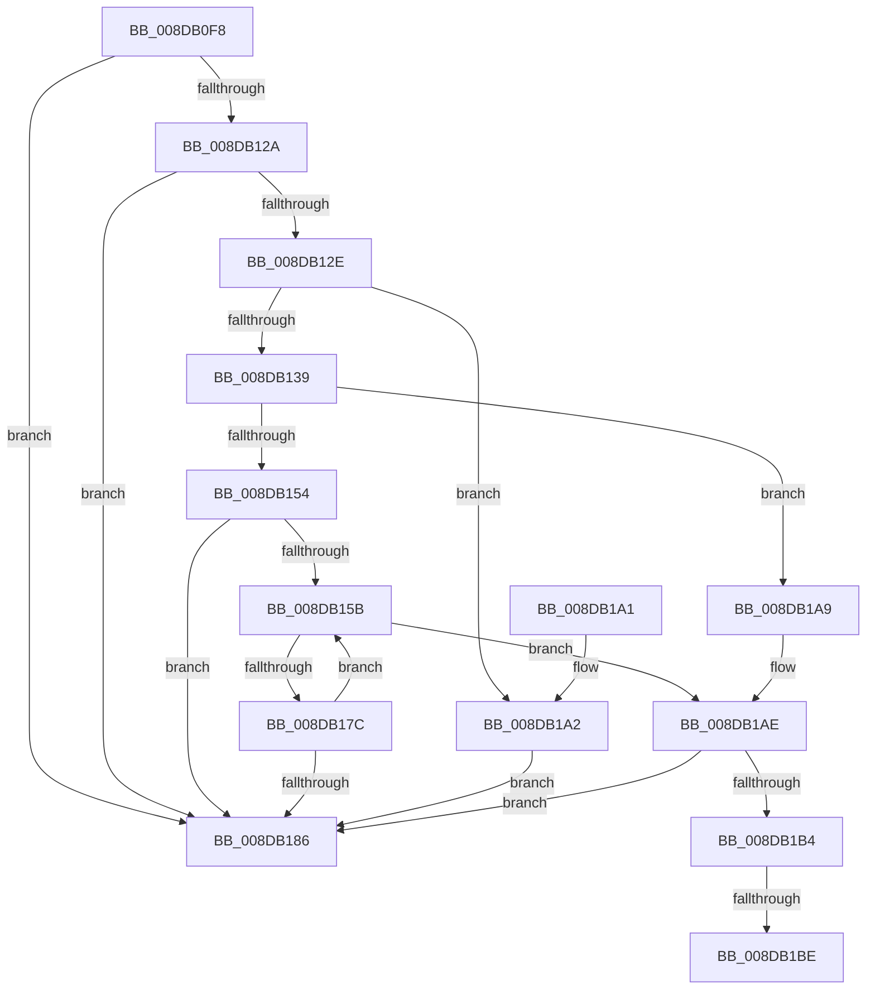

# PnpCopyDevPropertyArray

- RVA: `0x008DB0F8`–`0x008DB1C3` (길이 `203` bytes)
- VA: `0x00000001408DB0F8`
- 실행 섹션: `PAGE`
- PDB 이름 있음: `예`; PDB Function 태그: `예`
- unwind 정보 RVA: `0x0007D214`
- 디코드: `65`개 명령, `203/203` bytes 표시
- 미해석 바이트: `0` (있으면 어셈블리에 `.byte`로 보존)

> 이 문서는 커널 이미지의 기계어와 PDB 기호를 분석해 생성했습니다. 4번과 5번은 함수 원형과 자료형을 바이너리 사용 방식에서 추정한 C 해석이며 원본 소스 복구 결과는 아닙니다.

## 1. Dependencies

- 직접 호출 지점: **2**; 고유 호출 대상: **2**
- 직접 호출자로 확인된 함수: **5**
- RIP 상대 이미지 참조: **0**

### Outgoing calls
- `0x008DB147` → [ExAllocatePool2](../../poolcode/B8/ExAllocatePool2_function_00B820F0.md) (function, `0x00B820F0`)
- `0x008DB171` → [PnpCopyDevProperty](PnpCopyDevProperty_function_008DB1CC.md) (function, `0x008DB1CC`)

### Direct callers
- [PiSwQueuedCreateInfoCreate](../73/PiSwQueuedCreateInfoCreate_function_0073B1BC.md) at `0x0073B297`
- [PiSwInterfaceCreate](PiSwInterfaceCreate_function_008DA784.md) at `0x008DA7F3`
- [PiSwCompleteCreate](PiSwCompleteCreate_function_008DAB90.md) at `0x008DAD29`
- [PiSwIrpStartCreateWorker](PiSwIrpStartCreateWorker_function_008DB398.md) at `0x008DB5BD`
- [sub_00B1C4F6](../B1/Unknown_function_00B1C4F6.md) at `0x00B1C576`
- [sub_00B1C4F6](../B1/Unknown_function_00B1C4F6.md) at `0x00B1C811`

### Static image references
- 디코드된 RIP-relative 메모리 참조가 없습니다.

## 2. Other-region calls and transfers

- 다른 실행 섹션으로 향하는 call: **1**
  - `0x008DB147` → [ExAllocatePool2](../../poolcode/B8/ExAllocatePool2_function_00B820F0.md) (`PAGE` → `POOLCODE`)
- call이 아닌 외부 분기/꼬리 이동: **2**
  - `0x008DB1B8` → [sub_00B1C4B6](../B1/Unknown_function_00B1C4B6.md) (`tail-transfer`)
  - `0x008DB1BE` → [sub_00B1C4B6 + 0x26](../B1/Unknown_function_00B1C4B6.md) (`tail-transfer`)

## 3. Assembly (complete function range)

```asm
008DB0F8  48 89 5C 24 08                  mov qword ptr [rsp + 8], rbx
008DB0FD  48 89 6C 24 10                  mov qword ptr [rsp + 0x10], rbp
008DB102  48 89 74 24 18                  mov qword ptr [rsp + 0x18], rsi
008DB107  57                              push rdi
008DB108  41 56                           push r14
008DB10A  41 57                           push r15
008DB10C  48 83 EC 20                     sub rsp, 0x20
008DB110  48 8B 5C 24 60                  mov rbx, qword ptr [rsp + 0x60]
008DB115  33 F6                           xor esi, esi
008DB117  41 21 31                        and dword ptr [r9], esi
008DB11A  49 8B F9                        mov rdi, r9
008DB11D  4C 8B FA                        mov r15, rdx
008DB120  8B E9                           mov ebp, ecx
008DB122  48 21 33                        and qword ptr [rbx], rsi
008DB125  48 85 D2                        test rdx, rdx
008DB128  74 5C                           je 0x1408db186
008DB12A  85 C9                           test ecx, ecx
008DB12C  74 58                           je 0x1408db186
008DB12E  8D 46 30                        lea eax, [rsi + 0x30]
008DB131  48 F7 E5                        mul rbp
008DB134  48 85 D2                        test rdx, rdx
008DB137  75 69                           jne 0x1408db1a2
008DB139  41 B8 50 6E 70 57               mov r8d, 0x57706e50
008DB13F  48 8B D0                        mov rdx, rax
008DB142  B9 00 01 00 00                  mov ecx, 0x100
008DB147  E8 A4 6F 2A 00                  call 0x140b820f0
008DB14C  48 89 03                        mov qword ptr [rbx], rax
008DB14F  48 85 C0                        test rax, rax
008DB152  74 55                           je 0x1408db1a9
008DB154  45 33 F6                        xor r14d, r14d
008DB157  85 ED                           test ebp, ebp
008DB159  74 2B                           je 0x1408db186
008DB15B  4C 8B 03                        mov r8, qword ptr [rbx]
008DB15E  4B 8D 0C 76                     lea rcx, [r14 + r14*2]
008DB162  48 C1 E1 04                     shl rcx, 4
008DB166  BA 50 6E 70 57                  mov edx, 0x57706e50
008DB16B  4C 03 C1                        add r8, rcx
008DB16E  49 03 CF                        add rcx, r15
008DB171  E8 56 00 00 00                  call 0x1408db1cc
008DB176  8B F0                           mov esi, eax
008DB178  85 C0                           test eax, eax
008DB17A  78 32                           js 0x1408db1ae
008DB17C  FF 07                           inc dword ptr [rdi]
008DB17E  41 FF C6                        inc r14d
008DB181  44 3B F5                        cmp r14d, ebp
008DB184  72 D5                           jb 0x1408db15b
008DB186  48 8B 5C 24 40                  mov rbx, qword ptr [rsp + 0x40]
008DB18B  8B C6                           mov eax, esi
008DB18D  48 8B 74 24 50                  mov rsi, qword ptr [rsp + 0x50]
008DB192  48 8B 6C 24 48                  mov rbp, qword ptr [rsp + 0x48]
008DB197  48 83 C4 20                     add rsp, 0x20
008DB19B  41 5F                           pop r15
008DB19D  41 5E                           pop r14
008DB19F  5F                              pop rdi
008DB1A0  C3                              ret
008DB1A1  CC                              int3
008DB1A2  BE 95 00 00 C0                  mov esi, 0xc0000095
008DB1A7  EB DD                           jmp 0x1408db186
008DB1A9  BE 9A 00 00 C0                  mov esi, 0xc000009a
008DB1AE  48 83 3B 00                     cmp qword ptr [rbx], 0
008DB1B2  74 D2                           je 0x1408db186
008DB1B4  33 ED                           xor ebp, ebp
008DB1B6  39 2F                           cmp dword ptr [rdi], ebp
008DB1B8  0F 87 F8 12 24 00               ja 0x140b1c4b6
008DB1BE  E9 19 13 24 00                  jmp 0x140b1c4dc
```

## 4. C-style interpretation (structured pseudocode)

```c
__int64 __fastcall PnpCopyDevPropertyArray(int a1, __int64 a2, __int64 a3, __int64 a4, __int64 a5)
{
    __int64 result;
    __int64 v_r14;
    __int64 v_rbp;
    __int64 v_rsi;
    __int64 v_rsp;
    unsigned __int64 v_stack_p10;
    unsigned __int64 v_stack_p18;
    unsigned __int64 v_stack_p8;

    v_stack_p8 = v_rbx;
    v_stack_p10 = v_rbp;
    v_stack_p18 = v_rsi;
    v_rsp = (v_rsp) - (32);
    v_rsi = 0;
    if (a2 == 0) goto loc_008DB186;
    if (a1 == 0) goto loc_008DB186;
    if (a2 != 0) goto loc_008DB1A2;
    result = ExAllocatePool2(256, v_rsi + 48, (unsigned int)(0x57706E50ULL), a4);
    *(unsigned __int64 *)(a5) = result;
    if (result == 0) goto loc_008DB1A9;
    v_r14 = 0;
    if ((unsigned int)((unsigned int)(a1)) == 0) goto loc_008DB186;
loc_008DB15B:
    a1 = (v_r14 + v_r14 * 2) << (4);
    a3 = (*(unsigned __int64 *)(a5)) + (a1);
    a1 = (a1) + (a2);
    result = PnpCopyDevProperty(a1, (unsigned int)(0x57706E50ULL), a3, a4);
    if (sign_flag) goto loc_008DB1AE;
    v_r14 = (unsigned int)((v_r14) + 1);
    if (((unsigned int)(v_r14)) < ((unsigned int)((unsigned int)(a1)))) goto loc_008DB15B;
loc_008DB186:
    v_rsp = (v_rsp) + (32);
    return (unsigned int)((unsigned int)((unsigned int)((unsigned int)(result))));
loc_008DB1A2:
    goto loc_008DB186;
loc_008DB1A9:
loc_008DB1AE:
    if ((*(unsigned __int64 *)(v_stack_p8)) == 0) goto loc_008DB186;
    v_rbp = 0;
}
```

## 5. (Beta) C Style

```c
int64_t PnpCopyDevPropertyArray(int32_t Arg1, int64_t Arg2, int64_t Arg3, void *Arg4, void *Arg5)
{
    uint8_t *arg4 = (uint8_t *)Arg4;
    uint8_t *arg5 = (uint8_t *)Arg5;

    int64_t result;
    int64_t local_r14;
    int64_t local_rbp;
    int64_t local_rsi;
    int64_t local_rsp;
    uint64_t v_stack_p10;
    uint64_t v_stack_p18;
    uint64_t v_stack_p8;

    v_stack_p8 = local_rbx;
    v_stack_p10 = local_rbp;
    v_stack_p18 = local_rsi;
    local_rsp = (local_rsp) - (32);
    local_rsi = 0;
    if (Arg2 == 0) goto loc_008DB186;
    if (Arg1 == 0) goto loc_008DB186;
    if (Arg2 != 0) goto loc_008DB1A2;
    result = ExAllocatePool2(256, local_rsi + 48, (uint32_t)(0x57706E50ULL), Arg4);
    *(uint64_t *)(arg5) = result;
    if (result == 0) goto loc_008DB1A9;
    local_r14 = 0;
    if ((uint32_t)((uint32_t)(Arg1)) == 0) goto loc_008DB186;
loc_008DB15B:
    Arg1 = (local_r14 + local_r14 * 2) << (4);
    Arg3 = (*(uint64_t *)(arg5)) + (Arg1);
    Arg1 = (Arg1) + (Arg2);
    result = PnpCopyDevProperty(Arg1, (uint32_t)(0x57706E50ULL), Arg3, Arg4);
    if (sign_flag) goto loc_008DB1AE;
    local_r14 = (uint32_t)((local_r14) + 1);
    if (((uint32_t)(local_r14)) < ((uint32_t)((uint32_t)(Arg1)))) goto loc_008DB15B;
loc_008DB186:
    local_rsp = (local_rsp) + (32);
    return (uint32_t)((uint32_t)((uint32_t)((uint32_t)(result))));
loc_008DB1A2:
    goto loc_008DB186;
loc_008DB1A9:
loc_008DB1AE:
    if ((*(uint64_t *)(v_stack_p8)) == 0) goto loc_008DB186;
    local_rbp = 0;
}
```

### 관측된 메모리 오프셋

구조체 형식이 확인되지 않은 접근은 인자 기준의 오프셋으로만 기록했습니다.

| 기준 인자 | 오프셋 표현 | 폭 (bit) | 접근 |
|---|---:|---:|---|
| `Arg4` | `+ 0x0` | `32` | `R` |
| `Arg4` | `+ 0x0` | `32` | `R/W` |
| `Arg5` | `+ 0x0` | `64` | `R` |
| `Arg5` | `+ 0x0` | `64` | `R/W` |
| `Arg5` | `+ 0x0` | `64` | `W` |

## 6. Execution-region graph

[열기: 2D/3D 그래프와 함수 탐색 컨트롤 패널](../../../control-panel.html?section=page&rva=0x008DB0F8&view=graph)

- 2D 그래프는 위에서 아래로 흐르고, 3D 그래프는 빈 공간을 드래그해 회전합니다. Shift+드래그는 이동, 휠은 확대·축소, 함수 노드 선택은 대상 보고서 이동입니다.

### Static fallback


