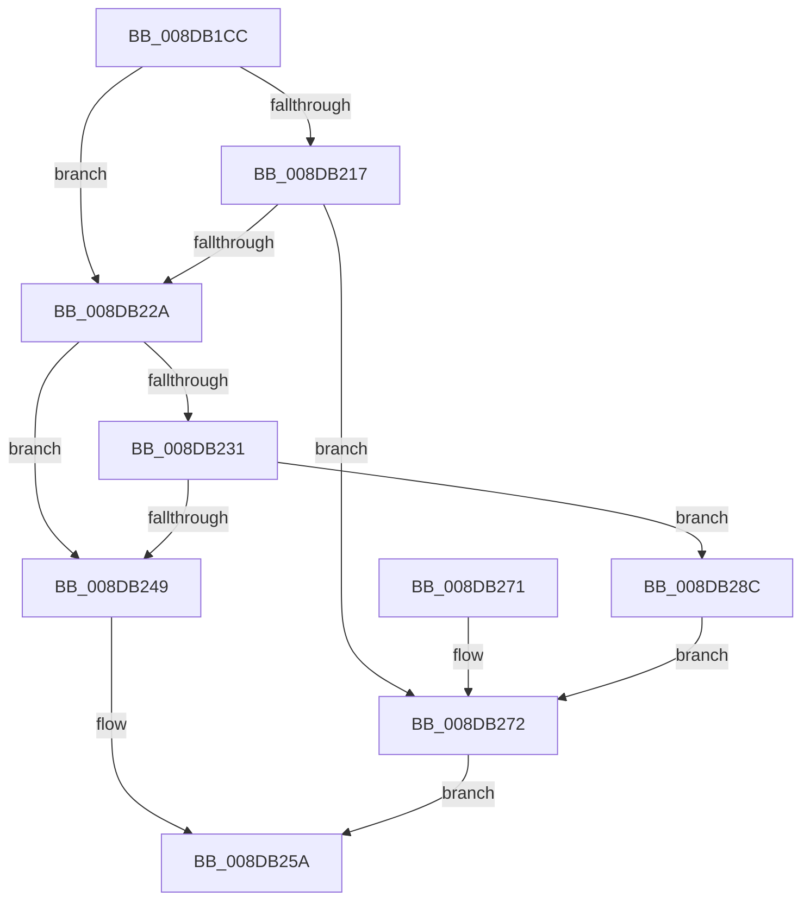

# PnpCopyDevProperty

- RVA: `0x008DB1CC`–`0x008DB293` (길이 `199` bytes)
- VA: `0x00000001408DB1CC`
- 실행 섹션: `PAGE`
- PDB 이름 있음: `예`; PDB Function 태그: `아니요`
- unwind 정보 RVA: `0x00069864`
- 디코드: `59`개 명령, `199/199` bytes 표시
- 미해석 바이트: `0` (있으면 어셈블리에 `.byte`로 보존)

> 이 문서는 커널 이미지의 기계어와 PDB 기호를 분석해 생성했습니다. 4번과 5번은 함수 원형과 자료형을 바이너리 사용 방식에서 추정한 C 해석이며 원본 소스 복구 결과는 아닙니다.

## 1. Dependencies

- 직접 호출 지점: **4**; 고유 호출 대상: **4**
- 직접 호출자로 확인된 함수: **1**
- RIP 상대 이미지 참조: **0**

### Outgoing calls
- `0x008DB21F` → [PnpAllocatePWSTR](PnpAllocatePWSTR_function_008DE620.md) (function, `0x008DE620`)
- `0x008DB23B` → [ExAllocatePool2](../../poolcode/B8/ExAllocatePool2_function_00B820F0.md) (function, `0x00B820F0`)
- `0x008DB255` → [memcpy](../../text/6C/memcpy_function_006C6840.md) (function, `0x006C6840`)
- `0x008DB277` → [PnpFreeDevProperty](PnpFreeDevProperty_function_008DB29C.md) (function, `0x008DB29C`)

### Direct callers
- [PnpCopyDevPropertyArray](PnpCopyDevPropertyArray_function_008DB0F8.md) at `0x008DB171`

### Static image references
- 디코드된 RIP-relative 메모리 참조가 없습니다.

## 2. Other-region calls and transfers

- 다른 실행 섹션으로 향하는 call: **2**
  - `0x008DB23B` → [ExAllocatePool2](../../poolcode/B8/ExAllocatePool2_function_00B820F0.md) (`PAGE` → `POOLCODE`)
  - `0x008DB255` → [memcpy](../../text/6C/memcpy_function_006C6840.md) (`PAGE` → `.text`)
- 별도 외부 분기/꼬리 이동을 확인하지 못했습니다.

## 3. Assembly (complete function range)

```asm
008DB1CC  48 89 5C 24 08                  mov qword ptr [rsp + 8], rbx
008DB1D1  48 89 6C 24 10                  mov qword ptr [rsp + 0x10], rbp
008DB1D6  48 89 74 24 18                  mov qword ptr [rsp + 0x18], rsi
008DB1DB  57                              push rdi
008DB1DC  48 83 EC 20                     sub rsp, 0x20
008DB1E0  0F 10 01                        movups xmm0, xmmword ptr [rcx]
008DB1E3  33 FF                           xor edi, edi
008DB1E5  4D 8D 48 18                     lea r9, [r8 + 0x18]
008DB1E9  48 8B E9                        mov rbp, rcx
008DB1EC  49 8B D8                        mov rbx, r8
008DB1EF  41 0F 11 00                     movups xmmword ptr [r8], xmm0
008DB1F3  8B F2                           mov esi, edx
008DB1F5  0F 10 49 10                     movups xmm1, xmmword ptr [rcx + 0x10]
008DB1F9  41 0F 11 48 10                  movups xmmword ptr [r8 + 0x10], xmm1
008DB1FE  0F 10 41 20                     movups xmm0, xmmword ptr [rcx + 0x20]
008DB202  41 0F 11 40 20                  movups xmmword ptr [r8 + 0x20], xmm0
008DB207  49 21 39                        and qword ptr [r9], rdi
008DB20A  49 21 78 28                     and qword ptr [r8 + 0x28], rdi
008DB20E  48 8B 49 18                     mov rcx, qword ptr [rcx + 0x18]
008DB212  48 85 C9                        test rcx, rcx
008DB215  74 13                           je 0x1408db22a
008DB217  44 8B C2                        mov r8d, edx
008DB21A  BA FF FF FF 7F                  mov edx, 0x7fffffff
008DB21F  E8 FC 33 00 00                  call 0x1408de620
008DB224  8B F8                           mov edi, eax
008DB226  85 C0                           test eax, eax
008DB228  78 48                           js 0x1408db272
008DB22A  8B 43 24                        mov eax, dword ptr [rbx + 0x24]
008DB22D  85 C0                           test eax, eax
008DB22F  74 18                           je 0x1408db249
008DB231  8B D0                           mov edx, eax
008DB233  44 8B C6                        mov r8d, esi
008DB236  B9 00 01 00 00                  mov ecx, 0x100
008DB23B  E8 B0 6E 2A 00                  call 0x140b820f0
008DB240  48 89 43 28                     mov qword ptr [rbx + 0x28], rax
008DB244  48 85 C0                        test rax, rax
008DB247  74 43                           je 0x1408db28c
008DB249  44 8B 43 24                     mov r8d, dword ptr [rbx + 0x24]
008DB24D  48 8B 55 28                     mov rdx, qword ptr [rbp + 0x28]
008DB251  48 8B 4B 28                     mov rcx, qword ptr [rbx + 0x28]
008DB255  E8 E6 B5 DE FF                  call 0x1406c6840
008DB25A  48 8B 5C 24 30                  mov rbx, qword ptr [rsp + 0x30]
008DB25F  8B C7                           mov eax, edi
008DB261  48 8B 6C 24 38                  mov rbp, qword ptr [rsp + 0x38]
008DB266  48 8B 74 24 40                  mov rsi, qword ptr [rsp + 0x40]
008DB26B  48 83 C4 20                     add rsp, 0x20
008DB26F  5F                              pop rdi
008DB270  C3                              ret
008DB271  CC                              int3
008DB272  8B D6                           mov edx, esi
008DB274  48 8B CB                        mov rcx, rbx
008DB277  E8 20 00 00 00                  call 0x1408db29c
008DB27C  0F 57 C0                        xorps xmm0, xmm0
008DB27F  0F 11 03                        movups xmmword ptr [rbx], xmm0
008DB282  0F 11 43 10                     movups xmmword ptr [rbx + 0x10], xmm0
008DB286  0F 11 43 20                     movups xmmword ptr [rbx + 0x20], xmm0
008DB28A  EB CE                           jmp 0x1408db25a
008DB28C  BF 9A 00 00 C0                  mov edi, 0xc000009a
008DB291  EB DF                           jmp 0x1408db272
```

## 4. C-style interpretation (structured pseudocode)

```c
__int64 __fastcall PnpCopyDevProperty(__int64 a1, int a2, __int64 a3)
{
    __int64 result;
    __int64 v_rdi;
    __int64 v_rsp;
    unsigned __int64 v_stack_p10;
    unsigned __int64 v_stack_p18;
    unsigned __int64 v_stack_p8;

    v_stack_p8 = v_rbx;
    v_stack_p10 = v_rbp;
    v_stack_p18 = v_rsi;
    v_rsp = (v_rsp) - (32);
    v_rdi = 0;
    *(unsigned __int64 *)(a3) = v_xmm0;
    *(unsigned __int64 *)(a3 + 16) = v_xmm1;
    *(unsigned __int64 *)(a3 + 32) = v_xmm0;
    if (*(unsigned __int64 *)(a1 + 24) == 0) goto loc_008DB22A;
    result = PnpAllocatePWSTR(*(unsigned __int64 *)(a1 + 24), (unsigned int)(0x7FFFFFFFULL), (unsigned int)(a2), a3 + 24);
    if (sign_flag) goto loc_008DB272;
loc_008DB22A:
    if ((unsigned int)((unsigned int)(*(unsigned int *)(a3 + 36))) == 0) goto loc_008DB249;
    result = ExAllocatePool2(256, (unsigned int)((unsigned int)((unsigned int)(*(unsigned int *)(a3 + 36)))), (unsigned int)((unsigned int)((unsigned int)(a2))), a3 + 24);
    *(unsigned __int64 *)(a3 + 40) = result;
    if (result == 0) goto loc_008DB28C;
loc_008DB249:
    result = memcpy(*(unsigned __int64 *)(a3 + 40), *(unsigned __int64 *)(a1 + 40), (unsigned int)(*(unsigned int *)(a3 + 36)), a3 + 24);
loc_008DB25A:
    v_rsp = (v_rsp) + (32);
    return (unsigned int)((unsigned int)((unsigned int)((unsigned int)(result))));
loc_008DB272:
    result = PnpFreeDevProperty(v_stack_p8, (unsigned int)((unsigned int)(v_stack_p18)), (unsigned int)(*(unsigned int *)(a3 + 36)), a3 + 24);
    *(unsigned __int64 *)(v_stack_p8) = v_xmm0;
    *(unsigned __int64 *)(v_stack_p8 + 16) = v_xmm0;
    *(unsigned __int64 *)(v_stack_p8 + 32) = v_xmm0;
    goto loc_008DB25A;
loc_008DB28C:
    goto loc_008DB272;
}
```

## 5. (Beta) C Style

```c
int64_t PnpCopyDevProperty(void *Arg1, int32_t Arg2, void *Arg3)
{
    uint8_t *arg1 = (uint8_t *)Arg1;
    uint8_t *arg3 = (uint8_t *)Arg3;

    int64_t result;
    int64_t local_rdi;
    int64_t local_rsp;
    uint64_t v_stack_p10;
    uint64_t v_stack_p18;
    uint64_t v_stack_p8;

    v_stack_p8 = local_rbx;
    v_stack_p10 = local_rbp;
    v_stack_p18 = local_rsi;
    local_rsp = (local_rsp) - (32);
    local_rdi = 0;
    *(uint64_t *)(arg3) = v_xmm0;
    *(uint64_t *)(arg3 + 0x10) = v_xmm1;
    *(uint64_t *)(arg3 + 0x20) = v_xmm0;
    if (*(uint64_t *)(arg1 + 0x18) == 0) goto loc_008DB22A;
    result = PnpAllocatePWSTR(*(uint64_t *)(arg1 + 0x18), (uint32_t)(0x7FFFFFFFULL), (uint32_t)(Arg2), Arg3 + 24);
    if (sign_flag) goto loc_008DB272;
loc_008DB22A:
    if ((uint32_t)((uint32_t)(*(uint32_t *)(arg3 + 0x24))) == 0) goto loc_008DB249;
    result = ExAllocatePool2(256, (uint32_t)((uint32_t)((uint32_t)(*(uint32_t *)(arg3 + 0x24)))), (uint32_t)((uint32_t)((uint32_t)(Arg2))), Arg3 + 24);
    *(uint64_t *)(arg3 + 0x28) = result;
    if (result == 0) goto loc_008DB28C;
loc_008DB249:
    result = memcpy(*(uint64_t *)(arg3 + 0x28), *(uint64_t *)(arg1 + 0x28), (uint32_t)(*(uint32_t *)(arg3 + 0x24)), Arg3 + 24);
loc_008DB25A:
    local_rsp = (local_rsp) + (32);
    return (uint32_t)((uint32_t)((uint32_t)((uint32_t)(result))));
loc_008DB272:
    result = PnpFreeDevProperty(v_stack_p8, (uint32_t)((uint32_t)(v_stack_p18)), (uint32_t)(*(uint32_t *)(arg3 + 0x24)), Arg3 + 24);
    *(uint64_t *)(v_stack_p8) = v_xmm0;
    *(uint64_t *)(v_stack_p8 + 0x10) = v_xmm0;
    *(uint64_t *)(v_stack_p8 + 0x20) = v_xmm0;
    goto loc_008DB25A;
loc_008DB28C:
    goto loc_008DB272;
}
```

### 관측된 메모리 오프셋

구조체 형식이 확인되지 않은 접근은 인자 기준의 오프셋으로만 기록했습니다.

| 기준 인자 | 오프셋 표현 | 폭 (bit) | 접근 |
|---|---:|---:|---|
| `Arg1` | `+ 0x0` | `128` | `R` |
| `Arg1` | `+ 0x10` | `128` | `R` |
| `Arg1` | `+ 0x18` | `64` | `R` |
| `Arg1` | `+ 0x20` | `128` | `R` |
| `Arg1` | `+ 0x28` | `64` | `R` |
| `Arg3` | `+ 0x0` | `64` | `R/W` |
| `Arg3` | `+ 0x0` | `128` | `R` |
| `Arg3` | `+ 0x10` | `128` | `R` |
| `Arg3` | `+ 0x18` | `64` | `R` |
| `Arg3` | `+ 0x20` | `128` | `R` |
| `Arg3` | `+ 0x24` | `32` | `R` |
| `Arg3` | `+ 0x28` | `64` | `R` |
| `Arg3` | `+ 0x28` | `64` | `R/W` |
| `Arg3` | `+ 0x28` | `64` | `W` |

## 6. Execution-region graph

[열기: 2D/3D 그래프와 함수 탐색 컨트롤 패널](../../../control-panel.html?section=page&rva=0x008DB1CC&view=graph)

- 2D 그래프는 위에서 아래로 흐르고, 3D 그래프는 빈 공간을 드래그해 회전합니다. Shift+드래그는 이동, 휠은 확대·축소, 함수 노드 선택은 대상 보고서 이동입니다.

### Static fallback


