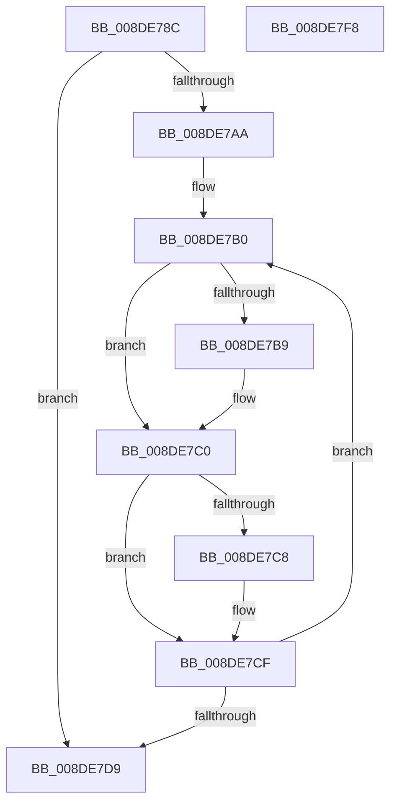

# PnpFreeDevPropertyArray

- RVA: `0x008DE78C`–`0x008DE7F9` (길이 `109` bytes)
- VA: `0x00000001408DE78C`
- 실행 섹션: `PAGE`
- PDB 이름 있음: `예`; PDB Function 태그: `아니요`
- unwind 정보 RVA: `0x0005C954`
- 디코드: `34`개 명령, `109/109` bytes 표시
- 미해석 바이트: `0` (있으면 어셈블리에 `.byte`로 보존)

> 이 문서는 커널 이미지의 기계어와 PDB 기호를 분석해 생성했습니다. 4번과 5번은 함수 원형과 자료형을 바이너리 사용 방식에서 추정한 C 해석이며 원본 소스 복구 결과는 아닙니다.

## 1. Dependencies

- 직접 호출 지점: **3**; 고유 호출 대상: **1**
- 직접 호출자로 확인된 함수: **7**
- RIP 상대 이미지 참조: **0**

### Outgoing calls
- `0x008DE7BB` → [ExFreePoolWithTag](../../poolcode/B8/ExFreePoolWithTag_function_00B82870.md) (function, `0x00B82870`)
- `0x008DE7CA` → [ExFreePoolWithTag](../../poolcode/B8/ExFreePoolWithTag_function_00B82870.md) (function, `0x00B82870`)
- `0x008DE7DE` → [ExFreePoolWithTag](../../poolcode/B8/ExFreePoolWithTag_function_00B82870.md) (function, `0x00B82870`)

### Direct callers
- [PiSwDeviceFree](PiSwDeviceFree_function_008DA63C.md) at `0x008DA69E`
- [PiSwCompleteCreate](PiSwCompleteCreate_function_008DAB90.md) at `0x008DB04C`
- [PiSwInterfaceFree](PiSwInterfaceFree_function_008DB064.md) at `0x008DB0A6`
- [PiDqActionDataFree](PiDqActionDataFree_function_008DE4A8.md) at `0x008DE4DB`
- [PiSwQueuedCreateInfoFree](../94/PiSwQueuedCreateInfoFree_function_0094D92C.md) at `0x0094D97E`
- [PiSwProcessRemove](../94/PiSwProcessRemove_function_0094E3B8.md) at `0x0094E644`
- [sub_00B1C4F6](../B1/Unknown_function_00B1C4F6.md) at `0x00B1C5A4`
- [sub_00B1C4F6](../B1/Unknown_function_00B1C4F6.md) at `0x00B1C754`

### Static image references
- 디코드된 RIP-relative 메모리 참조가 없습니다.

## 2. Other-region calls and transfers

- 다른 실행 섹션으로 향하는 call: **3**
  - `0x008DE7BB` → [ExFreePoolWithTag](../../poolcode/B8/ExFreePoolWithTag_function_00B82870.md) (`PAGE` → `POOLCODE`)
  - `0x008DE7CA` → [ExFreePoolWithTag](../../poolcode/B8/ExFreePoolWithTag_function_00B82870.md) (`PAGE` → `POOLCODE`)
  - `0x008DE7DE` → [ExFreePoolWithTag](../../poolcode/B8/ExFreePoolWithTag_function_00B82870.md) (`PAGE` → `POOLCODE`)
- 별도 외부 분기/꼬리 이동을 확인하지 못했습니다.

## 3. Assembly (complete function range)

```asm
008DE78C  48 89 5C 24 08                  mov qword ptr [rsp + 8], rbx
008DE791  48 89 6C 24 10                  mov qword ptr [rsp + 0x10], rbp
008DE796  48 89 74 24 18                  mov qword ptr [rsp + 0x18], rsi
008DE79B  57                              push rdi
008DE79C  48 83 EC 20                     sub rsp, 0x20
008DE7A0  41 8B F8                        mov edi, r8d
008DE7A3  48 8B EA                        mov rbp, rdx
008DE7A6  85 C9                           test ecx, ecx
008DE7A8  74 2F                           je 0x1408de7d9
008DE7AA  48 8D 5A 28                     lea rbx, [rdx + 0x28]
008DE7AE  8B F1                           mov esi, ecx
008DE7B0  48 8B 4B F0                     mov rcx, qword ptr [rbx - 0x10]
008DE7B4  48 85 C9                        test rcx, rcx
008DE7B7  74 07                           je 0x1408de7c0
008DE7B9  8B D7                           mov edx, edi
008DE7BB  E8 B0 40 2A 00                  call 0x140b82870
008DE7C0  48 8B 0B                        mov rcx, qword ptr [rbx]
008DE7C3  48 85 C9                        test rcx, rcx
008DE7C6  74 07                           je 0x1408de7cf
008DE7C8  8B D7                           mov edx, edi
008DE7CA  E8 A1 40 2A 00                  call 0x140b82870
008DE7CF  48 83 C3 30                     add rbx, 0x30
008DE7D3  48 83 EE 01                     sub rsi, 1
008DE7D7  75 D7                           jne 0x1408de7b0
008DE7D9  8B D7                           mov edx, edi
008DE7DB  48 8B CD                        mov rcx, rbp
008DE7DE  E8 8D 40 2A 00                  call 0x140b82870
008DE7E3  48 8B 5C 24 30                  mov rbx, qword ptr [rsp + 0x30]
008DE7E8  48 8B 6C 24 38                  mov rbp, qword ptr [rsp + 0x38]
008DE7ED  48 8B 74 24 40                  mov rsi, qword ptr [rsp + 0x40]
008DE7F2  48 83 C4 20                     add rsp, 0x20
008DE7F6  5F                              pop rdi
008DE7F7  C3                              ret
008DE7F8  CC                              int3
```

## 4. C-style interpretation (structured pseudocode)

```c
__int64 __fastcall PnpFreeDevPropertyArray(int a1, __int64 a2, int a3)
{
    __int64 result;
    __int64 v_rbx;
    __int64 v_rsi;
    __int64 v_rsp;
    unsigned __int64 v_stack_p10;
    unsigned __int64 v_stack_p18;
    unsigned __int64 v_stack_p8;

    v_stack_p8 = v_rbx;
    v_stack_p10 = v_rbp;
    v_stack_p18 = v_rsi;
    v_rsp = (v_rsp) - (32);
    if (a1 == 0) goto loc_008DE7D9;
loc_008DE7B0:
    if (*(unsigned __int64 *)(a2 + 40 - 16) != 0) {
        a2 = (unsigned int)((unsigned int)(a3));
        result = ExFreePoolWithTag(*(unsigned __int64 *)(a2 + 40 - 16), a2, a3, a4);
    }
    if (*(unsigned __int64 *)(a2 + 40) != 0) {
        a2 = (unsigned int)((unsigned int)(a3));
        result = ExFreePoolWithTag(*(unsigned __int64 *)(a2 + 40), a2, a3, a4);
    }
    v_rbx = (a2 + 40) + (48);
    v_rsi = ((unsigned int)(a1)) - (1);
    if (condition_is_not_equal) goto loc_008DE7B0;
loc_008DE7D9:
    result = ExFreePoolWithTag(a2, (unsigned int)((unsigned int)((unsigned int)(a3))), a3, a4);
    v_rsp = (v_rsp) + (32);
    return result;
}
```

## 5. (Beta) C Style

```c
int64_t PnpFreeDevPropertyArray(int32_t Arg1, void *Arg2, int32_t Arg3)
{
    uint8_t *arg2 = (uint8_t *)Arg2;

    int64_t result;
    int64_t local_rbx;
    int64_t local_rsi;
    int64_t local_rsp;
    uint64_t v_stack_p10;
    uint64_t v_stack_p18;
    uint64_t v_stack_p8;

    v_stack_p8 = local_rbx;
    v_stack_p10 = local_rbp;
    v_stack_p18 = local_rsi;
    local_rsp = (local_rsp) - (32);
    if (Arg1 == 0) goto loc_008DE7D9;
loc_008DE7B0:
    if (*(uint64_t *)(arg2 + 0x28 - 0x10) != 0) {
        Arg2 = (uint32_t)((uint32_t)(Arg3));
        result = ExFreePoolWithTag(*(uint64_t *)(arg2 + 0x28 - 0x10), Arg2, Arg3, a4);
    }
    if (*(uint64_t *)(arg2 + 0x28) != 0) {
        Arg2 = (uint32_t)((uint32_t)(Arg3));
        result = ExFreePoolWithTag(*(uint64_t *)(arg2 + 0x28), Arg2, Arg3, a4);
    }
    local_rbx = (Arg2 + 40) + (48);
    local_rsi = ((uint32_t)(Arg1)) - (1);
    if (condition_is_not_equal) goto loc_008DE7B0;
loc_008DE7D9:
    result = ExFreePoolWithTag(Arg2, (uint32_t)((uint32_t)((uint32_t)(Arg3))), Arg3, a4);
    local_rsp = (local_rsp) + (32);
    return result;
}
```

### 관측된 메모리 오프셋

구조체 형식이 확인되지 않은 접근은 인자 기준의 오프셋으로만 기록했습니다.

| 기준 인자 | 오프셋 표현 | 폭 (bit) | 접근 |
|---|---:|---:|---|
| `Arg2` | `- 0x10` | `64` | `R` |
| `Arg2` | `+ 0x0` | `64` | `R` |
| `Arg2` | `+ 0x28` | `64` | `R` |

## 6. Execution-region graph

[열기: 2D/3D 그래프와 함수 탐색 컨트롤 패널](../../../control-panel.html?section=page&rva=0x008DE78C&view=graph)

- 2D 그래프는 위에서 아래로 흐르고, 3D 그래프는 빈 공간을 드래그해 회전합니다. Shift+드래그는 이동, 휠은 확대·축소, 함수 노드 선택은 대상 보고서 이동입니다.

### Static fallback


