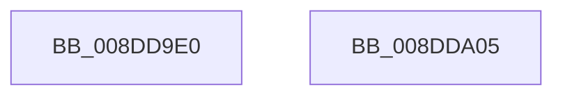

# PnpIsNullGuid

- RVA: `0x008DD9E0`–`0x008DDA06` (길이 `38` bytes)
- VA: `0x00000001408DD9E0`
- 실행 섹션: `PAGE`
- PDB 이름 있음: `예`; PDB Function 태그: `아니요`
- unwind 정보 RVA: `0x0005C788`
- 디코드: `10`개 명령, `38/38` bytes 표시
- 미해석 바이트: `0` (있으면 어셈블리에 `.byte`로 보존)

> 이 문서는 커널 이미지의 기계어와 PDB 기호를 분석해 생성했습니다. 4번과 5번은 함수 원형과 자료형을 바이너리 사용 방식에서 추정한 C 해석이며 원본 소스 복구 결과는 아닙니다.

## 1. Dependencies

- 직접 호출 지점: **1**; 고유 호출 대상: **1**
- 직접 호출자로 확인된 함수: **7**
- RIP 상대 이미지 참조: **1**

### Outgoing calls
- `0x008DD9F4` → [RtlCompareMemory](../../text/6B/RtlCompareMemory_function_006BA670.md) (function, `0x006BA670`)

### Direct callers
- [PiDqIrpQueryCreate](PiDqIrpQueryCreate_function_008DCC04.md) at `0x008DCD97`
- [PiDqObjectManagerServiceActionQueue](PiDqObjectManagerServiceActionQueue_function_008DD640.md) at `0x008DD8D4`
- [PiDevCfgResetDeviceDriverSettings](../96/PiDevCfgResetDeviceDriverSettings_function_00966168.md) at `0x009662EE`
- [PiDevCfgFindDeviceDriver](../97/PiDevCfgFindDeviceDriver_function_0097602C.md) at `0x0097693F`
- [PiDevCfgFindDeviceDriver](../97/PiDevCfgFindDeviceDriver_function_0097602C.md) at `0x00976C16`
- [PiDevCfgConfigureDevice](../97/PiDevCfgConfigureDevice_function_00977BB4.md) at `0x0097892D`
- [PiDevCfgConfigureDevice](../97/PiDevCfgConfigureDevice_function_00977BB4.md) at `0x00978940`
- [PiDevCfgConfigureDevice](../97/PiDevCfgConfigureDevice_function_00977BB4.md) at `0x00978A3B`
- [PiDevCfgBuildDriverConfigurationId](../AB/PiDevCfgBuildDriverConfigurationId_function_00ABC0D0.md) at `0x00ABC13A`
- [PiDevCfgBuildDriverConfigurationId](../AB/PiDevCfgBuildDriverConfigurationId_function_00ABC0D0.md) at `0x00ABC223`
- [sub_00B1DC0E](../B1/Unknown_function_00B1DC0E.md) at `0x00B1DCFF`
- [sub_00B1DC0E](../B1/Unknown_function_00B1DC0E.md) at `0x00B1DD1A`

### Static image references
- `0x008DD9ED` → RVA `0x000112D0` (`.rdata`; read)

## 2. Other-region calls and transfers

- 다른 실행 섹션으로 향하는 call: **1**
  - `0x008DD9F4` → [RtlCompareMemory](../../text/6B/RtlCompareMemory_function_006BA670.md) (`PAGE` → `.text`)
- 별도 외부 분기/꼬리 이동을 확인하지 못했습니다.

## 3. Assembly (complete function range)

```asm
008DD9E0  48 83 EC 28                     sub rsp, 0x28
008DD9E4  48 8B D1                        mov rdx, rcx
008DD9E7  41 B8 10 00 00 00               mov r8d, 0x10
008DD9ED  48 8D 0D DC 38 73 FF            lea rcx, [rip - 0x8cc724]
008DD9F4  E8 77 CC DD FF                  call 0x1406ba670
008DD9F9  48 83 F8 10                     cmp rax, 0x10
008DD9FD  0F 94 C0                        sete al
008DDA00  48 83 C4 28                     add rsp, 0x28
008DDA04  C3                              ret
008DDA05  CC                              int3
```

## 4. C-style interpretation (structured pseudocode)

```c
__int64 __fastcall PnpIsNullGuid(__int64 a1)
{
    __int64 result;
    __int64 v_rsp;

    v_rsp = (v_rsp) - (40);
    result = RtlCompareMemory(v_rip - 9226020, a1, 16, a4);
    result = (result == 16) ? 1 : 0;
    v_rsp = (v_rsp) + (40);
    return result;
}
```

## 5. (Beta) C Style

```c
int64_t PnpIsNullGuid(int64_t Arg1)
{
    int64_t result;
    int64_t local_rsp;

    local_rsp = (local_rsp) - (40);
    result = RtlCompareMemory(v_rip - 9226020, Arg1, 16, a4);
    result = (result == 16) ? 1 : 0;
    local_rsp = (local_rsp) + (40);
    return result;
}
```

## 6. Execution-region graph

[열기: 2D/3D 그래프와 함수 탐색 컨트롤 패널](../../../control-panel.html?section=page&rva=0x008DD9E0&view=graph)

- 2D 그래프는 위에서 아래로 흐르고, 3D 그래프는 빈 공간을 드래그해 회전합니다. Shift+드래그는 이동, 휠은 확대·축소, 함수 노드 선택은 대상 보고서 이동입니다.

### Static fallback


