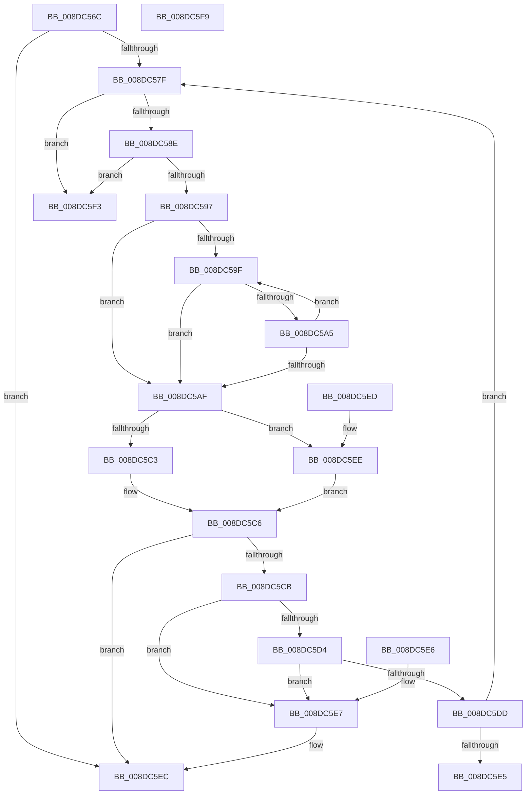

# PnpValidateMultiSz

- RVA: `0x008DC56C`–`0x008DC5FA` (길이 `142` bytes)
- VA: `0x00000001408DC56C`
- 실행 섹션: `PAGE`
- PDB 이름 있음: `예`; PDB Function 태그: `아니요`
- unwind 정보 RVA: `0x000DB714`
- 디코드: `50`개 명령, `142/142` bytes 표시
- 미해석 바이트: `0` (있으면 어셈블리에 `.byte`로 보존)

> 이 문서는 커널 이미지의 기계어와 PDB 기호를 분석해 생성했습니다. 4번과 5번은 함수 원형과 자료형을 바이너리 사용 방식에서 추정한 C 해석이며 원본 소스 복구 결과는 아닙니다.

## 1. Dependencies

- 직접 호출 지점: **0**; 고유 호출 대상: **0**
- 직접 호출자로 확인된 함수: **2**
- RIP 상대 이미지 참조: **0**

### Outgoing calls
- 직접 디코드된 call 명령이 없습니다.

### Direct callers
- [PiSwValidateCreateData](PiSwValidateCreateData_function_008DB958.md) at `0x008DBA7B`
- [PiSwValidateCreateData](PiSwValidateCreateData_function_008DB958.md) at `0x008DBAF9`
- [PiDqQueryValidateQueryData](PiDqQueryValidateQueryData_function_008DC67C.md) at `0x008DC787`
- [PiDqQueryValidateQueryData](PiDqQueryValidateQueryData_function_008DC67C.md) at `0x008DC7A6`

### Static image references
- 디코드된 RIP-relative 메모리 참조가 없습니다.

## 2. Other-region calls and transfers

- 다른 실행 섹션으로 향하는 call: **0**
- 별도 외부 분기/꼬리 이동을 확인하지 못했습니다.

## 3. Assembly (complete function range)

```asm
008DC56C  45 33 DB                        xor r11d, r11d
008DC56F  4C 8B D1                        mov r10, rcx
008DC572  B8 0D 00 00 C0                  mov eax, 0xc000000d
008DC577  45 8B CB                        mov r9d, r11d
008DC57A  48 85 C9                        test rcx, rcx
008DC57D  74 6D                           je 0x1408dc5ec
008DC57F  4C 8B C2                        mov r8, rdx
008DC582  4B 8D 04 4A                     lea rax, [r10 + r9*2]
008DC586  4D 2B C1                        sub r8, r9
008DC589  48 85 C0                        test rax, rax
008DC58C  74 65                           je 0x1408dc5f3
008DC58E  49 81 F8 FF FF FF 7F            cmp r8, 0x7fffffff
008DC595  77 5C                           ja 0x1408dc5f3
008DC597  49 8B C8                        mov rcx, r8
008DC59A  4D 85 C0                        test r8, r8
008DC59D  74 10                           je 0x1408dc5af
008DC59F  66 44 39 18                     cmp word ptr [rax], r11w
008DC5A3  74 0A                           je 0x1408dc5af
008DC5A5  48 83 C0 02                     add rax, 2
008DC5A9  48 83 E9 01                     sub rcx, 1
008DC5AD  75 F0                           jne 0x1408dc59f
008DC5AF  48 8B C1                        mov rax, rcx
008DC5B2  48 F7 D8                        neg rax
008DC5B5  1B C0                           sbb eax, eax
008DC5B7  F7 D0                           not eax
008DC5B9  25 0D 00 00 C0                  and eax, 0xc000000d
008DC5BE  48 85 C9                        test rcx, rcx
008DC5C1  74 2B                           je 0x1408dc5ee
008DC5C3  4C 2B C1                        sub r8, rcx
008DC5C6  48 85 C9                        test rcx, rcx
008DC5C9  74 21                           je 0x1408dc5ec
008DC5CB  4B 8D 04 08                     lea rax, [r8 + r9]
008DC5CF  49 3B C1                        cmp rax, r9
008DC5D2  72 13                           jb 0x1408dc5e7
008DC5D4  4C 8D 48 01                     lea r9, [rax + 1]
008DC5D8  4C 3B C8                        cmp r9, rax
008DC5DB  72 0A                           jb 0x1408dc5e7
008DC5DD  41 8B C3                        mov eax, r11d
008DC5E0  4D 85 C0                        test r8, r8
008DC5E3  75 9A                           jne 0x1408dc57f
008DC5E5  C3                              ret
008DC5E6  CC                              int3
008DC5E7  B8 95 00 00 C0                  mov eax, 0xc0000095
008DC5EC  C3                              ret
008DC5ED  CC                              int3
008DC5EE  4D 8B C3                        mov r8, r11
008DC5F1  EB D3                           jmp 0x1408dc5c6
008DC5F3  B8 0D 00 00 C0                  mov eax, 0xc000000d
008DC5F8  C3                              ret
008DC5F9  CC                              int3
```

## 4. C-style interpretation (structured pseudocode)

```c
__int64 __fastcall PnpValidateMultiSz(__int64 a1, __int64 a2)
{
    __int64 result;
    __int64 v_r11;

    v_r11 = 0;
    if (a1 == 0) goto loc_008DC5EC;
loc_008DC57F:
    a3 = (a2) - (0);
    if (a1 + 0 * 2 == 0) goto loc_008DC5F3;
    if (a3 > 0x7FFFFFFFULL) goto loc_008DC5F3;
    if (a3 == 0) goto loc_008DC5AF;
loc_008DC59F:
    if ((*(unsigned __int16 *)(a1 + 0 * 2)) == 0) goto loc_008DC5AF;
    result = (a1 + 0 * 2) + (2);
    a1 = (a3) - (1);
    if (condition_is_not_equal) goto loc_008DC59F;
loc_008DC5AF:
    result = -(a1);
    result = (unsigned int)(~(result));
    result = (unsigned int)((result) & (0xC000000DULL));
    if (a1 == 0) goto loc_008DC5EE;
    a3 = (a3) - (a1);
loc_008DC5C6:
    if (a1 == 0) goto loc_008DC5EC;
    if ((a3 + 0 * 1) < 0) goto loc_008DC5E7;
    if ((a3 + 0 * 1 + 1) < (a3 + 0 * 1)) goto loc_008DC5E7;
    if (a3 != 0) goto loc_008DC57F;
    return 0;
loc_008DC5E7:
loc_008DC5EC:
    return (unsigned int)(0xC0000095ULL);
loc_008DC5EE:
    goto loc_008DC5C6;
loc_008DC5F3:
    return (unsigned int)(0xC000000DULL);
}
```

## 5. (Beta) C Style

```c
int64_t PnpValidateMultiSz(void *Arg1, int64_t Arg2)
{
    uint8_t *arg1 = (uint8_t *)Arg1;

    int64_t result;
    int64_t local_r11;

    local_r11 = 0;
    if (Arg1 == NULL) goto loc_008DC5EC;
loc_008DC57F:
    a3 = (Arg2) - (0);
    if (Arg1 + 0 * 2 == 0) goto loc_008DC5F3;
    if (a3 > 0x7FFFFFFFULL) goto loc_008DC5F3;
    if (a3 == 0) goto loc_008DC5AF;
loc_008DC59F:
    if ((*(uint16_t *)(arg1 + 0x0 * 2)) == 0) goto loc_008DC5AF;
    result = (Arg1 + 0 * 2) + (2);
    Arg1 = (a3) - (1);
    if (condition_is_not_equal) goto loc_008DC59F;
loc_008DC5AF:
    result = -(Arg1);
    result = (uint32_t)(~(result));
    result = (uint32_t)((result) & (0xC000000DULL));
    if (Arg1 == NULL) goto loc_008DC5EE;
    a3 = (a3) - (Arg1);
loc_008DC5C6:
    if (Arg1 == NULL) goto loc_008DC5EC;
    if ((a3 + 0 * 1) < 0) goto loc_008DC5E7;
    if ((a3 + 0 * 1 + 1) < (a3 + 0 * 1)) goto loc_008DC5E7;
    if (a3 != 0) goto loc_008DC57F;
    return 0;
loc_008DC5E7:
loc_008DC5EC:
    return (uint32_t)(0xC0000095ULL);
loc_008DC5EE:
    goto loc_008DC5C6;
loc_008DC5F3:
    return (uint32_t)(0xC000000DULL);
}
```

### 관측된 메모리 오프셋

구조체 형식이 확인되지 않은 접근은 인자 기준의 오프셋으로만 기록했습니다.

| 기준 인자 | 오프셋 표현 | 폭 (bit) | 접근 |
|---|---:|---:|---|
| `Arg1` | `+ 0x0 + r9*2` | `64` | `R` |

## 6. Execution-region graph

[열기: 2D/3D 그래프와 함수 탐색 컨트롤 패널](../../../control-panel.html?section=page&rva=0x008DC56C&view=graph)

- 2D 그래프는 위에서 아래로 흐르고, 3D 그래프는 빈 공간을 드래그해 회전합니다. Shift+드래그는 이동, 휠은 확대·축소, 함수 노드 선택은 대상 보고서 이동입니다.

### Static fallback


