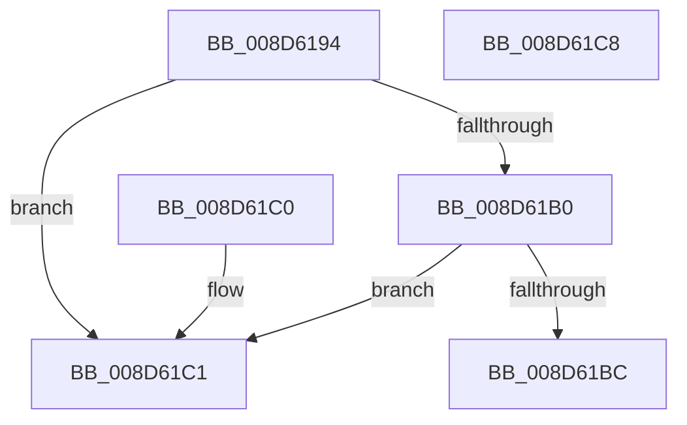

# PsGetSessionLocaleId

- RVA: `0x008D6194`–`0x008D61C9` (길이 `53` bytes)
- VA: `0x00000001408D6194`
- 실행 섹션: `PAGE`
- PDB 이름 있음: `예`; PDB Function 태그: `아니요`
- unwind 정보 RVA: `0x000DB714`
- 디코드: `13`개 명령, `53/53` bytes 표시
- 미해석 바이트: `0` (있으면 어셈블리에 `.byte`로 보존)

> 이 문서는 커널 이미지의 기계어와 PDB 기호를 분석해 생성했습니다. 4번과 5번은 함수 원형과 자료형을 바이너리 사용 방식에서 추정한 C 해석이며 원본 소스 복구 결과는 아닙니다.

## 1. Dependencies

- 직접 호출 지점: **0**; 고유 호출 대상: **0**
- 직접 호출자로 확인된 함수: **2**
- RIP 상대 이미지 참조: **1**

### Outgoing calls
- 직접 디코드된 call 명령이 없습니다.

### Direct callers
- [PspUserThreadStartup](PspUserThreadStartup_function_008D5B10.md) at `0x008D5B83`
- [NtQueryDefaultLocale](NtQueryDefaultLocale_function_008D6800.md) at `0x008D6848`

### Static image references
- `0x008D61C1` → RVA `0x00FD9C74` (`PAGEDATA`; read)

## 2. Other-region calls and transfers

- 다른 실행 섹션으로 향하는 call: **0**
- 별도 외부 분기/꼬리 이동을 확인하지 못했습니다.

## 3. Assembly (complete function range)

```asm
008D6194  65 48 8B 04 25 88 01 00 00      mov rax, qword ptr gs:[0x188]
008D619D  48 8B 88 B8 00 00 00            mov rcx, qword ptr [rax + 0xb8]
008D61A4  48 8B 81 E8 02 00 00            mov rax, qword ptr [rcx + 0x2e8]
008D61AB  48 85 C0                        test rax, rax
008D61AE  74 11                           je 0x1408d61c1
008D61B0  F7 81 FC 05 00 00 00 10 00 00   test dword ptr [rcx + 0x5fc], 0x1000
008D61BA  75 05                           jne 0x1408d61c1
008D61BC  8B 40 30                        mov eax, dword ptr [rax + 0x30]
008D61BF  C3                              ret
008D61C0  CC                              int3
008D61C1  8B 05 AD 3A 70 00               mov eax, dword ptr [rip + 0x703aad]
008D61C7  C3                              ret
008D61C8  CC                              int3
```

## 4. C-style interpretation (structured pseudocode)

```c
__int64 __fastcall PsGetSessionLocaleId(void)
{
    if (*(unsigned __int64 *)(*(unsigned __int64 *)(*(unsigned __int64 *)(gs_base + (0 + 392)) + 184) + 744) == 0) goto loc_008D61C1;
    if (((*(unsigned int *)(*(unsigned __int64 *)(*(unsigned __int64 *)(gs_base + (0 + 392)) + 184) + 1532)) & (0x1000ULL)) != 0) goto loc_008D61C1;
    return (unsigned int)(*(unsigned int *)(*(unsigned __int64 *)(*(unsigned __int64 *)(*(unsigned __int64 *)(gs_base + (0 + 392)) + 184) + 744) + 48));
loc_008D61C1:
    return (unsigned int)(*(unsigned int *)(v_rip + 7355053));
}
```

## 5. (Beta) C Style

```c
void PsGetSessionLocaleId(void)
{
    if (*(uint64_t *)(*(uint64_t *)(*(uint64_t *)(gs_base + (0 + 0x188)) + 0xB8) + 0x2E8) == 0) goto loc_008D61C1;
    if (((*(uint32_t *)(*(uint64_t *)(*(uint64_t *)(gs_base + (0 + 0x188)) + 0xB8) + 0x5FC)) & (0x1000ULL)) != 0) goto loc_008D61C1;
    return (uint32_t)(*(uint32_t *)(*(uint64_t *)(*(uint64_t *)(*(uint64_t *)(gs_base + (0 + 0x188)) + 0xB8) + 0x2E8) + 0x30));
loc_008D61C1:
    return (uint32_t)(*(uint32_t *)(v_rip + 0x703AAD));
}
```

## 6. Execution-region graph

[열기: 2D/3D 그래프와 함수 탐색 컨트롤 패널](../../../control-panel.html?section=page&rva=0x008D6194&view=graph)

- 2D 그래프는 위에서 아래로 흐르고, 3D 그래프는 빈 공간을 드래그해 회전합니다. Shift+드래그는 이동, 휠은 확대·축소, 함수 노드 선택은 대상 보고서 이동입니다.

### Static fallback


