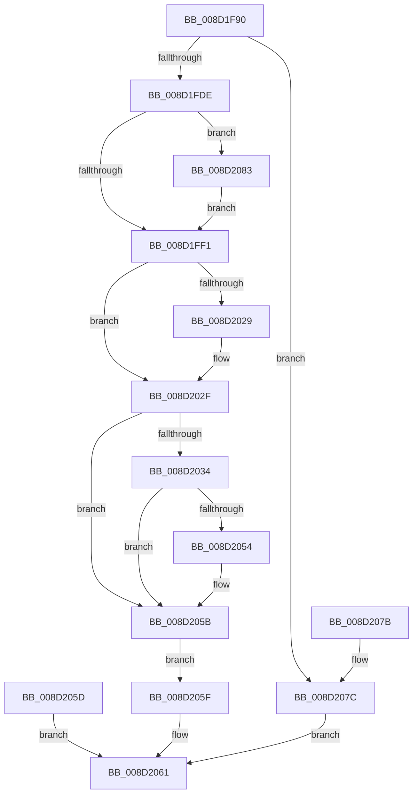

# PsGetSupportedProcessorArchitectures

- RVA: `0x008D1F90`–`0x008D2090` (길이 `256` bytes)
- VA: `0x00000001408D1F90`
- 실행 섹션: `PAGE`
- PDB 이름 있음: `예`; PDB Function 태그: `아니요`
- unwind 정보 RVA: `0x00084C5C`
- 디코드: `78`개 명령, `256/256` bytes 표시
- 미해석 바이트: `0` (있으면 어셈블리에 `.byte`로 보존)

> 이 문서는 커널 이미지의 기계어와 PDB 기호를 분석해 생성했습니다. 4번과 5번은 함수 원형과 자료형을 바이너리 사용 방식에서 추정한 C 해석이며 원본 소스 복구 결과는 아닙니다.

## 1. Dependencies

- 직접 호출 지점: **3**; 고유 호출 대상: **3**
- 직접 호출자로 확인된 함수: **1**
- RIP 상대 이미지 참조: **0**

### Outgoing calls
- `0x008D1FBB` → [PsWow64IsMachineSupported](PsWow64IsMachineSupported_function_008D20A0.md) (function, `0x008D20A0`)
- `0x008D1FF9` → [memset](../../text/6C/memset_function_006C6C40.md) (function, `0x006C6C40`)
- `0x008D2083` → [PsWow64GetProcessMachine](PsWow64GetProcessMachine_function_008D2130.md) (function, `0x008D2130`)

### Direct callers
- [ExpQuerySystemInformation](../A5/ExpQuerySystemInformation_function_00A57858.md) at `0x00A5B321`

### Static image references
- 디코드된 RIP-relative 메모리 참조가 없습니다.

## 2. Other-region calls and transfers

- 다른 실행 섹션으로 향하는 call: **1**
  - `0x008D1FF9` → [memset](../../text/6C/memset_function_006C6C40.md) (`PAGE` → `.text`)
- 별도 외부 분기/꼬리 이동을 확인하지 못했습니다.

## 3. Assembly (complete function range)

```asm
008D1F90  48 89 5C 24 08                  mov qword ptr [rsp + 8], rbx
008D1F95  48 89 74 24 10                  mov qword ptr [rsp + 0x10], rsi
008D1F9A  48 89 7C 24 18                  mov qword ptr [rsp + 0x18], rdi
008D1F9F  41 54                           push r12
008D1FA1  41 56                           push r14
008D1FA3  41 57                           push r15
008D1FA5  48 83 EC 30                     sub rsp, 0x30
008D1FA9  49 8B D9                        mov rbx, r9
008D1FAC  41 8B F8                        mov edi, r8d
008D1FAF  48 8B F1                        mov rsi, rcx
008D1FB2  41 BC 4C 01 00 00               mov r12d, 0x14c
008D1FB8  41 8B CC                        mov ecx, r12d
008D1FBB  E8 E0 00 00 00                  call 0x1408d20a0
008D1FC0  44 8B F8                        mov r15d, eax
008D1FC3  8B D0                           mov edx, eax
008D1FC5  F7 DA                           neg edx
008D1FC7  45 1B F6                        sbb r14d, r14d
008D1FCA  41 83 E6 04                     and r14d, 4
008D1FCE  41 83 C6 08                     add r14d, 8
008D1FD2  44 89 33                        mov dword ptr [rbx], r14d
008D1FD5  44 3B F7                        cmp r14d, edi
008D1FD8  0F 87 9E 00 00 00               ja 0x1408d207c
008D1FDE  33 FF                           xor edi, edi
008D1FE0  0F B7 DF                        movzx ebx, di
008D1FE3  48 8B 4C 24 70                  mov rcx, qword ptr [rsp + 0x70]
008D1FE8  48 85 C9                        test rcx, rcx
008D1FEB  0F 85 92 00 00 00               jne 0x1408d2083
008D1FF1  45 8B C6                        mov r8d, r14d
008D1FF4  33 D2                           xor edx, edx
008D1FF6  48 8B CE                        mov rcx, rsi
008D1FF9  E8 42 4C DF FF                  call 0x1406c6c40
008D1FFE  8B 0E                           mov ecx, dword ptr [rsi]
008D2000  81 E1 64 86 FF FF               and ecx, 0xffff8664
008D2006  B8 64 86 00 00                  mov eax, 0x8664
008D200B  0B C8                           or ecx, eax
008D200D  89 0E                           mov dword ptr [rsi], ecx
008D200F  0F BA E9 10                     bts ecx, 0x10
008D2013  89 0E                           mov dword ptr [rsi], ecx
008D2015  BA 00 00 02 00                  mov edx, 0x20000
008D201A  0B CA                           or ecx, edx
008D201C  89 0E                           mov dword ptr [rsi], ecx
008D201E  0F BA E9 12                     bts ecx, 0x12
008D2022  89 0E                           mov dword ptr [rsi], ecx
008D2024  66 3B C3                        cmp ax, bx
008D2027  75 06                           jne 0x1408d202f
008D2029  0F BA E9 13                     bts ecx, 0x13
008D202D  89 0E                           mov dword ptr [rsi], ecx
008D202F  45 85 FF                        test r15d, r15d
008D2032  74 27                           je 0x1408d205b
008D2034  8B 46 04                        mov eax, dword ptr [rsi + 4]
008D2037  25 4C 01 FF FF                  and eax, 0xffff014c
008D203C  41 0B C4                        or eax, r12d
008D203F  89 46 04                        mov dword ptr [rsi + 4], eax
008D2042  0B C2                           or eax, edx
008D2044  89 46 04                        mov dword ptr [rsi + 4], eax
008D2047  0F BA E8 14                     bts eax, 0x14
008D204B  89 46 04                        mov dword ptr [rsi + 4], eax
008D204E  66 44 3B E3                     cmp r12w, bx
008D2052  75 07                           jne 0x1408d205b
008D2054  0F BA E8 13                     bts eax, 0x13
008D2058  89 46 04                        mov dword ptr [rsi + 4], eax
008D205B  EB 02                           jmp 0x1408d205f
008D205D  EB 02                           jmp 0x1408d2061
008D205F  33 C0                           xor eax, eax
008D2061  48 8B 5C 24 50                  mov rbx, qword ptr [rsp + 0x50]
008D2066  48 8B 74 24 58                  mov rsi, qword ptr [rsp + 0x58]
008D206B  48 8B 7C 24 60                  mov rdi, qword ptr [rsp + 0x60]
008D2070  48 83 C4 30                     add rsp, 0x30
008D2074  41 5F                           pop r15
008D2076  41 5E                           pop r14
008D2078  41 5C                           pop r12
008D207A  C3                              ret
008D207B  CC                              int3
008D207C  B8 23 00 00 C0                  mov eax, 0xc0000023
008D2081  EB DE                           jmp 0x1408d2061
008D2083  E8 A8 00 00 00                  call 0x1408d2130
008D2088  0F B7 D8                        movzx ebx, ax
008D208B  E9 61 FF FF FF                  jmp 0x1408d1ff1
```

## 4. C-style interpretation (structured pseudocode)

```c
__int64 __fastcall PsGetSupportedProcessorArchitectures(__int64 a1, __int64 a2, int a3, __int64 a4, __int64 a5)
{
    __int64 result;
    __int64 v_r14;
    __int64 v_rdi;
    __int64 v_rsp;
    unsigned __int64 v_stack_p10;
    unsigned __int64 v_stack_p18;
    unsigned __int64 v_stack_p8;

    v_stack_p8 = v_rbx;
    v_stack_p10 = v_rsi;
    v_stack_p18 = v_rdi;
    v_rsp = (v_rsp) - (48);
    result = PsWow64IsMachineSupported(332, a2, a3, a4);
    a2 = (unsigned int)(-((unsigned int)((unsigned int)(result))));
    v_r14 = (unsigned int)((v_r14) & (4));
    v_r14 = (unsigned int)((v_r14) + (8));
    *(unsigned int *)(a4) = (unsigned int)(v_r14);
    if (((unsigned int)(v_r14)) > ((unsigned int)((unsigned int)(a3)))) goto loc_008D207C;
    v_rdi = 0;
    if (a5 != 0) goto loc_008D2083;
loc_008D1FF1:
    a2 = 0;
    result = memset(a1, a2, (unsigned int)((unsigned int)(v_r14)), a4);
    a1 = (unsigned int)(((unsigned int)(*(unsigned int *)(a1))) & (0xFFFF8664ULL));
    a1 = (unsigned int)((a1) | ((unsigned int)((unsigned int)(0x8664ULL))));
    *(unsigned int *)(a1) = (unsigned int)(a1);
    *(unsigned int *)(a1) = (unsigned int)(a1);
    a1 = (unsigned int)((a1) | ((unsigned int)((unsigned int)(0x20000ULL))));
    *(unsigned int *)(a1) = (unsigned int)(a1);
    *(unsigned int *)(a1) = (unsigned int)(a1);
    if (((unsigned __int16)((unsigned int)(0x8664ULL))) == 0) {
        *(unsigned int *)(a1) = (unsigned int)(a1);
    }
    if ((unsigned int)((unsigned int)((unsigned int)(result))) == 0) goto loc_008D205B;
    result = (unsigned int)(((unsigned int)(*(unsigned int *)(a1 + 4))) & (0xFFFF014CULL));
    result = (unsigned int)((result) | (332));
    *(unsigned int *)(a1 + 4) = (unsigned int)(result);
    result = (unsigned int)((result) | ((unsigned int)((unsigned int)(0x20000ULL))));
    *(unsigned int *)(a1 + 4) = (unsigned int)(result);
    *(unsigned int *)(a1 + 4) = (unsigned int)(result);
    if (332 == 0) {
        *(unsigned int *)(a1 + 4) = (unsigned int)(result);
    }
    goto loc_008D205F;
loc_008D205F:
    result = 0;
loc_008D2061:
    v_rsp = (v_rsp) + (48);
    return result;
loc_008D207C:
    goto loc_008D2061;
loc_008D2083:
    result = PsWow64GetProcessMachine(a1, (unsigned int)(0x20000ULL), (unsigned int)((unsigned int)(v_r14)), a4);
    goto loc_008D1FF1;
}
```

## 5. (Beta) C Style

```c
int64_t PsGetSupportedProcessorArchitectures(void *Arg1, int64_t Arg2, int32_t Arg3, void *Arg4, int64_t Arg5)
{
    uint8_t *arg1 = (uint8_t *)Arg1;
    uint8_t *arg4 = (uint8_t *)Arg4;

    int64_t result;
    int64_t local_r14;
    int64_t local_rdi;
    int64_t local_rsp;
    uint64_t v_stack_p10;
    uint64_t v_stack_p18;
    uint64_t v_stack_p8;

    v_stack_p8 = local_rbx;
    v_stack_p10 = local_rsi;
    v_stack_p18 = local_rdi;
    local_rsp = (local_rsp) - (48);
    result = PsWow64IsMachineSupported(332, Arg2, Arg3, Arg4);
    Arg2 = (uint32_t)(-((uint32_t)((uint32_t)(result))));
    local_r14 = (uint32_t)((local_r14) & (4));
    local_r14 = (uint32_t)((local_r14) + (8));
    *(uint32_t *)(arg4) = (uint32_t)(local_r14);
    if (((uint32_t)(local_r14)) > ((uint32_t)((uint32_t)(Arg3)))) goto loc_008D207C;
    local_rdi = 0;
    if (Arg5 != 0) goto loc_008D2083;
loc_008D1FF1:
    Arg2 = 0;
    result = memset(Arg1, Arg2, (uint32_t)((uint32_t)(local_r14)), Arg4);
    Arg1 = (uint32_t)(((uint32_t)(*(uint32_t *)(arg1))) & (0xFFFF8664ULL));
    Arg1 = (uint32_t)((Arg1) | ((uint32_t)((uint32_t)(0x8664ULL))));
    *(uint32_t *)(arg1) = (uint32_t)(Arg1);
    *(uint32_t *)(arg1) = (uint32_t)(Arg1);
    Arg1 = (uint32_t)((Arg1) | ((uint32_t)((uint32_t)(0x20000ULL))));
    *(uint32_t *)(arg1) = (uint32_t)(Arg1);
    *(uint32_t *)(arg1) = (uint32_t)(Arg1);
    if (((uint16_t)((uint32_t)(0x8664ULL))) == 0) {
        *(uint32_t *)(arg1) = (uint32_t)(Arg1);
    }
    if ((uint32_t)((uint32_t)((uint32_t)(result))) == 0) goto loc_008D205B;
    result = (uint32_t)(((uint32_t)(*(uint32_t *)(arg1 + 0x4))) & (0xFFFF014CULL));
    result = (uint32_t)((result) | (332));
    *(uint32_t *)(arg1 + 0x4) = (uint32_t)(result);
    result = (uint32_t)((result) | ((uint32_t)((uint32_t)(0x20000ULL))));
    *(uint32_t *)(arg1 + 0x4) = (uint32_t)(result);
    *(uint32_t *)(arg1 + 0x4) = (uint32_t)(result);
    if (332 == 0) {
        *(uint32_t *)(arg1 + 0x4) = (uint32_t)(result);
    }
    goto loc_008D205F;
loc_008D205F:
    result = 0;
loc_008D2061:
    local_rsp = (local_rsp) + (48);
    return result;
loc_008D207C:
    goto loc_008D2061;
loc_008D2083:
    result = PsWow64GetProcessMachine(Arg1, (uint32_t)(0x20000ULL), (uint32_t)((uint32_t)(local_r14)), Arg4);
    goto loc_008D1FF1;
}
```

### 관측된 메모리 오프셋

구조체 형식이 확인되지 않은 접근은 인자 기준의 오프셋으로만 기록했습니다.

| 기준 인자 | 오프셋 표현 | 폭 (bit) | 접근 |
|---|---:|---:|---|
| `Arg1` | `+ 0x0` | `32` | `R` |
| `Arg1` | `+ 0x0` | `32` | `W` |
| `Arg1` | `+ 0x4` | `32` | `R` |
| `Arg1` | `+ 0x4` | `32` | `W` |
| `Arg4` | `+ 0x0` | `32` | `W` |

## 6. Execution-region graph

[열기: 2D/3D 그래프와 함수 탐색 컨트롤 패널](../../../control-panel.html?section=page&rva=0x008D1F90&view=graph)

- 2D 그래프는 위에서 아래로 흐르고, 3D 그래프는 빈 공간을 드래그해 회전합니다. Shift+드래그는 이동, 휠은 확대·축소, 함수 노드 선택은 대상 보고서 이동입니다.

### Static fallback


