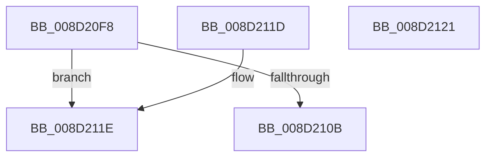

# PsQuerySystemDllInfo

- RVA: `0x008D20F8`–`0x008D2122` (길이 `42` bytes)
- VA: `0x00000001408D20F8`
- 실행 섹션: `PAGE`
- PDB 이름 있음: `예`; PDB Function 태그: `아니요`
- unwind 정보 RVA: `0x000DB714`
- 디코드: `15`개 명령, `42/42` bytes 표시
- 미해석 바이트: `0` (있으면 어셈블리에 `.byte`로 보존)

> 이 문서는 커널 이미지의 기계어와 PDB 기호를 분석해 생성했습니다. 4번과 5번은 함수 원형과 자료형을 바이너리 사용 방식에서 추정한 C 해석이며 원본 소스 복구 결과는 아닙니다.

## 1. Dependencies

- 직접 호출 지점: **0**; 고유 호출 대상: **0**
- 직접 호출자로 확인된 함수: **8**
- RIP 상대 이미지 참조: **1**

### Outgoing calls
- 직접 디코드된 call 명령이 없습니다.

### Direct callers
- [PspWow64PickBestNtdll](../../text/4A/PspWow64PickBestNtdll_function_004A1088.md) at `0x004A109E`
- [PspWow64PickBestNtdll](../../text/4A/PspWow64PickBestNtdll_function_004A1088.md) at `0x004A10D4`
- [PsWow64IsMachineSupported](PsWow64IsMachineSupported_function_008D20A0.md) at `0x008D20C4`
- [DbgkCreateThread](DbgkCreateThread_function_008D5E34.md) at `0x008D5FE7`
- [DbgkSendSystemDllMessages](../A1/DbgkSendSystemDllMessages_function_00A10C04.md) at `0x00A10CA8`
- [ExpSystemErrorHandler2](../../pagelk/B7/ExpSystemErrorHandler2_function_00B72C30.md) at `0x00B72DF9`
- [MmInitSystemDll](../../init/BE/MmInitSystemDll_function_00BEEFB0.md) at `0x00BEEFB8`
- [PspInitializeSystemDlls](../../init/C4/PspInitializeSystemDlls_function_00C45DC4.md) at `0x00C45DF1`
- [PspLocateNtdllAddressesForScpCfg](../../init/C4/PspLocateNtdllAddressesForScpCfg_function_00C46CB0.md) at `0x00C46CFB`

### Static image references
- `0x008D20FB` → RVA `0x00FD8130` (`PAGEDATA`; read)

## 2. Other-region calls and transfers

- 다른 실행 섹션으로 향하는 call: **0**
- 별도 외부 분기/꼬리 이동을 확인하지 못했습니다.

## 3. Assembly (complete function range)

```asm
008D20F8  48 63 C1                        movsxd rax, ecx
008D20FB  48 8D 0D 2E 60 70 00            lea rcx, [rip + 0x70602e]
008D2102  48 8B 0C C1                     mov rcx, qword ptr [rcx + rax*8]
008D2106  48 85 C9                        test rcx, rcx
008D2109  74 13                           je 0x1408d211e
008D210B  48 8B 41 20                     mov rax, qword ptr [rcx + 0x20]
008D210F  48 83 C1 08                     add rcx, 8
008D2113  48 F7 D8                        neg rax
008D2116  48 1B C0                        sbb rax, rax
008D2119  48 23 C1                        and rax, rcx
008D211C  C3                              ret
008D211D  CC                              int3
008D211E  33 C0                           xor eax, eax
008D2120  C3                              ret
008D2121  CC                              int3
```

## 4. C-style interpretation (structured pseudocode)

```c
__int64 __fastcall PsQuerySystemDllInfo(int a1)
{
    __int64 result;

    if (*(unsigned __int64 *)(v_rip + 7364654 + (int)(a1) * 8) == 0) goto loc_008D211E;
    a1 = (*(unsigned __int64 *)(v_rip + 7364654 + (int)(a1) * 8)) + (8);
    result = -(*(unsigned __int64 *)(*(unsigned __int64 *)(v_rip + 7364654 + (int)(a1) * 8) + 32));
    result = (result) & (a1);
    return result;
loc_008D211E:
    result = 0;
    return result;
}
```

## 5. (Beta) C Style

```c
int64_t PsQuerySystemDllInfo(int32_t Arg1)
{
    int64_t result;

    if (*(uint64_t *)(v_rip + 0x70602E + (int32_t)(Arg1) * 8) == 0) goto loc_008D211E;
    Arg1 = (*(uint64_t *)(v_rip + 0x70602E + (int32_t)(Arg1) * 8)) + (8);
    result = -(*(uint64_t *)(*(uint64_t *)(v_rip + 0x70602E + (int32_t)(Arg1) * 8) + 0x20));
    result = (result) & (Arg1);
    return result;
loc_008D211E:
    result = 0;
    return result;
}
```

## 6. Execution-region graph

[열기: 2D/3D 그래프와 함수 탐색 컨트롤 패널](../../../control-panel.html?section=page&rva=0x008D20F8&view=graph)

- 2D 그래프는 위에서 아래로 흐르고, 3D 그래프는 빈 공간을 드래그해 회전합니다. Shift+드래그는 이동, 휠은 확대·축소, 함수 노드 선택은 대상 보고서 이동입니다.

### Static fallback


