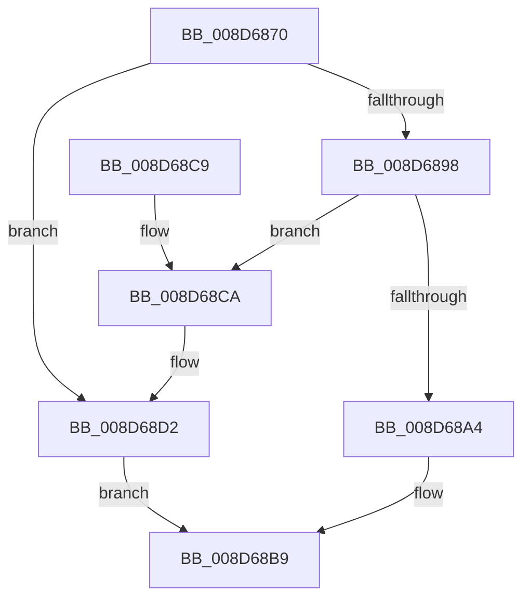

# PsReferenceProcessFilePointer

- RVA: `0x008D6870`–`0x008D68D9` (길이 `105` bytes)
- VA: `0x00000001408D6870`
- 실행 섹션: `PAGE`
- PDB 이름 있음: `예`; PDB Function 태그: `아니요`
- unwind 정보 RVA: `0x00073EA0`
- 디코드: `30`개 명령, `105/105` bytes 표시
- 미해석 바이트: `0` (있으면 어셈블리에 `.byte`로 보존)

> 이 문서는 커널 이미지의 기계어와 PDB 기호를 분석해 생성했습니다. 4번과 5번은 함수 원형과 자료형을 바이너리 사용 방식에서 추정한 C 해석이며 원본 소스 복구 결과는 아닙니다.

## 1. Dependencies

- 직접 호출 지점: **4**; 고유 호출 대상: **3**
- 직접 호출자로 확인된 함수: **7**
- RIP 상대 이미지 참조: **0**

### Outgoing calls
- `0x008D688F` → [ExAcquireRundownProtection](../../text/21/ExAcquireRundownProtection_function_00216620.md) (function, `0x00216620`)
- `0x008D68A4` → [MmGetFileObjectForSection](MmGetFileObjectForSection_function_008D68E0.md) (function, `0x008D68E0`)
- `0x008D68AF` → [ExReleaseRundownProtection](../../text/34/ExReleaseRundownProtection_function_00349E80.md) (function, `0x00349E80`)
- `0x008D68CD` → [ExReleaseRundownProtection](../../text/34/ExReleaseRundownProtection_function_00349E80.md) (function, `0x00349E80`)

### Direct callers
- [SepMandatorySubProcessToken](../../text/4C/SepMandatorySubProcessToken_function_004C0B88.md) at `0x004C0BFB`
- [SepVerifyDesktopAppxImage](../../text/60/SepVerifyDesktopAppxImage_function_0060885C.md) at `0x006088E4`
- [SepVerifyDesktopAppxImage](../../text/60/SepVerifyDesktopAppxImage_function_0060885C.md) at `0x0060891E`
- [PsCheckProcessFileSigningLevel](../78/PsCheckProcessFileSigningLevel_function_00783800.md) at `0x0078388C`
- [DbgkCreateThread](DbgkCreateThread_function_008D5E34.md) at `0x008D5FAE`
- [PspCallProcessNotifyRoutines](../90/PspCallProcessNotifyRoutines_function_00904928.md) at `0x00904BE2`
- [CmpCheckExeOwnerForPca](../9A/CmpCheckExeOwnerForPca_function_009A343C.md) at `0x009A346F`
- [NtQueryInformationProcess](../9A/NtQueryInformationProcess_function_009AA250.md) at `0x009AB6DA`
- [NtQueryInformationProcess](../9A/NtQueryInformationProcess_function_009AA250.md) at `0x009AD865`

### Static image references
- 디코드된 RIP-relative 메모리 참조가 없습니다.

## 2. Other-region calls and transfers

- 다른 실행 섹션으로 향하는 call: **3**
  - `0x008D688F` → [ExAcquireRundownProtection](../../text/21/ExAcquireRundownProtection_function_00216620.md) (`PAGE` → `.text`)
  - `0x008D68AF` → [ExReleaseRundownProtection](../../text/34/ExReleaseRundownProtection_function_00349E80.md) (`PAGE` → `.text`)
  - `0x008D68CD` → [ExReleaseRundownProtection](../../text/34/ExReleaseRundownProtection_function_00349E80.md) (`PAGE` → `.text`)
- 별도 외부 분기/꼬리 이동을 확인하지 못했습니다.

## 3. Assembly (complete function range)

```asm
008D6870  48 89 5C 24 08                  mov qword ptr [rsp + 8], rbx
008D6875  48 89 74 24 10                  mov qword ptr [rsp + 0x10], rsi
008D687A  57                              push rdi
008D687B  48 83 EC 20                     sub rsp, 0x20
008D687F  48 8D B9 E8 01 00 00            lea rdi, [rcx + 0x1e8]
008D6886  48 8B D9                        mov rbx, rcx
008D6889  48 8B CF                        mov rcx, rdi
008D688C  48 8B F2                        mov rsi, rdx
008D688F  E8 8C FD 93 FF                  call 0x140216620
008D6894  84 C0                           test al, al
008D6896  74 3A                           je 0x1408d68d2
008D6898  48 8B 8B A8 02 00 00            mov rcx, qword ptr [rbx + 0x2a8]
008D689F  48 85 C9                        test rcx, rcx
008D68A2  74 26                           je 0x1408d68ca
008D68A4  E8 37 00 00 00                  call 0x1408d68e0
008D68A9  48 8B CF                        mov rcx, rdi
008D68AC  48 8B D8                        mov rbx, rax
008D68AF  E8 CC 35 A7 FF                  call 0x140349e80
008D68B4  33 C0                           xor eax, eax
008D68B6  48 89 1E                        mov qword ptr [rsi], rbx
008D68B9  48 8B 5C 24 30                  mov rbx, qword ptr [rsp + 0x30]
008D68BE  48 8B 74 24 38                  mov rsi, qword ptr [rsp + 0x38]
008D68C3  48 83 C4 20                     add rsp, 0x20
008D68C7  5F                              pop rdi
008D68C8  C3                              ret
008D68C9  CC                              int3
008D68CA  48 8B CF                        mov rcx, rdi
008D68CD  E8 AE 35 A7 FF                  call 0x140349e80
008D68D2  B8 01 00 00 C0                  mov eax, 0xc0000001
008D68D7  EB E0                           jmp 0x1408d68b9
```

## 4. C-style interpretation (structured pseudocode)

```c
__int64 __fastcall PsReferenceProcessFilePointer(__int64 a1, __int64 a2)
{
    __int64 result;
    __int64 v_rsp;
    unsigned __int64 v_stack_p10;
    unsigned __int64 v_stack_p8;

    v_stack_p8 = v_rbx;
    v_stack_p10 = v_rsi;
    v_rsp = (v_rsp) - (32);
    result = ExAcquireRundownProtection(a1 + 488, a2, a3, a4);
    if ((unsigned __int8)(result) == 0) goto loc_008D68D2;
    if (*(unsigned __int64 *)(a1 + 680) == 0) goto loc_008D68CA;
    result = MmGetFileObjectForSection(*(unsigned __int64 *)(a1 + 680), a2, a3, a4);
    result = ExReleaseRundownProtection(a1 + 488, a2, a3, a4);
    result = 0;
    *(unsigned __int64 *)(a2) = 0;
loc_008D68B9:
    v_rsp = (v_rsp) + (32);
    return result;
loc_008D68CA:
    result = ExReleaseRundownProtection(a1 + 488, a2, a3, a4);
loc_008D68D2:
    goto loc_008D68B9;
}
```

## 5. (Beta) C Style

```c
int64_t PsReferenceProcessFilePointer(void *Arg1, void *Arg2)
{
    uint8_t *arg1 = (uint8_t *)Arg1;
    uint8_t *arg2 = (uint8_t *)Arg2;

    int64_t result;
    int64_t local_rsp;
    uint64_t v_stack_p10;
    uint64_t v_stack_p8;

    v_stack_p8 = local_rbx;
    v_stack_p10 = local_rsi;
    local_rsp = (local_rsp) - (32);
    result = ExAcquireRundownProtection(Arg1 + 488, Arg2, a3, a4);
    if ((uint8_t)(result) == 0) goto loc_008D68D2;
    if (*(uint64_t *)(arg1 + 0x2A8) == 0) goto loc_008D68CA;
    result = MmGetFileObjectForSection(*(uint64_t *)(arg1 + 0x2A8), Arg2, a3, a4);
    result = ExReleaseRundownProtection(Arg1 + 488, Arg2, a3, a4);
    result = 0;
    *(uint64_t *)(arg2) = 0;
loc_008D68B9:
    local_rsp = (local_rsp) + (32);
    return result;
loc_008D68CA:
    result = ExReleaseRundownProtection(Arg1 + 488, Arg2, a3, a4);
loc_008D68D2:
    goto loc_008D68B9;
}
```

### 관측된 메모리 오프셋

구조체 형식이 확인되지 않은 접근은 인자 기준의 오프셋으로만 기록했습니다.

| 기준 인자 | 오프셋 표현 | 폭 (bit) | 접근 |
|---|---:|---:|---|
| `Arg1` | `+ 0x1E8` | `64` | `R` |
| `Arg1` | `+ 0x2A8` | `64` | `R` |
| `Arg2` | `+ 0x0` | `64` | `W` |

## 6. Execution-region graph

[열기: 2D/3D 그래프와 함수 탐색 컨트롤 패널](../../../control-panel.html?section=page&rva=0x008D6870&view=graph)

- 2D 그래프는 위에서 아래로 흐르고, 3D 그래프는 빈 공간을 드래그해 회전합니다. Shift+드래그는 이동, 휠은 확대·축소, 함수 노드 선택은 대상 보고서 이동입니다.

### Static fallback


