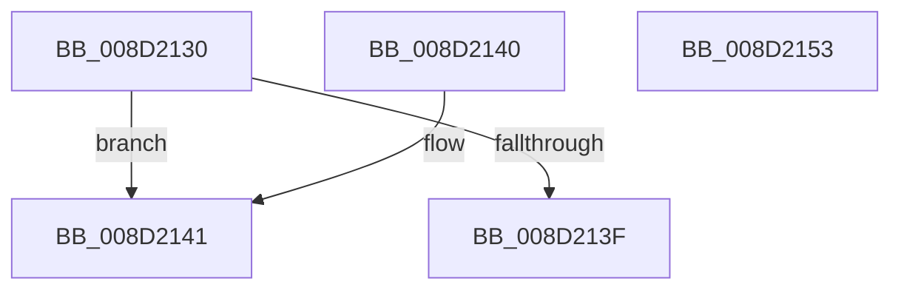

# PsWow64GetProcessMachine

- RVA: `0x008D2130`–`0x008D2154` (길이 `36` bytes)
- VA: `0x00000001408D2130`
- 실행 섹션: `PAGE`
- PDB 이름 있음: `예`; PDB Function 태그: `아니요`
- unwind 정보 RVA: `0x000DB714`
- 디코드: `11`개 명령, `36/36` bytes 표시
- 미해석 바이트: `0` (있으면 어셈블리에 `.byte`로 보존)

> 이 문서는 커널 이미지의 기계어와 PDB 기호를 분석해 생성했습니다. 4번과 5번은 함수 원형과 자료형을 바이너리 사용 방식에서 추정한 C 해석이며 원본 소스 복구 결과는 아닙니다.

## 1. Dependencies

- 직접 호출 지점: **0**; 고유 호출 대상: **0**
- 직접 호출자로 확인된 함수: **15**
- RIP 상대 이미지 참조: **0**

### Outgoing calls
- 직접 디코드된 call 명령이 없습니다.

### Direct callers
- [RtlpWalkFrameChain](../../text/2F/RtlpWalkFrameChain_function_002F3ED0.md) at `0x002F40EE`
- [RtlpWalkFrameChain](../../text/2F/RtlpWalkFrameChain_function_002F3ED0.md) at `0x002F4983`
- [KiContinuePreviousModeUser](../../text/2F/KiContinuePreviousModeUser_function_002F9B10.md) at `0x002F9D8A`
- [KiDispatchException](../../text/3D/KiDispatchException_function_003D7650.md) at `0x003D7998`
- [KeVerifyContextRecord](../../text/40/KeVerifyContextRecord_function_0040BE90.md) at `0x0040BF19`
- [WbGetWowTrapFrame](../81/WbGetWowTrapFrame_function_00811DF0.md) at `0x00811E1F`
- [PspWow64SetContextThread](../8C/PspWow64SetContextThread_function_008CCC88.md) at `0x008CCCF8`
- [PspWow64SetupCpuArea](../8C/PspWow64SetupCpuArea_function_008CDBFC.md) at `0x008CDC12`
- [PspWow64InitThread](../8C/PspWow64InitThread_function_008CDC98.md) at `0x008CDCE4`
- [MiCommitVadMetadataBits](MiCommitVadMetadataBits_function_008D1A00.md) at `0x008D1ACD`
- [PsGetSupportedProcessorArchitectures](PsGetSupportedProcessorArchitectures_function_008D1F90.md) at `0x008D2083`
- [sub_008D2B19](Unknown_function_008D2B19.md) at `0x008D2BA6`
- [WbValidateHeapExecuteCallArguments](WbValidateHeapExecuteCallArguments_function_008D2C50.md) at `0x008D2E97`
- [WbDisableTracing](WbDisableTracing_function_008D4368.md) at `0x008D43E0`
- [WbSetWowTrapFrame](WbSetWowTrapFrame_function_008D57EC.md) at `0x008D581E`
- [PspWow64GetContextThread](../A1/PspWow64GetContextThread_function_00A11E90.md) at `0x00A11EF6`

### Static image references
- 디코드된 RIP-relative 메모리 참조가 없습니다.

## 2. Other-region calls and transfers

- 다른 실행 섹션으로 향하는 call: **0**
- 별도 외부 분기/꼬리 이동을 확인하지 못했습니다.

## 3. Assembly (complete function range)

```asm
008D2130  48 83 B9 10 03 00 00 00         cmp qword ptr [rcx + 0x310], 0
008D2138  B8 64 86 00 00                  mov eax, 0x8664
008D213D  75 02                           jne 0x1408d2141
008D213F  C3                              ret
008D2140  CC                              int3
008D2141  0F B7 89 EC 06 00 00            movzx ecx, word ptr [rcx + 0x6ec]
008D2148  66 85 C9                        test cx, cx
008D214B  66 0F 44 C8                     cmove cx, ax
008D214F  0F B7 C1                        movzx eax, cx
008D2152  C3                              ret
008D2153  CC                              int3
```

## 4. C-style interpretation (structured pseudocode)

```c
__int64 __fastcall PsWow64GetProcessMachine(__int64 a1)
{
    if ((*(unsigned __int64 *)(a1 + 784)) != 0) goto loc_008D2141;
    return (unsigned int)(0x8664ULL);
loc_008D2141:
    a1 = *(unsigned __int16 *)(a1 + 1772);
    if ((unsigned __int16)(*(unsigned __int16 *)(a1 + 1772)) == 0) { a1 = (unsigned __int16)((unsigned int)(0x8664ULL)); }
    return (unsigned __int16)(a1);
}
```

## 5. (Beta) C Style

```c
int64_t PsWow64GetProcessMachine(void *Arg1)
{
    uint8_t *arg1 = (uint8_t *)Arg1;

    if ((*(uint64_t *)(arg1 + 0x310)) != 0) goto loc_008D2141;
    return (uint32_t)(0x8664ULL);
loc_008D2141:
    Arg1 = *(uint16_t *)(arg1 + 0x6EC);
    if ((uint16_t)(*(uint16_t *)(arg1 + 0x6EC)) == 0) { Arg1 = (uint16_t)((uint32_t)(0x8664ULL)); }
    return (uint16_t)(Arg1);
}
```

### 관측된 메모리 오프셋

구조체 형식이 확인되지 않은 접근은 인자 기준의 오프셋으로만 기록했습니다.

| 기준 인자 | 오프셋 표현 | 폭 (bit) | 접근 |
|---|---:|---:|---|
| `Arg1` | `+ 0x310` | `64` | `R` |
| `Arg1` | `+ 0x6EC` | `16` | `R` |

## 6. Execution-region graph

[열기: 2D/3D 그래프와 함수 탐색 컨트롤 패널](../../../control-panel.html?section=page&rva=0x008D2130&view=graph)

- 2D 그래프는 위에서 아래로 흐르고, 3D 그래프는 빈 공간을 드래그해 회전합니다. Shift+드래그는 이동, 휠은 확대·축소, 함수 노드 선택은 대상 보고서 이동입니다.

### Static fallback


