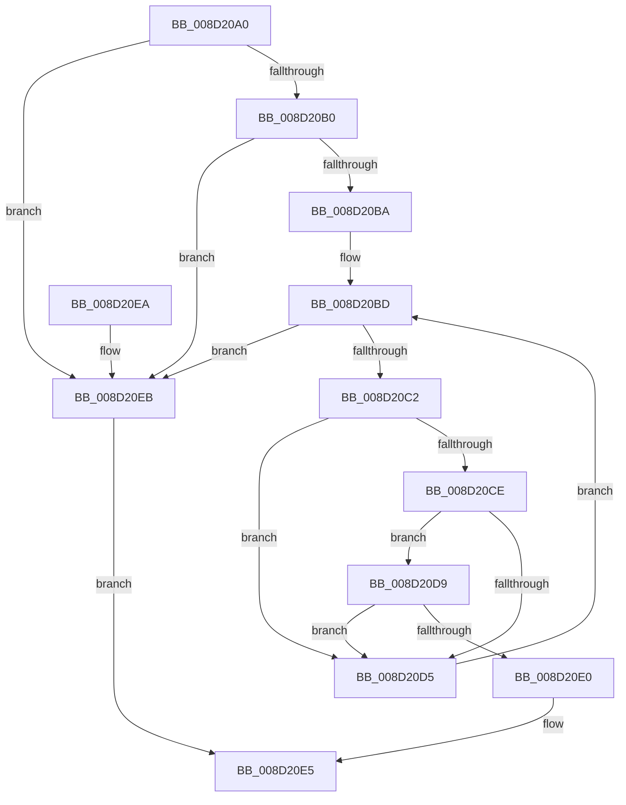

# PsWow64IsMachineSupported

- RVA: `0x008D20A0`–`0x008D20EF` (길이 `79` bytes)
- VA: `0x00000001408D20A0`
- 실행 섹션: `PAGE`
- PDB 이름 있음: `예`; PDB Function 태그: `아니요`
- unwind 정보 RVA: `0x00069B1C`
- 디코드: `28`개 명령, `79/79` bytes 표시
- 미해석 바이트: `0` (있으면 어셈블리에 `.byte`로 보존)

> 이 문서는 커널 이미지의 기계어와 PDB 기호를 분석해 생성했습니다. 4번과 5번은 함수 원형과 자료형을 바이너리 사용 방식에서 추정한 C 해석이며 원본 소스 복구 결과는 아닙니다.

## 1. Dependencies

- 직접 호출 지점: **2**; 고유 호출 대상: **2**
- 직접 호출자로 확인된 함수: **4**
- RIP 상대 이미지 참조: **0**

### Outgoing calls
- `0x008D20B0` → [RtlWow64GetEquivalentMachineCHPE](../../text/47/RtlWow64GetEquivalentMachineCHPE_function_0047F9A4.md) (function, `0x0047F9A4`)
- `0x008D20C4` → [PsQuerySystemDllInfo](PsQuerySystemDllInfo_function_008D20F8.md) (function, `0x008D20F8`)

### Direct callers
- [CmpSetVersionData](../7E/CmpSetVersionData_function_007E7854.md) at `0x007E78ED`
- [PsGetSupportedProcessorArchitectures](PsGetSupportedProcessorArchitectures_function_008D1F90.md) at `0x008D1FBB`
- [PspSelectMachineForProcess](../A1/PspSelectMachineForProcess_function_00A1FFBC.md) at `0x00A200AF`
- [sub_00B37422](../B3/Unknown_function_00B37422.md) at `0x00B3747E`
- [sub_00B37422](../B3/Unknown_function_00B37422.md) at `0x00B374A5`

### Static image references
- 디코드된 RIP-relative 메모리 참조가 없습니다.

## 2. Other-region calls and transfers

- 다른 실행 섹션으로 향하는 call: **1**
  - `0x008D20B0` → [RtlWow64GetEquivalentMachineCHPE](../../text/47/RtlWow64GetEquivalentMachineCHPE_function_0047F9A4.md) (`PAGE` → `.text`)
- 별도 외부 분기/꼬리 이동을 확인하지 못했습니다.

## 3. Assembly (complete function range)

```asm
008D20A0  48 83 EC 28                     sub rsp, 0x28
008D20A4  45 33 C9                        xor r9d, r9d
008D20A7  44 0F B7 C1                     movzx r8d, cx
008D20AB  66 85 C9                        test cx, cx
008D20AE  74 3B                           je 0x1408d20eb
008D20B0  E8 EF D8 BA FF                  call 0x14047f9a4
008D20B5  66 3B C1                        cmp ax, cx
008D20B8  75 31                           jne 0x1408d20eb
008D20BA  41 8B D1                        mov edx, r9d
008D20BD  83 FA 06                        cmp edx, 6
008D20C0  7D 29                           jge 0x1408d20eb
008D20C2  8B CA                           mov ecx, edx
008D20C4  E8 2F 00 00 00                  call 0x1408d20f8
008D20C9  48 85 C0                        test rax, rax
008D20CC  74 07                           je 0x1408d20d5
008D20CE  8B 08                           mov ecx, dword ptr [rax]
008D20D0  F6 C1 08                        test cl, 8
008D20D3  75 04                           jne 0x1408d20d9
008D20D5  FF C2                           inc edx
008D20D7  EB E4                           jmp 0x1408d20bd
008D20D9  66 44 39 40 02                  cmp word ptr [rax + 2], r8w
008D20DE  75 F5                           jne 0x1408d20d5
008D20E0  B8 01 00 00 00                  mov eax, 1
008D20E5  48 83 C4 28                     add rsp, 0x28
008D20E9  C3                              ret
008D20EA  CC                              int3
008D20EB  33 C0                           xor eax, eax
008D20ED  EB F6                           jmp 0x1408d20e5
```

## 4. C-style interpretation (structured pseudocode)

```c
__int64 __fastcall PsWow64IsMachineSupported(unsigned __int16 a1, __int64 a2, __int64 a3, int a4)
{
    __int64 result;
    __int64 v_rsp;

    v_rsp = (v_rsp) - (40);
    a4 = 0;
    if (a1 == 0) goto loc_008D20EB;
    result = RtlWow64GetEquivalentMachineCHPE(a1, a2, a1, a4);
    if (((unsigned __int16)(result)) != a1) goto loc_008D20EB;
loc_008D20BD:
    if (0 >= 6) goto loc_008D20EB;
    result = PsQuerySystemDllInfo(0, 0, a1, a4);
    if (result == 0) goto loc_008D20D5;
    if ((((unsigned __int8)((unsigned int)(*(unsigned int *)(result)))) & (8)) != 0) goto loc_008D20D9;
loc_008D20D5:
    a2 = (unsigned int)((0) + 1);
    goto loc_008D20BD;
loc_008D20D9:
    if ((*(unsigned __int16 *)(result + 2)) != a1) goto loc_008D20D5;
loc_008D20E5:
    v_rsp = (v_rsp) + (40);
    return 1;
loc_008D20EB:
    result = 0;
    goto loc_008D20E5;
}
```

## 5. (Beta) C Style

```c
int64_t PsWow64IsMachineSupported(uint16_t Arg1, int64_t Arg2, int64_t Arg3, int32_t Arg4)
{
    int64_t result;
    int64_t local_rsp;

    local_rsp = (local_rsp) - (40);
    Arg4 = 0;
    if (Arg1 == 0) goto loc_008D20EB;
    result = RtlWow64GetEquivalentMachineCHPE(Arg1, Arg2, Arg1, Arg4);
    if (((uint16_t)(result)) != Arg1) goto loc_008D20EB;
loc_008D20BD:
    if (0 >= 6) goto loc_008D20EB;
    result = PsQuerySystemDllInfo(0, 0, Arg1, Arg4);
    if (result == 0) goto loc_008D20D5;
    if ((((uint8_t)((uint32_t)(*(uint32_t *)(result)))) & (8)) != 0) goto loc_008D20D9;
loc_008D20D5:
    Arg2 = (uint32_t)((0) + 1);
    goto loc_008D20BD;
loc_008D20D9:
    if ((*(uint16_t *)(result + 0x2)) != Arg1) goto loc_008D20D5;
loc_008D20E5:
    local_rsp = (local_rsp) + (40);
    return 1;
loc_008D20EB:
    result = 0;
    goto loc_008D20E5;
}
```

## 6. Execution-region graph

[열기: 2D/3D 그래프와 함수 탐색 컨트롤 패널](../../../control-panel.html?section=page&rva=0x008D20A0&view=graph)

- 2D 그래프는 위에서 아래로 흐르고, 3D 그래프는 빈 공간을 드래그해 회전합니다. Shift+드래그는 이동, 휠은 확대·축소, 함수 노드 선택은 대상 보고서 이동입니다.

### Static fallback


