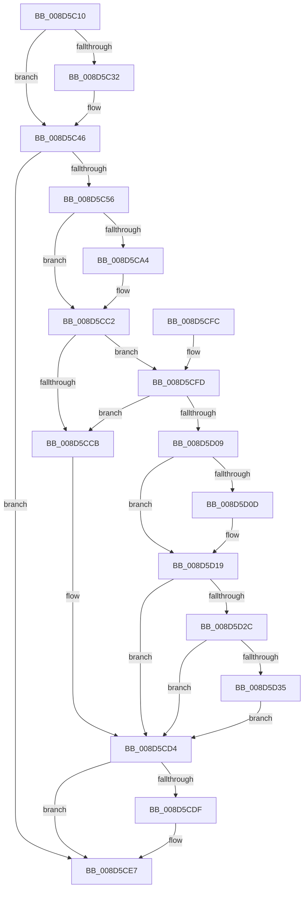

# PspDisablePrimaryTokenExchange

- RVA: `0x008D5C10`–`0x008D5D3F` (길이 `303` bytes)
- VA: `0x00000001408D5C10`
- 실행 섹션: `PAGE`
- PDB 이름 있음: `예`; PDB Function 태그: `아니요`
- unwind 정보 RVA: `0x00065734`
- 디코드: `68`개 명령, `303/303` bytes 표시
- 미해석 바이트: `0` (있으면 어셈블리에 `.byte`로 보존)

> 이 문서는 커널 이미지의 기계어와 PDB 기호를 분석해 생성했습니다. 4번과 5번은 함수 원형과 자료형을 바이너리 사용 방식에서 추정한 C 해석이며 원본 소스 복구 결과는 아닙니다.

## 1. Dependencies

- 직접 호출 지점: **9**; 고유 호출 대상: **9**
- 직접 호출자로 확인된 함수: **3**
- RIP 상대 이미지 참조: **0**

### Outgoing calls
- `0x008D5C41` → [PspLockUnlockProcessExclusive](../../text/41/PspLockUnlockProcessExclusive_function_00419B48.md) (function, `0x00419B48`)
- `0x008D5C5E` → [PsReferencePrimaryTokenWithTag](../../text/20/PsReferencePrimaryTokenWithTag_function_0020FF80.md) (function, `0x0020FF80`)
- `0x008D5C69` → [SeTokenIsAdmin](../9F/SeTokenIsAdmin_function_009FE650.md) (function, `0x009FE650`)
- `0x008D5C74` → [ObfDereferenceObject](../../text/2F/ObfDereferenceObject_function_002F9350.md) (function, `0x002F9350`)
- `0x008D5CBD` → [PspSynchronizeThreadIsolationDomains](../../text/3C/PspSynchronizeThreadIsolationDomains_function_003C479C.md) (function, `0x003C479C`)
- `0x008D5CC2` → [KeKvaShadowingActive](../../text/4B/KeKvaShadowingActive_function_004B2CA8.md) (function, `0x004B2CA8`)
- `0x008D5CE2` → [PspOneDirectionSecurityDomainCombine](../8A/PspOneDirectionSecurityDomainCombine_function_008A23BC.md) (function, `0x008A23BC`)
- `0x008D5D1C` → [KeSynchronizeAddressPolicy](../../text/49/KeSynchronizeAddressPolicy_function_00498358.md) (function, `0x00498358`)
- `0x008D5D38` → [MmSynchronizeAddressPolicy](../AA/MmSynchronizeAddressPolicy_function_00AA0484.md) (function, `0x00AA0484`)

### Direct callers
- [PspSystemThreadStartup](../../text/49/PspSystemThreadStartup_function_004932C0.md) at `0x004932FA`
- [PspUserThreadStartup](PspUserThreadStartup_function_008D5B10.md) at `0x008D5B47`
- [PspSecureThreadStartup](../AA/PspSecureThreadStartup_function_00AABDF0.md) at `0x00AABE1B`

### Static image references
- 디코드된 RIP-relative 메모리 참조가 없습니다.

## 2. Other-region calls and transfers

- 다른 실행 섹션으로 향하는 call: **6**
  - `0x008D5C41` → [PspLockUnlockProcessExclusive](../../text/41/PspLockUnlockProcessExclusive_function_00419B48.md) (`PAGE` → `.text`)
  - `0x008D5C5E` → [PsReferencePrimaryTokenWithTag](../../text/20/PsReferencePrimaryTokenWithTag_function_0020FF80.md) (`PAGE` → `.text`)
  - `0x008D5C74` → [ObfDereferenceObject](../../text/2F/ObfDereferenceObject_function_002F9350.md) (`PAGE` → `.text`)
  - `0x008D5CBD` → [PspSynchronizeThreadIsolationDomains](../../text/3C/PspSynchronizeThreadIsolationDomains_function_003C479C.md) (`PAGE` → `.text`)
  - `0x008D5CC2` → [KeKvaShadowingActive](../../text/4B/KeKvaShadowingActive_function_004B2CA8.md) (`PAGE` → `.text`)
  - `0x008D5D1C` → [KeSynchronizeAddressPolicy](../../text/49/KeSynchronizeAddressPolicy_function_00498358.md) (`PAGE` → `.text`)
- 별도 외부 분기/꼬리 이동을 확인하지 못했습니다.

## 3. Assembly (complete function range)

```asm
008D5C10  48 89 5C 24 08                  mov qword ptr [rsp + 8], rbx
008D5C15  48 89 74 24 10                  mov qword ptr [rsp + 0x10], rsi
008D5C1A  57                              push rdi
008D5C1B  48 83 EC 20                     sub rsp, 0x20
008D5C1F  48 8B B1 B8 00 00 00            mov rsi, qword ptr [rcx + 0xb8]
008D5C26  F7 86 F0 01 00 00 00 80 00 00   test dword ptr [rsi + 0x1f0], 0x8000
008D5C30  75 14                           jne 0x1408d5c46
008D5C32  F0 0F BA AE F0 01 00 00 0F      lock bts dword ptr [rsi + 0x1f0], 0xf
008D5C3B  48 8B D1                        mov rdx, rcx
008D5C3E  48 8B CE                        mov rcx, rsi
008D5C41  E8 02 3F B4 FF                  call 0x140419b48
008D5C46  F7 86 FC 05 00 00 00 00 40 00   test dword ptr [rsi + 0x5fc], 0x400000
008D5C50  0F 85 91 00 00 00               jne 0x1408d5ce7
008D5C56  BA 44 66 6C 74                  mov edx, 0x746c6644
008D5C5B  48 8B CE                        mov rcx, rsi
008D5C5E  E8 1D A3 93 FF                  call 0x14020ff80
008D5C63  48 8B C8                        mov rcx, rax
008D5C66  48 8B D8                        mov rbx, rax
008D5C69  E8 E2 89 12 00                  call 0x1409fe650
008D5C6E  48 8B CB                        mov rcx, rbx
008D5C71  40 8A F8                        mov dil, al
008D5C74  E8 D7 36 A2 FF                  call 0x1402f9350
008D5C79  33 C9                           xor ecx, ecx
008D5C7B  40 84 FF                        test dil, dil
008D5C7E  BF 01 00 00 00                  mov edi, 1
008D5C83  0F 95 C1                        setne cl
008D5C86  40 84 BE 70 01 00 00            test byte ptr [rsi + 0x170], dil
008D5C8D  0F 45 CF                        cmovne ecx, edi
008D5C90  8D 5F FF                        lea ebx, [rdi - 1]
008D5C93  F7 86 FC 05 00 00 00 00 80 00   test dword ptr [rsi + 0x5fc], 0x800000
008D5C9D  0F 44 D9                        cmove ebx, ecx
008D5CA0  85 DB                           test ebx, ebx
008D5CA2  74 1E                           je 0x1408d5cc2
008D5CA4  48 C7 86 60 07 00 00 00 00 00 00  mov qword ptr [rsi + 0x760], 0
008D5CAF  48 8B CE                        mov rcx, rsi
008D5CB2  48 C7 86 68 07 00 00 00 00 00 00  mov qword ptr [rsi + 0x768], 0
008D5CBD  E8 DA EA AE FF                  call 0x1403c479c
008D5CC2  E8 E1 CF BD FF                  call 0x1404b2ca8
008D5CC7  85 C0                           test eax, eax
008D5CC9  75 32                           jne 0x1408d5cfd
008D5CCB  F0 0F BA AE FC 05 00 00 0E      lock bts dword ptr [rsi + 0x5fc], 0xe
008D5CD4  F0 0F BA AE FC 05 00 00 16      lock bts dword ptr [rsi + 0x5fc], 0x16
008D5CDD  72 08                           jb 0x1408d5ce7
008D5CDF  48 8B CE                        mov rcx, rsi
008D5CE2  E8 D5 C6 FC FF                  call 0x1408a23bc
008D5CE7  F0 83 0C 24 00                  lock or dword ptr [rsp], 0
008D5CEC  48 8B 5C 24 30                  mov rbx, qword ptr [rsp + 0x30]
008D5CF1  48 8B 74 24 38                  mov rsi, qword ptr [rsp + 0x38]
008D5CF6  48 83 C4 20                     add rsp, 0x20
008D5CFA  5F                              pop rdi
008D5CFB  C3                              ret
008D5CFC  CC                              int3
008D5CFD  8B 86 FC 05 00 00               mov eax, dword ptr [rsi + 0x5fc]
008D5D03  0F BA E0 0E                     bt eax, 0xe
008D5D07  72 C2                           jb 0x1408d5ccb
008D5D09  85 DB                           test ebx, ebx
008D5D0B  74 0C                           je 0x1408d5d19
008D5D0D  40 88 BE 60 01 00 00            mov byte ptr [rsi + 0x160], dil
008D5D14  F0 83 0C 24 00                  lock or dword ptr [rsp], 0
008D5D19  48 8B CE                        mov rcx, rsi
008D5D1C  E8 37 26 BC FF                  call 0x140498358
008D5D21  F0 0F BA AE FC 05 00 00 0E      lock bts dword ptr [rsi + 0x5fc], 0xe
008D5D2A  72 A8                           jb 0x1408d5cd4
008D5D2C  40 38 BE 60 01 00 00            cmp byte ptr [rsi + 0x160], dil
008D5D33  75 9F                           jne 0x1408d5cd4
008D5D35  48 8B CE                        mov rcx, rsi
008D5D38  E8 47 A7 1C 00                  call 0x140aa0484
008D5D3D  EB 95                           jmp 0x1408d5cd4
```

## 4. C-style interpretation (structured pseudocode)

```c
__int64 __fastcall PspDisablePrimaryTokenExchange(__int64 a1)
{
    __int64 result;
    __int64 v_rbx;
    __int64 v_rsp;
    unsigned int v_stack_m28;
    unsigned int v_stack_p0;
    unsigned __int64 v_stack_p10;
    unsigned __int64 v_stack_p8;

    v_stack_p8 = v_rbx;
    v_stack_p10 = v_rsi;
    v_rsp = (v_rsp) - (32);
    if (((*(unsigned int *)(*(unsigned __int64 *)(a1 + 184) + 496)) & (0x8000ULL)) == 0) {
        a2 = a1;
        a1 = *(unsigned __int64 *)(a1 + 184);
        result = PspLockUnlockProcessExclusive(a1, a2, a3, a4);
    }
    if (((*(unsigned int *)(*(unsigned __int64 *)(a1 + 184) + 1532)) & (0x400000ULL)) != 0) goto loc_008D5CE7;
    result = PsReferencePrimaryTokenWithTag(*(unsigned __int64 *)(a1 + 184), (unsigned int)(0x746C6644ULL), a3, a4);
    result = SeTokenIsAdmin(result, (unsigned int)(0x746C6644ULL), a3, a4);
    result = ObfDereferenceObject(result, (unsigned int)(0x746C6644ULL), a3, a4);
    a1 = 0;
    a1 = ((unsigned __int8)((unsigned __int8)(result)) != 0) ? 1 : 0;
    if (((*(unsigned __int8 *)(*(unsigned __int64 *)(a1 + 184) + 368)) & (1)) != 0) { a1 = 1; }
    v_rbx = 1 - 1;
    if (((*(unsigned int *)(*(unsigned __int64 *)(a1 + 184) + 1532)) & (0x800000ULL)) == 0) { v_rbx = (unsigned int)(a1); }
    if ((unsigned int)(v_rbx) != 0) {
        *(unsigned __int64 *)(*(unsigned __int64 *)(a1 + 184) + 1888) = 0;
        a1 = *(unsigned __int64 *)(a1 + 184);
        *(unsigned __int64 *)(*(unsigned __int64 *)(a1 + 184) + 1896) = 0;
        result = PspSynchronizeThreadIsolationDomains(a1, (unsigned int)(0x746C6644ULL), a3, a4);
    }
    result = KeKvaShadowingActive(a1, (unsigned int)(0x746C6644ULL), a3, a4);
    if ((unsigned int)(result) != 0) goto loc_008D5CFD;
loc_008D5CCB:
loc_008D5CD4:
    if (!(condition_is_below)) {
        a1 = *(unsigned __int64 *)(a1 + 184);
        result = PspOneDirectionSecurityDomainCombine(a1, (unsigned int)(0x746C6644ULL), a3, a4);
    }
    v_rsp = (v_rsp) + (32);
    return result;
loc_008D5CFD:
    if (condition_is_below) goto loc_008D5CCB;
    if ((unsigned int)(v_stack_p8) != 0) {
        *(unsigned __int8 *)(v_stack_p10 + 352) = 1;
    }
    result = KeSynchronizeAddressPolicy(v_stack_p10, (unsigned int)(0x746C6644ULL), a3, a4);
    if (condition_is_below) goto loc_008D5CD4;
    if ((*(unsigned __int8 *)(v_stack_p10 + 352)) != 1) goto loc_008D5CD4;
    result = MmSynchronizeAddressPolicy(v_stack_p10, (unsigned int)(0x746C6644ULL), a3, a4);
    goto loc_008D5CD4;
}
```

## 5. (Beta) C Style

```c
int64_t PspDisablePrimaryTokenExchange(void *Arg1)
{
    uint8_t *arg1 = (uint8_t *)Arg1;

    int64_t result;
    int64_t local_rbx;
    int64_t local_rsp;
    uint32_t v_stack_m28;
    uint32_t v_stack_p0;
    uint64_t v_stack_p10;
    uint64_t v_stack_p8;

    v_stack_p8 = local_rbx;
    v_stack_p10 = local_rsi;
    local_rsp = (local_rsp) - (32);
    if (((*(uint32_t *)(*(uint64_t *)(arg1 + 0xB8) + 0x1F0)) & (0x8000ULL)) == 0) {
        a2 = Arg1;
        Arg1 = *(uint64_t *)(arg1 + 0xB8);
        result = PspLockUnlockProcessExclusive(Arg1, a2, a3, a4);
    }
    if (((*(uint32_t *)(*(uint64_t *)(arg1 + 0xB8) + 0x5FC)) & (0x400000ULL)) != 0) goto loc_008D5CE7;
    result = PsReferencePrimaryTokenWithTag(*(uint64_t *)(arg1 + 0xB8), (uint32_t)(0x746C6644ULL), a3, a4);
    result = SeTokenIsAdmin(result, (uint32_t)(0x746C6644ULL), a3, a4);
    result = ObfDereferenceObject(result, (uint32_t)(0x746C6644ULL), a3, a4);
    Arg1 = 0;
    Arg1 = ((uint8_t)((uint8_t)(result)) != 0) ? 1 : 0;
    if (((*(uint8_t *)(*(uint64_t *)(arg1 + 0xB8) + 0x170)) & (1)) != 0) { Arg1 = 1; }
    local_rbx = 1 - 1;
    if (((*(uint32_t *)(*(uint64_t *)(arg1 + 0xB8) + 0x5FC)) & (0x800000ULL)) == 0) { local_rbx = (uint32_t)(Arg1); }
    if ((uint32_t)(local_rbx) != 0) {
        *(uint64_t *)(*(uint64_t *)(arg1 + 0xB8) + 0x760) = 0;
        Arg1 = *(uint64_t *)(arg1 + 0xB8);
        *(uint64_t *)(*(uint64_t *)(arg1 + 0xB8) + 0x768) = 0;
        result = PspSynchronizeThreadIsolationDomains(Arg1, (uint32_t)(0x746C6644ULL), a3, a4);
    }
    result = KeKvaShadowingActive(Arg1, (uint32_t)(0x746C6644ULL), a3, a4);
    if ((uint32_t)(result) != 0) goto loc_008D5CFD;
loc_008D5CCB:
loc_008D5CD4:
    if (!(condition_is_below)) {
        Arg1 = *(uint64_t *)(arg1 + 0xB8);
        result = PspOneDirectionSecurityDomainCombine(Arg1, (uint32_t)(0x746C6644ULL), a3, a4);
    }
    local_rsp = (local_rsp) + (32);
    return result;
loc_008D5CFD:
    if (condition_is_below) goto loc_008D5CCB;
    if ((uint32_t)(v_stack_p8) != 0) {
        *(uint8_t *)(v_stack_p10 + 0x160) = 1;
    }
    result = KeSynchronizeAddressPolicy(v_stack_p10, (uint32_t)(0x746C6644ULL), a3, a4);
    if (condition_is_below) goto loc_008D5CD4;
    if ((*(uint8_t *)(v_stack_p10 + 0x160)) != 1) goto loc_008D5CD4;
    result = MmSynchronizeAddressPolicy(v_stack_p10, (uint32_t)(0x746C6644ULL), a3, a4);
    goto loc_008D5CD4;
}
```

### 관측된 메모리 오프셋

구조체 형식이 확인되지 않은 접근은 인자 기준의 오프셋으로만 기록했습니다.

| 기준 인자 | 오프셋 표현 | 폭 (bit) | 접근 |
|---|---:|---:|---|
| `Arg1` | `+ 0xB8` | `64` | `R` |

## 6. Execution-region graph

[열기: 2D/3D 그래프와 함수 탐색 컨트롤 패널](../../../control-panel.html?section=page&rva=0x008D5C10&view=graph)

- 2D 그래프는 위에서 아래로 흐르고, 3D 그래프는 빈 공간을 드래그해 회전합니다. Shift+드래그는 이동, 휠은 확대·축소, 함수 노드 선택은 대상 보고서 이동입니다.

### Static fallback


