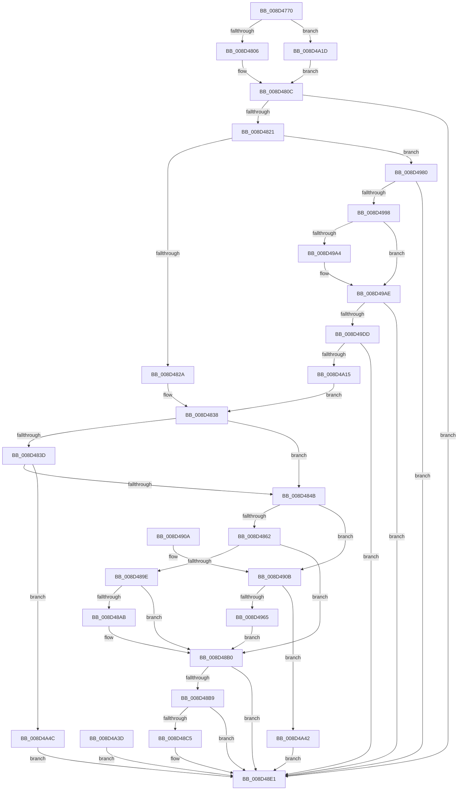

# PspGetContextThreadInternal

- RVA: `0x008D4770`–`0x008D4A56` (길이 `742` bytes)
- VA: `0x00000001408D4770`
- 실행 섹션: `PAGE`
- PDB 이름 있음: `예`; PDB Function 태그: `아니요`
- unwind 정보 RVA: `0x00085040`
- 디코드: `183`개 명령, `742/742` bytes 표시
- 미해석 바이트: `0` (있으면 어셈블리에 `.byte`로 보존)

> 이 문서는 커널 이미지의 기계어와 PDB 기호를 분석해 생성했습니다. 4번과 5번은 함수 원형과 자료형을 바이너리 사용 방식에서 추정한 C 해석이며 원본 소스 복구 결과는 아닙니다.

## 1. Dependencies

- 직접 호출 지점: **15**; 고유 호출 대상: **14**
- 직접 호출자로 확인된 함수: **11**
- RIP 상대 이미지 참조: **2**

### Outgoing calls
- `0x008D47C0` → [memset](../../text/6C/memset_function_006C6C40.md) (function, `0x006C6C40`)
- `0x008D47D1` → [memset](../../text/6C/memset_function_006C6C40.md) (function, `0x006C6C40`)
- `0x008D4814` → [RtlpSanitizeContextFlags](../../text/3D/RtlpSanitizeContextFlags_function_003D7070.md) (function, `0x003D7070`)
- `0x008D488E` → [PspGetSetContextSpecialApc](../../text/6B/PspGetSetContextSpecialApc_function_006BA460.md) (function, `0x006BA460`)
- `0x008D48AB` → [KiCheckForKernelApcDelivery](../../text/2E/KiCheckForKernelApcDelivery_function_002E2C80.md) (function, `0x002E2C80`)
- `0x008D48DC` → [RtlpWriteExtendedContext](RtlpWriteExtendedContext_function_008D4A5C.md) (function, `0x008D4A5C`)
- `0x008D48EB` → [_security_check_cookie](../../text/6A/_security_check_cookie_function_006AC640.md) (function, `0x006AC640`)
- `0x008D491A` → [KeInitializeEvent](../../text/40/KeInitializeEvent_function_0040DD10.md) (function, `0x0040DD10`)
- `0x008D4944` → [KeInitializeApc](../../text/42/KeInitializeApc_function_00428510.md) (function, `0x00428510`)
- `0x008D4958` → [KeInsertQueueApc](../../text/20/KeInsertQueueApc_function_00203F10.md) (function, `0x00203F10`)
- `0x008D4976` → [KeWaitForSingleObject](../../text/20/KeWaitForSingleObject_function_0020E6B0.md) (function, `0x0020E6B0`)
- `0x008D498B` → [RtlGetExtendedContextLength](../../text/3D/RtlGetExtendedContextLength_function_003D7190.md) (function, `0x003D7190`)
- `0x008D49B5` → [_chkstk](../../text/6B/_chkstk_function_006BA960.md) (function, `0x006BA960`)
- `0x008D49D0` → [RtlInitializeExtendedContext](../../text/3D/RtlInitializeExtendedContext_function_003D7220.md) (function, `0x003D7220`)
- `0x008D4A08` → [RtlpReadExtendedContext](RtlpReadExtendedContext_function_008D61D0.md) (function, `0x008D61D0`)

### Direct callers
- [PspPicoGetContextThreadEx](../78/PspPicoGetContextThreadEx_function_00787620.md) at `0x00787631`
- [PspWow64SetContextThread](../8C/PspWow64SetContextThread_function_008CCC88.md) at `0x008CCE45`
- [sub_008D2508](Unknown_function_008D2508.md) at `0x008D25D9`
- [sub_008D27AD](Unknown_function_008D27AD.md) at `0x008D2889`
- [sub_008D292D](Unknown_function_008D292D.md) at `0x008D2A3D`
- [PsGetUserContextThread](PsGetUserContextThread_function_008D43FC.md) at `0x008D440E`
- [PspInitializeThunkContext](PspInitializeThunkContext_function_008D5418.md) at `0x008D5580`
- [PspWow64GetContextThread](../A1/PspWow64GetContextThread_function_00A11E90.md) at `0x00A12035`
- [NtGetContextThread](../A3/NtGetContextThread_function_00A30BE0.md) at `0x00A30C7A`
- [PsGetContextThread](../A6/PsGetContextThread_function_00A60D20.md) at `0x00A60D2F`
- [NtCreateUserProcess](../AE/NtCreateUserProcess_function_00AEA680.md) at `0x00AEB35A`

### Static image references
- `0x008D478F` → RVA `0x00E0A740` (`.data`; read)
- `0x008D4933` → RVA `0x006BA460` (`PspGetSetContextSpecialApc`; read)

## 2. Other-region calls and transfers

- 다른 실행 섹션으로 향하는 call: **13**
  - `0x008D47C0` → [memset](../../text/6C/memset_function_006C6C40.md) (`PAGE` → `.text`)
  - `0x008D47D1` → [memset](../../text/6C/memset_function_006C6C40.md) (`PAGE` → `.text`)
  - `0x008D4814` → [RtlpSanitizeContextFlags](../../text/3D/RtlpSanitizeContextFlags_function_003D7070.md) (`PAGE` → `.text`)
  - `0x008D488E` → [PspGetSetContextSpecialApc](../../text/6B/PspGetSetContextSpecialApc_function_006BA460.md) (`PAGE` → `.text`)
  - `0x008D48AB` → [KiCheckForKernelApcDelivery](../../text/2E/KiCheckForKernelApcDelivery_function_002E2C80.md) (`PAGE` → `.text`)
  - `0x008D48EB` → [_security_check_cookie](../../text/6A/_security_check_cookie_function_006AC640.md) (`PAGE` → `.text`)
  - `0x008D491A` → [KeInitializeEvent](../../text/40/KeInitializeEvent_function_0040DD10.md) (`PAGE` → `.text`)
  - `0x008D4944` → [KeInitializeApc](../../text/42/KeInitializeApc_function_00428510.md) (`PAGE` → `.text`)
  - `0x008D4958` → [KeInsertQueueApc](../../text/20/KeInsertQueueApc_function_00203F10.md) (`PAGE` → `.text`)
  - `0x008D4976` → [KeWaitForSingleObject](../../text/20/KeWaitForSingleObject_function_0020E6B0.md) (`PAGE` → `.text`)
  - `0x008D498B` → [RtlGetExtendedContextLength](../../text/3D/RtlGetExtendedContextLength_function_003D7190.md) (`PAGE` → `.text`)
  - `0x008D49B5` → [_chkstk](../../text/6B/_chkstk_function_006BA960.md) (`PAGE` → `.text`)
  - `0x008D49D0` → [RtlInitializeExtendedContext](../../text/3D/RtlInitializeExtendedContext_function_003D7220.md) (`PAGE` → `.text`)
- 별도 외부 분기/꼬리 이동을 확인하지 못했습니다.

## 3. Assembly (complete function range)

```asm
008D4770  40 55                           push rbp
008D4772  56                              push rsi
008D4773  57                              push rdi
008D4774  41 54                           push r12
008D4776  41 55                           push r13
008D4778  41 56                           push r14
008D477A  41 57                           push r15
008D477C  48 81 EC 00 02 00 00            sub rsp, 0x200
008D4783  48 8D 6C 24 40                  lea rbp, [rsp + 0x40]
008D4788  48 89 9D 10 02 00 00            mov qword ptr [rbp + 0x210], rbx
008D478F  48 8B 05 AA 5F 53 00            mov rax, qword ptr [rip + 0x535faa]
008D4796  48 33 C5                        xor rax, rbp
008D4799  48 89 85 B0 01 00 00            mov qword ptr [rbp + 0x1b0], rax
008D47A0  45 0F B6 F9                     movzx r15d, r9b
008D47A4  45 0F B6 F0                     movzx r14d, r8b
008D47A8  48 8B F2                        mov rsi, rdx
008D47AB  4C 8B E9                        mov r13, rcx
008D47AE  45 33 E4                        xor r12d, r12d
008D47B1  4C 89 65 08                     mov qword ptr [rbp + 8], r12
008D47B5  33 D2                           xor edx, edx
008D47B7  45 8D 44 24 58                  lea r8d, [r12 + 0x58]
008D47BC  48 8D 4D 10                     lea rcx, [rbp + 0x10]
008D47C0  E8 7B 24 DF FF                  call 0x1406c6c40
008D47C5  33 D2                           xor edx, edx
008D47C7  41 B8 27 01 00 00               mov r8d, 0x127
008D47CD  48 8D 4D 69                     lea rcx, [rbp + 0x69]
008D47D1  E8 6A 24 DF FF                  call 0x1406c6c40
008D47D6  44 89 65 04                     mov dword ptr [rbp + 4], r12d
008D47DA  0F 57 C0                        xorps xmm0, xmm0
008D47DD  0F 11 85 90 01 00 00            movups xmmword ptr [rbp + 0x190], xmm0
008D47E4  0F 11 85 A0 01 00 00            movups xmmword ptr [rbp + 0x1a0], xmm0
008D47EB  8B 9D 20 02 00 00               mov ebx, dword ptr [rbp + 0x220]
008D47F1  83 E3 01                        and ebx, 1
008D47F4  65 48 8B 3C 25 88 01 00 00      mov rdi, qword ptr gs:[0x188]
008D47FD  45 84 F6                        test r14b, r14b
008D4800  0F 85 17 02 00 00               jne 0x1408d4a1d
008D4806  8B 46 30                        mov eax, dword ptr [rsi + 0x30]
008D4809  89 45 00                        mov dword ptr [rbp], eax
008D480C  41 0F B6 D6                     movzx edx, r14b
008D4810  48 8D 4D 00                     lea rcx, [rbp]
008D4814  E8 57 28 B0 FF                  call 0x1403d7070
008D4819  85 C0                           test eax, eax
008D481B  0F 88 C0 00 00 00               js 0x1408d48e1
008D4821  45 84 F6                        test r14b, r14b
008D4824  0F 85 56 01 00 00               jne 0x1408d4980
008D482A  48 89 B5 88 00 00 00            mov qword ptr [rbp + 0x88], rsi
008D4831  4C 8D B6 D0 04 00 00            lea r14, [rsi + 0x4d0]
008D4838  45 84 FF                        test r15b, r15b
008D483B  74 0E                           je 0x1408d484b
008D483D  41 F7 45 74 00 04 00 00         test dword ptr [r13 + 0x74], 0x400
008D4845  0F 85 01 02 00 00               jne 0x1408d4a4c
008D484B  44 88 7D 68                     mov byte ptr [rbp + 0x68], r15b
008D484F  02 DB                           add bl, bl
008D4851  0F B6 45 69                     movzx eax, byte ptr [rbp + 0x69]
008D4855  24 FD                           and al, 0xfd
008D4857  0A D8                           or bl, al
008D4859  4C 3B EF                        cmp r13, rdi
008D485C  0F 85 A9 00 00 00               jne 0x1408d490b
008D4862  4C 89 65 50                     mov qword ptr [rbp + 0x50], r12
008D4866  4C 89 6D 58                     mov qword ptr [rbp + 0x58], r13
008D486A  80 E3 FE                        and bl, 0xfe
008D486D  88 5D 69                        mov byte ptr [rbp + 0x69], bl
008D4870  66 FF 8F E6 01 00 00            dec word ptr [rdi + 0x1e6]
008D4877  90                              nop
008D4878  48 8D 45 58                     lea rax, [rbp + 0x58]
008D487C  48 89 44 24 20                  mov qword ptr [rsp + 0x20], rax
008D4881  4C 8D 4D 50                     lea r9, [rbp + 0x50]
008D4885  45 33 C0                        xor r8d, r8d
008D4888  33 D2                           xor edx, edx
008D488A  48 8D 4D 10                     lea rcx, [rbp + 0x10]
008D488E  E8 CD 5B DE FF                  call 0x1406ba460
008D4893  90                              nop
008D4894  66 83 87 E6 01 00 00 01         add word ptr [rdi + 0x1e6], 1
008D489C  75 12                           jne 0x1408d48b0
008D489E  90                              nop
008D489F  48 8D 87 98 00 00 00            lea rax, [rdi + 0x98]
008D48A6  48 39 00                        cmp qword ptr [rax], rax
008D48A9  74 05                           je 0x1408d48b0
008D48AB  E8 D0 E3 A0 FF                  call 0x1402e2c80
008D48B0  8B 45 6C                        mov eax, dword ptr [rbp + 0x6c]
008D48B3  8B C8                           mov ecx, eax
008D48B5  85 C0                           test eax, eax
008D48B7  78 28                           js 0x1408d48e1
008D48B9  4C 8B 8D 88 00 00 00            mov r9, qword ptr [rbp + 0x88]
008D48C0  4C 3B CE                        cmp r9, rsi
008D48C3  74 1C                           je 0x1408d48e1
008D48C5  45 8B 49 30                     mov r9d, dword ptr [r9 + 0x30]
008D48C9  48 8D 96 D0 04 00 00            lea rdx, [rsi + 0x4d0]
008D48D0  4C 89 74 24 20                  mov qword ptr [rsp + 0x20], r14
008D48D5  4C 8D 85 90 01 00 00            lea r8, [rbp + 0x190]
008D48DC  E8 7B 01 00 00                  call 0x1408d4a5c
008D48E1  48 8B 8D B0 01 00 00            mov rcx, qword ptr [rbp + 0x1b0]
008D48E8  48 33 CD                        xor rcx, rbp
008D48EB  E8 50 7D DD FF                  call 0x1406ac640
008D48F0  48 8B 9D 10 02 00 00            mov rbx, qword ptr [rbp + 0x210]
008D48F7  48 8D A5 C0 01 00 00            lea rsp, [rbp + 0x1c0]
008D48FE  41 5F                           pop r15
008D4900  41 5E                           pop r14
008D4902  41 5D                           pop r13
008D4904  41 5C                           pop r12
008D4906  5F                              pop rdi
008D4907  5E                              pop rsi
008D4908  5D                              pop rbp
008D4909  C3                              ret
008D490A  CC                              int3
008D490B  80 CB 01                        or bl, 1
008D490E  88 5D 69                        mov byte ptr [rbp + 0x69], bl
008D4911  45 33 C0                        xor r8d, r8d
008D4914  33 D2                           xor edx, edx
008D4916  48 8D 4D 70                     lea rcx, [rbp + 0x70]
008D491A  E8 F1 93 B3 FF                  call 0x14040dd10
008D491F  4C 89 64 24 38                  mov qword ptr [rsp + 0x38], r12
008D4924  C6 44 24 30 00                  mov byte ptr [rsp + 0x30], 0
008D4929  4C 89 64 24 28                  mov qword ptr [rsp + 0x28], r12
008D492E  4C 89 64 24 20                  mov qword ptr [rsp + 0x20], r12
008D4933  4C 8D 0D 26 5B DE FF            lea r9, [rip - 0x21a4da]
008D493A  45 33 C0                        xor r8d, r8d
008D493D  49 8B D5                        mov rdx, r13
008D4940  48 8D 4D 10                     lea rcx, [rbp + 0x10]
008D4944  E8 C7 3B B5 FF                  call 0x140428510
008D4949  41 B9 02 00 00 00               mov r9d, 2
008D494F  4D 8B C5                        mov r8, r13
008D4952  33 D2                           xor edx, edx
008D4954  48 8D 4D 10                     lea rcx, [rbp + 0x10]
008D4958  E8 B3 F5 92 FF                  call 0x140203f10
008D495D  84 C0                           test al, al
008D495F  0F 84 DD 00 00 00               je 0x1408d4a42
008D4965  4C 89 64 24 20                  mov qword ptr [rsp + 0x20], r12
008D496A  45 33 C9                        xor r9d, r9d
008D496D  45 33 C0                        xor r8d, r8d
008D4970  33 D2                           xor edx, edx
008D4972  48 8D 4D 70                     lea rcx, [rbp + 0x70]
008D4976  E8 35 9D 93 FF                  call 0x14020e6b0
008D497B  E9 30 FF FF FF                  jmp 0x1408d48b0
008D4980  48 8D 55 04                     lea rdx, [rbp + 4]
008D4984  44 8B 65 00                     mov r12d, dword ptr [rbp]
008D4988  41 8B CC                        mov ecx, r12d
008D498B  E8 00 28 B0 FF                  call 0x1403d7190
008D4990  85 C0                           test eax, eax
008D4992  0F 88 49 FF FF FF               js 0x1408d48e1
008D4998  8B 45 04                        mov eax, dword ptr [rbp + 4]
008D499B  48 8D 48 0F                     lea rcx, [rax + 0xf]
008D499F  48 3B C8                        cmp rcx, rax
008D49A2  77 0A                           ja 0x1408d49ae
008D49A4  48 B9 F0 FF FF FF FF FF FF 0F   movabs rcx, 0xffffffffffffff0
008D49AE  48 83 E1 F0                     and rcx, 0xfffffffffffffff0
008D49B2  48 8B C1                        mov rax, rcx
008D49B5  E8 A6 5F DE FF                  call 0x1406ba960
008D49BA  48 2B E1                        sub rsp, rcx
008D49BD  48 8D 4C 24 40                  lea rcx, [rsp + 0x40]
008D49C2  48 89 8D 88 00 00 00            mov qword ptr [rbp + 0x88], rcx
008D49C9  4C 8D 45 08                     lea r8, [rbp + 8]
008D49CD  41 8B D4                        mov edx, r12d
008D49D0  E8 4B 28 B0 FF                  call 0x1403d7220
008D49D5  85 C0                           test eax, eax
008D49D7  0F 88 04 FF FF FF               js 0x1408d48e1
008D49DD  4C 8B 75 08                     mov r14, qword ptr [rbp + 8]
008D49E1  49 8D 86 30 FB FF FF            lea rax, [r14 - 0x4d0]
008D49E8  48 89 85 88 00 00 00            mov qword ptr [rbp + 0x88], rax
008D49EF  48 8D 85 90 01 00 00            lea rax, [rbp + 0x190]
008D49F6  48 89 44 24 28                  mov qword ptr [rsp + 0x28], rax
008D49FB  48 89 74 24 20                  mov qword ptr [rsp + 0x20], rsi
008D4A00  45 8B CC                        mov r9d, r12d
008D4A03  4D 8B C6                        mov r8, r14
008D4A06  33 D2                           xor edx, edx
008D4A08  E8 C3 17 00 00                  call 0x1408d61d0
008D4A0D  85 C0                           test eax, eax
008D4A0F  0F 88 CC FE FF FF               js 0x1408d48e1
008D4A15  45 33 E4                        xor r12d, r12d
008D4A18  E9 1B FE FF FF                  jmp 0x1408d4838
008D4A1D  48 8D 46 30                     lea rax, [rsi + 0x30]
008D4A21  48 B9 00 00 FF FF FF 7F 00 00   movabs rcx, 0x7fffffff0000
008D4A2B  48 3B C1                        cmp rax, rcx
008D4A2E  48 0F 43 C1                     cmovae rax, rcx
008D4A32  90                              nop
008D4A33  8B 00                           mov eax, dword ptr [rax]
008D4A35  89 45 00                        mov dword ptr [rbp], eax
008D4A38  E9 CF FD FF FF                  jmp 0x1408d480c
008D4A3D  E9 9F FE FF FF                  jmp 0x1408d48e1
008D4A42  B8 01 00 00 C0                  mov eax, 0xc0000001
008D4A47  E9 95 FE FF FF                  jmp 0x1408d48e1
008D4A4C  B8 30 00 00 C0                  mov eax, 0xc0000030
008D4A51  E9 8B FE FF FF                  jmp 0x1408d48e1
```

## 4. C-style interpretation (structured pseudocode)

```c
__int64 __fastcall PspGetContextThreadInternal(__int64 a1, __int64 a2, unsigned __int8 a3, unsigned __int8 a4, unsigned int a5)
{
    __int64 result;
    __int64 v_r12;
    __int64 v_rbx;
    __int64 v_rsp;
    unsigned __int64 v_stack_m170;
    unsigned __int64 v_stack_m188;
    unsigned int v_stack_m18C;
    unsigned __int64 v_stack_m18F;
    unsigned __int8 v_stack_m190;
    unsigned __int64 v_stack_m1A0;
    unsigned __int64 v_stack_m1A8;
    unsigned __int64 v_stack_m1E8;
    unsigned __int64 v_stack_m1F0;
    unsigned int v_stack_m1F4;
    unsigned __int64 v_stack_m1F8;
    unsigned __int64 v_stack_m218;
    unsigned __int64 v_stack_m38;
    unsigned __int64 v_stack_m48;
    unsigned __int64 v_stack_m58;
    unsigned __int64 v_stack_m68;
    unsigned __int64 v_stack_p18;
    unsigned __int64 v_stack_p20;
    unsigned __int64 v_stack_p28;
    unsigned __int8 v_stack_p30;
    unsigned __int64 v_stack_p38;
    unsigned __int64 v_stack_p40;

    v_rsp = (v_rsp) - (512);
    v_stack_p18 = v_rbx;
    result = (*(unsigned __int64 *)(v_rip + 5463978)) ^ (v_stack_m1F8);
    v_stack_m48 = result;
    v_r12 = 0;
    v_stack_m1F0 = 0;
    a2 = 0;
    result = memset(v_stack_m1E8, a2, v_r12 + 88, a4);
    a2 = 0;
    result = memset(v_stack_m18F, a2, 295, a4);
    v_stack_m1F4 = 0;
    v_stack_m68 = v_xmm0;
    v_stack_m58 = v_xmm0;
    v_rbx = (unsigned int)(((unsigned int)(a5)) & (1));
    if (a3 != 0) goto loc_008D4A1D;
    v_stack_m1F8 = (unsigned int)((unsigned int)(*(unsigned int *)(a2 + 48)));
loc_008D480C:
    result = RtlpSanitizeContextFlags(v_stack_m1F8, a3, 295, a4);
    if (sign_flag) goto loc_008D48E1;
    if (a3 != 0) goto loc_008D4980;
    v_stack_m170 = 0;
loc_008D4838:
    if (a4 == 0) goto loc_008D484B;
    if (((*(unsigned int *)(a1 + 116)) & (0x400ULL)) != 0) goto loc_008D4A4C;
loc_008D484B:
    v_stack_m190 = a4;
    v_rbx = (unsigned __int8)((v_rbx) + ((unsigned __int8)(v_rbx)));
    result = (unsigned __int8)((v_stack_m18F) & (253));
    v_rbx = (unsigned __int8)((v_rbx) | ((unsigned __int8)(result)));
    if (a1 != (*(unsigned __int64 *)(gs_base + (0 + 392)))) goto loc_008D490B;
    v_stack_m1A8 = 0;
    v_stack_m1A0 = a1;
    v_rbx = (unsigned __int8)((v_rbx) & (254));
    v_stack_m18F = (unsigned __int8)(v_rbx);
    v_stack_m218 = v_stack_m1A0;
    a3 = 0;
    a2 = 0;
    result = PspGetSetContextSpecialApc(v_stack_m1E8, a2, a3, v_stack_m1A8);
    if (condition_is_not_equal) goto loc_008D48B0;
    result = *(unsigned __int64 *)(gs_base + (0 + 392)) + 152;
    if ((*(unsigned __int64 *)(*(unsigned __int64 *)(gs_base + (0 + 392)) + 152)) != (*(unsigned __int64 *)(gs_base + (0 + 392)) + 152)) {
        result = KiCheckForKernelApcDelivery(v_stack_m1E8, a2, a3, v_stack_m1A8);
    }
    if (sign_flag) goto loc_008D48E1;
    result = (unsigned int)(v_stack_m18C);
    if (v_stack_m170 != 0) {
        a4 = *(unsigned int *)(v_stack_m170 + 48);
        a2 = a2 + 1232;
        v_stack_m218 = a2 + 1232;
        a3 = v_stack_m68;
        result = RtlpWriteExtendedContext((unsigned int)((unsigned int)((unsigned int)(v_stack_m18C))), a2, a3, a4);
    }
    a1 = (v_stack_m48) ^ (v_stack_m1F8);
    result = _security_check_cookie(a1, a2, a3, a4);
    return result;
loc_008D490B:
    v_rbx = (unsigned __int8)((v_stack_p18) | (1));
    v_stack_m18F = (unsigned __int8)(v_rbx);
    a3 = 0;
    a2 = 0;
    result = KeInitializeEvent(v_stack_m188, a2, a3, a4);
    v_stack_p38 = 0;
    v_stack_p30 = 0;
    v_stack_p28 = 0;
    v_stack_p20 = 0;
    a3 = 0;
    result = KeInitializeApc(v_stack_m1E8, a1, a3, v_rip - 2204890);
    a2 = 0;
    result = KeInsertQueueApc(v_stack_m1E8, a2, a1, 2);
    if ((unsigned __int8)(result) == 0) goto loc_008D4A42;
    v_stack_p20 = 0;
    a4 = 0;
    a3 = 0;
    a2 = 0;
    result = KeWaitForSingleObject(v_stack_m188, a2, a3, a4);
    goto loc_008D48B0;
loc_008D4980:
    result = RtlGetExtendedContextLength((unsigned int)((unsigned int)((unsigned int)(v_stack_m1F8))), v_stack_m1F4, a3, a4);
    if (sign_flag) goto loc_008D48E1;
    if (((unsigned int)(v_stack_m1F4) + 15) <= ((unsigned int)(v_stack_m1F4))) {
    }
    a1 = ((unsigned int)(v_stack_m1F4) + 15) & (-16);
    result = _chkstk(a1, v_stack_m1F4, a3, a4);
    v_rsp = (v_stack_m38) - (a1);
    v_stack_m170 = v_stack_p40;
    result = RtlInitializeExtendedContext(v_stack_p40, (unsigned int)((unsigned int)((unsigned int)(v_stack_m1F8))), v_stack_m1F0, a4);
    if (sign_flag) goto loc_008D48E1;
    v_stack_m170 = v_stack_m1F0 - 1232;
    v_stack_p28 = v_stack_m68;
    v_stack_p20 = 0;
    a2 = 0;
    result = RtlpReadExtendedContext(v_stack_p40, a2, v_stack_m1F0, (unsigned int)((unsigned int)((unsigned int)(v_stack_m1F8))));
    if (sign_flag) goto loc_008D48E1;
    v_r12 = 0;
    goto loc_008D4838;
loc_008D4A1D:
    result = a2 + 48;
    if ((a2 + 48) >= v_stack_p40) { result = v_stack_p40; }
    v_stack_m1F8 = (unsigned int)((unsigned int)(*(unsigned int *)(result)));
    goto loc_008D480C;
loc_008D4A42:
    goto loc_008D48E1;
loc_008D4A4C:
    goto loc_008D48E1;
}
```

## 5. (Beta) C Style

```c
int64_t PspGetContextThreadInternal(void *Arg1, void *Arg2, uint8_t Arg3, uint8_t Arg4, uint32_t Arg5)
{
    uint8_t *arg1 = (uint8_t *)Arg1;
    uint8_t *arg2 = (uint8_t *)Arg2;

    int64_t result;
    int64_t local_r12;
    int64_t local_rbx;
    int64_t local_rsp;
    uint64_t v_stack_m170;
    uint64_t v_stack_m188;
    uint32_t v_stack_m18C;
    uint64_t v_stack_m18F;
    uint8_t v_stack_m190;
    uint64_t v_stack_m1A0;
    uint64_t v_stack_m1A8;
    uint64_t v_stack_m1E8;
    uint64_t v_stack_m1F0;
    uint32_t v_stack_m1F4;
    uint64_t v_stack_m1F8;
    uint64_t v_stack_m218;
    uint64_t v_stack_m38;
    uint64_t v_stack_m48;
    uint64_t v_stack_m58;
    uint64_t v_stack_m68;
    uint64_t v_stack_p18;
    uint64_t v_stack_p20;
    uint64_t v_stack_p28;
    uint8_t v_stack_p30;
    uint64_t v_stack_p38;
    uint64_t v_stack_p40;

    local_rsp = (local_rsp) - (512);
    v_stack_p18 = local_rbx;
    result = (*(uint64_t *)(v_rip + 0x535FAA)) ^ (v_stack_m1F8);
    v_stack_m48 = result;
    local_r12 = 0;
    v_stack_m1F0 = 0;
    Arg2 = 0;
    result = memset(v_stack_m1E8, Arg2, local_r12 + 88, Arg4);
    Arg2 = 0;
    result = memset(v_stack_m18F, Arg2, 295, Arg4);
    v_stack_m1F4 = 0;
    v_stack_m68 = v_xmm0;
    v_stack_m58 = v_xmm0;
    local_rbx = (uint32_t)(((uint32_t)(Arg5)) & (1));
    if (Arg3 != 0) goto loc_008D4A1D;
    v_stack_m1F8 = (uint32_t)((uint32_t)(*(uint32_t *)(arg2 + 0x30)));
loc_008D480C:
    result = RtlpSanitizeContextFlags(v_stack_m1F8, Arg3, 295, Arg4);
    if (sign_flag) goto loc_008D48E1;
    if (Arg3 != 0) goto loc_008D4980;
    v_stack_m170 = 0;
loc_008D4838:
    if (Arg4 == 0) goto loc_008D484B;
    if (((*(uint32_t *)(arg1 + 0x74)) & (0x400ULL)) != 0) goto loc_008D4A4C;
loc_008D484B:
    v_stack_m190 = Arg4;
    local_rbx = (uint8_t)((local_rbx) + ((uint8_t)(local_rbx)));
    result = (uint8_t)((v_stack_m18F) & (253));
    local_rbx = (uint8_t)((local_rbx) | ((uint8_t)(result)));
    if (Arg1 != (*(uint64_t *)(gs_base + (0 + 0x188)))) goto loc_008D490B;
    v_stack_m1A8 = 0;
    v_stack_m1A0 = Arg1;
    local_rbx = (uint8_t)((local_rbx) & (254));
    v_stack_m18F = (uint8_t)(local_rbx);
    v_stack_m218 = v_stack_m1A0;
    Arg3 = 0;
    Arg2 = 0;
    result = PspGetSetContextSpecialApc(v_stack_m1E8, Arg2, Arg3, v_stack_m1A8);
    if (condition_is_not_equal) goto loc_008D48B0;
    result = *(uint64_t *)(gs_base + (0 + 0x188)) + 152;
    if ((*(uint64_t *)(*(uint64_t *)(gs_base + (0 + 0x188)) + 0x98)) != (*(uint64_t *)(gs_base + (0 + 0x188)) + 152)) {
        result = KiCheckForKernelApcDelivery(v_stack_m1E8, Arg2, Arg3, v_stack_m1A8);
    }
    if (sign_flag) goto loc_008D48E1;
    result = (uint32_t)(v_stack_m18C);
    if (v_stack_m170 != 0) {
        Arg4 = *(uint32_t *)(v_stack_m170 + 0x30);
        Arg2 = Arg2 + 1232;
        v_stack_m218 = Arg2 + 1232;
        Arg3 = v_stack_m68;
        result = RtlpWriteExtendedContext((uint32_t)((uint32_t)((uint32_t)(v_stack_m18C))), Arg2, Arg3, Arg4);
    }
    Arg1 = (v_stack_m48) ^ (v_stack_m1F8);
    result = _security_check_cookie(Arg1, Arg2, Arg3, Arg4);
    return result;
loc_008D490B:
    local_rbx = (uint8_t)((v_stack_p18) | (1));
    v_stack_m18F = (uint8_t)(local_rbx);
    Arg3 = 0;
    Arg2 = 0;
    result = KeInitializeEvent(v_stack_m188, Arg2, Arg3, Arg4);
    v_stack_p38 = 0;
    v_stack_p30 = 0;
    v_stack_p28 = 0;
    v_stack_p20 = 0;
    Arg3 = 0;
    result = KeInitializeApc(v_stack_m1E8, Arg1, Arg3, v_rip - 2204890);
    Arg2 = 0;
    result = KeInsertQueueApc(v_stack_m1E8, Arg2, Arg1, 2);
    if ((uint8_t)(result) == 0) goto loc_008D4A42;
    v_stack_p20 = 0;
    Arg4 = 0;
    Arg3 = 0;
    Arg2 = 0;
    result = KeWaitForSingleObject(v_stack_m188, Arg2, Arg3, Arg4);
    goto loc_008D48B0;
loc_008D4980:
    result = RtlGetExtendedContextLength((uint32_t)((uint32_t)((uint32_t)(v_stack_m1F8))), v_stack_m1F4, Arg3, Arg4);
    if (sign_flag) goto loc_008D48E1;
    if (((uint32_t)(v_stack_m1F4) + 15) <= ((uint32_t)(v_stack_m1F4))) {
    }
    Arg1 = ((uint32_t)(v_stack_m1F4) + 15) & (-16);
    result = _chkstk(Arg1, v_stack_m1F4, Arg3, Arg4);
    local_rsp = (v_stack_m38) - (Arg1);
    v_stack_m170 = v_stack_p40;
    result = RtlInitializeExtendedContext(v_stack_p40, (uint32_t)((uint32_t)((uint32_t)(v_stack_m1F8))), v_stack_m1F0, Arg4);
    if (sign_flag) goto loc_008D48E1;
    v_stack_m170 = v_stack_m1F0 - 1232;
    v_stack_p28 = v_stack_m68;
    v_stack_p20 = 0;
    Arg2 = 0;
    result = RtlpReadExtendedContext(v_stack_p40, Arg2, v_stack_m1F0, (uint32_t)((uint32_t)((uint32_t)(v_stack_m1F8))));
    if (sign_flag) goto loc_008D48E1;
    local_r12 = 0;
    goto loc_008D4838;
loc_008D4A1D:
    result = Arg2 + 48;
    if ((Arg2 + 48) >= v_stack_p40) { result = v_stack_p40; }
    v_stack_m1F8 = (uint32_t)((uint32_t)(*(uint32_t *)(result)));
    goto loc_008D480C;
loc_008D4A42:
    goto loc_008D48E1;
loc_008D4A4C:
    goto loc_008D48E1;
}
```

### 관측된 메모리 오프셋

구조체 형식이 확인되지 않은 접근은 인자 기준의 오프셋으로만 기록했습니다.

| 기준 인자 | 오프셋 표현 | 폭 (bit) | 접근 |
|---|---:|---:|---|
| `Arg1` | `+ 0x74` | `32` | `R` |
| `Arg2` | `+ 0x30` | `32` | `R` |
| `Arg2` | `+ 0x30` | `64` | `R` |
| `Arg2` | `+ 0x4D0` | `64` | `R` |

## 6. Execution-region graph

[열기: 2D/3D 그래프와 함수 탐색 컨트롤 패널](../../../control-panel.html?section=page&rva=0x008D4770&view=graph)

- 2D 그래프는 위에서 아래로 흐르고, 3D 그래프는 빈 공간을 드래그해 회전합니다. Shift+드래그는 이동, 휠은 확대·축소, 함수 노드 선택은 대상 보고서 이동입니다.

### Static fallback


