# PspInitializeThunkContext

- RVA: `0x008D5418`–`0x008D57E5` (길이 `973` bytes)
- VA: `0x00000001408D5418`
- 실행 섹션: `PAGE`
- PDB 이름 있음: `예`; PDB Function 태그: `아니요`
- unwind 정보 RVA: `0x00085138`
- 디코드: `227`개 명령, `973/973` bytes 표시
- 미해석 바이트: `0` (있으면 어셈블리에 `.byte`로 보존)

> 이 문서는 커널 이미지의 기계어와 PDB 기호를 분석해 생성했습니다. 4번과 5번은 함수 원형과 자료형을 바이너리 사용 방식에서 추정한 C 해석이며 원본 소스 복구 결과는 아닙니다.

## 1. Dependencies

- 직접 호출 지점: **20**; 고유 호출 대상: **16**
- 직접 호출자로 확인된 함수: **1**
- RIP 상대 이미지 참조: **5**

### Outgoing calls
- `0x008D5461` → [memset](../../text/6C/memset_function_006C6C40.md) (function, `0x006C6C40`)
- `0x008D54BA` → [RtlGetExtendedContextLength2](../../text/49/RtlGetExtendedContextLength2_function_00493FE0.md) (function, `0x00493FE0`)
- `0x008D54E4` → [_chkstk](../../text/6B/_chkstk_function_006BA960.md) (function, `0x006BA960`)
- `0x008D54F6` → [memset](../../text/6C/memset_function_006C6C40.md) (function, `0x006C6C40`)
- `0x008D5508` → [RtlInitializeExtendedContext2](../../text/2F/RtlInitializeExtendedContext2_function_002F5D40.md) (function, `0x002F5D40`)
- `0x008D5526` → [memset](../../text/6C/memset_function_006C6C40.md) (function, `0x006C6C40`)
- `0x008D5551` → [ExReferenceCallBackBlock](../../text/2F/ExReferenceCallBackBlock_function_002F0040.md) (function, `0x002F0040`)
- `0x008D5580` → [PspGetContextThreadInternal](PspGetContextThreadInternal_function_008D4770.md) (function, `0x008D4770`)
- `0x008D5681` → [RtlInitializeExtendedContext2](../../text/2F/RtlInitializeExtendedContext2_function_002F5D40.md) (function, `0x002F5D40`)
- `0x008D5698` → [RtlCopyContext](RtlCopyContext_function_008D5940.md) (function, `0x008D5940`)
- `0x008D56AD` → [KePopulateContinuationContext](../../text/3D/KePopulateContinuationContext_function_003D9340.md) (function, `0x003D9340`)
- `0x008D56BA` → [ProbeForWrite](../8E/ProbeForWrite_function_008E91C0.md) (function, `0x008E91C0`)
- `0x008D56EE` → [PspSetContextThreadInternal](PspSetContextThreadInternal_function_008D4420.md) (function, `0x008D4420`)
- `0x008D570D` → [KiCheckForKernelApcDelivery](../../text/2E/KiCheckForKernelApcDelivery_function_002E2C80.md) (function, `0x002E2C80`)
- `0x008D5720` → [_security_check_cookie](../../text/6A/_security_check_cookie_function_006AC640.md) (function, `0x006AC640`)
- `0x008D5773` → [guard_dispatch_icall](../../text/6B/guard_dispatch_icall_function_006BAAD0.md) (function, `0x006BAAD0`)
- `0x008D577E` → [ExDereferenceCallBackBlock](../../text/44/ExDereferenceCallBackBlock_function_0044D730.md) (function, `0x0044D730`)
- `0x008D57B3` → [PspGetBaseTrapFrame](../../text/43/PspGetBaseTrapFrame_function_0043DBC0.md) (function, `0x0043DBC0`)
- `0x008D57C0` → [PspGetBaseTrapFrame](../../text/43/PspGetBaseTrapFrame_function_0043DBC0.md) (function, `0x0043DBC0`)
- `0x008D57DB` → [KiDispatchException](../../text/3D/KiDispatchException_function_003D7650.md) (function, `0x003D7650`)

### Direct callers
- [PspUserThreadStartup](PspUserThreadStartup_function_008D5B10.md) at `0x008D5BBE`

### Static image references
- `0x008D5446` → RVA `0x00E0A740` (`.data`; read)
- `0x008D5533` → RVA `0x00FD9A88` (`PAGEDATA`; read)
- `0x008D5543` → RVA `0x00F06120` (`.data`; read)
- `0x008D55AE` → RVA `0x00FD8130` (`PAGEDATA`; read)
- `0x008D55B9` → RVA `0x00FC7478` (`ALMOSTRO`; read)

## 2. Other-region calls and transfers

- 다른 실행 섹션으로 향하는 call: **16**
  - `0x008D5461` → [memset](../../text/6C/memset_function_006C6C40.md) (`PAGE` → `.text`)
  - `0x008D54BA` → [RtlGetExtendedContextLength2](../../text/49/RtlGetExtendedContextLength2_function_00493FE0.md) (`PAGE` → `.text`)
  - `0x008D54E4` → [_chkstk](../../text/6B/_chkstk_function_006BA960.md) (`PAGE` → `.text`)
  - `0x008D54F6` → [memset](../../text/6C/memset_function_006C6C40.md) (`PAGE` → `.text`)
  - `0x008D5508` → [RtlInitializeExtendedContext2](../../text/2F/RtlInitializeExtendedContext2_function_002F5D40.md) (`PAGE` → `.text`)
  - `0x008D5526` → [memset](../../text/6C/memset_function_006C6C40.md) (`PAGE` → `.text`)
  - `0x008D5551` → [ExReferenceCallBackBlock](../../text/2F/ExReferenceCallBackBlock_function_002F0040.md) (`PAGE` → `.text`)
  - `0x008D5681` → [RtlInitializeExtendedContext2](../../text/2F/RtlInitializeExtendedContext2_function_002F5D40.md) (`PAGE` → `.text`)
  - `0x008D56AD` → [KePopulateContinuationContext](../../text/3D/KePopulateContinuationContext_function_003D9340.md) (`PAGE` → `.text`)
  - `0x008D570D` → [KiCheckForKernelApcDelivery](../../text/2E/KiCheckForKernelApcDelivery_function_002E2C80.md) (`PAGE` → `.text`)
  - `0x008D5720` → [_security_check_cookie](../../text/6A/_security_check_cookie_function_006AC640.md) (`PAGE` → `.text`)
  - `0x008D5773` → [guard_dispatch_icall](../../text/6B/guard_dispatch_icall_function_006BAAD0.md) (`PAGE` → `.text`)
  - `0x008D577E` → [ExDereferenceCallBackBlock](../../text/44/ExDereferenceCallBackBlock_function_0044D730.md) (`PAGE` → `.text`)
  - `0x008D57B3` → [PspGetBaseTrapFrame](../../text/43/PspGetBaseTrapFrame_function_0043DBC0.md) (`PAGE` → `.text`)
  - `0x008D57C0` → [PspGetBaseTrapFrame](../../text/43/PspGetBaseTrapFrame_function_0043DBC0.md) (`PAGE` → `.text`)
  - `0x008D57DB` → [KiDispatchException](../../text/3D/KiDispatchException_function_003D7650.md) (`PAGE` → `.text`)
- 별도 외부 분기/꼬리 이동을 확인하지 못했습니다.

## 3. Assembly (complete function range)

```asm
008D5418  40 55                           push rbp
008D541A  41 56                           push r14
008D541C  41 57                           push r15
008D541E  48 81 EC E0 05 00 00            sub rsp, 0x5e0
008D5425  48 8D 6C 24 30                  lea rbp, [rsp + 0x30]
008D542A  48 89 9D D0 05 00 00            mov qword ptr [rbp + 0x5d0], rbx
008D5431  48 89 B5 D8 05 00 00            mov qword ptr [rbp + 0x5d8], rsi
008D5438  4C 89 A5 E0 05 00 00            mov qword ptr [rbp + 0x5e0], r12
008D543F  4C 89 AD E8 05 00 00            mov qword ptr [rbp + 0x5e8], r13
008D5446  48 8B 05 F3 52 53 00            mov rax, qword ptr [rip + 0x5352f3]
008D544D  48 33 C5                        xor rax, rbp
008D5450  48 89 85 A0 05 00 00            mov qword ptr [rbp + 0x5a0], rax
008D5457  33 D2                           xor edx, edx
008D5459  44 8D 42 7C                     lea r8d, [rdx + 0x7c]
008D545D  48 8D 4D 4C                     lea rcx, [rbp + 0x4c]
008D5461  E8 DA 17 DF FF                  call 0x1406c6c40
008D5466  48 83 65 10 00                  and qword ptr [rbp + 0x10], 0
008D546B  83 65 00 00                     and dword ptr [rbp], 0
008D546F  48 83 65 20 00                  and qword ptr [rbp + 0x20], 0
008D5474  65 48 8B 34 25 88 01 00 00      mov rsi, qword ptr gs:[0x188]
008D547D  48 89 75 28                     mov qword ptr [rbp + 0x28], rsi
008D5481  8B 4E 74                        mov ecx, dword ptr [rsi + 0x74]
008D5484  81 E1 00 00 10 00               and ecx, 0x100000
008D548A  8B C1                           mov eax, ecx
008D548C  F7 D8                           neg eax
008D548E  4D 1B F6                        sbb r14, r14
008D5491  41 81 E6 00 08 00 00            and r14d, 0x800
008D5498  4C 89 75 18                     mov qword ptr [rbp + 0x18], r14
008D549C  F7 D9                           neg ecx
008D549E  45 1B E4                        sbb r12d, r12d
008D54A1  41 83 E4 40                     and r12d, 0x40
008D54A5  41 81 C4 1B 00 10 00            add r12d, 0x10001b
008D54AC  44 89 65 08                     mov dword ptr [rbp + 8], r12d
008D54B0  45 8B C6                        mov r8d, r14d
008D54B3  48 8D 55 00                     lea rdx, [rbp]
008D54B7  41 8B CC                        mov ecx, r12d
008D54BA  E8 21 EB BB FF                  call 0x140493fe0
008D54BF  8B D8                           mov ebx, eax
008D54C1  85 C0                           test eax, eax
008D54C3  0F 88 BF 02 00 00               js 0x1408d5788
008D54C9  44 8B 45 00                     mov r8d, dword ptr [rbp]
008D54CD  49 8D 40 0F                     lea rax, [r8 + 0xf]
008D54D1  49 3B C0                        cmp rax, r8
008D54D4  77 0A                           ja 0x1408d54e0
008D54D6  48 B8 F0 FF FF FF FF FF FF 0F   movabs rax, 0xffffffffffffff0
008D54E0  48 83 E0 F0                     and rax, 0xfffffffffffffff0
008D54E4  E8 77 54 DE FF                  call 0x1406ba960
008D54E9  48 2B E0                        sub rsp, rax
008D54EC  4C 8D 6C 24 30                  lea r13, [rsp + 0x30]
008D54F1  33 D2                           xor edx, edx
008D54F3  49 8B CD                        mov rcx, r13
008D54F6  E8 45 17 DF FF                  call 0x1406c6c40
008D54FB  4D 8B CE                        mov r9, r14
008D54FE  4C 8D 45 10                     lea r8, [rbp + 0x10]
008D5502  41 8B D4                        mov edx, r12d
008D5505  49 8B CD                        mov rcx, r13
008D5508  E8 33 08 A2 FF                  call 0x1402f5d40
008D550D  8B D8                           mov ebx, eax
008D550F  85 C0                           test eax, eax
008D5511  0F 88 71 02 00 00               js 0x1408d5788
008D5517  33 D2                           xor edx, edx
008D5519  41 B8 D0 04 00 00               mov r8d, 0x4d0
008D551F  48 8D 8D D0 00 00 00            lea rcx, [rbp + 0xd0]
008D5526  E8 15 17 DF FF                  call 0x1406c6c40
008D552B  66 FF 8E E6 01 00 00            dec word ptr [rsi + 0x1e6]
008D5532  90                              nop
008D5533  8B 05 4F 45 70 00               mov eax, dword ptr [rip + 0x70454f]
008D5539  41 BE 01 00 00 00               mov r14d, 1
008D553F  A8 10                           test al, 0x10
008D5541  74 2C                           je 0x1408d556f
008D5543  48 8D 1D D6 0B 63 00            lea rbx, [rip + 0x630bd6]
008D554A  45 8D 66 3F                     lea r12d, [r14 + 0x3f]
008D554E  48 8B CB                        mov rcx, rbx
008D5551  E8 EA AA A1 FF                  call 0x1402f0040
008D5556  4C 8B F8                        mov r15, rax
008D5559  48 85 C0                        test rax, rax
008D555C  0F 85 ED 01 00 00               jne 0x1408d574f
008D5562  48 83 C3 08                     add rbx, 8
008D5566  4D 2B E6                        sub r12, r14
008D5569  75 E3                           jne 0x1408d554e
008D556B  44 8B 65 08                     mov r12d, dword ptr [rbp + 8]
008D556F  83 64 24 20 00                  and dword ptr [rsp + 0x20], 0
008D5574  45 8A CE                        mov r9b, r14b
008D5577  45 33 C0                        xor r8d, r8d
008D557A  49 8B D5                        mov rdx, r13
008D557D  48 8B CE                        mov rcx, rsi
008D5580  E8 EB F1 FF FF                  call 0x1408d4770
008D5585  8B D8                           mov ebx, eax
008D5587  89 45 04                        mov dword ptr [rbp + 4], eax
008D558A  85 C0                           test eax, eax
008D558C  0F 88 63 01 00 00               js 0x1408d56f5
008D5592  8B 55 00                        mov edx, dword ptr [rbp]
008D5595  4D 8B BD 98 00 00 00            mov r15, qword ptr [r13 + 0x98]
008D559C  4C 2B FA                        sub r15, rdx
008D559F  49 83 E7 F0                     and r15, 0xfffffffffffffff0
008D55A3  49 8D 47 D8                     lea rax, [r15 - 0x28]
008D55A7  48 89 85 68 01 00 00            mov qword ptr [rbp + 0x168], rax
008D55AE  48 8B 05 7B 2B 70 00            mov rax, qword ptr [rip + 0x702b7b]
008D55B5  48 8B 48 20                     mov rcx, qword ptr [rax + 0x20]
008D55B9  4C 8B 05 B8 1E 6F 00            mov r8, qword ptr [rip + 0x6f1eb8]
008D55C0  C7 85 00 01 00 00 0B 00 10 00   mov dword ptr [rbp + 0x100], 0x10000b
008D55CA  4C 89 85 C8 01 00 00            mov qword ptr [rbp + 0x1c8], r8
008D55D1  4C 89 BD 50 01 00 00            mov qword ptr [rbp + 0x150], r15
008D55D8  48 89 8D 58 01 00 00            mov qword ptr [rbp + 0x158], rcx
008D55DF  B9 2B 00 00 00                  mov ecx, 0x2b
008D55E4  C7 85 0A 01 00 00 2B 00 2B 00   mov dword ptr [rbp + 0x10a], 0x2b002b
008D55EE  C7 85 0E 01 00 00 53 00 2B 00   mov dword ptr [rbp + 0x10e], 0x2b0053
008D55F8  66 89 8D 12 01 00 00            mov word ptr [rbp + 0x112], cx
008D55FF  8D 41 08                        lea eax, [rcx + 8]
008D5602  66 89 85 08 01 00 00            mov word ptr [rbp + 0x108], ax
008D5609  B9 80 1F 00 00                  mov ecx, 0x1f80
008D560E  89 8D 04 01 00 00               mov dword ptr [rbp + 0x104], ecx
008D5614  B8 7F 02 00 00                  mov eax, 0x27f
008D5619  66 89 85 D0 01 00 00            mov word ptr [rbp + 0x1d0], ax
008D5620  89 8D E8 01 00 00               mov dword ptr [rbp + 0x1e8], ecx
008D5626  48 8B 86 B8 00 00 00            mov rax, qword ptr [rsi + 0xb8]
008D562D  48 8B 88 68 01 00 00            mov rcx, qword ptr [rax + 0x168]
008D5634  48 85 C9                        test rcx, rcx
008D5637  74 0E                           je 0x1408d5647
008D5639  4C 89 85 98 01 00 00            mov qword ptr [rbp + 0x198], r8
008D5640  48 89 8D C8 01 00 00            mov qword ptr [rbp + 0x1c8], rcx
008D5647  48 8D 42 FF                     lea rax, [rdx - 1]
008D564B  49 8B CF                        mov rcx, r15
008D564E  48 3D FE 0F 00 00               cmp rax, 0xffe
008D5654  77 5E                           ja 0x1408d56b4
008D5656  48 B8 00 00 FF FF FF 7F 00 00   movabs rax, 0x7fffffff0000
008D5660  4C 3B F8                        cmp r15, rax
008D5663  48 0F 43 C8                     cmovae rcx, rax
008D5667  8A 01                           mov al, byte ptr [rcx]
008D5669  88 01                           mov byte ptr [rcx], al
008D566B  8A 44 11 FF                     mov al, byte ptr [rcx + rdx - 1]
008D566F  88 44 11 FF                     mov byte ptr [rcx + rdx - 1], al
008D5673  4C 8B 4D 18                     mov r9, qword ptr [rbp + 0x18]
008D5677  4C 8D 45 20                     lea r8, [rbp + 0x20]
008D567B  41 8B D4                        mov edx, r12d
008D567E  49 8B CF                        mov rcx, r15
008D5681  E8 BA 06 A2 FF                  call 0x1402f5d40
008D5686  8B D8                           mov ebx, eax
008D5688  89 45 04                        mov dword ptr [rbp + 4], eax
008D568B  85 C0                           test eax, eax
008D568D  78 32                           js 0x1408d56c1
008D568F  4D 8B C5                        mov r8, r13
008D5692  41 8B D4                        mov edx, r12d
008D5695  49 8B CF                        mov rcx, r15
008D5698  E8 A3 02 00 00                  call 0x1408d5940
008D569D  8B D8                           mov ebx, eax
008D569F  89 45 04                        mov dword ptr [rbp + 4], eax
008D56A2  85 C0                           test eax, eax
008D56A4  78 1B                           js 0x1408d56c1
008D56A6  49 8B 8D F8 00 00 00            mov rcx, qword ptr [r13 + 0xf8]
008D56AD  E8 8E 3C B0 FF                  call 0x1403d9340
008D56B2  EB 0D                           jmp 0x1408d56c1
008D56B4  41 B8 10 00 00 00               mov r8d, 0x10
008D56BA  E8 01 3B 01 00                  call 0x1408e91c0
008D56BF  EB B2                           jmp 0x1408d5673
008D56C1  EB 0F                           jmp 0x1408d56d2
008D56C3  8B D8                           mov ebx, eax
008D56C5  89 45 04                        mov dword ptr [rbp + 4], eax
008D56C8  41 BE 01 00 00 00               mov r14d, 1
008D56CE  48 8B 75 28                     mov rsi, qword ptr [rbp + 0x28]
008D56D2  85 DB                           test ebx, ebx
008D56D4  78 1F                           js 0x1408d56f5
008D56D6  C7 44 24 20 02 00 00 00         mov dword ptr [rsp + 0x20], 2
008D56DE  45 8A CE                        mov r9b, r14b
008D56E1  45 33 C0                        xor r8d, r8d
008D56E4  48 8D 95 D0 00 00 00            lea rdx, [rbp + 0xd0]
008D56EB  48 8B CE                        mov rcx, rsi
008D56EE  E8 2D ED FF FF                  call 0x1408d4420
008D56F3  8B D8                           mov ebx, eax
008D56F5  90                              nop
008D56F6  66 44 01 B6 E6 01 00 00         add word ptr [rsi + 0x1e6], r14w
008D56FE  75 12                           jne 0x1408d5712
008D5700  90                              nop
008D5701  48 8D 86 98 00 00 00            lea rax, [rsi + 0x98]
008D5708  48 39 00                        cmp qword ptr [rax], rax
008D570B  74 05                           je 0x1408d5712
008D570D  E8 6E D5 A0 FF                  call 0x1402e2c80
008D5712  85 DB                           test ebx, ebx
008D5714  78 7D                           js 0x1408d5793
008D5716  48 8B 8D A0 05 00 00            mov rcx, qword ptr [rbp + 0x5a0]
008D571D  48 33 CD                        xor rcx, rbp
008D5720  E8 1B 6F DD FF                  call 0x1406ac640
008D5725  48 8B 9D D0 05 00 00            mov rbx, qword ptr [rbp + 0x5d0]
008D572C  48 8B B5 D8 05 00 00            mov rsi, qword ptr [rbp + 0x5d8]
008D5733  4C 8B A5 E0 05 00 00            mov r12, qword ptr [rbp + 0x5e0]
008D573A  4C 8B AD E8 05 00 00            mov r13, qword ptr [rbp + 0x5e8]
008D5741  48 8D A5 B0 05 00 00            lea rsp, [rbp + 0x5b0]
008D5748  41 5F                           pop r15
008D574A  41 5E                           pop r14
008D574C  5D                              pop rbp
008D574D  C3                              ret
008D574E  CC                              int3
008D574F  8B 48 10                        mov ecx, dword ptr [rax + 0x10]
008D5752  41 84 CE                        test r14b, cl
008D5755  74 21                           je 0x1408d5778
008D5757  48 8B 40 08                     mov rax, qword ptr [rax + 8]
008D575B  48 8B 8E 20 02 00 00            mov rcx, qword ptr [rsi + 0x220]
008D5762  45 8A C6                        mov r8b, r14b
008D5765  48 8B 96 10 05 00 00            mov rdx, qword ptr [rsi + 0x510]
008D576C  48 8B 89 D0 01 00 00            mov rcx, qword ptr [rcx + 0x1d0]
008D5773  E8 58 53 DE FF                  call 0x1406baad0
008D5778  49 8B D7                        mov rdx, r15
008D577B  48 8B CB                        mov rcx, rbx
008D577E  E8 AD 7F B7 FF                  call 0x14044d730
008D5783  E9 DA FD FF FF                  jmp 0x1408d5562
008D5788  41 BE 01 00 00 00               mov r14d, 1
008D578E  E9 62 FF FF FF                  jmp 0x1408d56f5
008D5793  83 65 34 00                     and dword ptr [rbp + 0x34], 0
008D5797  48 8B 05 DA 1C 6F 00            mov rax, qword ptr [rip + 0x6f1cda]
008D579E  48 89 45 40                     mov qword ptr [rbp + 0x40], rax
008D57A2  89 5D 30                        mov dword ptr [rbp + 0x30], ebx
008D57A5  83 65 48 00                     and dword ptr [rbp + 0x48], 0
008D57A9  48 83 65 38 00                  and qword ptr [rbp + 0x38], 0
008D57AE  33 D2                           xor edx, edx
008D57B0  48 8B CE                        mov rcx, rsi
008D57B3  E8 08 84 B6 FF                  call 0x14043dbc0
008D57B8  48 8B D8                        mov rbx, rax
008D57BB  33 D2                           xor edx, edx
008D57BD  48 8B CE                        mov rcx, rsi
008D57C0  E8 FB 83 B6 FF                  call 0x14043dbc0
008D57C5  48 8D 90 C0 FE FF FF            lea rdx, [rax - 0x140]
008D57CC  C6 44 24 20 00                  mov byte ptr [rsp + 0x20], 0
008D57D1  45 8A CE                        mov r9b, r14b
008D57D4  4C 8B C3                        mov r8, rbx
008D57D7  48 8D 4D 30                     lea rcx, [rbp + 0x30]
008D57DB  E8 70 1E B0 FF                  call 0x1403d7650
008D57E0  E9 31 FF FF FF                  jmp 0x1408d5716
```

## 4. C-style interpretation (structured pseudocode)

```c
__int64 __fastcall PspInitializeThunkContext(__int64 a1, int a2)
{
    __int64 result;
    __int64 v_r12;
    __int64 v_r14;
    __int64 v_r15;
    __int64 v_rbx;
    __int64 v_rsp;
    unsigned __int64 v_stack_m18;
    unsigned __int64 v_stack_m28;
    unsigned int v_stack_m3E0;
    unsigned __int16 v_stack_m3F8;
    unsigned __int64 v_stack_m400;
    unsigned __int64 v_stack_m430;
    unsigned __int64 v_stack_m460;
    unsigned __int64 v_stack_m470;
    unsigned __int64 v_stack_m478;
    unsigned __int16 v_stack_m4B6;
    unsigned int v_stack_m4BA;
    unsigned int v_stack_m4BE;
    unsigned __int16 v_stack_m4C0;
    unsigned int v_stack_m4C4;
    unsigned int v_stack_m4C8;
    unsigned __int64 v_stack_m4F8;
    unsigned __int64 v_stack_m57C;
    unsigned int v_stack_m580;
    unsigned __int64 v_stack_m588;
    unsigned __int64 v_stack_m590;
    unsigned int v_stack_m594;
    unsigned int v_stack_m598;
    unsigned __int64 v_stack_m5A0;
    unsigned __int64 v_stack_m5A8;
    unsigned __int64 v_stack_m5B0;
    unsigned __int64 v_stack_m5B8;
    unsigned int v_stack_m5C0;
    unsigned int v_stack_m5C4;
    unsigned __int64 v_stack_m5C8;
    unsigned int v_stack_m5D8;
    unsigned __int64 v_stack_p10;
    unsigned __int64 v_stack_p18;
    unsigned __int64 v_stack_p20;
    unsigned __int64 v_stack_p8;

    v_rsp = (v_rsp) - (0x5E0ULL);
    v_stack_p8 = v_rbx;
    v_stack_p10 = v_rsi;
    v_stack_p18 = v_r12;
    v_stack_p20 = v_r13;
    result = (*(unsigned __int64 *)(v_rip + 5460723)) ^ (v_stack_m5C8);
    v_stack_m28 = result;
    a2 = 0;
    result = memset(v_stack_m57C, a2, a2 + 124, a4);
    v_stack_m5A0 = *(unsigned __int64 *)(gs_base + (0 + 392));
    a1 = (unsigned int)(((unsigned int)(*(unsigned int *)(*(unsigned __int64 *)(gs_base + (0 + 392)) + 116))) & (0x100000ULL));
    result = (unsigned int)(-((unsigned int)((unsigned int)(a1))));
    v_r14 = (unsigned int)((v_r14) & (0x800ULL));
    v_stack_m5B0 = v_r14;
    a1 = (unsigned int)(-(a1));
    v_r12 = (unsigned int)((v_r12) & (64));
    v_r12 = (unsigned int)((v_r12) + (0x10001BULL));
    v_stack_m5C0 = (unsigned int)(v_r12);
    result = RtlGetExtendedContextLength2((unsigned int)((unsigned int)(v_r12)), v_stack_m5C8, (unsigned int)((unsigned int)(v_r14)), a4);
    if (sign_flag) goto loc_008D5788;
    if (((unsigned int)(v_stack_m5C8) + 15) <= ((unsigned int)(v_stack_m5C8))) {
    }
    result = ((unsigned int)(v_stack_m5C8) + 15) & (-16);
    result = _chkstk((unsigned int)((unsigned int)(v_r12)), v_stack_m5C8, (unsigned int)(v_stack_m5C8), a4);
    v_rsp = (v_rsp) - (result);
    a2 = 0;
    result = memset(v_stack_m5C8, a2, (unsigned int)(v_stack_m5C8), a4);
    result = RtlInitializeExtendedContext2(v_stack_m5C8, (unsigned int)((unsigned int)(v_r12)), v_stack_m5B8, v_r14);
    if (sign_flag) goto loc_008D5788;
    a2 = 0;
    result = memset(v_stack_m4F8, a2, (unsigned int)(0x4D0ULL), v_r14);
    if ((((unsigned __int8)((unsigned int)(*(unsigned int *)(v_rip + 7357775)))) & (16)) == 0) goto loc_008D556F;
loc_008D554E:
    result = ExReferenceCallBackBlock(v_rip + 6491094, a2, (unsigned int)(0x4D0ULL), v_r14);
    if (result != 0) goto loc_008D574F;
loc_008D5562:
    v_rbx = (v_rip + 6491094) + (8);
    v_r12 = (1 + 63) - (1);
    if (condition_is_not_equal) goto loc_008D554E;
loc_008D556F:
    a3 = 0;
    result = PspGetContextThreadInternal(*(unsigned __int64 *)(gs_base + (0 + 392)), v_stack_m5C8, a3, 1);
    v_stack_m5C4 = (unsigned int)(result);
    if (sign_flag) goto loc_008D56F5;
    v_r15 = (*(unsigned __int64 *)(v_stack_m5C8 + 152)) - ((unsigned int)(v_stack_m5C8));
    v_r15 = (v_r15) & (-16);
    v_stack_m460 = v_r15 - 40;
    v_stack_m4C8 = 0x10000BULL;
    v_stack_m400 = *(unsigned __int64 *)(v_rip + 7282360);
    v_stack_m478 = v_r15;
    v_stack_m470 = *(unsigned __int64 *)(*(unsigned __int64 *)(v_rip + 7351163) + 32);
    v_stack_m4BE = 0x2B002BULL;
    v_stack_m4BA = 0x2B0053ULL;
    v_stack_m4B6 = 43;
    v_stack_m4C0 = (unsigned __int16)(43 + 8);
    v_stack_m4C4 = (unsigned int)((unsigned int)(0x1F80ULL));
    v_stack_m3F8 = 639;
    v_stack_m3E0 = (unsigned int)((unsigned int)(0x1F80ULL));
    if (*(unsigned __int64 *)(*(unsigned __int64 *)(*(unsigned __int64 *)(gs_base + (0 + 392)) + 184) + 360) != 0) {
        v_stack_m430 = *(unsigned __int64 *)(v_rip + 7282360);
        v_stack_m400 = *(unsigned __int64 *)(*(unsigned __int64 *)(*(unsigned __int64 *)(gs_base + (0 + 392)) + 184) + 360);
    }
    if (((unsigned int)(v_stack_m5C8) - 1) > 0xFFEULL) goto loc_008D56B4;
    a1 = v_r15;
    if (v_r15 >= ((unsigned int)(v_stack_m5C8) - 1)) { a1 = (unsigned int)(v_stack_m5C8) - 1; }
    *(unsigned __int8 *)(a1) = (unsigned __int8)(*(unsigned __int8 *)(a1));
    *(unsigned __int8 *)(a1 + (unsigned int)(v_stack_m5C8) * 1 - 1) = (unsigned __int8)(*(unsigned __int8 *)(a1 + (unsigned int)(v_stack_m5C8) * 1 - 1));
loc_008D5673:
    result = RtlInitializeExtendedContext2(v_r15, (unsigned int)((unsigned int)((unsigned int)(v_stack_m5C0))), v_stack_m5A8, v_stack_m5B0);
    v_stack_m5C4 = (unsigned int)(result);
    if (sign_flag) goto loc_008D56C1;
    result = RtlCopyContext(v_r15, (unsigned int)((unsigned int)((unsigned int)(v_stack_m5C0))), v_stack_m5C8, v_stack_m5B0);
    v_stack_m5C4 = (unsigned int)(result);
    if (sign_flag) goto loc_008D56C1;
    result = KePopulateContinuationContext(*(unsigned __int64 *)(v_stack_m5C8 + 248), (unsigned int)((unsigned int)((unsigned int)(v_stack_m5C0))), v_stack_m5C8, v_stack_m5B0);
    goto loc_008D56C1;
loc_008D56B4:
    result = ProbeForWrite(*(unsigned __int64 *)(v_stack_m5C8 + 248), (unsigned int)((unsigned int)((unsigned int)(v_stack_m5C0))), 16, v_stack_m5B0);
    goto loc_008D5673;
loc_008D56C1:
    goto loc_008D56D2;
loc_008D56D2:
    v_rbx = (unsigned int)((unsigned int)(result));
    if (!(sign_flag)) {
        v_stack_m5D8 = 2;
        a4 = 1;
        a3 = 0;
        a2 = v_stack_m4F8;
        a1 = *(unsigned __int64 *)(gs_base + (0 + 392));
        result = PspSetContextThreadInternal(a1, a2, a3, a4);
        v_rbx = (unsigned int)(result);
    }
    if (condition_is_not_equal) goto loc_008D5712;
    result = *(unsigned __int64 *)(gs_base + (0 + 392)) + 152;
    if ((*(unsigned __int64 *)(*(unsigned __int64 *)(gs_base + (0 + 392)) + 152)) != (*(unsigned __int64 *)(gs_base + (0 + 392)) + 152)) {
        result = KiCheckForKernelApcDelivery(a1, a2, a3, a4);
    }
    if (sign_flag) goto loc_008D5793;
loc_008D5716:
    a1 = (v_stack_m28) ^ (v_stack_m5C8);
    result = _security_check_cookie(a1, a2, a3, a4);
    return result;
loc_008D574F:
    if (((1) & ((unsigned __int8)((unsigned int)(*(unsigned int *)(result + 16))))) != 0) {
        result = *(unsigned __int64 *)(result + 8);
        a1 = *(unsigned __int64 *)(v_stack_p10 + 544);
        a3 = 1;
        a2 = *(unsigned __int64 *)(v_stack_p10 + 1296);
        a1 = *(unsigned __int64 *)(a1 + 464);
        result = guard_dispatch_icall(a1, a2, a3, a4);
    }
    result = ExDereferenceCallBackBlock(v_stack_p8, v_r15, a3, a4);
    goto loc_008D5562;
loc_008D5788:
    goto loc_008D56F5;
loc_008D5793:
    v_stack_m588 = *(unsigned __int64 *)(v_rip + 7281882);
    v_stack_m598 = (unsigned int)(v_stack_p8);
    a2 = 0;
    result = PspGetBaseTrapFrame(v_stack_p10, a2, a3, a4);
    a2 = 0;
    result = PspGetBaseTrapFrame(v_stack_p10, a2, a3, a4);
    v_stack_p20 = 0;
    result = KiDispatchException(v_stack_m598, result - 320, result, 1);
    goto loc_008D5716;
}
```

## 5. (Beta) C Style

```c
int64_t PspInitializeThunkContext(int64_t Arg1, int32_t Arg2)
{
    int64_t result;
    int64_t local_r12;
    int64_t local_r14;
    int64_t local_r15;
    int64_t local_rbx;
    int64_t local_rsp;
    uint64_t v_stack_m18;
    uint64_t v_stack_m28;
    uint32_t v_stack_m3E0;
    uint16_t v_stack_m3F8;
    uint64_t v_stack_m400;
    uint64_t v_stack_m430;
    uint64_t v_stack_m460;
    uint64_t v_stack_m470;
    uint64_t v_stack_m478;
    uint16_t v_stack_m4B6;
    uint32_t v_stack_m4BA;
    uint32_t v_stack_m4BE;
    uint16_t v_stack_m4C0;
    uint32_t v_stack_m4C4;
    uint32_t v_stack_m4C8;
    uint64_t v_stack_m4F8;
    uint64_t v_stack_m57C;
    uint32_t v_stack_m580;
    uint64_t v_stack_m588;
    uint64_t v_stack_m590;
    uint32_t v_stack_m594;
    uint32_t v_stack_m598;
    uint64_t v_stack_m5A0;
    uint64_t v_stack_m5A8;
    uint64_t v_stack_m5B0;
    uint64_t v_stack_m5B8;
    uint32_t v_stack_m5C0;
    uint32_t v_stack_m5C4;
    uint64_t v_stack_m5C8;
    uint32_t v_stack_m5D8;
    uint64_t v_stack_p10;
    uint64_t v_stack_p18;
    uint64_t v_stack_p20;
    uint64_t v_stack_p8;

    local_rsp = (local_rsp) - (0x5E0ULL);
    v_stack_p8 = local_rbx;
    v_stack_p10 = local_rsi;
    v_stack_p18 = local_r12;
    v_stack_p20 = local_r13;
    result = (*(uint64_t *)(v_rip + 0x5352F3)) ^ (v_stack_m5C8);
    v_stack_m28 = result;
    Arg2 = 0;
    result = memset(v_stack_m57C, Arg2, Arg2 + 124, a4);
    v_stack_m5A0 = *(uint64_t *)(gs_base + (0 + 0x188));
    Arg1 = (uint32_t)(((uint32_t)(*(uint32_t *)(*(uint64_t *)(gs_base + (0 + 0x188)) + 0x74))) & (0x100000ULL));
    result = (uint32_t)(-((uint32_t)((uint32_t)(Arg1))));
    local_r14 = (uint32_t)((local_r14) & (0x800ULL));
    v_stack_m5B0 = local_r14;
    Arg1 = (uint32_t)(-(Arg1));
    local_r12 = (uint32_t)((local_r12) & (64));
    local_r12 = (uint32_t)((local_r12) + (0x10001BULL));
    v_stack_m5C0 = (uint32_t)(local_r12);
    result = RtlGetExtendedContextLength2((uint32_t)((uint32_t)(local_r12)), v_stack_m5C8, (uint32_t)((uint32_t)(local_r14)), a4);
    if (sign_flag) goto loc_008D5788;
    if (((uint32_t)(v_stack_m5C8) + 15) <= ((uint32_t)(v_stack_m5C8))) {
    }
    result = ((uint32_t)(v_stack_m5C8) + 15) & (-16);
    result = _chkstk((uint32_t)((uint32_t)(local_r12)), v_stack_m5C8, (uint32_t)(v_stack_m5C8), a4);
    local_rsp = (local_rsp) - (result);
    Arg2 = 0;
    result = memset(v_stack_m5C8, Arg2, (uint32_t)(v_stack_m5C8), a4);
    result = RtlInitializeExtendedContext2(v_stack_m5C8, (uint32_t)((uint32_t)(local_r12)), v_stack_m5B8, local_r14);
    if (sign_flag) goto loc_008D5788;
    Arg2 = 0;
    result = memset(v_stack_m4F8, Arg2, (uint32_t)(0x4D0ULL), local_r14);
    if ((((uint8_t)((uint32_t)(*(uint32_t *)(v_rip + 0x70454F)))) & (16)) == 0) goto loc_008D556F;
loc_008D554E:
    result = ExReferenceCallBackBlock(v_rip + 6491094, Arg2, (uint32_t)(0x4D0ULL), local_r14);
    if (result != 0) goto loc_008D574F;
loc_008D5562:
    local_rbx = (v_rip + 6491094) + (8);
    local_r12 = (1 + 63) - (1);
    if (condition_is_not_equal) goto loc_008D554E;
loc_008D556F:
    a3 = 0;
    result = PspGetContextThreadInternal(*(uint64_t *)(gs_base + (0 + 0x188)), v_stack_m5C8, a3, 1);
    v_stack_m5C4 = (uint32_t)(result);
    if (sign_flag) goto loc_008D56F5;
    local_r15 = (*(uint64_t *)(v_stack_m5C8 + 0x98)) - ((uint32_t)(v_stack_m5C8));
    local_r15 = (local_r15) & (-16);
    v_stack_m460 = local_r15 - 40;
    v_stack_m4C8 = 0x10000BULL;
    v_stack_m400 = *(uint64_t *)(v_rip + 0x6F1EB8);
    v_stack_m478 = local_r15;
    v_stack_m470 = *(uint64_t *)(*(uint64_t *)(v_rip + 0x702B7B) + 0x20);
    v_stack_m4BE = 0x2B002BULL;
    v_stack_m4BA = 0x2B0053ULL;
    v_stack_m4B6 = 43;
    v_stack_m4C0 = (uint16_t)(43 + 8);
    v_stack_m4C4 = (uint32_t)((uint32_t)(0x1F80ULL));
    v_stack_m3F8 = 639;
    v_stack_m3E0 = (uint32_t)((uint32_t)(0x1F80ULL));
    if (*(uint64_t *)(*(uint64_t *)(*(uint64_t *)(gs_base + (0 + 0x188)) + 0xB8) + 0x168) != 0) {
        v_stack_m430 = *(uint64_t *)(v_rip + 0x6F1EB8);
        v_stack_m400 = *(uint64_t *)(*(uint64_t *)(*(uint64_t *)(gs_base + (0 + 0x188)) + 0xB8) + 0x168);
    }
    if (((uint32_t)(v_stack_m5C8) - 1) > 0xFFEULL) goto loc_008D56B4;
    Arg1 = local_r15;
    if (local_r15 >= ((uint32_t)(v_stack_m5C8) - 1)) { Arg1 = (uint32_t)(v_stack_m5C8) - 1; }
    *(uint8_t *)(Arg1) = (uint8_t)(*(uint8_t *)(Arg1));
    *(uint8_t *)(Arg1 + (uint32_t)(v_stack_m5C8) * 1 - 0x1) = (uint8_t)(*(uint8_t *)(Arg1 + (uint32_t)(v_stack_m5C8) * 1 - 0x1));
loc_008D5673:
    result = RtlInitializeExtendedContext2(local_r15, (uint32_t)((uint32_t)((uint32_t)(v_stack_m5C0))), v_stack_m5A8, v_stack_m5B0);
    v_stack_m5C4 = (uint32_t)(result);
    if (sign_flag) goto loc_008D56C1;
    result = RtlCopyContext(local_r15, (uint32_t)((uint32_t)((uint32_t)(v_stack_m5C0))), v_stack_m5C8, v_stack_m5B0);
    v_stack_m5C4 = (uint32_t)(result);
    if (sign_flag) goto loc_008D56C1;
    result = KePopulateContinuationContext(*(uint64_t *)(v_stack_m5C8 + 0xF8), (uint32_t)((uint32_t)((uint32_t)(v_stack_m5C0))), v_stack_m5C8, v_stack_m5B0);
    goto loc_008D56C1;
loc_008D56B4:
    result = ProbeForWrite(*(uint64_t *)(v_stack_m5C8 + 0xF8), (uint32_t)((uint32_t)((uint32_t)(v_stack_m5C0))), 16, v_stack_m5B0);
    goto loc_008D5673;
loc_008D56C1:
    goto loc_008D56D2;
loc_008D56D2:
    local_rbx = (uint32_t)((uint32_t)(result));
    if (!(sign_flag)) {
        v_stack_m5D8 = 2;
        a4 = 1;
        a3 = 0;
        Arg2 = v_stack_m4F8;
        Arg1 = *(uint64_t *)(gs_base + (0 + 0x188));
        result = PspSetContextThreadInternal(Arg1, Arg2, a3, a4);
        local_rbx = (uint32_t)(result);
    }
    if (condition_is_not_equal) goto loc_008D5712;
    result = *(uint64_t *)(gs_base + (0 + 0x188)) + 152;
    if ((*(uint64_t *)(*(uint64_t *)(gs_base + (0 + 0x188)) + 0x98)) != (*(uint64_t *)(gs_base + (0 + 0x188)) + 152)) {
        result = KiCheckForKernelApcDelivery(Arg1, Arg2, a3, a4);
    }
    if (sign_flag) goto loc_008D5793;
loc_008D5716:
    Arg1 = (v_stack_m28) ^ (v_stack_m5C8);
    result = _security_check_cookie(Arg1, Arg2, a3, a4);
    return result;
loc_008D574F:
    if (((1) & ((uint8_t)((uint32_t)(*(uint32_t *)(result + 0x10))))) != 0) {
        result = *(uint64_t *)(result + 0x8);
        Arg1 = *(uint64_t *)(v_stack_p10 + 0x220);
        a3 = 1;
        Arg2 = *(uint64_t *)(v_stack_p10 + 0x510);
        Arg1 = *(uint64_t *)(Arg1 + 0x1D0);
        result = guard_dispatch_icall(Arg1, Arg2, a3, a4);
    }
    result = ExDereferenceCallBackBlock(v_stack_p8, local_r15, a3, a4);
    goto loc_008D5562;
loc_008D5788:
    goto loc_008D56F5;
loc_008D5793:
    v_stack_m588 = *(uint64_t *)(v_rip + 0x6F1CDA);
    v_stack_m598 = (uint32_t)(v_stack_p8);
    Arg2 = 0;
    result = PspGetBaseTrapFrame(v_stack_p10, Arg2, a3, a4);
    Arg2 = 0;
    result = PspGetBaseTrapFrame(v_stack_p10, Arg2, a3, a4);
    v_stack_p20 = 0;
    result = KiDispatchException(v_stack_m598, result - 320, result, 1);
    goto loc_008D5716;
}
```

## 6. Execution-region graph

[열기: 2D/3D 그래프와 함수 탐색 컨트롤 패널](../../../control-panel.html?section=page&rva=0x008D5418&view=graph)

- 2D 그래프는 위에서 아래로 흐르고, 3D 그래프는 빈 공간을 드래그해 회전합니다. Shift+드래그는 이동, 휠은 확대·축소, 함수 노드 선택은 대상 보고서 이동입니다.

### Static fallback

```mermaid
flowchart TD
  bb_008D5418[BB_008D5418]
  bb_008D54C9[BB_008D54C9]
  bb_008D54D6[BB_008D54D6]
  bb_008D54E0[BB_008D54E0]
  bb_008D5517[BB_008D5517]
  bb_008D5543[BB_008D5543]
  bb_008D554E[BB_008D554E]
  bb_008D5562[BB_008D5562]
  bb_008D556B[BB_008D556B]
  bb_008D556F[BB_008D556F]
  bb_008D5592[BB_008D5592]
  bb_008D5639[BB_008D5639]
  bb_008D5647[BB_008D5647]
  bb_008D5656[BB_008D5656]
  bb_008D5673[BB_008D5673]
  bb_008D568F[BB_008D568F]
  bb_008D56A6[BB_008D56A6]
  bb_008D56B4[BB_008D56B4]
  bb_008D56C1[BB_008D56C1]
  bb_008D56C3[BB_008D56C3]
  bb_008D56D2[BB_008D56D2]
  bb_008D56D6[BB_008D56D6]
  bb_008D56F5[BB_008D56F5]
  bb_008D5700[BB_008D5700]
  bb_008D570D[BB_008D570D]
  bb_008D5712[BB_008D5712]
  bb_008D5716[BB_008D5716]
  bb_008D574E[BB_008D574E]
  bb_008D574F[BB_008D574F]
  bb_008D5757[BB_008D5757]
  bb_008D5778[BB_008D5778]
  bb_008D5788[BB_008D5788]
  bb_008D5793[BB_008D5793]
  bb_008D5418 -->|branch| bb_008D5788
  bb_008D5418 -->|fallthrough| bb_008D54C9
  bb_008D54C9 -->|branch| bb_008D54E0
  bb_008D54C9 -->|fallthrough| bb_008D54D6
  bb_008D54D6 -->|flow| bb_008D54E0
  bb_008D54E0 -->|branch| bb_008D5788
  bb_008D54E0 -->|fallthrough| bb_008D5517
  bb_008D5517 -->|branch| bb_008D556F
  bb_008D5517 -->|fallthrough| bb_008D5543
  bb_008D5543 -->|flow| bb_008D554E
  bb_008D554E -->|branch| bb_008D574F
  bb_008D554E -->|fallthrough| bb_008D5562
  bb_008D5562 -->|branch| bb_008D554E
  bb_008D5562 -->|fallthrough| bb_008D556B
  bb_008D556B -->|flow| bb_008D556F
  bb_008D556F -->|branch| bb_008D56F5
  bb_008D556F -->|fallthrough| bb_008D5592
  bb_008D5592 -->|branch| bb_008D5647
  bb_008D5592 -->|fallthrough| bb_008D5639
  bb_008D5639 -->|flow| bb_008D5647
  bb_008D5647 -->|branch| bb_008D56B4
  bb_008D5647 -->|fallthrough| bb_008D5656
  bb_008D5656 -->|flow| bb_008D5673
  bb_008D5673 -->|branch| bb_008D56C1
  bb_008D5673 -->|fallthrough| bb_008D568F
  bb_008D568F -->|branch| bb_008D56C1
  bb_008D568F -->|fallthrough| bb_008D56A6
  bb_008D56A6 -->|branch| bb_008D56C1
  bb_008D56B4 -->|branch| bb_008D5673
  bb_008D56C1 -->|branch| bb_008D56D2
  bb_008D56C3 -->|flow| bb_008D56D2
  bb_008D56D2 -->|branch| bb_008D56F5
  bb_008D56D2 -->|fallthrough| bb_008D56D6
  bb_008D56D6 -->|flow| bb_008D56F5
  bb_008D56F5 -->|branch| bb_008D5712
  bb_008D56F5 -->|fallthrough| bb_008D5700
  bb_008D5700 -->|branch| bb_008D5712
  bb_008D5700 -->|fallthrough| bb_008D570D
  bb_008D570D -->|flow| bb_008D5712
  bb_008D5712 -->|branch| bb_008D5793
  bb_008D5712 -->|fallthrough| bb_008D5716
  bb_008D574E -->|flow| bb_008D574F
  bb_008D574F -->|branch| bb_008D5778
  bb_008D574F -->|fallthrough| bb_008D5757
  bb_008D5757 -->|flow| bb_008D5778
  bb_008D5778 -->|branch| bb_008D5562
  bb_008D5788 -->|branch| bb_008D56F5
  bb_008D5793 -->|branch| bb_008D5716
```


