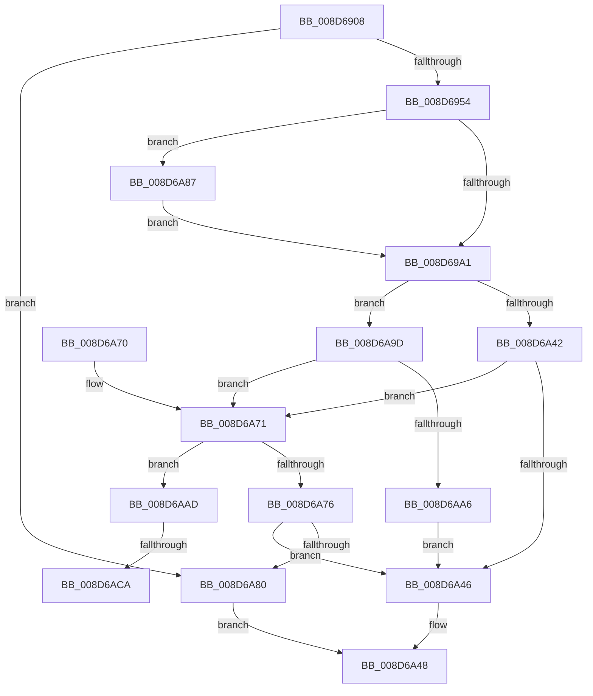

# PspMapSystemDll

- RVA: `0x008D6908`–`0x008D6AD2` (길이 `458` bytes)
- VA: `0x00000001408D6908`
- 실행 섹션: `PAGE`
- PDB 이름 있음: `예`; PDB Function 태그: `예`
- unwind 정보 RVA: `0x00085314`
- 디코드: `119`개 명령, `458/458` bytes 표시
- 미해석 바이트: `0` (있으면 어셈블리에 `.byte`로 보존)

> 이 문서는 커널 이미지의 기계어와 PDB 기호를 분석해 생성했습니다. 4번과 5번은 함수 원형과 자료형을 바이너리 사용 방식에서 추정한 C 해석이며 원본 소스 복구 결과는 아닙니다.

## 1. Dependencies

- 직접 호출 지점: **5**; 고유 호출 대상: **5**
- 직접 호출자로 확인된 함수: **4**
- RIP 상대 이미지 참조: **2**

### Outgoing calls
- `0x008D6943` → [PspReferenceSystemDll](PspReferenceSystemDll_function_008D6AD8.md) (function, `0x008D6AD8`)
- `0x008D6A20` → [MmMapViewOfSectionEx](../../text/48/MmMapViewOfSectionEx_function_0048E244.md) (function, `0x0048E244`)
- `0x008D6A35` → [ObFastDereferenceObject](../../text/3E/ObFastDereferenceObject_function_003ED5F0.md) (function, `0x003ED5F0`)
- `0x008D6A4F` → [_security_check_cookie](../../text/6A/_security_check_cookie_function_006AC640.md) (function, `0x006AC640`)
- `0x008D6AB6` → [RtlImageNtHeader](../../text/44/RtlImageNtHeader_function_00443B60.md) (function, `0x00443B60`)

### Direct callers
- [PsLocateSystemDlls](../77/PsLocateSystemDlls_function_0077ED90.md) at `0x0077EE14`
- [PspLocateSystemDll](../77/PspLocateSystemDll_function_0077F0D0.md) at `0x0077F303`
- [PsMapSystemDlls](../8C/PsMapSystemDlls_function_008CFFA0.md) at `0x008D005B`
- [PspInitPhase3](../../init/C4/PspInitPhase3_function_00C455F8.md) at `0x00C45663`
- [PspInitPhase3](../../init/C4/PspInitPhase3_function_00C455F8.md) at `0x00C45698`

### Static image references
- `0x008D6926` → RVA `0x00E0A740` (`.data`; read)
- `0x008D6A9D` → RVA `0x00FC6AB0` (`ALMOSTRO`; read)

## 2. Other-region calls and transfers

- 다른 실행 섹션으로 향하는 call: **4**
  - `0x008D6A20` → [MmMapViewOfSectionEx](../../text/48/MmMapViewOfSectionEx_function_0048E244.md) (`PAGE` → `.text`)
  - `0x008D6A35` → [ObFastDereferenceObject](../../text/3E/ObFastDereferenceObject_function_003ED5F0.md) (`PAGE` → `.text`)
  - `0x008D6A4F` → [_security_check_cookie](../../text/6A/_security_check_cookie_function_006AC640.md) (`PAGE` → `.text`)
  - `0x008D6AB6` → [RtlImageNtHeader](../../text/44/RtlImageNtHeader_function_00443B60.md) (`PAGE` → `.text`)
- call이 아닌 외부 분기/꼬리 이동: **2**
  - `0x008D6AC4` → [sub_00B1BBBE](../B1/Unknown_function_00B1BBBE.md) (`tail-transfer`)
  - `0x008D6ACD` → [sub_00B1BBBE + 0x4](../B1/Unknown_function_00B1BBBE.md) (`tail-transfer`)

## 3. Assembly (complete function range)

```asm
008D6908  48 89 5C 24 18                  mov qword ptr [rsp + 0x18], rbx
008D690D  48 89 74 24 20                  mov qword ptr [rsp + 0x20], rsi
008D6912  55                              push rbp
008D6913  57                              push rdi
008D6914  41 54                           push r12
008D6916  41 56                           push r14
008D6918  41 57                           push r15
008D691A  48 8D 6C 24 C9                  lea rbp, [rsp - 0x37]
008D691F  48 81 EC E0 00 00 00            sub rsp, 0xe0
008D6926  48 8B 05 13 3E 53 00            mov rax, qword ptr [rip + 0x533e13]
008D692D  48 33 C4                        xor rax, rsp
008D6930  48 89 45 27                     mov qword ptr [rbp + 0x27], rax
008D6934  4C 8B F1                        mov r14, rcx
008D6937  45 8B F9                        mov r15d, r9d
008D693A  48 8B 0A                        mov rcx, qword ptr [rdx]
008D693D  41 8B F8                        mov edi, r8d
008D6940  48 8B DA                        mov rbx, rdx
008D6943  E8 90 01 00 00                  call 0x1408d6ad8
008D6948  4C 8B E0                        mov r12, rax
008D694B  48 85 C0                        test rax, rax
008D694E  0F 84 2C 01 00 00               je 0x1408d6a80
008D6954  48 83 65 C7 00                  and qword ptr [rbp - 0x39], 0
008D6959  48 8D 45 DF                     lea rax, [rbp - 0x21]
008D695D  48 83 65 D7 00                  and qword ptr [rbp - 0x29], 0
008D6962  0F 57 C0                        xorps xmm0, xmm0
008D6965  48 83 65 CF 00                  and qword ptr [rbp - 0x31], 0
008D696A  41 B9 02 00 00 00               mov r9d, 2
008D6970  44 8B 43 08                     mov r8d, dword ptr [rbx + 8]
008D6974  41 8B D1                        mov edx, r9d
008D6977  0F 11 45 F7                     movups xmmword ptr [rbp - 9], xmm0
008D697B  C6 45 F7 01                     mov byte ptr [rbp - 9], 1
008D697F  48 89 45 FF                     mov qword ptr [rbp - 1], rax
008D6983  0F 11 45 07                     movups xmmword ptr [rbp + 7], xmm0
008D6987  C6 45 07 05                     mov byte ptr [rbp + 7], 5
008D698B  48 C7 45 0F 20 00 00 00         mov qword ptr [rbp + 0xf], 0x20
008D6993  0F 11 45 17                     movups xmmword ptr [rbp + 0x17], xmm0
008D6997  41 F6 C0 20                     test r8b, 0x20
008D699B  0F 85 E6 00 00 00               jne 0x1408d6a87
008D69A1  33 C0                           xor eax, eax
008D69A3  C7 44 24 60 00 00 00 02         mov dword ptr [rsp + 0x60], 0x2000000
008D69AB  48 89 45 EF                     mov qword ptr [rbp - 0x11], rax
008D69AF  F7 DF                           neg edi
008D69B1  0F 11 45 DF                     movups xmmword ptr [rbp - 0x21], xmm0
008D69B5  1B C0                           sbb eax, eax
008D69B7  25 00 00 00 20                  and eax, 0x20000000
008D69BC  66 0F 73 D8 08                  psrldq xmm0, 8
008D69C1  8B C8                           mov ecx, eax
008D69C3  0F BA E9 12                     bts ecx, 0x12
008D69C7  45 85 FF                        test r15d, r15d
008D69CA  0F 44 C8                        cmove ecx, eax
008D69CD  41 F6 C0 08                     test r8b, 8
008D69D1  49 B8 FF FF FE FF FF 7F 00 00   movabs r8, 0x7ffffffeffff
008D69DB  66 48 0F 7E C0                  movq rax, xmm0
008D69E0  49 0F 44 C0                     cmove rax, r8
008D69E4  48 83 64 24 50 00               and qword ptr [rsp + 0x50], 0
008D69EA  83 64 24 48 00                  and dword ptr [rsp + 0x48], 0
008D69EF  4C 8D 45 C7                     lea r8, [rbp - 0x39]
008D69F3  89 54 24 40                     mov dword ptr [rsp + 0x40], edx
008D69F7  49 8B D6                        mov rdx, r14
008D69FA  48 89 45 E7                     mov qword ptr [rbp - 0x19], rax
008D69FE  48 8D 45 F7                     lea rax, [rbp - 9]
008D6A02  48 89 44 24 38                  mov qword ptr [rsp + 0x38], rax
008D6A07  48 8D 45 CF                     lea rax, [rbp - 0x31]
008D6A0B  44 89 4C 24 30                  mov dword ptr [rsp + 0x30], r9d
008D6A10  4C 8D 4D D7                     lea r9, [rbp - 0x29]
008D6A14  89 4C 24 28                     mov dword ptr [rsp + 0x28], ecx
008D6A18  49 8B CC                        mov rcx, r12
008D6A1B  48 89 44 24 20                  mov qword ptr [rsp + 0x20], rax
008D6A20  E8 1F 78 BB FF                  call 0x14048e244
008D6A25  48 8B 0B                        mov rcx, qword ptr [rbx]
008D6A28  41 B8 50 73 53 64               mov r8d, 0x64537350
008D6A2E  49 8B D4                        mov rdx, r12
008D6A31  8B F0                           mov esi, eax
008D6A33  8B F8                           mov edi, eax
008D6A35  E8 B6 6B B1 FF                  call 0x1403ed5f0
008D6A3A  81 FF 03 00 00 40               cmp edi, 0x40000003
008D6A40  74 5B                           je 0x1408d6a9d
008D6A42  85 FF                           test edi, edi
008D6A44  79 2B                           jns 0x1408d6a71
008D6A46  8B C6                           mov eax, esi
008D6A48  48 8B 4D 27                     mov rcx, qword ptr [rbp + 0x27]
008D6A4C  48 33 CC                        xor rcx, rsp
008D6A4F  E8 EC 5B DD FF                  call 0x1406ac640
008D6A54  4C 8D 9C 24 E0 00 00 00         lea r11, [rsp + 0xe0]
008D6A5C  49 8B 5B 40                     mov rbx, qword ptr [r11 + 0x40]
008D6A60  49 8B 73 48                     mov rsi, qword ptr [r11 + 0x48]
008D6A64  49 8B E3                        mov rsp, r11
008D6A67  41 5F                           pop r15
008D6A69  41 5E                           pop r14
008D6A6B  41 5C                           pop r12
008D6A6D  5F                              pop rdi
008D6A6E  5D                              pop rbp
008D6A6F  C3                              ret
008D6A70  CC                              int3
008D6A71  45 85 FF                        test r15d, r15d
008D6A74  75 37                           jne 0x1408d6aad
008D6A76  48 8B 45 C7                     mov rax, qword ptr [rbp - 0x39]
008D6A7A  48 39 43 20                     cmp qword ptr [rbx + 0x20], rax
008D6A7E  74 C6                           je 0x1408d6a46
008D6A80  B8 01 00 00 C0                  mov eax, 0xc0000001
008D6A85  EB C1                           jmp 0x1408d6a48
008D6A87  0F B7 43 0A                     movzx eax, word ptr [rbx + 0xa]
008D6A8B  BA 03 00 00 00                  mov edx, 3
008D6A90  48 89 45 1F                     mov qword ptr [rbp + 0x1f], rax
008D6A94  C6 45 17 06                     mov byte ptr [rbp + 0x17], 6
008D6A98  E9 04 FF FF FF                  jmp 0x1408d69a1
008D6A9D  4C 3B 35 0C 00 6F 00            cmp r14, qword ptr [rip + 0x6f000c]
008D6AA4  74 CB                           je 0x1408d6a71
008D6AA6  BE 18 00 00 C0                  mov esi, 0xc0000018
008D6AAB  EB 99                           jmp 0x1408d6a46
008D6AAD  4C 8B 75 C7                     mov r14, qword ptr [rbp - 0x39]
008D6AB1  33 F6                           xor esi, esi
008D6AB3  49 8B CE                        mov rcx, r14
008D6AB6  E8 A5 D0 B6 FF                  call 0x140443b60
008D6ABB  BA 0B 01 00 00                  mov edx, 0x10b
008D6AC0  66 39 50 18                     cmp word ptr [rax + 0x18], dx
008D6AC4  0F 85 F4 50 24 00               jne 0x140b1bbbe
008D6ACA  8B 50 34                        mov edx, dword ptr [rax + 0x34]
008D6ACD  E9 F0 50 24 00                  jmp 0x140b1bbc2
```

## 4. C-style interpretation (structured pseudocode)

```c
__int64 __fastcall PspMapSystemDll(__int64 a1, __int64 a2, int a3, int a4)
{
    __int64 result;
    __int64 v_rdi;
    __int64 v_rsi;
    __int64 v_rsp;
    unsigned __int64 v_stack_m28;
    unsigned __int64 v_stack_m38;
    unsigned __int64 v_stack_m40;
    unsigned __int64 v_stack_m48;
    unsigned __int64 v_stack_m50;
    unsigned __int64 v_stack_m58;
    unsigned __int64 v_stack_m5F;
    unsigned __int64 v_stack_m60;
    unsigned __int64 v_stack_m68;
    unsigned __int64 v_stack_m70;
    unsigned __int64 v_stack_m78;
    unsigned __int64 v_stack_m80;
    unsigned __int64 v_stack_m88;
    unsigned __int64 v_stack_m90;
    unsigned __int64 v_stack_m98;
    unsigned int v_stack_mA8;
    unsigned __int64 v_stack_mB8;
    unsigned int v_stack_mC0;
    unsigned int v_stack_mC8;
    unsigned __int64 v_stack_mD0;
    unsigned int v_stack_mD8;
    unsigned int v_stack_mE0;
    unsigned __int64 v_stack_mE8;
    unsigned __int64 v_stack_p18;
    unsigned __int64 v_stack_p20;

    v_stack_p18 = v_rbx;
    v_stack_p20 = v_rsi;
    v_rsp = (v_rsp) - (224);
    result = (*(unsigned __int64 *)(v_rip + 5455379)) ^ (v_rsp);
    v_stack_m38 = result;
    result = PspReferenceSystemDll(*(unsigned __int64 *)(a2), a2, a3, a4);
    if (result == 0) goto loc_008D6A80;
    v_stack_m68 = v_xmm0;
    v_stack_m68 = 1;
    v_stack_m60 = v_stack_m80;
    v_stack_m58 = v_xmm0;
    v_stack_m58 = 5;
    v_stack_m50 = 32;
    v_stack_m48 = v_xmm0;
    if ((((unsigned __int8)((unsigned int)(*(unsigned int *)(a2 + 8)))) & (32)) != 0) goto loc_008D6A87;
loc_008D69A1:
    result = 0;
    v_stack_mA8 = 0x2000000ULL;
    v_stack_m70 = 0;
    v_rdi = (unsigned int)(-((unsigned int)(a3)));
    v_stack_m80 = v_xmm0;
    result = (unsigned int)((result) & (0x20000000ULL));
    a1 = (unsigned int)((unsigned int)(result));
    if ((unsigned int)((unsigned int)(a4)) == 0) { a1 = (unsigned int)(result); }
    if ((((unsigned __int8)((unsigned int)(*(unsigned int *)(a2 + 8)))) & (8)) == 0) { result = (unsigned int)(*(unsigned int *)(a2 + 8)); }
    v_stack_mC8 = 2;
    v_stack_m78 = result;
    v_stack_mD0 = v_stack_m68;
    v_stack_mD8 = 2;
    v_stack_mE0 = (unsigned int)(a1);
    v_stack_mE8 = v_stack_m90;
    result = MmMapViewOfSectionEx(result, a1, v_stack_m98, v_stack_m88);
    result = ObFastDereferenceObject(*(unsigned __int64 *)(a2), result, (unsigned int)(0x64537350ULL), v_stack_m88);
    if (((unsigned int)((unsigned int)((unsigned int)(result)))) == 0x40000003ULL) goto loc_008D6A9D;
    if (!sign_flag) goto loc_008D6A71;
loc_008D6A46:
loc_008D6A48:
    a1 = (v_stack_m38) ^ (v_rsp);
    result = _security_check_cookie(a1, result, (unsigned int)(0x64537350ULL), v_stack_m88);
    return result;
loc_008D6A71:
    if ((unsigned int)((unsigned int)(a4)) != 0) goto loc_008D6AAD;
    if ((*(unsigned __int64 *)(*(unsigned __int64 *)(v_stack_m28 + 64) + 32)) == v_stack_m98) goto loc_008D6A46;
loc_008D6A80:
    goto loc_008D6A48;
loc_008D6A87:
    v_stack_m40 = *(unsigned __int16 *)(*(unsigned __int64 *)(v_stack_m28 + 64) + 10);
    v_stack_m48 = 6;
    goto loc_008D69A1;
loc_008D6A9D:
    if (a1 == (*(unsigned __int64 *)(v_rip + 7274508))) goto loc_008D6A71;
    goto loc_008D6A46;
loc_008D6AAD:
    v_rsi = 0;
    result = RtlImageNtHeader(v_stack_m98, 3, (unsigned int)(0x64537350ULL), v_stack_m88);
}
```

## 5. (Beta) C Style

```c
int64_t PspMapSystemDll(int64_t Arg1, void *Arg2, int32_t Arg3, int32_t Arg4)
{
    uint8_t *arg2 = (uint8_t *)Arg2;

    int64_t result;
    int64_t local_rdi;
    int64_t local_rsi;
    int64_t local_rsp;
    uint64_t v_stack_m28;
    uint64_t v_stack_m38;
    uint64_t v_stack_m40;
    uint64_t v_stack_m48;
    uint64_t v_stack_m50;
    uint64_t v_stack_m58;
    uint64_t v_stack_m5F;
    uint64_t v_stack_m60;
    uint64_t v_stack_m68;
    uint64_t v_stack_m70;
    uint64_t v_stack_m78;
    uint64_t v_stack_m80;
    uint64_t v_stack_m88;
    uint64_t v_stack_m90;
    uint64_t v_stack_m98;
    uint32_t v_stack_mA8;
    uint64_t v_stack_mB8;
    uint32_t v_stack_mC0;
    uint32_t v_stack_mC8;
    uint64_t v_stack_mD0;
    uint32_t v_stack_mD8;
    uint32_t v_stack_mE0;
    uint64_t v_stack_mE8;
    uint64_t v_stack_p18;
    uint64_t v_stack_p20;

    v_stack_p18 = local_rbx;
    v_stack_p20 = local_rsi;
    local_rsp = (local_rsp) - (224);
    result = (*(uint64_t *)(v_rip + 0x533E13)) ^ (local_rsp);
    v_stack_m38 = result;
    result = PspReferenceSystemDll(*(uint64_t *)(arg2), Arg2, Arg3, Arg4);
    if (result == 0) goto loc_008D6A80;
    v_stack_m68 = v_xmm0;
    v_stack_m68 = 1;
    v_stack_m60 = v_stack_m80;
    v_stack_m58 = v_xmm0;
    v_stack_m58 = 5;
    v_stack_m50 = 32;
    v_stack_m48 = v_xmm0;
    if ((((uint8_t)((uint32_t)(*(uint32_t *)(arg2 + 0x8)))) & (32)) != 0) goto loc_008D6A87;
loc_008D69A1:
    result = 0;
    v_stack_mA8 = 0x2000000ULL;
    v_stack_m70 = 0;
    local_rdi = (uint32_t)(-((uint32_t)(Arg3)));
    v_stack_m80 = v_xmm0;
    result = (uint32_t)((result) & (0x20000000ULL));
    Arg1 = (uint32_t)((uint32_t)(result));
    if ((uint32_t)((uint32_t)(Arg4)) == 0) { Arg1 = (uint32_t)(result); }
    if ((((uint8_t)((uint32_t)(*(uint32_t *)(arg2 + 0x8)))) & (8)) == 0) { result = (uint32_t)(*(uint32_t *)(arg2 + 0x8)); }
    v_stack_mC8 = 2;
    v_stack_m78 = result;
    v_stack_mD0 = v_stack_m68;
    v_stack_mD8 = 2;
    v_stack_mE0 = (uint32_t)(Arg1);
    v_stack_mE8 = v_stack_m90;
    result = MmMapViewOfSectionEx(result, Arg1, v_stack_m98, v_stack_m88);
    result = ObFastDereferenceObject(*(uint64_t *)(arg2), result, (uint32_t)(0x64537350ULL), v_stack_m88);
    if (((uint32_t)((uint32_t)((uint32_t)(result)))) == 0x40000003ULL) goto loc_008D6A9D;
    if (!sign_flag) goto loc_008D6A71;
loc_008D6A46:
loc_008D6A48:
    Arg1 = (v_stack_m38) ^ (local_rsp);
    result = _security_check_cookie(Arg1, result, (uint32_t)(0x64537350ULL), v_stack_m88);
    return result;
loc_008D6A71:
    if ((uint32_t)((uint32_t)(Arg4)) != 0) goto loc_008D6AAD;
    if ((*(uint64_t *)(*(uint64_t *)(v_stack_m28 + 0x40) + 0x20)) == v_stack_m98) goto loc_008D6A46;
loc_008D6A80:
    goto loc_008D6A48;
loc_008D6A87:
    v_stack_m40 = *(uint16_t *)(*(uint64_t *)(v_stack_m28 + 0x40) + 0xA);
    v_stack_m48 = 6;
    goto loc_008D69A1;
loc_008D6A9D:
    if (Arg1 == (*(uint64_t *)(v_rip + 0x6F000C))) goto loc_008D6A71;
    goto loc_008D6A46;
loc_008D6AAD:
    local_rsi = 0;
    result = RtlImageNtHeader(v_stack_m98, 3, (uint32_t)(0x64537350ULL), v_stack_m88);
}
```

### 관측된 메모리 오프셋

구조체 형식이 확인되지 않은 접근은 인자 기준의 오프셋으로만 기록했습니다.

| 기준 인자 | 오프셋 표현 | 폭 (bit) | 접근 |
|---|---:|---:|---|
| `Arg2` | `+ 0x0` | `64` | `R` |
| `Arg2` | `+ 0x8` | `32` | `R` |
| `Arg2` | `+ 0xA` | `16` | `R` |
| `Arg2` | `+ 0x20` | `64` | `R` |

## 6. Execution-region graph

[열기: 2D/3D 그래프와 함수 탐색 컨트롤 패널](../../../control-panel.html?section=page&rva=0x008D6908&view=graph)

- 2D 그래프는 위에서 아래로 흐르고, 3D 그래프는 빈 공간을 드래그해 회전합니다. Shift+드래그는 이동, 휠은 확대·축소, 함수 노드 선택은 대상 보고서 이동입니다.

### Static fallback


