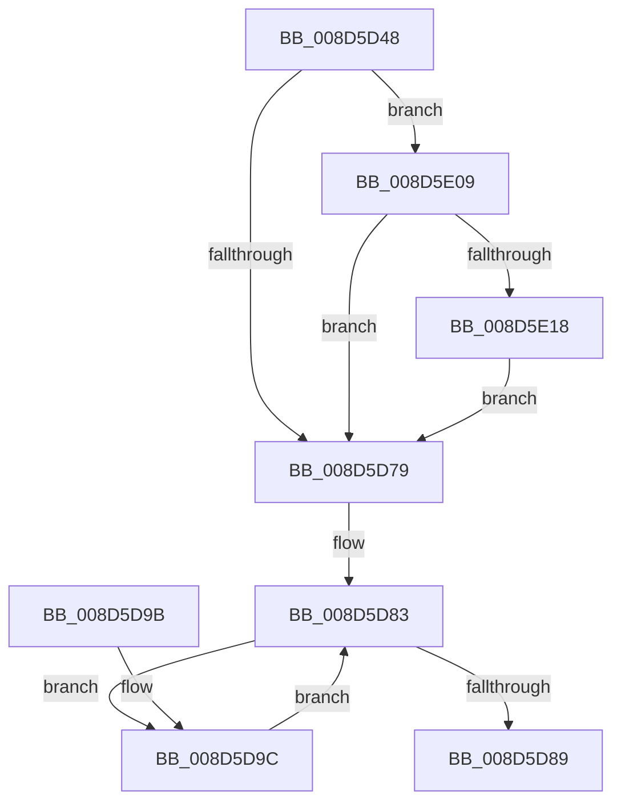

# PspNotifyThreadCreation

- RVA: `0x008D5D48`–`0x008D5E2C` (길이 `228` bytes)
- VA: `0x00000001408D5D48`
- 실행 섹션: `PAGE`
- PDB 이름 있음: `예`; PDB Function 태그: `아니요`
- unwind 정보 RVA: `0x000851D4`
- 디코드: `50`개 명령, `228/228` bytes 표시
- 미해석 바이트: `0` (있으면 어셈블리에 `.byte`로 보존)

> 이 문서는 커널 이미지의 기계어와 PDB 기호를 분석해 생성했습니다. 4번과 5번은 함수 원형과 자료형을 바이너리 사용 방식에서 추정한 C 해석이며 원본 소스 복구 결과는 아닙니다.

## 1. Dependencies

- 직접 호출 지점: **5**; 고유 호출 대상: **5**
- 직접 호출자로 확인된 함수: **2**
- RIP 상대 이미지 참조: **1**

### Outgoing calls
- `0x008D5D64` → [DbgkCreateThread](DbgkCreateThread_function_008D5E34.md) (function, `0x008D5E34`)
- `0x008D5DA1` → [KeQuerySystemTimePrecise](../../text/37/KeQuerySystemTimePrecise_function_0037DA40.md) (function, `0x0037DA40`)
- `0x008D5DB1` → [KeQueryPerformanceCounter](../../text/37/KeQueryPerformanceCounter_function_0037E7E0.md) (function, `0x0037E7E0`)
- `0x008D5DBE` → [ExGenRandom](../../text/41/ExGenRandom_function_0041B010.md) (function, `0x0041B010`)
- `0x008D5E22` → [PfProcessCreateNotification](../95/PfProcessCreateNotification_function_0095EB98.md) (function, `0x0095EB98`)

### Direct callers
- [PspUserThreadStartup](PspUserThreadStartup_function_008D5B10.md) at `0x008D5BAC`
- [PspSecureThreadStartup](../AA/PspSecureThreadStartup_function_00AABDF0.md) at `0x00AABE2D`

### Static image references
- `0x008D5DE9` → RVA `0x00FC5008` (`ALMOSTRO`; read)

## 2. Other-region calls and transfers

- 다른 실행 섹션으로 향하는 call: **3**
  - `0x008D5DA1` → [KeQuerySystemTimePrecise](../../text/37/KeQuerySystemTimePrecise_function_0037DA40.md) (`PAGE` → `.text`)
  - `0x008D5DB1` → [KeQueryPerformanceCounter](../../text/37/KeQueryPerformanceCounter_function_0037E7E0.md) (`PAGE` → `.text`)
  - `0x008D5DBE` → [ExGenRandom](../../text/41/ExGenRandom_function_0041B010.md) (`PAGE` → `.text`)
- 별도 외부 분기/꼬리 이동을 확인하지 못했습니다.

## 3. Assembly (complete function range)

```asm
008D5D48  48 89 5C 24 10                  mov qword ptr [rsp + 0x10], rbx
008D5D4D  48 89 6C 24 18                  mov qword ptr [rsp + 0x18], rbp
008D5D52  57                              push rdi
008D5D53  48 83 EC 20                     sub rsp, 0x20
008D5D57  48 83 64 24 30 00               and qword ptr [rsp + 0x30], 0
008D5D5D  48 8B 99 20 02 00 00            mov rbx, qword ptr [rcx + 0x220]
008D5D64  E8 CB 00 00 00                  call 0x1408d5e34
008D5D69  F7 83 F4 01 00 00 00 00 08 00   test dword ptr [rbx + 0x1f4], 0x80000
008D5D73  0F 84 90 00 00 00               je 0x1408d5e09
008D5D79  48 BD 30 03 00 00 80 F7 FF FF   movabs rbp, 0xfffff78000000330
008D5D83  83 7D 00 00                     cmp dword ptr [rbp], 0
008D5D87  74 13                           je 0x1408d5d9c
008D5D89  48 8B 5C 24 38                  mov rbx, qword ptr [rsp + 0x38]
008D5D8E  33 C0                           xor eax, eax
008D5D90  48 8B 6C 24 40                  mov rbp, qword ptr [rsp + 0x40]
008D5D95  48 83 C4 20                     add rsp, 0x20
008D5D99  5F                              pop rdi
008D5D9A  C3                              ret
008D5D9B  CC                              int3
008D5D9C  48 8D 4C 24 30                  lea rcx, [rsp + 0x30]
008D5DA1  E8 9A 7C AA FF                  call 0x14037da40
008D5DA6  65 48 8B 3C 25 20 00 00 00      mov rdi, qword ptr gs:[0x20]
008D5DAF  33 C9                           xor ecx, ecx
008D5DB1  E8 2A 8A AA FF                  call 0x14037e7e0
008D5DB6  B9 01 00 00 00                  mov ecx, 1
008D5DBB  48 8B D8                        mov rbx, rax
008D5DBE  E8 4D 52 B4 FF                  call 0x14041b010
008D5DC3  44 8B C0                        mov r8d, eax
008D5DC6  0F 31                           rdtsc
008D5DC8  8B 8F 10 2D 00 00               mov ecx, dword ptr [rdi + 0x2d10]
008D5DCE  48 C1 E2 20                     shl rdx, 0x20
008D5DD2  48 0B C2                        or rax, rdx
008D5DD5  8B 97 50 86 00 00               mov edx, dword ptr [rdi + 0x8650]
008D5DDB  33 97 40 86 00 00               xor edx, dword ptr [rdi + 0x8640]
008D5DE1  44 33 C0                        xor r8d, eax
008D5DE4  41 33 C8                        xor ecx, r8d
008D5DE7  33 D1                           xor edx, ecx
008D5DE9  48 8B 0D 18 F2 6E 00            mov rcx, qword ptr [rip + 0x6ef218]
008D5DF0  33 D3                           xor edx, ebx
008D5DF2  33 54 24 34                     xor edx, dword ptr [rsp + 0x34]
008D5DF6  33 54 24 30                     xor edx, dword ptr [rsp + 0x30]
008D5DFA  33 C0                           xor eax, eax
008D5DFC  F0 0F B1 91 30 03 00 00         lock cmpxchg dword ptr [rcx + 0x330], edx
008D5E04  E9 7A FF FF FF                  jmp 0x1408d5d83
008D5E09  F0 0F BA AB F4 01 00 00 13      lock bts dword ptr [rbx + 0x1f4], 0x13
008D5E12  0F 82 61 FF FF FF               jb 0x1408d5d79
008D5E18  48 8B 93 A8 02 00 00            mov rdx, qword ptr [rbx + 0x2a8]
008D5E1F  48 8B CB                        mov rcx, rbx
008D5E22  E8 71 8D 08 00                  call 0x14095eb98
008D5E27  E9 4D FF FF FF                  jmp 0x1408d5d79
```

## 4. C-style interpretation (structured pseudocode)

```c
__int64 __fastcall PspNotifyThreadCreation(__int64 a1, __int64 a2)
{
    __int64 result;
    __int64 v_rsp;
    unsigned __int64 v_stack_p10;
    unsigned __int64 v_stack_p18;
    unsigned __int64 v_stack_p30;
    unsigned int v_stack_p34;
    unsigned __int64 v_stack_p8;

    v_stack_p10 = v_rbx;
    v_stack_p18 = v_rbp;
    v_rsp = (v_rsp) - (32);
    result = DbgkCreateThread(a1, a2, a3, a4);
    if (((*(unsigned int *)(*(unsigned __int64 *)(a1 + 544) + 500)) & (0x80000ULL)) == 0) goto loc_008D5E09;
loc_008D5D79:
loc_008D5D83:
    if ((*(unsigned int *)(v_rbp)) == 0) goto loc_008D5D9C;
    result = 0;
    v_rsp = (v_rsp) + (32);
    return result;
loc_008D5D9C:
    result = KeQuerySystemTimePrecise(v_stack_p30, a2, a3, a4);
    a1 = 0;
    result = KeQueryPerformanceCounter(a1, a2, a3, a4);
    result = ExGenRandom(1, a2, a3, a4);
    a2 = (a2) << (32);
    result = (result) | (a2);
    a2 = (unsigned int)(((unsigned int)(*(unsigned int *)(*(unsigned __int64 *)(gs_base + (0 + 32)) + 34384))) ^ (*(unsigned int *)(*(unsigned __int64 *)(gs_base + (0 + 32)) + 34368)));
    a3 = (unsigned int)(((unsigned int)((unsigned int)(result))) ^ ((unsigned int)(result)));
    a1 = (unsigned int)(((unsigned int)(*(unsigned int *)(*(unsigned __int64 *)(gs_base + (0 + 32)) + 11536))) ^ ((unsigned int)(a3)));
    a2 = (unsigned int)((a2) ^ ((unsigned int)(a1)));
    a2 = (unsigned int)((a2) ^ ((unsigned int)(result)));
    a2 = (unsigned int)((a2) ^ (v_stack_p34));
    a2 = (unsigned int)((a2) ^ (v_stack_p30));
    result = 0;
    goto loc_008D5D83;
loc_008D5E09:
    if (condition_is_below) goto loc_008D5D79;
    result = PfProcessCreateNotification(0, *(unsigned __int64 *)(result + 680), a3, a4);
    goto loc_008D5D79;
}
```

## 5. (Beta) C Style

```c
int64_t PspNotifyThreadCreation(void *Arg1, int64_t Arg2)
{
    uint8_t *arg1 = (uint8_t *)Arg1;

    int64_t result;
    int64_t local_rsp;
    uint64_t v_stack_p10;
    uint64_t v_stack_p18;
    uint64_t v_stack_p30;
    uint32_t v_stack_p34;
    uint64_t v_stack_p8;

    v_stack_p10 = local_rbx;
    v_stack_p18 = local_rbp;
    local_rsp = (local_rsp) - (32);
    result = DbgkCreateThread(Arg1, Arg2, a3, a4);
    if (((*(uint32_t *)(*(uint64_t *)(arg1 + 0x220) + 0x1F4)) & (0x80000ULL)) == 0) goto loc_008D5E09;
loc_008D5D79:
loc_008D5D83:
    if ((*(uint32_t *)(local_rbp)) == 0) goto loc_008D5D9C;
    result = 0;
    local_rsp = (local_rsp) + (32);
    return result;
loc_008D5D9C:
    result = KeQuerySystemTimePrecise(v_stack_p30, Arg2, a3, a4);
    Arg1 = 0;
    result = KeQueryPerformanceCounter(Arg1, Arg2, a3, a4);
    result = ExGenRandom(1, Arg2, a3, a4);
    Arg2 = (Arg2) << (32);
    result = (result) | (Arg2);
    Arg2 = (uint32_t)(((uint32_t)(*(uint32_t *)(*(uint64_t *)(gs_base + (0 + 0x20)) + 0x8650))) ^ (*(uint32_t *)(*(uint64_t *)(gs_base + (0 + 0x20)) + 0x8640)));
    a3 = (uint32_t)(((uint32_t)((uint32_t)(result))) ^ ((uint32_t)(result)));
    Arg1 = (uint32_t)(((uint32_t)(*(uint32_t *)(*(uint64_t *)(gs_base + (0 + 0x20)) + 0x2D10))) ^ ((uint32_t)(a3)));
    Arg2 = (uint32_t)((Arg2) ^ ((uint32_t)(Arg1)));
    Arg2 = (uint32_t)((Arg2) ^ ((uint32_t)(result)));
    Arg2 = (uint32_t)((Arg2) ^ (v_stack_p34));
    Arg2 = (uint32_t)((Arg2) ^ (v_stack_p30));
    result = 0;
    goto loc_008D5D83;
loc_008D5E09:
    if (condition_is_below) goto loc_008D5D79;
    result = PfProcessCreateNotification(0, *(uint64_t *)(result + 0x2A8), a3, a4);
    goto loc_008D5D79;
}
```

### 관측된 메모리 오프셋

구조체 형식이 확인되지 않은 접근은 인자 기준의 오프셋으로만 기록했습니다.

| 기준 인자 | 오프셋 표현 | 폭 (bit) | 접근 |
|---|---:|---:|---|
| `Arg1` | `+ 0x220` | `64` | `R` |

## 6. Execution-region graph

[열기: 2D/3D 그래프와 함수 탐색 컨트롤 패널](../../../control-panel.html?section=page&rva=0x008D5D48&view=graph)

- 2D 그래프는 위에서 아래로 흐르고, 3D 그래프는 빈 공간을 드래그해 회전합니다. Shift+드래그는 이동, 휠은 확대·축소, 함수 노드 선택은 대상 보고서 이동입니다.

### Static fallback


