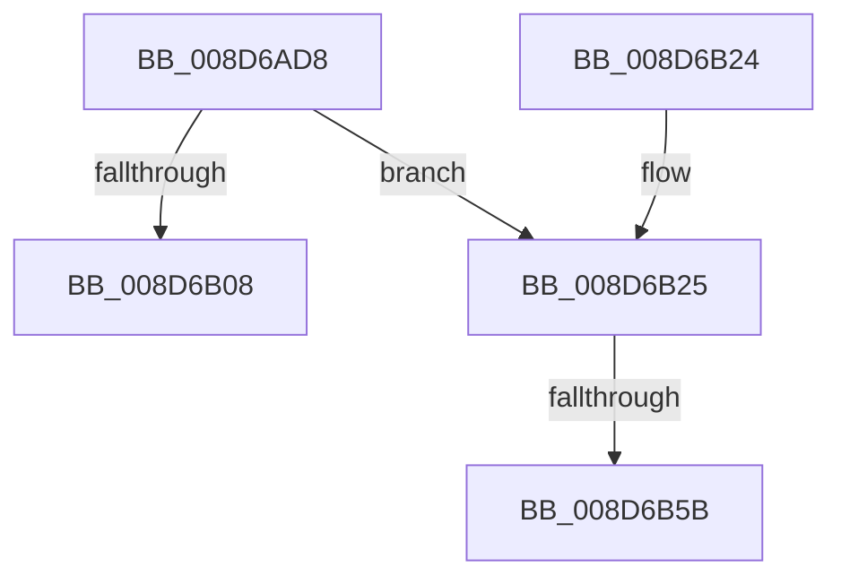

# PspReferenceSystemDll

- RVA: `0x008D6AD8`–`0x008D6B71` (길이 `153` bytes)
- VA: `0x00000001408D6AD8`
- 실행 섹션: `PAGE`
- PDB 이름 있음: `예`; PDB Function 태그: `예`
- unwind 정보 RVA: `0x0008534C`
- 디코드: `44`개 명령, `153/153` bytes 표시
- 미해석 바이트: `0` (있으면 어셈블리에 `.byte`로 보존)

> 이 문서는 커널 이미지의 기계어와 PDB 기호를 분석해 생성했습니다. 4번과 5번은 함수 원형과 자료형을 바이너리 사용 방식에서 추정한 C 해석이며 원본 소스 복구 결과는 아닙니다.

## 1. Dependencies

- 직접 호출 지점: **3**; 고유 호출 대상: **3**
- 직접 호출자로 확인된 함수: **4**
- RIP 상대 이미지 참조: **0**

### Outgoing calls
- `0x008D6AF8` → [ObFastReferenceObject](../../text/40/ObFastReferenceObject_function_004099C0.md) (function, `0x004099C0`)
- `0x008D6B42` → [KeAbPreAcquire](../../text/21/KeAbPreAcquire_function_00210230.md) (function, `0x00210230`)
- `0x008D6B66` → [ExfAcquirePushLockSharedEx](../../text/21/ExfAcquirePushLockSharedEx_function_0021044C.md) (function, `0x0021044C`)

### Direct callers
- [DbgkCreateThread](DbgkCreateThread_function_008D5E34.md) at `0x008D6091`
- [PspMapSystemDll](PspMapSystemDll_function_008D6908.md) at `0x008D6943`
- [MmInitSystemDll](../../init/BE/MmInitSystemDll_function_00BEEFB0.md) at `0x00BEEFC9`
- [PspInitPhase3](../../init/C4/PspInitPhase3_function_00C455F8.md) at `0x00C4567C`
- [PspInitPhase3](../../init/C4/PspInitPhase3_function_00C455F8.md) at `0x00C456AB`

### Static image references
- 디코드된 RIP-relative 메모리 참조가 없습니다.

## 2. Other-region calls and transfers

- 다른 실행 섹션으로 향하는 call: **3**
  - `0x008D6AF8` → [ObFastReferenceObject](../../text/40/ObFastReferenceObject_function_004099C0.md) (`PAGE` → `.text`)
  - `0x008D6B42` → [KeAbPreAcquire](../../text/21/KeAbPreAcquire_function_00210230.md) (`PAGE` → `.text`)
  - `0x008D6B66` → [ExfAcquirePushLockSharedEx](../../text/21/ExfAcquirePushLockSharedEx_function_0021044C.md) (`PAGE` → `.text`)
- call이 아닌 외부 분기/꼬리 이동: **2**
  - `0x008D6B55` → [sub_00B1BBD6](../B1/Unknown_function_00B1BBD6.md) (`tail-transfer`)
  - `0x008D6B6C` → [sub_00B1BBD6](../B1/Unknown_function_00B1BBD6.md) (`tail-transfer`)

## 3. Assembly (complete function range)

```asm
008D6AD8  48 89 5C 24 10                  mov qword ptr [rsp + 0x10], rbx
008D6ADD  48 89 6C 24 18                  mov qword ptr [rsp + 0x18], rbp
008D6AE2  48 89 74 24 20                  mov qword ptr [rsp + 0x20], rsi
008D6AE7  57                              push rdi
008D6AE8  41 54                           push r12
008D6AEA  41 56                           push r14
008D6AEC  48 83 EC 20                     sub rsp, 0x20
008D6AF0  BA 50 73 53 64                  mov edx, 0x64537350
008D6AF5  48 8B F1                        mov rsi, rcx
008D6AF8  E8 C3 2E B3 FF                  call 0x1404099c0
008D6AFD  45 33 F6                        xor r14d, r14d
008D6B00  48 8B F8                        mov rdi, rax
008D6B03  48 85 C0                        test rax, rax
008D6B06  74 1D                           je 0x1408d6b25
008D6B08  48 8B 5C 24 48                  mov rbx, qword ptr [rsp + 0x48]
008D6B0D  48 8B C7                        mov rax, rdi
008D6B10  48 8B 6C 24 50                  mov rbp, qword ptr [rsp + 0x50]
008D6B15  48 8B 74 24 58                  mov rsi, qword ptr [rsp + 0x58]
008D6B1A  48 83 C4 20                     add rsp, 0x20
008D6B1E  41 5E                           pop r14
008D6B20  41 5C                           pop r12
008D6B22  5F                              pop rdi
008D6B23  C3                              ret
008D6B24  CC                              int3
008D6B25  65 48 8B 2C 25 88 01 00 00      mov rbp, qword ptr gs:[0x188]
008D6B2E  48 8D 5E 08                     lea rbx, [rsi + 8]
008D6B32  45 33 C0                        xor r8d, r8d
008D6B35  33 D2                           xor edx, edx
008D6B37  48 8B CB                        mov rcx, rbx
008D6B3A  66 FF 8D E4 01 00 00            dec word ptr [rbp + 0x1e4]
008D6B41  90                              nop
008D6B42  E8 E9 96 93 FF                  call 0x140210230
008D6B47  48 8B F8                        mov rdi, rax
008D6B4A  33 C0                           xor eax, eax
008D6B4C  44 8D 60 11                     lea r12d, [rax + 0x11]
008D6B50  F0 4C 0F B1 23                  lock cmpxchg qword ptr [rbx], r12
008D6B55  0F 84 7B 50 24 00               je 0x140b1bbd6
008D6B5B  4C 8B CB                        mov r9, rbx
008D6B5E  4C 8B C7                        mov r8, rdi
008D6B61  33 D2                           xor edx, edx
008D6B63  48 8B CB                        mov rcx, rbx
008D6B66  E8 E1 98 93 FF                  call 0x14021044c
008D6B6B  90                              nop
008D6B6C  E9 65 50 24 00                  jmp 0x140b1bbd6
```

## 4. C-style interpretation (structured pseudocode)

```c
__int64 __fastcall PspReferenceSystemDll(__int64 a1, __int64 a2, int a3)
{
    __int64 result;
    __int64 v_r14;
    __int64 v_rsp;
    unsigned __int64 v_stack_p10;
    unsigned __int64 v_stack_p18;
    unsigned __int64 v_stack_p20;

    v_stack_p10 = v_rbx;
    v_stack_p18 = v_rbp;
    v_stack_p20 = v_rsi;
    v_rsp = (v_rsp) - (32);
    result = ObFastReferenceObject(a1, (unsigned int)(0x64537350ULL), a3, a4);
    v_r14 = 0;
    if (result == 0) goto loc_008D6B25;
    v_rsp = (v_rsp) + (32);
    return result;
loc_008D6B25:
    a3 = 0;
    a2 = 0;
    result = KeAbPreAcquire(v_stack_p20 + 8, a2, a3, a4);
    result = 0;
    a2 = 0;
    result = ExfAcquirePushLockSharedEx(v_stack_p20 + 8, a2, 0, v_stack_p20 + 8);
}
```

## 5. (Beta) C Style

```c
int64_t PspReferenceSystemDll(void *Arg1, int64_t Arg2, int32_t Arg3)
{
    uint8_t *arg1 = (uint8_t *)Arg1;

    int64_t result;
    int64_t local_r14;
    int64_t local_rsp;
    uint64_t v_stack_p10;
    uint64_t v_stack_p18;
    uint64_t v_stack_p20;

    v_stack_p10 = local_rbx;
    v_stack_p18 = local_rbp;
    v_stack_p20 = local_rsi;
    local_rsp = (local_rsp) - (32);
    result = ObFastReferenceObject(Arg1, (uint32_t)(0x64537350ULL), Arg3, a4);
    local_r14 = 0;
    if (result == 0) goto loc_008D6B25;
    local_rsp = (local_rsp) + (32);
    return result;
loc_008D6B25:
    Arg3 = 0;
    Arg2 = 0;
    result = KeAbPreAcquire(v_stack_p20 + 8, Arg2, Arg3, a4);
    result = 0;
    Arg2 = 0;
    result = ExfAcquirePushLockSharedEx(v_stack_p20 + 8, Arg2, 0, v_stack_p20 + 8);
}
```

### 관측된 메모리 오프셋

구조체 형식이 확인되지 않은 접근은 인자 기준의 오프셋으로만 기록했습니다.

| 기준 인자 | 오프셋 표현 | 폭 (bit) | 접근 |
|---|---:|---:|---|
| `Arg1` | `+ 0x0` | `64` | `R` |
| `Arg1` | `+ 0x8` | `64` | `R` |

## 6. Execution-region graph

[열기: 2D/3D 그래프와 함수 탐색 컨트롤 패널](../../../control-panel.html?section=page&rva=0x008D6AD8&view=graph)

- 2D 그래프는 위에서 아래로 흐르고, 3D 그래프는 빈 공간을 드래그해 회전합니다. Shift+드래그는 이동, 휠은 확대·축소, 함수 노드 선택은 대상 보고서 이동입니다.

### Static fallback


