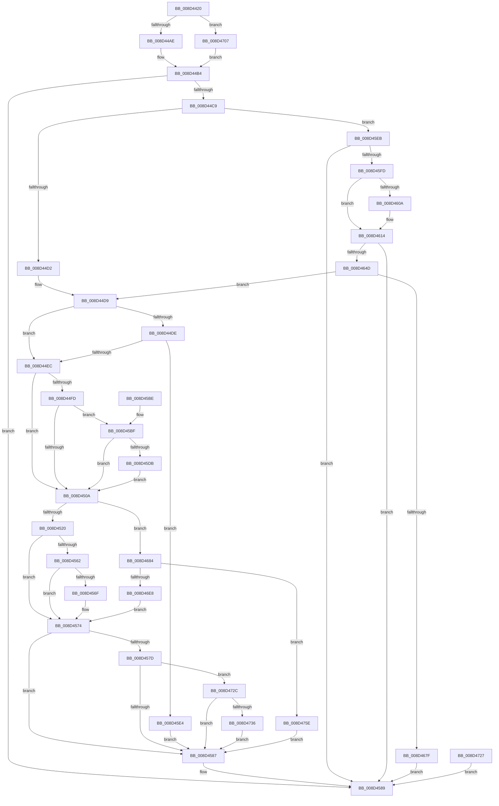

# PspSetContextThreadInternal

- RVA: `0x008D4420`–`0x008D4768` (길이 `840` bytes)
- VA: `0x00000001408D4420`
- 실행 섹션: `PAGE`
- PDB 이름 있음: `예`; PDB Function 태그: `아니요`
- unwind 정보 RVA: `0x00085000`
- 디코드: `197`개 명령, `840/840` bytes 표시
- 미해석 바이트: `0` (있으면 어셈블리에 `.byte`로 보존)

> 이 문서는 커널 이미지의 기계어와 PDB 기호를 분석해 생성했습니다. 4번과 5번은 함수 원형과 자료형을 바이너리 사용 방식에서 추정한 C 해석이며 원본 소스 복구 결과는 아닙니다.

## 1. Dependencies

- 직접 호출 지점: **18**; 고유 호출 대상: **15**
- 직접 호출자로 확인된 함수: **7**
- RIP 상대 이미지 참조: **2**

### Outgoing calls
- `0x008D447A` → [memset](../../text/6C/memset_function_006C6C40.md) (function, `0x006C6C40`)
- `0x008D448B` → [memset](../../text/6C/memset_function_006C6C40.md) (function, `0x006C6C40`)
- `0x008D44BC` → [RtlpSanitizeContextFlags](../../text/3D/RtlpSanitizeContextFlags_function_003D7070.md) (function, `0x003D7070`)
- `0x008D4551` → [PspGetSetContextSpecialApc](../../text/6B/PspGetSetContextSpecialApc_function_006BA460.md) (function, `0x006BA460`)
- `0x008D456F` → [KiCheckForKernelApcDelivery](../../text/2E/KiCheckForKernelApcDelivery_function_002E2C80.md) (function, `0x002E2C80`)
- `0x008D4593` → [_security_check_cookie](../../text/6A/_security_check_cookie_function_006AC640.md) (function, `0x006AC640`)
- `0x008D45C2` → [IoThreadToProcess](../../text/44/IoThreadToProcess_function_00448540.md) (function, `0x00448540`)
- `0x008D45CD` → [IoThreadToProcess](../../text/44/IoThreadToProcess_function_00448540.md) (function, `0x00448540`)
- `0x008D45F4` → [RtlGetExtendedContextLength](../../text/3D/RtlGetExtendedContextLength_function_003D7190.md) (function, `0x003D7190`)
- `0x008D4618` → [_chkstk](../../text/6B/_chkstk_function_006BA960.md) (function, `0x006BA960`)
- `0x008D462E` → [memset](../../text/6C/memset_function_006C6C40.md) (function, `0x006C6C40`)
- `0x008D4640` → [RtlInitializeExtendedContext](../../text/3D/RtlInitializeExtendedContext_function_003D7220.md) (function, `0x003D7220`)
- `0x008D4672` → [RtlpReadExtendedContext](RtlpReadExtendedContext_function_008D61D0.md) (function, `0x008D61D0`)
- `0x008D4693` → [KeInitializeEvent](../../text/40/KeInitializeEvent_function_0040DD10.md) (function, `0x0040DD10`)
- `0x008D46C9` → [KeInitializeApc](../../text/42/KeInitializeApc_function_00428510.md) (function, `0x00428510`)
- `0x008D46DF` → [KeInsertQueueApc](../../text/20/KeInsertQueueApc_function_00203F10.md) (function, `0x00203F10`)
- `0x008D46FD` → [KeWaitForSingleObject](../../text/20/KeWaitForSingleObject_function_0020E6B0.md) (function, `0x0020E6B0`)
- `0x008D4754` → [EtwTiLogSetContextThread](../A2/EtwTiLogSetContextThread_function_00A2FC70.md) (function, `0x00A2FC70`)

### Direct callers
- [PspPicoSetContextThreadEx](../78/PspPicoSetContextThreadEx_function_00787650.md) at `0x00787661`
- [PspWow64SetContextThread](../8C/PspWow64SetContextThread_function_008CCC88.md) at `0x008CD1C4`
- [sub_008D2508](Unknown_function_008D2508.md) at `0x008D261B`
- [sub_008D292D](Unknown_function_008D292D.md) at `0x008D2A82`
- [PspInitializeThunkContext](PspInitializeThunkContext_function_008D5418.md) at `0x008D56EE`
- [NtSetContextThread](../A8/NtSetContextThread_function_00A88440.md) at `0x00A88502`
- [PsSetContextThread](../AB/PsSetContextThread_function_00AB3960.md) at `0x00AB396F`

### Static image references
- `0x008D444B` → RVA `0x00E0A740` (`.data`; read)
- `0x008D46B8` → RVA `0x006BA460` (`PspGetSetContextSpecialApc`; read)

## 2. Other-region calls and transfers

- 다른 실행 섹션으로 향하는 call: **16**
  - `0x008D447A` → [memset](../../text/6C/memset_function_006C6C40.md) (`PAGE` → `.text`)
  - `0x008D448B` → [memset](../../text/6C/memset_function_006C6C40.md) (`PAGE` → `.text`)
  - `0x008D44BC` → [RtlpSanitizeContextFlags](../../text/3D/RtlpSanitizeContextFlags_function_003D7070.md) (`PAGE` → `.text`)
  - `0x008D4551` → [PspGetSetContextSpecialApc](../../text/6B/PspGetSetContextSpecialApc_function_006BA460.md) (`PAGE` → `.text`)
  - `0x008D456F` → [KiCheckForKernelApcDelivery](../../text/2E/KiCheckForKernelApcDelivery_function_002E2C80.md) (`PAGE` → `.text`)
  - `0x008D4593` → [_security_check_cookie](../../text/6A/_security_check_cookie_function_006AC640.md) (`PAGE` → `.text`)
  - `0x008D45C2` → [IoThreadToProcess](../../text/44/IoThreadToProcess_function_00448540.md) (`PAGE` → `.text`)
  - `0x008D45CD` → [IoThreadToProcess](../../text/44/IoThreadToProcess_function_00448540.md) (`PAGE` → `.text`)
  - `0x008D45F4` → [RtlGetExtendedContextLength](../../text/3D/RtlGetExtendedContextLength_function_003D7190.md) (`PAGE` → `.text`)
  - `0x008D4618` → [_chkstk](../../text/6B/_chkstk_function_006BA960.md) (`PAGE` → `.text`)
  - `0x008D462E` → [memset](../../text/6C/memset_function_006C6C40.md) (`PAGE` → `.text`)
  - `0x008D4640` → [RtlInitializeExtendedContext](../../text/3D/RtlInitializeExtendedContext_function_003D7220.md) (`PAGE` → `.text`)
  - `0x008D4693` → [KeInitializeEvent](../../text/40/KeInitializeEvent_function_0040DD10.md) (`PAGE` → `.text`)
  - `0x008D46C9` → [KeInitializeApc](../../text/42/KeInitializeApc_function_00428510.md) (`PAGE` → `.text`)
  - `0x008D46DF` → [KeInsertQueueApc](../../text/20/KeInsertQueueApc_function_00203F10.md) (`PAGE` → `.text`)
  - `0x008D46FD` → [KeWaitForSingleObject](../../text/20/KeWaitForSingleObject_function_0020E6B0.md) (`PAGE` → `.text`)
- 별도 외부 분기/꼬리 이동을 확인하지 못했습니다.

## 3. Assembly (complete function range)

```asm
008D4420  40 55                           push rbp
008D4422  41 54                           push r12
008D4424  41 55                           push r13
008D4426  41 56                           push r14
008D4428  41 57                           push r15
008D442A  48 81 EC E0 01 00 00            sub rsp, 0x1e0
008D4431  48 8D 6C 24 40                  lea rbp, [rsp + 0x40]
008D4436  48 89 9D D0 01 00 00            mov qword ptr [rbp + 0x1d0], rbx
008D443D  48 89 B5 D8 01 00 00            mov qword ptr [rbp + 0x1d8], rsi
008D4444  48 89 BD E0 01 00 00            mov qword ptr [rbp + 0x1e0], rdi
008D444B  48 8B 05 EE 62 53 00            mov rax, qword ptr [rip + 0x5362ee]
008D4452  48 33 C5                        xor rax, rbp
008D4455  48 89 85 90 01 00 00            mov qword ptr [rbp + 0x190], rax
008D445C  45 0F B6 F9                     movzx r15d, r9b
008D4460  45 0F B6 E0                     movzx r12d, r8b
008D4464  48 8B FA                        mov rdi, rdx
008D4467  4C 8B E9                        mov r13, rcx
008D446A  33 DB                           xor ebx, ebx
008D446C  48 89 5D 08                     mov qword ptr [rbp + 8], rbx
008D4470  33 D2                           xor edx, edx
008D4472  44 8D 43 58                     lea r8d, [rbx + 0x58]
008D4476  48 8D 4D 10                     lea rcx, [rbp + 0x10]
008D447A  E8 C1 27 DF FF                  call 0x1406c6c40
008D447F  33 D2                           xor edx, edx
008D4481  41 B8 27 01 00 00               mov r8d, 0x127
008D4487  48 8D 4D 69                     lea rcx, [rbp + 0x69]
008D448B  E8 B0 27 DF FF                  call 0x1406c6c40
008D4490  89 5D 04                        mov dword ptr [rbp + 4], ebx
008D4493  65 4C 8B 34 25 88 01 00 00      mov r14, qword ptr gs:[0x188]
008D449C  8B 9D F0 01 00 00               mov ebx, dword ptr [rbp + 0x1f0]
008D44A2  83 E3 01                        and ebx, 1
008D44A5  45 84 E4                        test r12b, r12b
008D44A8  0F 85 59 02 00 00               jne 0x1408d4707
008D44AE  8B 47 30                        mov eax, dword ptr [rdi + 0x30]
008D44B1  89 45 00                        mov dword ptr [rbp], eax
008D44B4  41 0F B6 D4                     movzx edx, r12b
008D44B8  48 8D 4D 00                     lea rcx, [rbp]
008D44BC  E8 AF 2B B0 FF                  call 0x1403d7070
008D44C1  85 C0                           test eax, eax
008D44C3  0F 88 C0 00 00 00               js 0x1408d4589
008D44C9  45 84 E4                        test r12b, r12b
008D44CC  0F 85 19 01 00 00               jne 0x1408d45eb
008D44D2  48 89 BD 88 00 00 00            mov qword ptr [rbp + 0x88], rdi
008D44D9  45 84 FF                        test r15b, r15b
008D44DC  74 0E                           je 0x1408d44ec
008D44DE  41 F7 45 74 00 04 00 00         test dword ptr [r13 + 0x74], 0x400
008D44E6  0F 85 F8 00 00 00               jne 0x1408d45e4
008D44EC  0F B6 75 69                     movzx esi, byte ptr [rbp + 0x69]
008D44F0  40 80 E6 FB                     and sil, 0xfb
008D44F4  40 88 75 69                     mov byte ptr [rbp + 0x69], sil
008D44F8  45 84 FF                        test r15b, r15b
008D44FB  74 0D                           je 0x1408d450a
008D44FD  F6 85 F0 01 00 00 02            test byte ptr [rbp + 0x1f0], 2
008D4504  0F 84 B5 00 00 00               je 0x1408d45bf
008D450A  44 88 7D 68                     mov byte ptr [rbp + 0x68], r15b
008D450E  02 DB                           add bl, bl
008D4510  40 80 E6 FD                     and sil, 0xfd
008D4514  40 0A DE                        or bl, sil
008D4517  4D 3B EE                        cmp r13, r14
008D451A  0F 85 64 01 00 00               jne 0x1408d4684
008D4520  48 C7 45 50 01 00 00 00         mov qword ptr [rbp + 0x50], 1
008D4528  4C 89 6D 58                     mov qword ptr [rbp + 0x58], r13
008D452C  80 E3 FE                        and bl, 0xfe
008D452F  88 5D 69                        mov byte ptr [rbp + 0x69], bl
008D4532  66 41 FF 8E E6 01 00 00         dec word ptr [r14 + 0x1e6]
008D453A  90                              nop
008D453B  48 8D 45 58                     lea rax, [rbp + 0x58]
008D453F  48 89 44 24 20                  mov qword ptr [rsp + 0x20], rax
008D4544  4C 8D 4D 50                     lea r9, [rbp + 0x50]
008D4548  45 33 C0                        xor r8d, r8d
008D454B  33 D2                           xor edx, edx
008D454D  48 8D 4D 10                     lea rcx, [rbp + 0x10]
008D4551  E8 0A 5F DE FF                  call 0x1406ba460
008D4556  90                              nop
008D4557  66 41 83 86 E6 01 00 00 01      add word ptr [r14 + 0x1e6], 1
008D4560  75 12                           jne 0x1408d4574
008D4562  90                              nop
008D4563  49 8D 86 98 00 00 00            lea rax, [r14 + 0x98]
008D456A  48 39 00                        cmp qword ptr [rax], rax
008D456D  74 05                           je 0x1408d4574
008D456F  E8 0C E7 A0 FF                  call 0x1402e2c80
008D4574  8B 5D 6C                        mov ebx, dword ptr [rbp + 0x6c]
008D4577  8B C3                           mov eax, ebx
008D4579  85 DB                           test ebx, ebx
008D457B  78 0A                           js 0x1408d4587
008D457D  41 80 FC 01                     cmp r12b, 1
008D4581  0F 84 A5 01 00 00               je 0x1408d472c
008D4587  8B C3                           mov eax, ebx
008D4589  48 8B 8D 90 01 00 00            mov rcx, qword ptr [rbp + 0x190]
008D4590  48 33 CD                        xor rcx, rbp
008D4593  E8 A8 80 DD FF                  call 0x1406ac640
008D4598  48 8B 9D D0 01 00 00            mov rbx, qword ptr [rbp + 0x1d0]
008D459F  48 8B B5 D8 01 00 00            mov rsi, qword ptr [rbp + 0x1d8]
008D45A6  48 8B BD E0 01 00 00            mov rdi, qword ptr [rbp + 0x1e0]
008D45AD  48 8D A5 A0 01 00 00            lea rsp, [rbp + 0x1a0]
008D45B4  41 5F                           pop r15
008D45B6  41 5E                           pop r14
008D45B8  41 5D                           pop r13
008D45BA  41 5C                           pop r12
008D45BC  5D                              pop rbp
008D45BD  C3                              ret
008D45BE  CC                              int3
008D45BF  49 8B CE                        mov rcx, r14
008D45C2  E8 79 3F B7 FF                  call 0x140448540
008D45C7  48 8B F8                        mov rdi, rax
008D45CA  49 8B CD                        mov rcx, r13
008D45CD  E8 6E 3F B7 FF                  call 0x140448540
008D45D2  48 3B C7                        cmp rax, rdi
008D45D5  0F 85 2F FF FF FF               jne 0x1408d450a
008D45DB  40 80 CE 14                     or sil, 0x14
008D45DF  E9 26 FF FF FF                  jmp 0x1408d450a
008D45E4  BB 30 00 00 C0                  mov ebx, 0xc0000030
008D45E9  EB 9C                           jmp 0x1408d4587
008D45EB  48 8D 55 04                     lea rdx, [rbp + 4]
008D45EF  8B 75 00                        mov esi, dword ptr [rbp]
008D45F2  8B CE                           mov ecx, esi
008D45F4  E8 97 2B B0 FF                  call 0x1403d7190
008D45F9  85 C0                           test eax, eax
008D45FB  78 8C                           js 0x1408d4589
008D45FD  44 8B 45 04                     mov r8d, dword ptr [rbp + 4]
008D4601  49 8D 40 0F                     lea rax, [r8 + 0xf]
008D4605  49 3B C0                        cmp rax, r8
008D4608  77 0A                           ja 0x1408d4614
008D460A  48 B8 F0 FF FF FF FF FF FF 0F   movabs rax, 0xffffffffffffff0
008D4614  48 83 E0 F0                     and rax, 0xfffffffffffffff0
008D4618  E8 43 63 DE FF                  call 0x1406ba960
008D461D  48 2B E0                        sub rsp, rax
008D4620  48 8D 4C 24 40                  lea rcx, [rsp + 0x40]
008D4625  48 89 8D 88 00 00 00            mov qword ptr [rbp + 0x88], rcx
008D462C  33 D2                           xor edx, edx
008D462E  E8 0D 26 DF FF                  call 0x1406c6c40
008D4633  4C 8D 45 08                     lea r8, [rbp + 8]
008D4637  8B D6                           mov edx, esi
008D4639  48 8B 8D 88 00 00 00            mov rcx, qword ptr [rbp + 0x88]
008D4640  E8 DB 2B B0 FF                  call 0x1403d7220
008D4645  85 C0                           test eax, eax
008D4647  0F 88 3C FF FF FF               js 0x1408d4589
008D464D  4C 8B 45 08                     mov r8, qword ptr [rbp + 8]
008D4651  49 8D 80 30 FB FF FF            lea rax, [r8 - 0x4d0]
008D4658  48 89 85 88 00 00 00            mov qword ptr [rbp + 0x88], rax
008D465F  48 C7 44 24 28 00 00 00 00      mov qword ptr [rsp + 0x28], 0
008D4668  48 89 7C 24 20                  mov qword ptr [rsp + 0x20], rdi
008D466D  44 8B CE                        mov r9d, esi
008D4670  B2 01                           mov dl, 1
008D4672  E8 59 1B 00 00                  call 0x1408d61d0
008D4677  85 C0                           test eax, eax
008D4679  0F 89 5A FE FF FF               jns 0x1408d44d9
008D467F  E9 05 FF FF FF                  jmp 0x1408d4589
008D4684  80 CB 01                        or bl, 1
008D4687  88 5D 69                        mov byte ptr [rbp + 0x69], bl
008D468A  45 33 C0                        xor r8d, r8d
008D468D  33 D2                           xor edx, edx
008D468F  48 8D 4D 70                     lea rcx, [rbp + 0x70]
008D4693  E8 78 96 B3 FF                  call 0x14040dd10
008D4698  48 C7 44 24 38 00 00 00 00      mov qword ptr [rsp + 0x38], 0
008D46A1  C6 44 24 30 00                  mov byte ptr [rsp + 0x30], 0
008D46A6  48 C7 44 24 28 00 00 00 00      mov qword ptr [rsp + 0x28], 0
008D46AF  48 C7 44 24 20 00 00 00 00      mov qword ptr [rsp + 0x20], 0
008D46B8  4C 8D 0D A1 5D DE FF            lea r9, [rip - 0x21a25f]
008D46BF  45 33 C0                        xor r8d, r8d
008D46C2  49 8B D5                        mov rdx, r13
008D46C5  48 8D 4D 10                     lea rcx, [rbp + 0x10]
008D46C9  E8 42 3E B5 FF                  call 0x140428510
008D46CE  41 B9 02 00 00 00               mov r9d, 2
008D46D4  4D 8B C5                        mov r8, r13
008D46D7  41 8D 51 FF                     lea edx, [r9 - 1]
008D46DB  48 8D 4D 10                     lea rcx, [rbp + 0x10]
008D46DF  E8 2C F8 92 FF                  call 0x140203f10
008D46E4  84 C0                           test al, al
008D46E6  74 76                           je 0x1408d475e
008D46E8  48 C7 44 24 20 00 00 00 00      mov qword ptr [rsp + 0x20], 0
008D46F1  45 33 C9                        xor r9d, r9d
008D46F4  45 33 C0                        xor r8d, r8d
008D46F7  33 D2                           xor edx, edx
008D46F9  48 8D 4D 70                     lea rcx, [rbp + 0x70]
008D46FD  E8 AE 9F 93 FF                  call 0x14020e6b0
008D4702  E9 6D FE FF FF                  jmp 0x1408d4574
008D4707  48 8D 47 30                     lea rax, [rdi + 0x30]
008D470B  48 B9 00 00 FF FF FF 7F 00 00   movabs rcx, 0x7fffffff0000
008D4715  48 3B C1                        cmp rax, rcx
008D4718  48 0F 43 C1                     cmovae rax, rcx
008D471C  90                              nop
008D471D  8B 00                           mov eax, dword ptr [rax]
008D471F  89 45 00                        mov dword ptr [rbp], eax
008D4722  E9 8D FD FF FF                  jmp 0x1408d44b4
008D4727  E9 5D FE FF FF                  jmp 0x1408d4589
008D472C  41 80 FF 01                     cmp r15b, 1
008D4730  0F 85 51 FE FF FF               jne 0x1408d4587
008D4736  65 48 8B 0C 25 88 01 00 00      mov rcx, qword ptr gs:[0x188]
008D473F  44 8B 4D 00                     mov r9d, dword ptr [rbp]
008D4743  4C 8B 85 88 00 00 00            mov r8, qword ptr [rbp + 0x88]
008D474A  49 8B D5                        mov rdx, r13
008D474D  0F B6 89 32 02 00 00            movzx ecx, byte ptr [rcx + 0x232]
008D4754  E8 17 B5 15 00                  call 0x140a2fc70
008D4759  E9 29 FE FF FF                  jmp 0x1408d4587
008D475E  BB 01 00 00 C0                  mov ebx, 0xc0000001
008D4763  E9 1F FE FF FF                  jmp 0x1408d4587
```

## 4. C-style interpretation (structured pseudocode)

```c
__int64 __fastcall PspSetContextThreadInternal(__int64 a1, __int64 a2, unsigned __int8 a3, unsigned __int8 a4, unsigned __int8 a5)
{
    __int64 result;
    __int64 v_rbx;
    __int64 v_rsi;
    __int64 v_rsp;
    unsigned __int64 v_stack_m140;
    unsigned __int64 v_stack_m158;
    unsigned int v_stack_m15C;
    unsigned __int64 v_stack_m15F;
    unsigned __int8 v_stack_m160;
    unsigned __int64 v_stack_m170;
    unsigned __int64 v_stack_m178;
    unsigned __int64 v_stack_m1B8;
    unsigned __int64 v_stack_m1C0;
    unsigned int v_stack_m1C4;
    unsigned __int64 v_stack_m1C8;
    unsigned __int64 v_stack_m1E8;
    unsigned __int64 v_stack_m28;
    unsigned __int64 v_stack_m38;
    unsigned __int64 v_stack_p10;
    unsigned __int64 v_stack_p18;
    unsigned __int64 v_stack_p20;
    unsigned __int64 v_stack_p28;
    unsigned __int8 v_stack_p30;
    unsigned __int64 v_stack_p38;
    unsigned __int64 v_stack_p40;
    unsigned __int64 v_stack_p8;

    v_rsp = (v_rsp) - (480);
    v_stack_p8 = v_rbx;
    v_stack_p10 = v_rsi;
    v_stack_p18 = v_rdi;
    result = (*(unsigned __int64 *)(v_rip + 5464814)) ^ (v_stack_m1C8);
    v_stack_m38 = result;
    v_rbx = 0;
    v_stack_m1C0 = 0;
    a2 = 0;
    result = memset(v_stack_m1B8, a2, v_rbx + 88, a4);
    a2 = 0;
    result = memset(v_stack_m15F, a2, 295, a4);
    v_stack_m1C4 = 0;
    v_rbx = (unsigned int)(((unsigned int)(a5)) & (1));
    if (a3 != 0) goto loc_008D4707;
    v_stack_m1C8 = (unsigned int)((unsigned int)(*(unsigned int *)(a2 + 48)));
loc_008D44B4:
    result = RtlpSanitizeContextFlags(v_stack_m1C8, a3, 295, a4);
    if (sign_flag) goto loc_008D4589;
    if (a3 != 0) goto loc_008D45EB;
    v_stack_m140 = 0;
loc_008D44D9:
    if (a4 == 0) goto loc_008D44EC;
    if (((*(unsigned int *)(a1 + 116)) & (0x400ULL)) != 0) goto loc_008D45E4;
loc_008D44EC:
    v_rsi = (unsigned __int8)((v_stack_m15F) & (251));
    v_stack_m15F = (unsigned __int8)(v_rsi);
    if (a4 == 0) goto loc_008D450A;
    if (((a5) & (2)) == 0) goto loc_008D45BF;
loc_008D450A:
    v_stack_m160 = a4;
    v_rbx = (unsigned __int8)((v_rbx) + ((unsigned __int8)(v_rbx)));
    v_rsi = (unsigned __int8)((v_rsi) & (253));
    v_rbx = (unsigned __int8)((v_rbx) | ((unsigned __int8)(v_rsi)));
    if (a1 != (*(unsigned __int64 *)(gs_base + (0 + 392)))) goto loc_008D4684;
    v_stack_m178 = 1;
    v_stack_m170 = a1;
    v_rbx = (unsigned __int8)((v_rbx) & (254));
    v_stack_m15F = (unsigned __int8)(v_rbx);
    v_stack_m1E8 = v_stack_m170;
    a3 = 0;
    a2 = 0;
    result = PspGetSetContextSpecialApc(v_stack_m1B8, a2, a3, v_stack_m178);
    if (condition_is_not_equal) goto loc_008D4574;
    result = *(unsigned __int64 *)(gs_base + (0 + 392)) + 152;
    if ((*(unsigned __int64 *)(*(unsigned __int64 *)(gs_base + (0 + 392)) + 152)) != (*(unsigned __int64 *)(gs_base + (0 + 392)) + 152)) {
        result = KiCheckForKernelApcDelivery(v_stack_m1B8, a2, a3, v_stack_m178);
    }
    if (sign_flag) goto loc_008D4587;
    if (0 == 1) goto loc_008D472C;
loc_008D4587:
loc_008D4589:
    a1 = (v_stack_m38) ^ (v_stack_m1C8);
    result = _security_check_cookie(a1, a2, a3, v_stack_m178);
    return result;
loc_008D45BF:
    result = IoThreadToProcess(*(unsigned __int64 *)(gs_base + (0 + 392)), a2, a3, v_stack_m178);
    result = IoThreadToProcess(a1, a2, a3, v_stack_m178);
    if (result != result) goto loc_008D450A;
    v_rsi = (unsigned __int8)((v_stack_p10) | (20));
    goto loc_008D450A;
loc_008D45E4:
    goto loc_008D4587;
loc_008D45EB:
    result = RtlGetExtendedContextLength((unsigned int)((unsigned int)((unsigned int)(v_stack_m1C8))), v_stack_m1C4, a3, v_stack_m178);
    if (sign_flag) goto loc_008D4589;
    if (((unsigned int)(v_stack_m1C4) + 15) <= ((unsigned int)(v_stack_m1C4))) {
    }
    result = ((unsigned int)(v_stack_m1C4) + 15) & (-16);
    result = _chkstk((unsigned int)((unsigned int)((unsigned int)(v_stack_m1C8))), v_stack_m1C4, (unsigned int)(v_stack_m1C4), v_stack_m178);
    v_rsp = (v_stack_m28) - (result);
    v_stack_m140 = v_stack_p40;
    a2 = 0;
    result = memset(v_stack_p40, a2, (unsigned int)(v_stack_m1C4), v_stack_m178);
    result = RtlInitializeExtendedContext(v_stack_m140, (unsigned int)((unsigned int)((unsigned int)(v_stack_m1C8))), v_stack_m1C0, v_stack_m178);
    if (sign_flag) goto loc_008D4589;
    v_stack_m140 = v_stack_m1C0 - 1232;
    v_stack_p28 = 0;
    v_stack_p20 = result;
    result = RtlpReadExtendedContext(v_stack_m140, 1, v_stack_m1C0, (unsigned int)((unsigned int)((unsigned int)(v_stack_m1C8))));
    if (!sign_flag) goto loc_008D44D9;
    goto loc_008D4589;
loc_008D4684:
    v_rbx = (unsigned __int8)(((unsigned int)(0xC0000030ULL)) | (1));
    v_stack_m15F = (unsigned __int8)(v_rbx);
    a3 = 0;
    a2 = 0;
    result = KeInitializeEvent(v_stack_m158, a2, a3, (unsigned int)((unsigned int)((unsigned int)(v_stack_m1C8))));
    v_stack_p38 = 0;
    v_stack_p30 = 0;
    v_stack_p28 = 0;
    v_stack_p20 = 0;
    a3 = 0;
    result = KeInitializeApc(v_stack_m1B8, a1, a3, v_rip - 2204255);
    result = KeInsertQueueApc(v_stack_m1B8, 2 - 1, a1, 2);
    if ((unsigned __int8)(result) == 0) goto loc_008D475E;
    v_stack_p20 = 0;
    a4 = 0;
    a3 = 0;
    a2 = 0;
    result = KeWaitForSingleObject(v_stack_m158, a2, a3, a4);
    goto loc_008D4574;
loc_008D4707:
    result = result + 48;
    if ((result + 48) >= v_stack_m158) { result = v_stack_m158; }
    v_stack_m1C8 = (unsigned int)((unsigned int)(*(unsigned int *)(result)));
    goto loc_008D44B4;
loc_008D472C:
    if (0 != 1) goto loc_008D4587;
    result = EtwTiLogSetContextThread(*(unsigned __int8 *)(*(unsigned __int64 *)(gs_base + (0 + 392)) + 562), a1, v_stack_m140, (unsigned int)(v_stack_m1C8));
    goto loc_008D4587;
loc_008D475E:
    goto loc_008D4587;
}
```

## 5. (Beta) C Style

```c
int64_t PspSetContextThreadInternal(void *Arg1, void *Arg2, uint8_t Arg3, uint8_t Arg4, uint8_t Arg5)
{
    uint8_t *arg1 = (uint8_t *)Arg1;
    uint8_t *arg2 = (uint8_t *)Arg2;

    int64_t result;
    int64_t local_rbx;
    int64_t local_rsi;
    int64_t local_rsp;
    uint64_t v_stack_m140;
    uint64_t v_stack_m158;
    uint32_t v_stack_m15C;
    uint64_t v_stack_m15F;
    uint8_t v_stack_m160;
    uint64_t v_stack_m170;
    uint64_t v_stack_m178;
    uint64_t v_stack_m1B8;
    uint64_t v_stack_m1C0;
    uint32_t v_stack_m1C4;
    uint64_t v_stack_m1C8;
    uint64_t v_stack_m1E8;
    uint64_t v_stack_m28;
    uint64_t v_stack_m38;
    uint64_t v_stack_p10;
    uint64_t v_stack_p18;
    uint64_t v_stack_p20;
    uint64_t v_stack_p28;
    uint8_t v_stack_p30;
    uint64_t v_stack_p38;
    uint64_t v_stack_p40;
    uint64_t v_stack_p8;

    local_rsp = (local_rsp) - (480);
    v_stack_p8 = local_rbx;
    v_stack_p10 = local_rsi;
    v_stack_p18 = local_rdi;
    result = (*(uint64_t *)(v_rip + 0x5362EE)) ^ (v_stack_m1C8);
    v_stack_m38 = result;
    local_rbx = 0;
    v_stack_m1C0 = 0;
    Arg2 = 0;
    result = memset(v_stack_m1B8, Arg2, local_rbx + 88, Arg4);
    Arg2 = 0;
    result = memset(v_stack_m15F, Arg2, 295, Arg4);
    v_stack_m1C4 = 0;
    local_rbx = (uint32_t)(((uint32_t)(Arg5)) & (1));
    if (Arg3 != 0) goto loc_008D4707;
    v_stack_m1C8 = (uint32_t)((uint32_t)(*(uint32_t *)(arg2 + 0x30)));
loc_008D44B4:
    result = RtlpSanitizeContextFlags(v_stack_m1C8, Arg3, 295, Arg4);
    if (sign_flag) goto loc_008D4589;
    if (Arg3 != 0) goto loc_008D45EB;
    v_stack_m140 = 0;
loc_008D44D9:
    if (Arg4 == 0) goto loc_008D44EC;
    if (((*(uint32_t *)(arg1 + 0x74)) & (0x400ULL)) != 0) goto loc_008D45E4;
loc_008D44EC:
    local_rsi = (uint8_t)((v_stack_m15F) & (251));
    v_stack_m15F = (uint8_t)(local_rsi);
    if (Arg4 == 0) goto loc_008D450A;
    if (((Arg5) & (2)) == 0) goto loc_008D45BF;
loc_008D450A:
    v_stack_m160 = Arg4;
    local_rbx = (uint8_t)((local_rbx) + ((uint8_t)(local_rbx)));
    local_rsi = (uint8_t)((local_rsi) & (253));
    local_rbx = (uint8_t)((local_rbx) | ((uint8_t)(local_rsi)));
    if (Arg1 != (*(uint64_t *)(gs_base + (0 + 0x188)))) goto loc_008D4684;
    v_stack_m178 = 1;
    v_stack_m170 = Arg1;
    local_rbx = (uint8_t)((local_rbx) & (254));
    v_stack_m15F = (uint8_t)(local_rbx);
    v_stack_m1E8 = v_stack_m170;
    Arg3 = 0;
    Arg2 = 0;
    result = PspGetSetContextSpecialApc(v_stack_m1B8, Arg2, Arg3, v_stack_m178);
    if (condition_is_not_equal) goto loc_008D4574;
    result = *(uint64_t *)(gs_base + (0 + 0x188)) + 152;
    if ((*(uint64_t *)(*(uint64_t *)(gs_base + (0 + 0x188)) + 0x98)) != (*(uint64_t *)(gs_base + (0 + 0x188)) + 152)) {
        result = KiCheckForKernelApcDelivery(v_stack_m1B8, Arg2, Arg3, v_stack_m178);
    }
    if (sign_flag) goto loc_008D4587;
    if (0 == 1) goto loc_008D472C;
loc_008D4587:
loc_008D4589:
    Arg1 = (v_stack_m38) ^ (v_stack_m1C8);
    result = _security_check_cookie(Arg1, Arg2, Arg3, v_stack_m178);
    return result;
loc_008D45BF:
    result = IoThreadToProcess(*(uint64_t *)(gs_base + (0 + 0x188)), Arg2, Arg3, v_stack_m178);
    result = IoThreadToProcess(Arg1, Arg2, Arg3, v_stack_m178);
    if (result != result) goto loc_008D450A;
    local_rsi = (uint8_t)((v_stack_p10) | (20));
    goto loc_008D450A;
loc_008D45E4:
    goto loc_008D4587;
loc_008D45EB:
    result = RtlGetExtendedContextLength((uint32_t)((uint32_t)((uint32_t)(v_stack_m1C8))), v_stack_m1C4, Arg3, v_stack_m178);
    if (sign_flag) goto loc_008D4589;
    if (((uint32_t)(v_stack_m1C4) + 15) <= ((uint32_t)(v_stack_m1C4))) {
    }
    result = ((uint32_t)(v_stack_m1C4) + 15) & (-16);
    result = _chkstk((uint32_t)((uint32_t)((uint32_t)(v_stack_m1C8))), v_stack_m1C4, (uint32_t)(v_stack_m1C4), v_stack_m178);
    local_rsp = (v_stack_m28) - (result);
    v_stack_m140 = v_stack_p40;
    Arg2 = 0;
    result = memset(v_stack_p40, Arg2, (uint32_t)(v_stack_m1C4), v_stack_m178);
    result = RtlInitializeExtendedContext(v_stack_m140, (uint32_t)((uint32_t)((uint32_t)(v_stack_m1C8))), v_stack_m1C0, v_stack_m178);
    if (sign_flag) goto loc_008D4589;
    v_stack_m140 = v_stack_m1C0 - 1232;
    v_stack_p28 = 0;
    v_stack_p20 = result;
    result = RtlpReadExtendedContext(v_stack_m140, 1, v_stack_m1C0, (uint32_t)((uint32_t)((uint32_t)(v_stack_m1C8))));
    if (!sign_flag) goto loc_008D44D9;
    goto loc_008D4589;
loc_008D4684:
    local_rbx = (uint8_t)(((uint32_t)(0xC0000030ULL)) | (1));
    v_stack_m15F = (uint8_t)(local_rbx);
    Arg3 = 0;
    Arg2 = 0;
    result = KeInitializeEvent(v_stack_m158, Arg2, Arg3, (uint32_t)((uint32_t)((uint32_t)(v_stack_m1C8))));
    v_stack_p38 = 0;
    v_stack_p30 = 0;
    v_stack_p28 = 0;
    v_stack_p20 = 0;
    Arg3 = 0;
    result = KeInitializeApc(v_stack_m1B8, Arg1, Arg3, v_rip - 2204255);
    result = KeInsertQueueApc(v_stack_m1B8, 2 - 1, Arg1, 2);
    if ((uint8_t)(result) == 0) goto loc_008D475E;
    v_stack_p20 = 0;
    Arg4 = 0;
    Arg3 = 0;
    Arg2 = 0;
    result = KeWaitForSingleObject(v_stack_m158, Arg2, Arg3, Arg4);
    goto loc_008D4574;
loc_008D4707:
    result = result + 48;
    if ((result + 48) >= v_stack_m158) { result = v_stack_m158; }
    v_stack_m1C8 = (uint32_t)((uint32_t)(*(uint32_t *)(result)));
    goto loc_008D44B4;
loc_008D472C:
    if (0 != 1) goto loc_008D4587;
    result = EtwTiLogSetContextThread(*(uint8_t *)(*(uint64_t *)(gs_base + (0 + 0x188)) + 0x232), Arg1, v_stack_m140, (uint32_t)(v_stack_m1C8));
    goto loc_008D4587;
loc_008D475E:
    goto loc_008D4587;
}
```

### 관측된 메모리 오프셋

구조체 형식이 확인되지 않은 접근은 인자 기준의 오프셋으로만 기록했습니다.

| 기준 인자 | 오프셋 표현 | 폭 (bit) | 접근 |
|---|---:|---:|---|
| `Arg1` | `+ 0x74` | `32` | `R` |
| `Arg2` | `+ 0x30` | `32` | `R` |
| `Arg2` | `+ 0x30` | `64` | `R` |

## 6. Execution-region graph

[열기: 2D/3D 그래프와 함수 탐색 컨트롤 패널](../../../control-panel.html?section=page&rva=0x008D4420&view=graph)

- 2D 그래프는 위에서 아래로 흐르고, 3D 그래프는 빈 공간을 드래그해 회전합니다. Shift+드래그는 이동, 휠은 확대·축소, 함수 노드 선택은 대상 보고서 이동입니다.

### Static fallback


