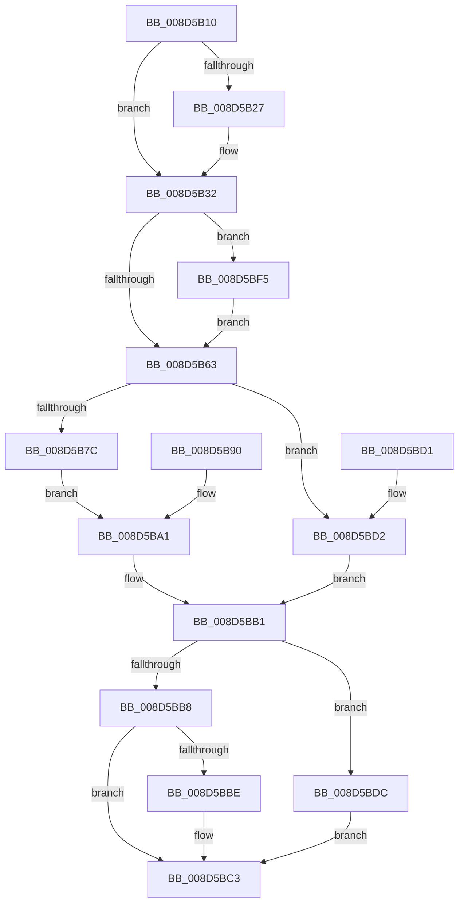

# PspUserThreadStartup

- RVA: `0x008D5B10`–`0x008D5C0A` (길이 `250` bytes)
- VA: `0x00000001408D5B10`
- 실행 섹션: `PAGE`
- PDB 이름 있음: `예`; PDB Function 태그: `아니요`
- unwind 정보 RVA: `0x000851A8`
- 디코드: `68`개 명령, `250/250` bytes 표시
- 미해석 바이트: `0` (있으면 어셈블리에 `.byte`로 보존)

> 이 문서는 커널 이미지의 기계어와 PDB 기호를 분석해 생성했습니다. 4번과 5번은 함수 원형과 자료형을 바이너리 사용 방식에서 추정한 C 해석이며 원본 소스 복구 결과는 아닙니다.

## 1. Dependencies

- 직접 호출 지점: **9**; 고유 호출 대상: **9**
- 직접 호출자로 확인된 함수: **0**
- RIP 상대 이미지 참조: **1**

### Outgoing calls
- `0x008D5B2D` → [KiLowerIrqlProcessIrqlFlags](../../text/4F/KiLowerIrqlProcessIrqlFlags_function_004F5698.md) (function, `0x004F5698`)
- `0x008D5B47` → [PspDisablePrimaryTokenExchange](PspDisablePrimaryTokenExchange_function_008D5C10.md) (function, `0x008D5C10`)
- `0x008D5B83` → [PsGetSessionLocaleId](PsGetSessionLocaleId_function_008D6194.md) (function, `0x008D6194`)
- `0x008D5BA4` → [KeUpdateTebSchedulingPropertiesCurrentThread](../../text/3C/KeUpdateTebSchedulingPropertiesCurrentThread_function_003C48E8.md) (function, `0x003C48E8`)
- `0x008D5BAC` → [PspNotifyThreadCreation](PspNotifyThreadCreation_function_008D5D48.md) (function, `0x008D5D48`)
- `0x008D5BBE` → [PspInitializeThunkContext](PspInitializeThunkContext_function_008D5418.md) (function, `0x008D5418`)
- `0x008D5BD5` → [DbgkCreateMinimalThread](DbgkCreateMinimalThread_function_008D6748.md) (function, `0x008D6748`)
- `0x008D5BEE` → [KeWaitForSingleObject](../../text/20/KeWaitForSingleObject_function_0020E6B0.md) (function, `0x0020E6B0`)
- `0x008D5C00` → [PspTerminateThreadByPointer](../90/PspTerminateThreadByPointer_function_00905E80.md) (function, `0x00905E80`)

### Direct callers
- 이 함수 시작 RVA로 연결되는 직접 call은 확인되지 않았습니다. 간접 호출은 완전히 역산할 수 없습니다.

### Static image references
- `0x008D5B1F` → RVA `0x00FC6D20` (`ALMOSTRO`; read)

## 2. Other-region calls and transfers

- 다른 실행 섹션으로 향하는 call: **3**
  - `0x008D5B2D` → [KiLowerIrqlProcessIrqlFlags](../../text/4F/KiLowerIrqlProcessIrqlFlags_function_004F5698.md) (`PAGE` → `.text`)
  - `0x008D5BA4` → [KeUpdateTebSchedulingPropertiesCurrentThread](../../text/3C/KeUpdateTebSchedulingPropertiesCurrentThread_function_003C48E8.md) (`PAGE` → `.text`)
  - `0x008D5BEE` → [KeWaitForSingleObject](../../text/20/KeWaitForSingleObject_function_0020E6B0.md) (`PAGE` → `.text`)
- 별도 외부 분기/꼬리 이동을 확인하지 못했습니다.

## 3. Assembly (complete function range)

```asm
008D5B10  48 89 5C 24 08                  mov qword ptr [rsp + 8], rbx
008D5B15  56                              push rsi
008D5B16  57                              push rdi
008D5B17  41 56                           push r14
008D5B19  48 83 EC 40                     sub rsp, 0x40
008D5B1D  33 FF                           xor edi, edi
008D5B1F  39 3D FB 11 6F 00               cmp dword ptr [rip + 0x6f11fb], edi
008D5B25  74 0B                           je 0x1408d5b32
008D5B27  44 0F 20 C1                     mov rcx, cr8
008D5B2B  33 D2                           xor edx, edx
008D5B2D  E8 66 FB C1 FF                  call 0x1404f5698
008D5B32  44 0F 22 C7                     mov cr8, rdi
008D5B36  65 48 8B 1C 25 88 01 00 00      mov rbx, qword ptr gs:[0x188]
008D5B3F  48 89 5C 24 70                  mov qword ptr [rsp + 0x70], rbx
008D5B44  48 8B CB                        mov rcx, rbx
008D5B47  E8 C4 00 00 00                  call 0x1408d5c10
008D5B4C  4C 8D B3 A0 05 00 00            lea r14, [rbx + 0x5a0]
008D5B53  4C 89 74 24 30                  mov qword ptr [rsp + 0x30], r14
008D5B58  41 8B 06                        mov eax, dword ptr [r14]
008D5B5B  A8 02                           test al, 2
008D5B5D  0F 84 92 00 00 00               je 0x1408d5bf5
008D5B63  48 8B B3 B8 00 00 00            mov rsi, qword ptr [rbx + 0xb8]
008D5B6A  48 81 C6 FC 05 00 00            add rsi, 0x5fc
008D5B71  48 89 74 24 78                  mov qword ptr [rsp + 0x78], rsi
008D5B76  8B 06                           mov eax, dword ptr [rsi]
008D5B78  A8 01                           test al, 1
008D5B7A  75 56                           jne 0x1408d5bd2
008D5B7C  48 8B 93 F0 00 00 00            mov rdx, qword ptr [rbx + 0xf0]
008D5B83  E8 0C 06 00 00                  call 0x1408d6194
008D5B88  89 82 08 01 00 00               mov dword ptr [rdx + 0x108], eax
008D5B8E  EB 11                           jmp 0x1408d5ba1
008D5B90  33 FF                           xor edi, edi
008D5B92  48 8B 5C 24 70                  mov rbx, qword ptr [rsp + 0x70]
008D5B97  48 8B 74 24 78                  mov rsi, qword ptr [rsp + 0x78]
008D5B9C  4C 8B 74 24 30                  mov r14, qword ptr [rsp + 0x30]
008D5BA1  48 8B CB                        mov rcx, rbx
008D5BA4  E8 3F ED AE FF                  call 0x1403c48e8
008D5BA9  48 8B CB                        mov rcx, rbx
008D5BAC  E8 97 01 00 00                  call 0x1408d5d48
008D5BB1  41 8B 06                        mov eax, dword ptr [r14]
008D5BB4  A8 01                           test al, 1
008D5BB6  75 24                           jne 0x1408d5bdc
008D5BB8  8B 06                           mov eax, dword ptr [rsi]
008D5BBA  A8 01                           test al, 1
008D5BBC  75 05                           jne 0x1408d5bc3
008D5BBE  E8 55 F8 FF FF                  call 0x1408d5418
008D5BC3  48 8B 5C 24 60                  mov rbx, qword ptr [rsp + 0x60]
008D5BC8  48 83 C4 40                     add rsp, 0x40
008D5BCC  41 5E                           pop r14
008D5BCE  5F                              pop rdi
008D5BCF  5E                              pop rsi
008D5BD0  C3                              ret
008D5BD1  CC                              int3
008D5BD2  48 8B CB                        mov rcx, rbx
008D5BD5  E8 6E 0B 00 00                  call 0x1408d6748
008D5BDA  EB D5                           jmp 0x1408d5bb1
008D5BDC  48 89 7C 24 20                  mov qword ptr [rsp + 0x20], rdi
008D5BE1  45 33 C9                        xor r9d, r9d
008D5BE4  41 B0 01                        mov r8b, 1
008D5BE7  41 8D 51 06                     lea edx, [r9 + 6]
008D5BEB  48 8B CB                        mov rcx, rbx
008D5BEE  E8 BD 8A 93 FF                  call 0x14020e6b0
008D5BF3  EB CE                           jmp 0x1408d5bc3
008D5BF5  41 B0 01                        mov r8b, 1
008D5BF8  BA 4B 00 00 C0                  mov edx, 0xc000004b
008D5BFD  48 8B CB                        mov rcx, rbx
008D5C00  E8 7B 02 03 00                  call 0x140905e80
008D5C05  E9 59 FF FF FF                  jmp 0x1408d5b63
```

## 4. C-style interpretation (structured pseudocode)

```c
__int64 __fastcall PspUserThreadStartup(__int64 a1, int a2, __int64 a3, int a4)
{
    __int64 result;
    __int64 v_rdi;
    __int64 v_rsi;
    __int64 v_rsp;
    unsigned __int64 v_stack_m28;
    unsigned __int64 v_stack_p18;
    unsigned __int64 v_stack_p20;
    unsigned __int64 v_stack_p8;

    v_stack_p8 = v_rbx;
    v_rsp = (v_rsp) - (64);
    v_rdi = 0;
    if ((*(unsigned int *)(v_rip + 7279099)) != 0) {
        a1 = v_cr8;
        a2 = 0;
        result = KiLowerIrqlProcessIrqlFlags(a1, a2, a3, a4);
    }
    v_stack_p18 = *(unsigned __int64 *)(gs_base + (0 + 392));
    result = PspDisablePrimaryTokenExchange(*(unsigned __int64 *)(gs_base + (0 + 392)), a2, a3, a4);
    v_stack_m28 = *(unsigned __int64 *)(gs_base + (0 + 392)) + 1440;
    if ((((unsigned __int8)((unsigned int)(*(unsigned int *)(*(unsigned __int64 *)(gs_base + (0 + 392)) + 1440)))) & (2)) == 0) goto loc_008D5BF5;
loc_008D5B63:
    v_rsi = (*(unsigned __int64 *)(*(unsigned __int64 *)(gs_base + (0 + 392)) + 184)) + (0x5FCULL);
    v_stack_p20 = v_rsi;
    if ((((unsigned __int8)((unsigned int)(*(unsigned int *)(v_rsi)))) & (1)) != 0) goto loc_008D5BD2;
    result = PsGetSessionLocaleId(*(unsigned __int64 *)(gs_base + (0 + 392)), *(unsigned __int64 *)(*(unsigned __int64 *)(gs_base + (0 + 392)) + 240), a3, a4);
    *(unsigned int *)(*(unsigned __int64 *)(*(unsigned __int64 *)(gs_base + (0 + 392)) + 240) + 264) = (unsigned int)(result);
    goto loc_008D5BA1;
loc_008D5BA1:
    result = KeUpdateTebSchedulingPropertiesCurrentThread(*(unsigned __int64 *)(gs_base + (0 + 392)), *(unsigned __int64 *)(*(unsigned __int64 *)(gs_base + (0 + 392)) + 240), a3, a4);
    result = PspNotifyThreadCreation(*(unsigned __int64 *)(gs_base + (0 + 392)), *(unsigned __int64 *)(*(unsigned __int64 *)(gs_base + (0 + 392)) + 240), a3, a4);
loc_008D5BB1:
    if ((((unsigned __int8)((unsigned int)(*(unsigned int *)(*(unsigned __int64 *)(gs_base + (0 + 392)) + 1440)))) & (1)) != 0) goto loc_008D5BDC;
    result = (unsigned int)(*(unsigned int *)(v_rsi));
    if ((((unsigned __int8)((unsigned int)(*(unsigned int *)(v_rsi)))) & (1)) == 0) {
        result = PspInitializeThunkContext(*(unsigned __int64 *)(gs_base + (0 + 392)), *(unsigned __int64 *)(*(unsigned __int64 *)(gs_base + (0 + 392)) + 240), a3, a4);
    }
    v_rsp = (v_rsp) + (64);
    return result;
loc_008D5BD2:
    result = DbgkCreateMinimalThread(v_stack_p8, *(unsigned __int64 *)(*(unsigned __int64 *)(gs_base + (0 + 392)) + 240), a3, a4);
    goto loc_008D5BB1;
loc_008D5BDC:
    v_stack_p20 = 0;
    a4 = 0;
    result = KeWaitForSingleObject(v_stack_p8, a4 + 6, 1, a4);
    goto loc_008D5BC3;
loc_008D5BF5:
    result = PspTerminateThreadByPointer(v_stack_p8, (unsigned int)(0xC000004BULL), 1, a4);
    goto loc_008D5B63;
}
```

## 5. (Beta) C Style

```c
int64_t PspUserThreadStartup(int64_t Arg1, int32_t Arg2, int64_t Arg3, int32_t Arg4)
{
    int64_t result;
    int64_t local_rdi;
    int64_t local_rsi;
    int64_t local_rsp;
    uint64_t v_stack_m28;
    uint64_t v_stack_p18;
    uint64_t v_stack_p20;
    uint64_t v_stack_p8;

    v_stack_p8 = local_rbx;
    local_rsp = (local_rsp) - (64);
    local_rdi = 0;
    if ((*(uint32_t *)(v_rip + 0x6F11FB)) != 0) {
        Arg1 = v_cr8;
        Arg2 = 0;
        result = KiLowerIrqlProcessIrqlFlags(Arg1, Arg2, Arg3, Arg4);
    }
    v_stack_p18 = *(uint64_t *)(gs_base + (0 + 0x188));
    result = PspDisablePrimaryTokenExchange(*(uint64_t *)(gs_base + (0 + 0x188)), Arg2, Arg3, Arg4);
    v_stack_m28 = *(uint64_t *)(gs_base + (0 + 0x188)) + 1440;
    if ((((uint8_t)((uint32_t)(*(uint32_t *)(*(uint64_t *)(gs_base + (0 + 0x188)) + 0x5A0)))) & (2)) == 0) goto loc_008D5BF5;
loc_008D5B63:
    local_rsi = (*(uint64_t *)(*(uint64_t *)(gs_base + (0 + 0x188)) + 0xB8)) + (0x5FCULL);
    v_stack_p20 = local_rsi;
    if ((((uint8_t)((uint32_t)(*(uint32_t *)(local_rsi)))) & (1)) != 0) goto loc_008D5BD2;
    result = PsGetSessionLocaleId(*(uint64_t *)(gs_base + (0 + 0x188)), *(uint64_t *)(*(uint64_t *)(gs_base + (0 + 0x188)) + 0xF0), Arg3, Arg4);
    *(uint32_t *)(*(uint64_t *)(*(uint64_t *)(gs_base + (0 + 0x188)) + 0xF0) + 0x108) = (uint32_t)(result);
    goto loc_008D5BA1;
loc_008D5BA1:
    result = KeUpdateTebSchedulingPropertiesCurrentThread(*(uint64_t *)(gs_base + (0 + 0x188)), *(uint64_t *)(*(uint64_t *)(gs_base + (0 + 0x188)) + 0xF0), Arg3, Arg4);
    result = PspNotifyThreadCreation(*(uint64_t *)(gs_base + (0 + 0x188)), *(uint64_t *)(*(uint64_t *)(gs_base + (0 + 0x188)) + 0xF0), Arg3, Arg4);
loc_008D5BB1:
    if ((((uint8_t)((uint32_t)(*(uint32_t *)(*(uint64_t *)(gs_base + (0 + 0x188)) + 0x5A0)))) & (1)) != 0) goto loc_008D5BDC;
    result = (uint32_t)(*(uint32_t *)(local_rsi));
    if ((((uint8_t)((uint32_t)(*(uint32_t *)(local_rsi)))) & (1)) == 0) {
        result = PspInitializeThunkContext(*(uint64_t *)(gs_base + (0 + 0x188)), *(uint64_t *)(*(uint64_t *)(gs_base + (0 + 0x188)) + 0xF0), Arg3, Arg4);
    }
    local_rsp = (local_rsp) + (64);
    return result;
loc_008D5BD2:
    result = DbgkCreateMinimalThread(v_stack_p8, *(uint64_t *)(*(uint64_t *)(gs_base + (0 + 0x188)) + 0xF0), Arg3, Arg4);
    goto loc_008D5BB1;
loc_008D5BDC:
    v_stack_p20 = 0;
    Arg4 = 0;
    result = KeWaitForSingleObject(v_stack_p8, Arg4 + 6, 1, Arg4);
    goto loc_008D5BC3;
loc_008D5BF5:
    result = PspTerminateThreadByPointer(v_stack_p8, (uint32_t)(0xC000004BULL), 1, Arg4);
    goto loc_008D5B63;
}
```

## 6. Execution-region graph

[열기: 2D/3D 그래프와 함수 탐색 컨트롤 패널](../../../control-panel.html?section=page&rva=0x008D5B10&view=graph)

- 2D 그래프는 위에서 아래로 흐르고, 3D 그래프는 빈 공간을 드래그해 회전합니다. Shift+드래그는 이동, 휠은 확대·축소, 함수 노드 선택은 대상 보고서 이동입니다.

### Static fallback


