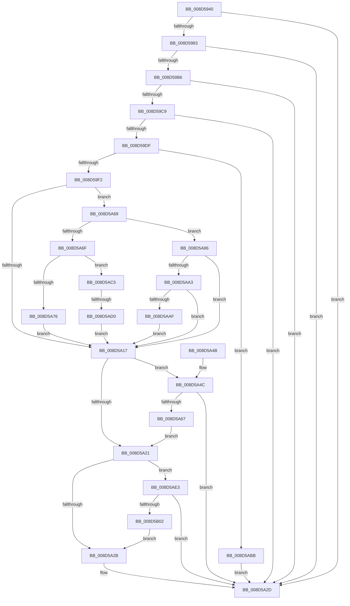

# RtlCopyContext

- RVA: `0x008D5940`–`0x008D5B07` (길이 `455` bytes)
- VA: `0x00000001408D5940`
- 실행 섹션: `PAGE`
- PDB 이름 있음: `예`; PDB Function 태그: `예`
- unwind 정보 RVA: `0x00085178`
- 디코드: `126`개 명령, `455/455` bytes 표시
- 미해석 바이트: `0` (있으면 어셈블리에 `.byte`로 보존)

> 이 문서는 커널 이미지의 기계어와 PDB 기호를 분석해 생성했습니다. 4번과 5번은 함수 원형과 자료형을 바이너리 사용 방식에서 추정한 C 해석이며 원본 소스 복구 결과는 아닙니다.

## 1. Dependencies

- 직접 호출 지점: **9**; 고유 호출 대상: **5**
- 직접 호출자로 확인된 함수: **5**
- RIP 상대 이미지 참조: **0**

### Outgoing calls
- `0x008D5976` → [RtlpValidateContextFlags](../../text/49/RtlpValidateContextFlags_function_0049BF20.md) (function, `0x0049BF20`)
- `0x008D5989` → [RtlpGetContextFlagsLocation](../../text/46/RtlpGetContextFlagsLocation_function_00462314.md) (function, `0x00462314`)
- `0x008D5999` → [RtlpGetContextFlagsLocation](../../text/46/RtlpGetContextFlagsLocation_function_00462314.md) (function, `0x00462314`)
- `0x008D59AD` → [RtlpValidateContextFlags](../../text/49/RtlpValidateContextFlags_function_0049BF20.md) (function, `0x0049BF20`)
- `0x008D59C0` → [RtlpValidateContextFlags](../../text/49/RtlpValidateContextFlags_function_0049BF20.md) (function, `0x0049BF20`)
- `0x008D59D4` → [RtlpValidateContextFlags](../../text/49/RtlpValidateContextFlags_function_0049BF20.md) (function, `0x0049BF20`)
- `0x008D59FD` → [RtlpCopyLegacyContext](../../text/3F/RtlpCopyLegacyContext_function_003F54A0.md) (function, `0x003F54A0`)
- `0x008D5A5C` → [RtlpCopyXStateChunk](../../text/3F/RtlpCopyXStateChunk_function_003F51D4.md) (function, `0x003F51D4`)
- `0x008D5AF3` → [RtlpCopyKernelCetChunk](../../text/5E/RtlpCopyKernelCetChunk_function_005E863C.md) (function, `0x005E863C`)

### Direct callers
- [PspSetContextState](../78/PspSetContextState_function_00789FBC.md) at `0x0078A056`
- [PspWow64SetContextThread](../8C/PspWow64SetContextThread_function_008CCC88.md) at `0x008CCF41`
- [PspWow64SetContextThread](../8C/PspWow64SetContextThread_function_008CCC88.md) at `0x008CCFFE`
- [PspInitializeThunkContext](PspInitializeThunkContext_function_008D5418.md) at `0x008D5698`
- [sub_009A6724](../9A/Unknown_function_009A6724.md) at `0x009A682A`
- [PspWow64GetContextThread](../A1/PspWow64GetContextThread_function_00A11E90.md) at `0x00A1211D`
- [PspWow64GetContextThread](../A1/PspWow64GetContextThread_function_00A11E90.md) at `0x00A1236A`

### Static image references
- 디코드된 RIP-relative 메모리 참조가 없습니다.

## 2. Other-region calls and transfers

- 다른 실행 섹션으로 향하는 call: **9**
  - `0x008D5976` → [RtlpValidateContextFlags](../../text/49/RtlpValidateContextFlags_function_0049BF20.md) (`PAGE` → `.text`)
  - `0x008D5989` → [RtlpGetContextFlagsLocation](../../text/46/RtlpGetContextFlagsLocation_function_00462314.md) (`PAGE` → `.text`)
  - `0x008D5999` → [RtlpGetContextFlagsLocation](../../text/46/RtlpGetContextFlagsLocation_function_00462314.md) (`PAGE` → `.text`)
  - `0x008D59AD` → [RtlpValidateContextFlags](../../text/49/RtlpValidateContextFlags_function_0049BF20.md) (`PAGE` → `.text`)
  - `0x008D59C0` → [RtlpValidateContextFlags](../../text/49/RtlpValidateContextFlags_function_0049BF20.md) (`PAGE` → `.text`)
  - `0x008D59D4` → [RtlpValidateContextFlags](../../text/49/RtlpValidateContextFlags_function_0049BF20.md) (`PAGE` → `.text`)
  - `0x008D59FD` → [RtlpCopyLegacyContext](../../text/3F/RtlpCopyLegacyContext_function_003F54A0.md) (`PAGE` → `.text`)
  - `0x008D5A5C` → [RtlpCopyXStateChunk](../../text/3F/RtlpCopyXStateChunk_function_003F51D4.md) (`PAGE` → `.text`)
  - `0x008D5AF3` → [RtlpCopyKernelCetChunk](../../text/5E/RtlpCopyKernelCetChunk_function_005E863C.md) (`PAGE` → `.text`)
- call이 아닌 외부 분기/꼬리 이동: **1**
  - `0x008D5ACA` → [sub_00B1BA62](../B1/Unknown_function_00B1BA62.md) (`tail-transfer`)

## 3. Assembly (complete function range)

```asm
008D5940  48 8B C4                        mov rax, rsp
008D5943  48 89 58 08                     mov qword ptr [rax + 8], rbx
008D5947  48 89 68 10                     mov qword ptr [rax + 0x10], rbp
008D594B  48 89 70 18                     mov qword ptr [rax + 0x18], rsi
008D594F  57                              push rdi
008D5950  41 54                           push r12
008D5952  41 55                           push r13
008D5954  41 56                           push r14
008D5956  41 57                           push r15
008D5958  48 83 EC 40                     sub rsp, 0x40
008D595C  83 60 C8 00                     and dword ptr [rax - 0x38], 0
008D5960  44 8B F2                        mov r14d, edx
008D5963  83 60 20 00                     and dword ptr [rax + 0x20], 0
008D5967  4C 8B E9                        mov r13, rcx
008D596A  41 8B CE                        mov ecx, r14d
008D596D  33 D2                           xor edx, edx
008D596F  4D 8B F8                        mov r15, r8
008D5972  33 FF                           xor edi, edi
008D5974  33 F6                           xor esi, esi
008D5976  E8 A5 65 BC FF                  call 0x14049bf20
008D597B  85 C0                           test eax, eax
008D597D  0F 88 AA 00 00 00               js 0x1408d5a2d
008D5983  41 8B D6                        mov edx, r14d
008D5986  49 8B CD                        mov rcx, r13
008D5989  E8 86 C9 B8 FF                  call 0x140462314
008D598E  49 8B CF                        mov rcx, r15
008D5991  48 89 44 24 38                  mov qword ptr [rsp + 0x38], rax
008D5996  4C 8B C0                        mov r8, rax
008D5999  E8 76 C9 B8 FF                  call 0x140462314
008D599E  45 8B 20                        mov r12d, dword ptr [r8]
008D59A1  33 D2                           xor edx, edx
008D59A3  41 8B CC                        mov ecx, r12d
008D59A6  8B 28                           mov ebp, dword ptr [rax]
008D59A8  0B CD                           or ecx, ebp
008D59AA  41 0B CE                        or ecx, r14d
008D59AD  E8 6E 65 BC FF                  call 0x14049bf20
008D59B2  85 C0                           test eax, eax
008D59B4  78 77                           js 0x1408d5a2d
008D59B6  41 23 EE                        and ebp, r14d
008D59B9  48 8D 54 24 30                  lea rdx, [rsp + 0x30]
008D59BE  8B CD                           mov ecx, ebp
008D59C0  E8 5B 65 BC FF                  call 0x14049bf20
008D59C5  85 C0                           test eax, eax
008D59C7  78 64                           js 0x1408d5a2d
008D59C9  48 8D 94 24 88 00 00 00         lea rdx, [rsp + 0x88]
008D59D1  41 8B CC                        mov ecx, r12d
008D59D4  E8 47 65 BC FF                  call 0x14049bf20
008D59D9  8B D8                           mov ebx, eax
008D59DB  85 C0                           test eax, eax
008D59DD  78 4E                           js 0x1408d5a2d
008D59DF  8B 84 24 88 00 00 00            mov eax, dword ptr [rsp + 0x88]
008D59E6  F7 D0                           not eax
008D59E8  85 44 24 30                     test dword ptr [rsp + 0x30], eax
008D59EC  0F 85 C9 00 00 00               jne 0x1408d5abb
008D59F2  4D 8B CF                        mov r9, r15
008D59F5  44 8B C5                        mov r8d, ebp
008D59F8  49 8B D5                        mov rdx, r13
008D59FB  B1 01                           mov cl, 1
008D59FD  E8 9E FA B1 FF                  call 0x1403f54a0
008D5A02  48 8B 44 24 38                  mov rax, qword ptr [rsp + 0x38]
008D5A07  44 09 20                        or dword ptr [rax], r12d
008D5A0A  F7 84 24 88 00 00 00 FE FF FF FF  test dword ptr [rsp + 0x88], 0xfffffffe
008D5A15  75 52                           jne 0x1408d5a69
008D5A17  8B 6C 24 30                     mov ebp, dword ptr [rsp + 0x30]
008D5A1B  40 F6 C5 02                     test bpl, 2
008D5A1F  75 2B                           jne 0x1408d5a4c
008D5A21  40 F6 C5 04                     test bpl, 4
008D5A25  0F 85 B8 00 00 00               jne 0x1408d5ae3
008D5A2B  8B C3                           mov eax, ebx
008D5A2D  4C 8D 5C 24 40                  lea r11, [rsp + 0x40]
008D5A32  49 8B 5B 30                     mov rbx, qword ptr [r11 + 0x30]
008D5A36  49 8B 6B 38                     mov rbp, qword ptr [r11 + 0x38]
008D5A3A  49 8B 73 40                     mov rsi, qword ptr [r11 + 0x40]
008D5A3E  49 8B E3                        mov rsp, r11
008D5A41  41 5F                           pop r15
008D5A43  41 5E                           pop r14
008D5A45  41 5D                           pop r13
008D5A47  41 5C                           pop r12
008D5A49  5F                              pop rdi
008D5A4A  C3                              ret
008D5A4B  CC                              int3
008D5A4C  4C 8B CE                        mov r9, rsi
008D5A4F  48 89 74 24 20                  mov qword ptr [rsp + 0x20], rsi
008D5A54  4C 8B C7                        mov r8, rdi
008D5A57  48 8B D7                        mov rdx, rdi
008D5A5A  B1 01                           mov cl, 1
008D5A5C  E8 73 F7 B1 FF                  call 0x1403f51d4
008D5A61  8B D8                           mov ebx, eax
008D5A63  85 C0                           test eax, eax
008D5A65  78 C6                           js 0x1408d5a2d
008D5A67  EB B8                           jmp 0x1408d5a21
008D5A69  0F BA E5 10                     bt ebp, 0x10
008D5A6D  72 17                           jb 0x1408d5a86
008D5A6F  41 0F BA E6 14                  bt r14d, 0x14
008D5A74  73 4F                           jae 0x1408d5ac5
008D5A76  49 8D B7 D0 04 00 00            lea rsi, [r15 + 0x4d0]
008D5A7D  49 8D BD D0 04 00 00            lea rdi, [r13 + 0x4d0]
008D5A84  EB 91                           jmp 0x1408d5a17
008D5A86  B8 20 00 01 00                  mov eax, 0x10020
008D5A8B  49 8D B7 CC 02 00 00            lea rsi, [r15 + 0x2cc]
008D5A92  23 E8                           and ebp, eax
008D5A94  49 8D BD CC 02 00 00            lea rdi, [r13 + 0x2cc]
008D5A9B  3B E8                           cmp ebp, eax
008D5A9D  0F 85 74 FF FF FF               jne 0x1408d5a17
008D5AA3  44 23 E0                        and r12d, eax
008D5AA6  44 3B E0                        cmp r12d, eax
008D5AA9  0F 84 68 FF FF FF               je 0x1408d5a17
008D5AAF  C7 47 0C CC 02 00 00            mov dword ptr [rdi + 0xc], 0x2cc
008D5AB6  E9 5C FF FF FF                  jmp 0x1408d5a17
008D5ABB  B8 05 00 00 80                  mov eax, 0x80000005
008D5AC0  E9 68 FF FF FF                  jmp 0x1408d5a2d
008D5AC5  41 0F BA E6 15                  bt r14d, 0x15
008D5ACA  0F 83 92 5F 24 00               jae 0x140b1ba62
008D5AD0  49 8D B7 A0 01 00 00            lea rsi, [r15 + 0x1a0]
008D5AD7  49 8D BD A0 01 00 00            lea rdi, [r13 + 0x1a0]
008D5ADE  E9 34 FF FF FF                  jmp 0x1408d5a17
008D5AE3  4C 8B CE                        mov r9, rsi
008D5AE6  48 89 74 24 20                  mov qword ptr [rsp + 0x20], rsi
008D5AEB  4C 8B C7                        mov r8, rdi
008D5AEE  48 8B D7                        mov rdx, rdi
008D5AF1  B1 01                           mov cl, 1
008D5AF3  E8 44 2B D1 FF                  call 0x1405e863c
008D5AF8  8B D8                           mov ebx, eax
008D5AFA  85 C0                           test eax, eax
008D5AFC  0F 88 2B FF FF FF               js 0x1408d5a2d
008D5B02  E9 24 FF FF FF                  jmp 0x1408d5a2b
```

## 4. C-style interpretation (structured pseudocode)

```c
__int64 __fastcall RtlCopyContext(__int64 a1, int a2, __int64 a3)
{
    __int64 result;
    __int64 v_r12;
    __int64 v_rbp;
    __int64 v_rdi;
    __int64 v_rsi;
    __int64 v_rsp;
    unsigned __int64 v_stack_m20;
    unsigned __int64 v_stack_m28;
    unsigned __int64 v_stack_m30;
    unsigned __int64 v_stack_m38;
    unsigned __int64 v_stack_p20;

    *(unsigned __int64 *)(v_rsp + 8) = v_rbx;
    *(unsigned __int64 *)(v_rsp + 16) = v_rbp;
    *(unsigned __int64 *)(v_rsp + 24) = v_rsi;
    v_rsp = (v_rsp) - (64);
    a2 = 0;
    v_rdi = 0;
    v_rsi = 0;
    result = RtlpValidateContextFlags((unsigned int)((unsigned int)((unsigned int)(a2))), a2, a3, a4);
    if (sign_flag) goto loc_008D5A2D;
    result = RtlpGetContextFlagsLocation(a1, (unsigned int)((unsigned int)((unsigned int)(a2))), a3, a4);
    v_stack_m30 = result;
    result = RtlpGetContextFlagsLocation(a3, (unsigned int)((unsigned int)((unsigned int)(a2))), result, a4);
    a2 = 0;
    a1 = (unsigned int)(((unsigned int)((unsigned int)((unsigned int)(*(unsigned int *)(result))))) | ((unsigned int)((unsigned int)(*(unsigned int *)(result)))));
    a1 = (unsigned int)((a1) | ((unsigned int)((unsigned int)(a2))));
    result = RtlpValidateContextFlags(a1, a2, result, a4);
    if (sign_flag) goto loc_008D5A2D;
    v_rbp = (unsigned int)(((unsigned int)(*(unsigned int *)(result))) & ((unsigned int)((unsigned int)(a2))));
    result = RtlpValidateContextFlags((unsigned int)((unsigned int)(v_rbp)), v_stack_m38, result, a4);
    if (sign_flag) goto loc_008D5A2D;
    result = RtlpValidateContextFlags((unsigned int)((unsigned int)((unsigned int)(*(unsigned int *)(result)))), v_stack_p20, result, a4);
    if (sign_flag) goto loc_008D5A2D;
    result = (unsigned int)(~((unsigned int)(v_stack_p20)));
    if (((v_stack_m38) & ((unsigned int)(result))) != 0) goto loc_008D5ABB;
    result = RtlpCopyLegacyContext(1, a1, (unsigned int)((unsigned int)(v_rbp)), a3);
    if (((v_stack_p20) & (0xFFFFFFFEULL)) != 0) goto loc_008D5A69;
loc_008D5A17:
    if ((((unsigned __int8)((unsigned int)(v_stack_m38))) & (2)) != 0) goto loc_008D5A4C;
loc_008D5A21:
    if ((((unsigned __int8)((unsigned int)(v_stack_m38))) & (4)) != 0) goto loc_008D5AE3;
loc_008D5A2B:
loc_008D5A2D:
    return (unsigned int)((unsigned int)((unsigned int)((unsigned int)(result))));
loc_008D5A4C:
    v_stack_m20 = *(unsigned __int64 *)(v_stack_m28 + 64);
    result = RtlpCopyXStateChunk(1, 0, 0, *(unsigned __int64 *)(v_stack_m28 + 64));
    if (sign_flag) goto loc_008D5A2D;
    goto loc_008D5A21;
loc_008D5A69:
    if (condition_is_below) goto loc_008D5A86;
    if (condition_is_above_or_equal) goto loc_008D5AC5;
    goto loc_008D5A17;
loc_008D5A86:
    v_rbp = (unsigned int)((*(unsigned __int64 *)(v_stack_m28 + 56)) & ((unsigned int)((unsigned int)(0x10020ULL))));
    if (((unsigned int)(v_rbp)) != ((unsigned int)((unsigned int)(0x10020ULL)))) goto loc_008D5A17;
    v_r12 = (unsigned int)(((unsigned int)(*(unsigned int *)(result))) & ((unsigned int)((unsigned int)(0x10020ULL))));
    if (((unsigned int)(v_r12)) == ((unsigned int)((unsigned int)(0x10020ULL)))) goto loc_008D5A17;
    *(unsigned int *)(a1 + 716 + 12) = 716;
    goto loc_008D5A17;
loc_008D5ABB:
    goto loc_008D5A2D;
loc_008D5AC5:
    goto loc_008D5A17;
loc_008D5AE3:
    v_stack_m20 = a3 + 416;
    result = RtlpCopyKernelCetChunk(1, a1 + 416, a1 + 416, a3 + 416);
    if (sign_flag) goto loc_008D5A2D;
    goto loc_008D5A2B;
}
```

## 5. (Beta) C Style

```c
int64_t RtlCopyContext(void *Arg1, int32_t Arg2, void *Arg3)
{
    uint8_t *arg1 = (uint8_t *)Arg1;
    uint8_t *arg3 = (uint8_t *)Arg3;

    int64_t result;
    int64_t local_r12;
    int64_t local_rbp;
    int64_t local_rdi;
    int64_t local_rsi;
    int64_t local_rsp;
    uint64_t v_stack_m20;
    uint64_t v_stack_m28;
    uint64_t v_stack_m30;
    uint64_t v_stack_m38;
    uint64_t v_stack_p20;

    *(uint64_t *)(local_rsp + 0x8) = local_rbx;
    *(uint64_t *)(local_rsp + 0x10) = local_rbp;
    *(uint64_t *)(local_rsp + 0x18) = local_rsi;
    local_rsp = (local_rsp) - (64);
    Arg2 = 0;
    local_rdi = 0;
    local_rsi = 0;
    result = RtlpValidateContextFlags((uint32_t)((uint32_t)((uint32_t)(Arg2))), Arg2, Arg3, a4);
    if (sign_flag) goto loc_008D5A2D;
    result = RtlpGetContextFlagsLocation(Arg1, (uint32_t)((uint32_t)((uint32_t)(Arg2))), Arg3, a4);
    v_stack_m30 = result;
    result = RtlpGetContextFlagsLocation(Arg3, (uint32_t)((uint32_t)((uint32_t)(Arg2))), result, a4);
    Arg2 = 0;
    Arg1 = (uint32_t)(((uint32_t)((uint32_t)((uint32_t)(*(uint32_t *)(result))))) | ((uint32_t)((uint32_t)(*(uint32_t *)(result)))));
    Arg1 = (uint32_t)((Arg1) | ((uint32_t)((uint32_t)(Arg2))));
    result = RtlpValidateContextFlags(Arg1, Arg2, result, a4);
    if (sign_flag) goto loc_008D5A2D;
    local_rbp = (uint32_t)(((uint32_t)(*(uint32_t *)(result))) & ((uint32_t)((uint32_t)(Arg2))));
    result = RtlpValidateContextFlags((uint32_t)((uint32_t)(local_rbp)), v_stack_m38, result, a4);
    if (sign_flag) goto loc_008D5A2D;
    result = RtlpValidateContextFlags((uint32_t)((uint32_t)((uint32_t)(*(uint32_t *)(result)))), v_stack_p20, result, a4);
    if (sign_flag) goto loc_008D5A2D;
    result = (uint32_t)(~((uint32_t)(v_stack_p20)));
    if (((v_stack_m38) & ((uint32_t)(result))) != 0) goto loc_008D5ABB;
    result = RtlpCopyLegacyContext(1, Arg1, (uint32_t)((uint32_t)(local_rbp)), Arg3);
    if (((v_stack_p20) & (0xFFFFFFFEULL)) != 0) goto loc_008D5A69;
loc_008D5A17:
    if ((((uint8_t)((uint32_t)(v_stack_m38))) & (2)) != 0) goto loc_008D5A4C;
loc_008D5A21:
    if ((((uint8_t)((uint32_t)(v_stack_m38))) & (4)) != 0) goto loc_008D5AE3;
loc_008D5A2B:
loc_008D5A2D:
    return (uint32_t)((uint32_t)((uint32_t)((uint32_t)(result))));
loc_008D5A4C:
    v_stack_m20 = *(uint64_t *)(v_stack_m28 + 0x40);
    result = RtlpCopyXStateChunk(1, 0, 0, *(uint64_t *)(v_stack_m28 + 0x40));
    if (sign_flag) goto loc_008D5A2D;
    goto loc_008D5A21;
loc_008D5A69:
    if (condition_is_below) goto loc_008D5A86;
    if (condition_is_above_or_equal) goto loc_008D5AC5;
    goto loc_008D5A17;
loc_008D5A86:
    local_rbp = (uint32_t)((*(uint64_t *)(v_stack_m28 + 0x38)) & ((uint32_t)((uint32_t)(0x10020ULL))));
    if (((uint32_t)(local_rbp)) != ((uint32_t)((uint32_t)(0x10020ULL)))) goto loc_008D5A17;
    local_r12 = (uint32_t)(((uint32_t)(*(uint32_t *)(result))) & ((uint32_t)((uint32_t)(0x10020ULL))));
    if (((uint32_t)(local_r12)) == ((uint32_t)((uint32_t)(0x10020ULL)))) goto loc_008D5A17;
    *(uint32_t *)(arg1 + 0x2CC + 0xC) = 716;
    goto loc_008D5A17;
loc_008D5ABB:
    goto loc_008D5A2D;
loc_008D5AC5:
    goto loc_008D5A17;
loc_008D5AE3:
    v_stack_m20 = Arg3 + 416;
    result = RtlpCopyKernelCetChunk(1, Arg1 + 416, Arg1 + 416, Arg3 + 416);
    if (sign_flag) goto loc_008D5A2D;
    goto loc_008D5A2B;
}
```

### 관측된 메모리 오프셋

구조체 형식이 확인되지 않은 접근은 인자 기준의 오프셋으로만 기록했습니다.

| 기준 인자 | 오프셋 표현 | 폭 (bit) | 접근 |
|---|---:|---:|---|
| `Arg1` | `+ 0xC` | `32` | `W` |
| `Arg1` | `+ 0x1A0` | `64` | `R` |
| `Arg1` | `+ 0x2CC` | `64` | `R` |
| `Arg1` | `+ 0x4D0` | `64` | `R` |
| `Arg3` | `+ 0x1A0` | `64` | `R` |
| `Arg3` | `+ 0x2CC` | `64` | `R` |
| `Arg3` | `+ 0x4D0` | `64` | `R` |

## 6. Execution-region graph

[열기: 2D/3D 그래프와 함수 탐색 컨트롤 패널](../../../control-panel.html?section=page&rva=0x008D5940&view=graph)

- 2D 그래프는 위에서 아래로 흐르고, 3D 그래프는 빈 공간을 드래그해 회전합니다. Shift+드래그는 이동, 휠은 확대·축소, 함수 노드 선택은 대상 보고서 이동입니다.

### Static fallback


