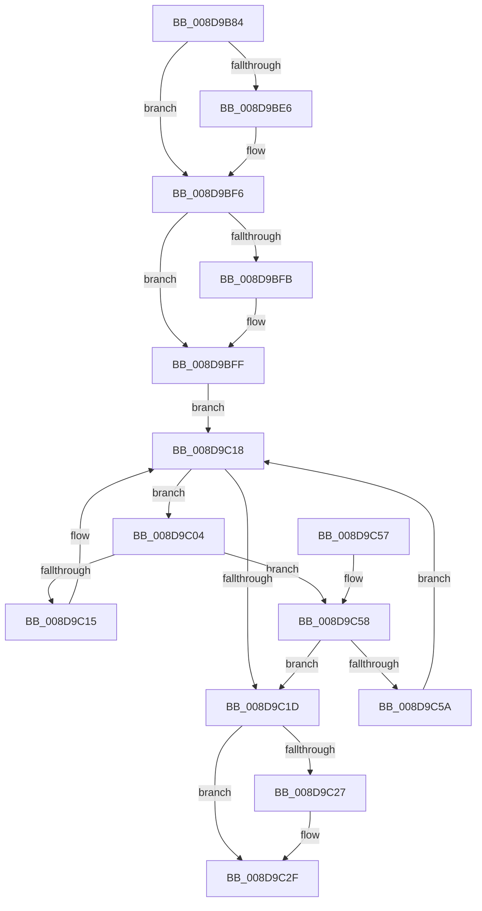

# RtlFindDynamicEnforcedAddressInRanges

- RVA: `0x008D9B84`–`0x008D9C60` (길이 `220` bytes)
- VA: `0x00000001408D9B84`
- 실행 섹션: `PAGE`
- PDB 이름 있음: `예`; PDB Function 태그: `아니요`
- unwind 정보 RVA: `0x000856A8`
- 디코드: `67`개 명령, `220/220` bytes 표시
- 미해석 바이트: `0` (있으면 어셈블리에 `.byte`로 보존)

> 이 문서는 커널 이미지의 기계어와 PDB 기호를 분석해 생성했습니다. 4번과 5번은 함수 원형과 자료형을 바이너리 사용 방식에서 추정한 C 해석이며 원본 소스 복구 결과는 아닙니다.

## 1. Dependencies

- 직접 호출 지점: **6**; 고유 호출 대상: **6**
- 직접 호출자로 확인된 함수: **1**
- RIP 상대 이미지 참조: **0**

### Outgoing calls
- `0x008D9BD1` → [KeAbPreAcquire](../../text/21/KeAbPreAcquire_function_00210230.md) (function, `0x00210230`)
- `0x008D9BF1` → [ExfAcquirePushLockSharedEx](../../text/21/ExfAcquirePushLockSharedEx_function_0021044C.md) (function, `0x0021044C`)
- `0x008D9C0C` → [RtlpDynamicEnforcedAddressRangesTreeCompare](../79/RtlpDynamicEnforcedAddressRangesTreeCompare_function_00794FD8.md) (function, `0x00794FD8`)
- `0x008D9C2A` → [ExfReleasePushLockShared](../../text/26/ExfReleasePushLockShared_function_00263440.md) (function, `0x00263440`)
- `0x008D9C32` → [KeAbPostRelease](../../text/2E/KeAbPostRelease_function_002E1600.md) (function, `0x002E1600`)
- `0x008D9C37` → [KeLeaveCriticalRegion](../../text/25/KeLeaveCriticalRegion_function_0025D8B0.md) (function, `0x0025D8B0`)

### Direct callers
- [KiCheckUserAddressCetCompat](KiCheckUserAddressCetCompat_function_008D9AF8.md) at `0x008D9B5E`

### Static image references
- 디코드된 RIP-relative 메모리 참조가 없습니다.

## 2. Other-region calls and transfers

- 다른 실행 섹션으로 향하는 call: **5**
  - `0x008D9BD1` → [KeAbPreAcquire](../../text/21/KeAbPreAcquire_function_00210230.md) (`PAGE` → `.text`)
  - `0x008D9BF1` → [ExfAcquirePushLockSharedEx](../../text/21/ExfAcquirePushLockSharedEx_function_0021044C.md) (`PAGE` → `.text`)
  - `0x008D9C2A` → [ExfReleasePushLockShared](../../text/26/ExfReleasePushLockShared_function_00263440.md) (`PAGE` → `.text`)
  - `0x008D9C32` → [KeAbPostRelease](../../text/2E/KeAbPostRelease_function_002E1600.md) (`PAGE` → `.text`)
  - `0x008D9C37` → [KeLeaveCriticalRegion](../../text/25/KeLeaveCriticalRegion_function_0025D8B0.md) (`PAGE` → `.text`)
- 별도 외부 분기/꼬리 이동을 확인하지 못했습니다.

## 3. Assembly (complete function range)

```asm
008D9B84  48 8B C4                        mov rax, rsp
008D9B87  48 89 58 10                     mov qword ptr [rax + 0x10], rbx
008D9B8B  48 89 68 18                     mov qword ptr [rax + 0x18], rbp
008D9B8F  56                              push rsi
008D9B90  57                              push rdi
008D9B91  41 56                           push r14
008D9B93  48 83 EC 50                     sub rsp, 0x50
008D9B97  48 89 50 D0                     mov qword ptr [rax - 0x30], rdx
008D9B9B  48 8D 79 08                     lea rdi, [rcx + 8]
008D9B9F  0F 57 C0                        xorps xmm0, xmm0
008D9BA2  48 C7 40 D8 01 00 00 00         mov qword ptr [rax - 0x28], 1
008D9BAA  F3 0F 7F 40 C0                  movdqu xmmword ptr [rax - 0x40], xmm0
008D9BAF  48 8B F1                        mov rsi, rcx
008D9BB2  33 ED                           xor ebp, ebp
008D9BB4  48 89 68 B8                     mov qword ptr [rax - 0x48], rbp
008D9BB8  45 33 C0                        xor r8d, r8d
008D9BBB  65 48 8B 04 25 88 01 00 00      mov rax, qword ptr gs:[0x188]
008D9BC4  33 D2                           xor edx, edx
008D9BC6  48 8B CF                        mov rcx, rdi
008D9BC9  66 FF 88 E4 01 00 00            dec word ptr [rax + 0x1e4]
008D9BD0  90                              nop
008D9BD1  E8 5A 66 93 FF                  call 0x140210230
008D9BD6  48 8B D8                        mov rbx, rax
008D9BD9  44 8D 75 11                     lea r14d, [rbp + 0x11]
008D9BDD  33 C0                           xor eax, eax
008D9BDF  F0 4C 0F B1 37                  lock cmpxchg qword ptr [rdi], r14
008D9BE4  74 10                           je 0x1408d9bf6
008D9BE6  4C 8B CF                        mov r9, rdi
008D9BE9  4C 8B C3                        mov r8, rbx
008D9BEC  33 D2                           xor edx, edx
008D9BEE  48 8B CF                        mov rcx, rdi
008D9BF1  E8 56 68 93 FF                  call 0x14021044c
008D9BF6  48 85 DB                        test rbx, rbx
008D9BF9  74 04                           je 0x1408d9bff
008D9BFB  C6 43 0A 01                     mov byte ptr [rbx + 0xa], 1
008D9BFF  48 8B 1E                        mov rbx, qword ptr [rsi]
008D9C02  EB 14                           jmp 0x1408d9c18
008D9C04  48 8B D3                        mov rdx, rbx
008D9C07  48 8D 4C 24 20                  lea rcx, [rsp + 0x20]
008D9C0C  E8 C7 B3 EB FF                  call 0x140794fd8
008D9C11  85 C0                           test eax, eax
008D9C13  79 43                           jns 0x1408d9c58
008D9C15  48 8B 1B                        mov rbx, qword ptr [rbx]
008D9C18  48 85 DB                        test rbx, rbx
008D9C1B  75 E7                           jne 0x1408d9c04
008D9C1D  49 8B C6                        mov rax, r14
008D9C20  F0 48 0F B1 2F                  lock cmpxchg qword ptr [rdi], rbp
008D9C25  74 08                           je 0x1408d9c2f
008D9C27  48 8B CF                        mov rcx, rdi
008D9C2A  E8 11 98 98 FF                  call 0x140263440
008D9C2F  48 8B CF                        mov rcx, rdi
008D9C32  E8 C9 79 A0 FF                  call 0x1402e1600
008D9C37  E8 74 3C 98 FF                  call 0x14025d8b0
008D9C3C  48 85 DB                        test rbx, rbx
008D9C3F  4C 8D 5C 24 50                  lea r11, [rsp + 0x50]
008D9C44  49 8B 5B 28                     mov rbx, qword ptr [r11 + 0x28]
008D9C48  49 8B 6B 30                     mov rbp, qword ptr [r11 + 0x30]
008D9C4C  0F 95 C0                        setne al
008D9C4F  49 8B E3                        mov rsp, r11
008D9C52  41 5E                           pop r14
008D9C54  5F                              pop rdi
008D9C55  5E                              pop rsi
008D9C56  C3                              ret
008D9C57  CC                              int3
008D9C58  7E C3                           jle 0x1408d9c1d
008D9C5A  48 8B 5B 08                     mov rbx, qword ptr [rbx + 8]
008D9C5E  EB B8                           jmp 0x1408d9c18
```

## 4. C-style interpretation (structured pseudocode)

```c
__int64 __fastcall RtlFindDynamicEnforcedAddressInRanges(__int64 a1, __int64 a2, int a3)
{
    __int64 result;
    __int64 v_rbp;
    __int64 v_rsp;
    unsigned __int64 v_stack_m18;
    unsigned __int64 v_stack_m48;

    *(unsigned __int64 *)(v_rsp + 16) = v_rbx;
    *(unsigned __int64 *)(v_rsp + 24) = v_rbp;
    v_rsp = (v_rsp) - (80);
    *(unsigned __int64 *)(v_rsp - 48) = a2;
    *(unsigned __int64 *)(v_rsp - 40) = 1;
    *(unsigned __int64 *)(v_rsp - 64) = v_xmm0;
    v_rbp = 0;
    *(unsigned __int64 *)(v_rsp - 72) = 0;
    a3 = 0;
    a2 = 0;
    result = KeAbPreAcquire(a1 + 8, a2, a3, a4);
    result = 0;
    if (!(condition_is_equal)) {
        a4 = a1 + 8;
        a3 = 0;
        a2 = 0;
        a1 = a1 + 8;
        result = ExfAcquirePushLockSharedEx(a1, a2, a3, a4);
    }
    if (result != 0) {
        *(unsigned __int8 *)(result + 10) = 1;
    }
    goto loc_008D9C18;
loc_008D9C04:
    result = RtlpDynamicEnforcedAddressRangesTreeCompare(v_stack_m48, *(unsigned __int64 *)(a1), a3, a4);
    if (!sign_flag) goto loc_008D9C58;
loc_008D9C18:
    if (*(unsigned __int64 *)(*(unsigned __int64 *)(a1)) != 0) goto loc_008D9C04;
loc_008D9C1D:
    result = v_rbp + 17;
    if (*(unsigned __int64 *)(*(unsigned __int64 *)(a1)) != 0) {
        a1 = a1 + 8;
        result = ExfReleasePushLockShared(a1, *(unsigned __int64 *)(a1), a3, a4);
    }
    result = KeAbPostRelease(a1 + 8, *(unsigned __int64 *)(a1), a3, a4);
    result = KeLeaveCriticalRegion(a1 + 8, *(unsigned __int64 *)(a1), a3, a4);
    result = (*(unsigned __int64 *)(*(unsigned __int64 *)(a1)) != 0) ? 1 : 0;
    return result;
loc_008D9C58:
    if (condition_is_less_or_equal) goto loc_008D9C1D;
    goto loc_008D9C18;
}
```

## 5. (Beta) C Style

```c
int64_t RtlFindDynamicEnforcedAddressInRanges(void *Arg1, int64_t Arg2, int32_t Arg3)
{
    uint8_t *arg1 = (uint8_t *)Arg1;

    int64_t result;
    int64_t local_rbp;
    int64_t local_rsp;
    uint64_t v_stack_m18;
    uint64_t v_stack_m48;

    *(uint64_t *)(local_rsp + 0x10) = local_rbx;
    *(uint64_t *)(local_rsp + 0x18) = local_rbp;
    local_rsp = (local_rsp) - (80);
    *(uint64_t *)(local_rsp - 0x30) = Arg2;
    *(uint64_t *)(local_rsp - 0x28) = 1;
    *(uint64_t *)(local_rsp - 0x40) = v_xmm0;
    local_rbp = 0;
    *(uint64_t *)(local_rsp - 0x48) = 0;
    Arg3 = 0;
    Arg2 = 0;
    result = KeAbPreAcquire(Arg1 + 8, Arg2, Arg3, a4);
    result = 0;
    if (!(condition_is_equal)) {
        a4 = Arg1 + 8;
        Arg3 = 0;
        Arg2 = 0;
        Arg1 = Arg1 + 8;
        result = ExfAcquirePushLockSharedEx(Arg1, Arg2, Arg3, a4);
    }
    if (result != 0) {
        *(uint8_t *)(result + 0xA) = 1;
    }
    goto loc_008D9C18;
loc_008D9C04:
    result = RtlpDynamicEnforcedAddressRangesTreeCompare(v_stack_m48, *(uint64_t *)(arg1), Arg3, a4);
    if (!sign_flag) goto loc_008D9C58;
loc_008D9C18:
    if (*(uint64_t *)(*(uint64_t *)(arg1)) != 0) goto loc_008D9C04;
loc_008D9C1D:
    result = local_rbp + 17;
    if (*(uint64_t *)(*(uint64_t *)(arg1)) != 0) {
        Arg1 = Arg1 + 8;
        result = ExfReleasePushLockShared(Arg1, *(uint64_t *)(arg1), Arg3, a4);
    }
    result = KeAbPostRelease(Arg1 + 8, *(uint64_t *)(arg1), Arg3, a4);
    result = KeLeaveCriticalRegion(Arg1 + 8, *(uint64_t *)(arg1), Arg3, a4);
    result = (*(uint64_t *)(*(uint64_t *)(arg1)) != 0) ? 1 : 0;
    return result;
loc_008D9C58:
    if (condition_is_less_or_equal) goto loc_008D9C1D;
    goto loc_008D9C18;
}
```

### 관측된 메모리 오프셋

구조체 형식이 확인되지 않은 접근은 인자 기준의 오프셋으로만 기록했습니다.

| 기준 인자 | 오프셋 표현 | 폭 (bit) | 접근 |
|---|---:|---:|---|
| `Arg1` | `+ 0x0` | `64` | `R` |
| `Arg1` | `+ 0x8` | `64` | `R` |

## 6. Execution-region graph

[열기: 2D/3D 그래프와 함수 탐색 컨트롤 패널](../../../control-panel.html?section=page&rva=0x008D9B84&view=graph)

- 2D 그래프는 위에서 아래로 흐르고, 3D 그래프는 빈 공간을 드래그해 회전합니다. Shift+드래그는 이동, 휠은 확대·축소, 함수 노드 선택은 대상 보고서 이동입니다.

### Static fallback


