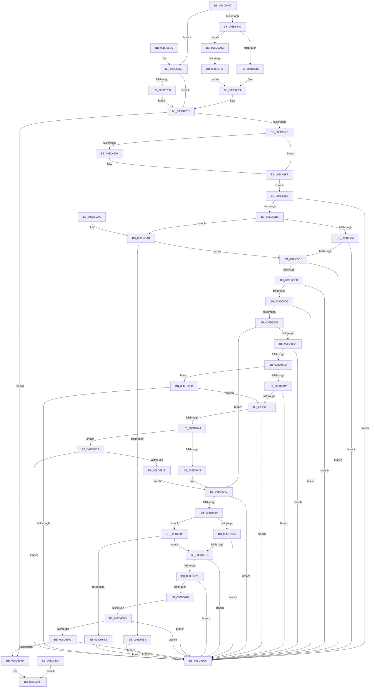

# RtlpReadExtendedContextLayout

- RVA: `0x008D64F0`–`0x008D673F` (길이 `591` bytes)
- VA: `0x00000001408D64F0`
- 실행 섹션: `PAGE`
- PDB 이름 있음: `예`; PDB Function 태그: `예`
- unwind 정보 RVA: `0x0008528C`
- 디코드: `157`개 명령, `591/591` bytes 표시
- 미해석 바이트: `0` (있으면 어셈블리에 `.byte`로 보존)

> 이 문서는 커널 이미지의 기계어와 PDB 기호를 분석해 생성했습니다. 4번과 5번은 함수 원형과 자료형을 바이너리 사용 방식에서 추정한 C 해석이며 원본 소스 복구 결과는 아닙니다.

## 1. Dependencies

- 직접 호출 지점: **1**; 고유 호출 대상: **1**
- 직접 호출자로 확인된 함수: **1**
- RIP 상대 이미지 참조: **0**

### Outgoing calls
- `0x008D6551` → [ExRaiseDatatypeMisalignment](../89/ExRaiseDatatypeMisalignment_function_00899FD0.md) (function, `0x00899FD0`)

### Direct callers
- [RtlpReadExtendedContext](RtlpReadExtendedContext_function_008D61D0.md) at `0x008D626B`

### Static image references
- 디코드된 RIP-relative 메모리 참조가 없습니다.

## 2. Other-region calls and transfers

- 다른 실행 섹션으로 향하는 call: **0**
- call이 아닌 외부 분기/꼬리 이동: **1**
  - `0x008D6710` → [sub_00B1BBA0](../B1/Unknown_function_00B1BBA0.md) (`tail-transfer`)

## 3. Assembly (complete function range)

```asm
008D64F0  48 89 5C 24 08                  mov qword ptr [rsp + 8], rbx
008D64F5  57                              push rdi
008D64F6  48 83 EC 40                     sub rsp, 0x40
008D64FA  45 33 D2                        xor r10d, r10d
008D64FD  48 8B 4C 24 70                  mov rcx, qword ptr [rsp + 0x70]
008D6502  0F BA E2 10                     bt edx, 0x10
008D6506  0F 82 CB 01 00 00               jb 0x1408d66d7
008D650C  0F BA E2 14                     bt edx, 0x14
008D6510  0F 83 F6 01 00 00               jae 0x1408d670c
008D6516  4D 8D 90 D0 04 00 00            lea r10, [r8 + 0x4d0]
008D651D  C7 41 0C D0 04 00 00            mov dword ptr [rcx + 0xc], 0x4d0
008D6524  41 8B C0                        mov eax, r8d
008D6527  41 2B C2                        sub eax, r10d
008D652A  89 41 08                        mov dword ptr [rcx + 8], eax
008D652D  8B 41 08                        mov eax, dword ptr [rcx + 8]
008D6530  89 01                           mov dword ptr [rcx], eax
008D6532  41 8B C2                        mov eax, r10d
008D6535  41 2B C0                        sub eax, r8d
008D6538  83 C0 20                        add eax, 0x20
008D653B  89 41 04                        mov dword ptr [rcx + 4], eax
008D653E  41 F7 C1 FE FF FF FF            test r9d, 0xfffffffe
008D6545  0F 84 52 01 00 00               je 0x1408d669d
008D654B  41 F6 C2 03                     test r10b, 3
008D654F  74 06                           je 0x1408d6557
008D6551  E8 7A 3A FC FF                  call 0x140899fd0
008D6556  CC                              int3
008D6557  49 8B C2                        mov rax, r10
008D655A  48 BA 00 00 FF FF FF 7F 00 00   movabs rdx, 0x7fffffff0000
008D6564  4C 3B D2                        cmp r10, rdx
008D6567  48 0F 43 C2                     cmovae rax, rdx
008D656B  90                              nop
008D656C  0F B6 00                        movzx eax, byte ptr [rax]
008D656F  41 0F 10 02                     movups xmm0, xmmword ptr [r10]
008D6573  0F 11 44 24 20                  movups xmmword ptr [rsp + 0x20], xmm0
008D6578  41 0F 10 4A 10                  movups xmm1, xmmword ptr [r10 + 0x10]
008D657D  0F 11 4C 24 30                  movups xmmword ptr [rsp + 0x30], xmm1
008D6582  EB 05                           jmp 0x1408d6589
008D6584  E9 16 01 00 00                  jmp 0x1408d669f
008D6589  4C 8B 44 24 28                  mov r8, qword ptr [rsp + 0x28]
008D658E  49 63 D0                        movsxd rdx, r8d
008D6591  4E 8D 1C 12                     lea r11, [rdx + r10]
008D6595  49 8B F8                        mov rdi, r8
008D6598  48 C1 EF 20                     shr rdi, 0x20
008D659C  48 8D 1C 3A                     lea rbx, [rdx + rdi]
008D65A0  49 03 DA                        add rbx, r10
008D65A3  42 8D 04 07                     lea eax, [rdi + r8]
008D65A7  44 3B C0                        cmp r8d, eax
008D65AA  0F 8F 16 01 00 00               jg 0x1408d66c6
008D65B0  45 85 C0                        test r8d, r8d
008D65B3  0F 89 F2 00 00 00               jns 0x1408d66ab
008D65B9  4D 3B DA                        cmp r11, r10
008D65BC  0F 83 04 01 00 00               jae 0x1408d66c6
008D65C2  49 3B DB                        cmp rbx, r11
008D65C5  0F 82 FB 00 00 00               jb 0x1408d66c6
008D65CB  44 39 41 08                     cmp dword ptr [rcx + 8], r8d
008D65CF  0F 85 F1 00 00 00               jne 0x1408d66c6
008D65D5  39 79 0C                        cmp dword ptr [rcx + 0xc], edi
008D65D8  0F 87 E8 00 00 00               ja 0x1408d66c6
008D65DE  41 F6 C1 02                     test r9b, 2
008D65E2  74 68                           je 0x1408d664c
008D65E4  48 8B 44 24 30                  mov rax, qword ptr [rsp + 0x30]
008D65E9  4C 63 C0                        movsxd r8, eax
008D65EC  4B 8D 1C 10                     lea rbx, [r8 + r10]
008D65F0  4C 8B C8                        mov r9, rax
008D65F3  49 C1 E9 20                     shr r9, 0x20
008D65F7  4F 8D 1C 08                     lea r11, [r8 + r9]
008D65FB  4D 03 DA                        add r11, r10
008D65FE  42 8D 14 08                     lea edx, [rax + r9]
008D6602  3B C2                           cmp eax, edx
008D6604  0F 8F BC 00 00 00               jg 0x1408d66c6
008D660A  85 C0                           test eax, eax
008D660C  0F 89 AB 00 00 00               jns 0x1408d66bd
008D6612  49 3B DA                        cmp rbx, r10
008D6615  0F 83 AB 00 00 00               jae 0x1408d66c6
008D661B  4C 3B DB                        cmp r11, rbx
008D661E  0F 82 A2 00 00 00               jb 0x1408d66c6
008D6624  48 89 41 10                     mov qword ptr [rcx + 0x10], rax
008D6628  44 8B 59 04                     mov r11d, dword ptr [rcx + 4]
008D662C  44 8B 09                        mov r9d, dword ptr [rcx]
008D662F  4C 8B C0                        mov r8, rax
008D6632  49 C1 E8 20                     shr r8, 0x20
008D6636  44 03 C0                        add r8d, eax
008D6639  43 8D 14 19                     lea edx, [r9 + r11]
008D663D  3B D0                           cmp edx, eax
008D663F  0F 8F E4 00 00 00               jg 0x1408d6729
008D6645  45 2B C1                        sub r8d, r9d
008D6648  44 89 41 04                     mov dword ptr [rcx + 4], r8d
008D664C  4C 63 09                        movsxd r9, dword ptr [rcx]
008D664F  4F 8D 04 11                     lea r8, [r9 + r10]
008D6653  8B 51 04                        mov edx, dword ptr [rcx + 4]
008D6656  49 8D 0C 11                     lea rcx, [r9 + rdx]
008D665A  49 03 CA                        add rcx, r10
008D665D  46 8D 1C 0A                     lea r11d, [rdx + r9]
008D6661  45 3B CB                        cmp r9d, r11d
008D6664  7F 60                           jg 0x1408d66c6
008D6666  45 85 C9                        test r9d, r9d
008D6669  79 4B                           jns 0x1408d66b6
008D666B  4D 3B C2                        cmp r8, r10
008D666E  73 56                           jae 0x1408d66c6
008D6670  49 3B C8                        cmp rcx, r8
008D6673  72 51                           jb 0x1408d66c6
008D6675  48 8B 4C 24 20                  mov rcx, qword ptr [rsp + 0x20]
008D667A  44 3B C9                        cmp r9d, ecx
008D667D  7C 47                           jl 0x1408d66c6
008D667F  48 8B C1                        mov rax, rcx
008D6682  48 C1 E8 20                     shr rax, 0x20
008D6686  03 C1                           add eax, ecx
008D6688  41 3B C3                        cmp eax, r11d
008D668B  7C 39                           jl 0x1408d66c6
008D668D  4D 3B C2                        cmp r8, r10
008D6690  77 34                           ja 0x1408d66c6
008D6692  49 63 C3                        movsxd rax, r11d
008D6695  49 03 C2                        add rax, r10
008D6698  49 3B C2                        cmp rax, r10
008D669B  72 29                           jb 0x1408d66c6
008D669D  33 C0                           xor eax, eax
008D669F  48 8B 5C 24 50                  mov rbx, qword ptr [rsp + 0x50]
008D66A4  48 83 C4 40                     add rsp, 0x40
008D66A8  5F                              pop rdi
008D66A9  C3                              ret
008D66AA  CC                              int3
008D66AB  4D 3B DA                        cmp r11, r10
008D66AE  0F 83 0E FF FF FF               jae 0x1408d65c2
008D66B4  EB 10                           jmp 0x1408d66c6
008D66B6  4D 3B C2                        cmp r8, r10
008D66B9  73 B5                           jae 0x1408d6670
008D66BB  EB 09                           jmp 0x1408d66c6
008D66BD  49 3B DA                        cmp rbx, r10
008D66C0  0F 83 55 FF FF FF               jae 0x1408d661b
008D66C6  B8 0D 00 00 C0                  mov eax, 0xc000000d
008D66CB  48 8B 5C 24 50                  mov rbx, qword ptr [rsp + 0x50]
008D66D0  48 83 C4 40                     add rsp, 0x40
008D66D4  5F                              pop rdi
008D66D5  C3                              ret
008D66D6  CC                              int3
008D66D7  4D 8D 90 CC 02 00 00            lea r10, [r8 + 0x2cc]
008D66DE  41 8B C0                        mov eax, r8d
008D66E1  41 2B C2                        sub eax, r10d
008D66E4  89 41 08                        mov dword ptr [rcx + 8], eax
008D66E7  C7 41 0C CC 00 00 00            mov dword ptr [rcx + 0xc], 0xcc
008D66EE  81 E2 20 00 01 00               and edx, 0x10020
008D66F4  81 FA 20 00 01 00               cmp edx, 0x10020
008D66FA  0F 85 2D FE FF FF               jne 0x1408d652d
008D6700  C7 41 0C CC 02 00 00            mov dword ptr [rcx + 0xc], 0x2cc
008D6707  E9 21 FE FF FF                  jmp 0x1408d652d
008D670C  0F BA E2 15                     bt edx, 0x15
008D6710  0F 83 8A 54 24 00               jae 0x140b1bba0
008D6716  4D 8D 90 A0 01 00 00            lea r10, [r8 + 0x1a0]
008D671D  C7 41 0C A0 01 00 00            mov dword ptr [rcx + 0xc], 0x1a0
008D6724  E9 FB FD FF FF                  jmp 0x1408d6524
008D6729  45 3B C1                        cmp r8d, r9d
008D672C  7F 98                           jg 0x1408d66c6
008D672E  44 2B C8                        sub r9d, eax
008D6731  45 03 CB                        add r9d, r11d
008D6734  44 89 49 04                     mov dword ptr [rcx + 4], r9d
008D6738  89 01                           mov dword ptr [rcx], eax
008D673A  E9 0D FF FF FF                  jmp 0x1408d664c
```

## 4. C-style interpretation (structured pseudocode)

```c
__int64 __fastcall RtlpReadExtendedContextLayout(__int64 a1, int a2, __int64 a3, int a4, __int64 a5)
{
    __int64 result;
    __int64 v_r10;
    __int64 v_r11;
    __int64 v_rbx;
    __int64 v_rdi;
    __int64 v_rsp;
    unsigned __int64 v_stack_m18;
    unsigned __int64 v_stack_m20;
    unsigned __int64 v_stack_m28;
    unsigned __int64 v_stack_p50;
    unsigned __int64 v_stack_p8;

    v_stack_p8 = v_rbx;
    v_rsp = (v_rsp) - (64);
    v_r10 = 0;
    if (condition_is_below) goto loc_008D66D7;
    if (condition_is_above_or_equal) goto loc_008D670C;
    *(unsigned int *)(a5 + 12) = 0x4D0ULL;
loc_008D6524:
    result = (unsigned int)(((unsigned int)((unsigned int)(a3))) - ((unsigned int)(a3 + 1232)));
    *(unsigned int *)(a5 + 8) = (unsigned int)(result);
loc_008D652D:
    *(unsigned int *)(a5) = (unsigned int)((unsigned int)(*(unsigned int *)(a5 + 8)));
    result = (unsigned int)(((unsigned int)((unsigned int)(a3 + 1232))) - ((unsigned int)(a3)));
    result = (unsigned int)((result) + (32));
    *(unsigned int *)(a5 + 4) = (unsigned int)(result);
    if (((a4) & (0xFFFFFFFEULL)) == 0) goto loc_008D669D;
    if ((((unsigned __int8)(a3 + 1232)) & (3)) != 0) {
        result = ExRaiseDatatypeMisalignment(a5, a2, a3, a4);
    }
    result = a3 + 1232;
    if ((a3 + 1232) >= a2) { result = a2; }
    v_stack_m28 = v_xmm0;
    v_stack_m18 = v_xmm1;
    goto loc_008D6589;
loc_008D6589:
    v_rdi = (v_stack_m20) >> (32);
    v_rbx = ((int)((unsigned int)(v_stack_m20)) + v_rdi * 1) + (a3 + 1232);
    if (((unsigned int)(v_stack_m20)) > ((unsigned int)(v_rdi + v_stack_m20 * 1))) goto loc_008D66C6;
    if (!sign_flag) goto loc_008D66AB;
    if (((int)((unsigned int)(v_stack_m20)) + a3 + 1232 * 1) >= (a3 + 1232)) goto loc_008D66C6;
loc_008D65C2:
    if (v_rbx < ((int)((unsigned int)(v_stack_m20)) + a3 + 1232 * 1)) goto loc_008D66C6;
    if ((*(unsigned int *)(a5 + 8)) != ((unsigned int)(v_stack_m20))) goto loc_008D66C6;
    if ((*(unsigned int *)(a5 + 12)) > ((unsigned int)(v_rdi))) goto loc_008D66C6;
    if ((((unsigned __int8)(a4)) & (2)) == 0) goto loc_008D664C;
    a4 = (v_stack_m18) >> (32);
    v_r11 = ((int)((unsigned int)(v_stack_m18)) + a4 * 1) + (a3 + 1232);
    if (((unsigned int)(v_stack_m18)) > ((unsigned int)(v_stack_m18 + a4 * 1))) goto loc_008D66C6;
    if (!sign_flag) goto loc_008D66BD;
    if (((int)((unsigned int)(v_stack_m18)) + a3 + 1232 * 1) >= (a3 + 1232)) goto loc_008D66C6;
loc_008D661B:
    if (v_r11 < ((int)((unsigned int)(v_stack_m18)) + a3 + 1232 * 1)) goto loc_008D66C6;
    *(unsigned __int64 *)(a5 + 16) = v_stack_m18;
    a3 = (v_stack_m18) >> (32);
    a3 = (unsigned int)((a3) + ((unsigned int)(v_stack_m18)));
    if (((unsigned int)((unsigned int)(*(unsigned int *)(a5)) + (unsigned int)(*(unsigned int *)(a5 + 4)) * 1)) > ((unsigned int)(v_stack_m18))) goto loc_008D6729;
    a3 = (unsigned int)((a3) - ((unsigned int)((unsigned int)(*(unsigned int *)(a5)))));
    *(unsigned int *)(a5 + 4) = (unsigned int)(a3);
loc_008D664C:
    a1 = ((int)(*(unsigned int *)(a5)) + (unsigned int)(*(unsigned int *)(a5 + 4)) * 1) + (a3 + 1232);
    if (((unsigned int)((int)(*(unsigned int *)(a5)))) > ((unsigned int)((unsigned int)(*(unsigned int *)(a5 + 4)) + (int)(*(unsigned int *)(a5)) * 1))) goto loc_008D66C6;
    if (!sign_flag) goto loc_008D66B6;
    if (((int)(*(unsigned int *)(a5)) + a3 + 1232 * 1) >= (a3 + 1232)) goto loc_008D66C6;
loc_008D6670:
    if (a1 < ((int)(*(unsigned int *)(a5)) + a3 + 1232 * 1)) goto loc_008D66C6;
    if (((unsigned int)((int)(*(unsigned int *)(a5)))) < ((unsigned int)(v_stack_m28))) goto loc_008D66C6;
    result = (v_stack_m28) >> (32);
    result = (unsigned int)((result) + ((unsigned int)(v_stack_m28)));
    if (((unsigned int)(result)) < ((unsigned int)((unsigned int)(*(unsigned int *)(a5 + 4)) + (int)(*(unsigned int *)(a5)) * 1))) goto loc_008D66C6;
    if (((int)(*(unsigned int *)(a5)) + a3 + 1232 * 1) > (a3 + 1232)) goto loc_008D66C6;
    result = ((int)((unsigned int)((unsigned int)(*(unsigned int *)(a5 + 4)) + (int)(*(unsigned int *)(a5)) * 1))) + (a3 + 1232);
    if (result < (a3 + 1232)) goto loc_008D66C6;
loc_008D669D:
    result = 0;
loc_008D669F:
    v_rsp = (v_rsp) + (64);
    return result;
loc_008D66AB:
    if (((unsigned int)(*(unsigned int *)(a5 + 4)) + (int)(*(unsigned int *)(a5)) * 1) >= (a3 + 1232)) goto loc_008D65C2;
    goto loc_008D66C6;
loc_008D66B6:
    if (((int)(*(unsigned int *)(a5)) + a3 + 1232 * 1) >= (a3 + 1232)) goto loc_008D6670;
    goto loc_008D66C6;
loc_008D66BD:
    if (v_stack_p8 >= (a3 + 1232)) goto loc_008D661B;
loc_008D66C6:
    v_rsp = (v_rsp) + (64);
    return (unsigned int)(0xC000000DULL);
loc_008D66D7:
    result = (unsigned int)(((unsigned int)((unsigned int)((int)(*(unsigned int *)(a5)) + a3 + 1232 * 1))) - ((unsigned int)((int)(*(unsigned int *)(a5)) + a3 + 1232 * 1 + 716)));
    *(unsigned int *)(v_stack_m28 + 8) = (unsigned int)(result);
    *(unsigned int *)(v_stack_m28 + 12) = 204;
    a2 = (unsigned int)(((unsigned int)(*(unsigned int *)(a5 + 4))) & (0x10020ULL));
    if (a2 != 0x10020ULL) goto loc_008D652D;
    *(unsigned int *)(v_stack_m28 + 12) = 716;
    goto loc_008D652D;
loc_008D670C:
    *(unsigned int *)(v_stack_m28 + 12) = 416;
    goto loc_008D6524;
loc_008D6729:
    if (((unsigned int)((int)(*(unsigned int *)(a5)) + a3 + 1232 * 1)) > ((unsigned int)((int)(*(unsigned int *)(a5))))) goto loc_008D66C6;
    a4 = (unsigned int)(((int)(*(unsigned int *)(a5))) - ((unsigned int)(result)));
    a4 = (unsigned int)((a4) + ((unsigned int)((unsigned int)(*(unsigned int *)(a5 + 4)) + (int)(*(unsigned int *)(a5)) * 1)));
    *(unsigned int *)(v_stack_m28 + 4) = a4;
    *(unsigned int *)(v_stack_m28) = (unsigned int)(result);
    goto loc_008D664C;
}
```

## 5. (Beta) C Style

```c
int64_t RtlpReadExtendedContextLayout(int64_t Arg1, int32_t Arg2, void *Arg3, int32_t Arg4, void *Arg5)
{
    uint8_t *arg3 = (uint8_t *)Arg3;
    uint8_t *arg5 = (uint8_t *)Arg5;

    int64_t result;
    int64_t local_r10;
    int64_t local_r11;
    int64_t local_rbx;
    int64_t local_rdi;
    int64_t local_rsp;
    uint64_t v_stack_m18;
    uint64_t v_stack_m20;
    uint64_t v_stack_m28;
    uint64_t v_stack_p50;
    uint64_t v_stack_p8;

    v_stack_p8 = local_rbx;
    local_rsp = (local_rsp) - (64);
    local_r10 = 0;
    if (condition_is_below) goto loc_008D66D7;
    if (condition_is_above_or_equal) goto loc_008D670C;
    *(uint32_t *)(arg5 + 0xC) = 0x4D0ULL;
loc_008D6524:
    result = (uint32_t)(((uint32_t)((uint32_t)(Arg3))) - ((uint32_t)(Arg3 + 1232)));
    *(uint32_t *)(arg5 + 0x8) = (uint32_t)(result);
loc_008D652D:
    *(uint32_t *)(arg5) = (uint32_t)((uint32_t)(*(uint32_t *)(arg5 + 0x8)));
    result = (uint32_t)(((uint32_t)((uint32_t)(Arg3 + 1232))) - ((uint32_t)(Arg3)));
    result = (uint32_t)((result) + (32));
    *(uint32_t *)(arg5 + 0x4) = (uint32_t)(result);
    if (((Arg4) & (0xFFFFFFFEULL)) == 0) goto loc_008D669D;
    if ((((uint8_t)(Arg3 + 1232)) & (3)) != 0) {
        result = ExRaiseDatatypeMisalignment(Arg5, Arg2, Arg3, Arg4);
    }
    result = Arg3 + 1232;
    if ((Arg3 + 1232) >= Arg2) { result = Arg2; }
    v_stack_m28 = v_xmm0;
    v_stack_m18 = v_xmm1;
    goto loc_008D6589;
loc_008D6589:
    local_rdi = (v_stack_m20) >> (32);
    local_rbx = ((int32_t)((uint32_t)(v_stack_m20)) + local_rdi * 1) + (Arg3 + 1232);
    if (((uint32_t)(v_stack_m20)) > ((uint32_t)(local_rdi + v_stack_m20 * 1))) goto loc_008D66C6;
    if (!sign_flag) goto loc_008D66AB;
    if (((int32_t)((uint32_t)(v_stack_m20)) + Arg3 + 1232 * 1) >= (Arg3 + 1232)) goto loc_008D66C6;
loc_008D65C2:
    if (local_rbx < ((int32_t)((uint32_t)(v_stack_m20)) + Arg3 + 1232 * 1)) goto loc_008D66C6;
    if ((*(uint32_t *)(arg5 + 0x8)) != ((uint32_t)(v_stack_m20))) goto loc_008D66C6;
    if ((*(uint32_t *)(arg5 + 0xC)) > ((uint32_t)(local_rdi))) goto loc_008D66C6;
    if ((((uint8_t)(Arg4)) & (2)) == 0) goto loc_008D664C;
    Arg4 = (v_stack_m18) >> (32);
    local_r11 = ((int32_t)((uint32_t)(v_stack_m18)) + Arg4 * 1) + (Arg3 + 1232);
    if (((uint32_t)(v_stack_m18)) > ((uint32_t)(v_stack_m18 + Arg4 * 1))) goto loc_008D66C6;
    if (!sign_flag) goto loc_008D66BD;
    if (((int32_t)((uint32_t)(v_stack_m18)) + Arg3 + 1232 * 1) >= (Arg3 + 1232)) goto loc_008D66C6;
loc_008D661B:
    if (local_r11 < ((int32_t)((uint32_t)(v_stack_m18)) + Arg3 + 1232 * 1)) goto loc_008D66C6;
    *(uint64_t *)(arg5 + 0x10) = v_stack_m18;
    Arg3 = (v_stack_m18) >> (32);
    Arg3 = (uint32_t)((Arg3) + ((uint32_t)(v_stack_m18)));
    if (((uint32_t)((uint32_t)(*(uint32_t *)(arg5)) + (uint32_t)(*(uint32_t *)(arg5 + 0x4)) * 1)) > ((uint32_t)(v_stack_m18))) goto loc_008D6729;
    Arg3 = (uint32_t)((Arg3) - ((uint32_t)((uint32_t)(*(uint32_t *)(arg5)))));
    *(uint32_t *)(arg5 + 0x4) = (uint32_t)(Arg3);
loc_008D664C:
    Arg1 = ((int32_t)(*(uint32_t *)(arg5)) + (uint32_t)(*(uint32_t *)(arg5 + 0x4)) * 1) + (Arg3 + 1232);
    if (((uint32_t)((int32_t)(*(uint32_t *)(arg5)))) > ((uint32_t)((uint32_t)(*(uint32_t *)(arg5 + 0x4)) + (int32_t)(*(uint32_t *)(arg5)) * 1))) goto loc_008D66C6;
    if (!sign_flag) goto loc_008D66B6;
    if (((int32_t)(*(uint32_t *)(arg5)) + Arg3 + 1232 * 1) >= (Arg3 + 1232)) goto loc_008D66C6;
loc_008D6670:
    if (Arg1 < ((int32_t)(*(uint32_t *)(arg5)) + Arg3 + 1232 * 1)) goto loc_008D66C6;
    if (((uint32_t)((int32_t)(*(uint32_t *)(arg5)))) < ((uint32_t)(v_stack_m28))) goto loc_008D66C6;
    result = (v_stack_m28) >> (32);
    result = (uint32_t)((result) + ((uint32_t)(v_stack_m28)));
    if (((uint32_t)(result)) < ((uint32_t)((uint32_t)(*(uint32_t *)(arg5 + 0x4)) + (int32_t)(*(uint32_t *)(arg5)) * 1))) goto loc_008D66C6;
    if (((int32_t)(*(uint32_t *)(arg5)) + Arg3 + 1232 * 1) > (Arg3 + 1232)) goto loc_008D66C6;
    result = ((int32_t)((uint32_t)((uint32_t)(*(uint32_t *)(arg5 + 0x4)) + (int32_t)(*(uint32_t *)(arg5)) * 1))) + (Arg3 + 1232);
    if (result < (Arg3 + 1232)) goto loc_008D66C6;
loc_008D669D:
    result = 0;
loc_008D669F:
    local_rsp = (local_rsp) + (64);
    return result;
loc_008D66AB:
    if (((uint32_t)(*(uint32_t *)(arg5 + 0x4)) + (int32_t)(*(uint32_t *)(arg5)) * 1) >= (Arg3 + 1232)) goto loc_008D65C2;
    goto loc_008D66C6;
loc_008D66B6:
    if (((int32_t)(*(uint32_t *)(arg5)) + Arg3 + 1232 * 1) >= (Arg3 + 1232)) goto loc_008D6670;
    goto loc_008D66C6;
loc_008D66BD:
    if (v_stack_p8 >= (Arg3 + 1232)) goto loc_008D661B;
loc_008D66C6:
    local_rsp = (local_rsp) + (64);
    return (uint32_t)(0xC000000DULL);
loc_008D66D7:
    result = (uint32_t)(((uint32_t)((uint32_t)((int32_t)(*(uint32_t *)(arg5)) + Arg3 + 1232 * 1))) - ((uint32_t)((int32_t)(*(uint32_t *)(arg5)) + Arg3 + 1232 * 1 + 716)));
    *(uint32_t *)(v_stack_m28 + 0x8) = (uint32_t)(result);
    *(uint32_t *)(v_stack_m28 + 0xC) = 204;
    Arg2 = (uint32_t)(((uint32_t)(*(uint32_t *)(arg5 + 0x4))) & (0x10020ULL));
    if (Arg2 != 0x10020ULL) goto loc_008D652D;
    *(uint32_t *)(v_stack_m28 + 0xC) = 716;
    goto loc_008D652D;
loc_008D670C:
    *(uint32_t *)(v_stack_m28 + 0xC) = 416;
    goto loc_008D6524;
loc_008D6729:
    if (((uint32_t)((int32_t)(*(uint32_t *)(arg5)) + Arg3 + 1232 * 1)) > ((uint32_t)((int32_t)(*(uint32_t *)(arg5))))) goto loc_008D66C6;
    Arg4 = (uint32_t)(((int32_t)(*(uint32_t *)(arg5))) - ((uint32_t)(result)));
    Arg4 = (uint32_t)((Arg4) + ((uint32_t)((uint32_t)(*(uint32_t *)(arg5 + 0x4)) + (int32_t)(*(uint32_t *)(arg5)) * 1)));
    *(uint32_t *)(v_stack_m28 + 0x4) = Arg4;
    *(uint32_t *)(v_stack_m28) = (uint32_t)(result);
    goto loc_008D664C;
}
```

### 관측된 메모리 오프셋

구조체 형식이 확인되지 않은 접근은 인자 기준의 오프셋으로만 기록했습니다.

| 기준 인자 | 오프셋 표현 | 폭 (bit) | 접근 |
|---|---:|---:|---|
| `Arg3` | `+ 0x1A0` | `64` | `R` |
| `Arg3` | `+ 0x2CC` | `64` | `R` |
| `Arg3` | `+ 0x4D0` | `64` | `R` |
| `Arg5` | `+ 0x0` | `32` | `W` |
| `Arg5` | `+ 0x4` | `32` | `W` |
| `Arg5` | `+ 0x8` | `32` | `R` |
| `Arg5` | `+ 0x8` | `32` | `W` |
| `Arg5` | `+ 0xC` | `32` | `W` |

## 6. Execution-region graph

[열기: 2D/3D 그래프와 함수 탐색 컨트롤 패널](../../../control-panel.html?section=page&rva=0x008D64F0&view=graph)

- 2D 그래프는 위에서 아래로 흐르고, 3D 그래프는 빈 공간을 드래그해 회전합니다. Shift+드래그는 이동, 휠은 확대·축소, 함수 노드 선택은 대상 보고서 이동입니다.

### Static fallback


