# RtlpReadExtendedContext

- RVA: `0x008D61D0`–`0x008D64E1` (길이 `785` bytes)
- VA: `0x00000001408D61D0`
- 실행 섹션: `PAGE`
- PDB 이름 있음: `예`; PDB Function 태그: `아니요`
- unwind 정보 RVA: `0x00085254`
- 디코드: `190`개 명령, `785/785` bytes 표시
- 미해석 바이트: `0` (있으면 어셈블리에 `.byte`로 보존)

> 이 문서는 커널 이미지의 기계어와 PDB 기호를 분석해 생성했습니다. 4번과 5번은 함수 원형과 자료형을 바이너리 사용 방식에서 추정한 C 해석이며 원본 소스 복구 결과는 아닙니다.

## 1. Dependencies

- 직접 호출 지점: **6**; 고유 호출 대상: **5**
- 직접 호출자로 확인된 함수: **7**
- RIP 상대 이미지 참조: **1**

### Outgoing calls
- `0x008D6243` → [RtlpValidateContextFlags](../../text/49/RtlpValidateContextFlags_function_0049BF20.md) (function, `0x0049BF20`)
- `0x008D626B` → [RtlpReadExtendedContextLayout](RtlpReadExtendedContextLayout_function_008D64F0.md) (function, `0x008D64F0`)
- `0x008D62CD` → [RtlpCopyExtendedContext](../../text/3F/RtlpCopyExtendedContext_function_003F4DD0.md) (function, `0x003F4DD0`)
- `0x008D63FC` → [ExRaiseDatatypeMisalignment](../89/ExRaiseDatatypeMisalignment_function_00899FD0.md) (function, `0x00899FD0`)
- `0x008D6442` → [ExRaiseDatatypeMisalignment](../89/ExRaiseDatatypeMisalignment_function_00899FD0.md) (function, `0x00899FD0`)
- `0x008D64BA` → [_security_check_cookie](../../text/6A/_security_check_cookie_function_006AC640.md) (function, `0x006AC640`)

### Direct callers
- [KiContinuePreviousModeUser](../../text/2F/KiContinuePreviousModeUser_function_002F9B10.md) at `0x002F9CD9`
- [KyRaiseException](../../text/3D/KyRaiseException_function_003D5E20.md) at `0x003D5F24`
- [KiUnwindUserSspForApcContextCopyBypass](../../text/3D/KiUnwindUserSspForApcContextCopyBypass_function_003D6F0C.md) at `0x003D6FCD`
- [PspWow64SetContextThread](../8C/PspWow64SetContextThread_function_008CCC88.md) at `0x008CD115`
- [PspSetContextThreadInternal](PspSetContextThreadInternal_function_008D4420.md) at `0x008D4672`
- [PspGetContextThreadInternal](PspGetContextThreadInternal_function_008D4770.md) at `0x008D4A08`
- [PspWow64GetContextThread](../A1/PspWow64GetContextThread_function_00A11E90.md) at `0x00A12270`

### Static image references
- `0x008D61E7` → RVA `0x00E0A740` (`.data`; read)

## 2. Other-region calls and transfers

- 다른 실행 섹션으로 향하는 call: **3**
  - `0x008D6243` → [RtlpValidateContextFlags](../../text/49/RtlpValidateContextFlags_function_0049BF20.md) (`PAGE` → `.text`)
  - `0x008D62CD` → [RtlpCopyExtendedContext](../../text/3F/RtlpCopyExtendedContext_function_003F4DD0.md) (`PAGE` → `.text`)
  - `0x008D64BA` → [_security_check_cookie](../../text/6A/_security_check_cookie_function_006AC640.md) (`PAGE` → `.text`)
- 별도 외부 분기/꼬리 이동을 확인하지 못했습니다.

## 3. Assembly (complete function range)

```asm
008D61D0  48 89 5C 24 08                  mov qword ptr [rsp + 8], rbx
008D61D5  48 89 74 24 10                  mov qword ptr [rsp + 0x10], rsi
008D61DA  57                              push rdi
008D61DB  41 54                           push r12
008D61DD  41 55                           push r13
008D61DF  41 56                           push r14
008D61E1  41 57                           push r15
008D61E3  48 83 EC 70                     sub rsp, 0x70
008D61E7  48 8B 05 52 45 53 00            mov rax, qword ptr [rip + 0x534552]
008D61EE  48 33 C4                        xor rax, rsp
008D61F1  48 89 44 24 68                  mov qword ptr [rsp + 0x68], rax
008D61F6  41 8B F9                        mov edi, r9d
008D61F9  4D 8B E8                        mov r13, r8
008D61FC  88 54 24 30                     mov byte ptr [rsp + 0x30], dl
008D6200  48 8B 84 24 C8 00 00 00         mov rax, qword ptr [rsp + 0xc8]
008D6208  4C 8B BC 24 C0 00 00 00         mov r15, qword ptr [rsp + 0xc0]
008D6210  33 C9                           xor ecx, ecx
008D6212  89 4C 24 34                     mov dword ptr [rsp + 0x34], ecx
008D6216  89 4C 24 40                     mov dword ptr [rsp + 0x40], ecx
008D621A  0F 57 C0                        xorps xmm0, xmm0
008D621D  0F 11 44 24 48                  movups xmmword ptr [rsp + 0x48], xmm0
008D6222  0F 11 44 24 58                  movups xmmword ptr [rsp + 0x58], xmm0
008D6227  44 8B F1                        mov r14d, ecx
008D622A  48 89 4C 24 38                  mov qword ptr [rsp + 0x38], rcx
008D622F  48 8D 5C 24 48                  lea rbx, [rsp + 0x48]
008D6234  48 85 C0                        test rax, rax
008D6237  48 0F 45 D8                     cmovne rbx, rax
008D623B  48 8D 54 24 34                  lea rdx, [rsp + 0x34]
008D6240  41 8B C9                        mov ecx, r9d
008D6243  E8 D8 5C BC FF                  call 0x14049bf20
008D6248  85 C0                           test eax, eax
008D624A  0F 88 62 02 00 00               js 0x1408d64b2
008D6250  8B 74 24 34                     mov esi, dword ptr [rsp + 0x34]
008D6254  40 F6 C6 04                     test sil, 4
008D6258  0F 85 7C 02 00 00               jne 0x1408d64da
008D625E  48 89 5C 24 20                  mov qword ptr [rsp + 0x20], rbx
008D6263  44 8B CE                        mov r9d, esi
008D6266  4D 8B C7                        mov r8, r15
008D6269  8B D7                           mov edx, edi
008D626B  E8 80 02 00 00                  call 0x1408d64f0
008D6270  85 C0                           test eax, eax
008D6272  0F 88 3A 02 00 00               js 0x1408d64b2
008D6278  44 8B E7                        mov r12d, edi
008D627B  41 81 E4 00 00 01 00            and r12d, 0x10000
008D6282  0F 84 34 01 00 00               je 0x1408d63bc
008D6288  41 8D 46 04                     lea eax, [r14 + 4]
008D628C  4D 8D B7 CC 02 00 00            lea r14, [r15 + 0x2cc]
008D6293  4C 89 74 24 38                  mov qword ptr [rsp + 0x38], r14
008D6298  E9 3A 01 00 00                  jmp 0x1408d63d7
008D629D  48 03 D0                        add rdx, rax
008D62A0  49 03 D6                        add rdx, r14
008D62A3  49 3B D1                        cmp rdx, r9
008D62A6  0F 87 F4 00 00 00               ja 0x1408d63a0
008D62AC  48 3B D1                        cmp rdx, rcx
008D62AF  0F 82 EB 00 00 00               jb 0x1408d63a0
008D62B5  48 89 5C 24 28                  mov qword ptr [rsp + 0x28], rbx
008D62BA  4C 89 74 24 20                  mov qword ptr [rsp + 0x20], r14
008D62BF  44 8B CF                        mov r9d, edi
008D62C2  45 33 C0                        xor r8d, r8d
008D62C5  49 8B D5                        mov rdx, r13
008D62C8  0F B6 4C 24 30                  movzx ecx, byte ptr [rsp + 0x30]
008D62CD  E8 FE EA B1 FF                  call 0x1403f4dd0
008D62D2  44 8B C8                        mov r9d, eax
008D62D5  89 44 24 44                     mov dword ptr [rsp + 0x44], eax
008D62D9  85 C0                           test eax, eax
008D62DB  0F 88 99 00 00 00               js 0x1408d637a
008D62E1  49 63 45 08                     movsxd rax, dword ptr [r13 + 8]
008D62E5  49 03 C5                        add rax, r13
008D62E8  45 85 E4                        test r12d, r12d
008D62EB  0F 85 9E 00 00 00               jne 0x1408d638f
008D62F1  0F BA E7 14                     bt edi, 0x14
008D62F5  0F 83 84 00 00 00               jae 0x1408d637f
008D62FB  89 78 30                        mov dword ptr [rax + 0x30], edi
008D62FE  40 F6 C6 02                     test sil, 2
008D6302  0F 84 9E 01 00 00               je 0x1408d64a6
008D6308  48 B9 D8 03 00 00 80 F7 FF FF   movabs rcx, 0xfffff780000003d8
008D6312  49 63 55 10                     movsxd rdx, dword ptr [r13 + 0x10]
008D6316  49 03 D5                        add rdx, r13
008D6319  49 BA 08 07 00 00 80 F7 FF FF   movabs r10, 0xfffff78000000708
008D6323  4D 8B 02                        mov r8, qword ptr [r10]
008D6326  4C 0B 01                        or r8, qword ptr [rcx]
008D6329  4C 23 02                        and r8, qword ptr [rdx]
008D632C  49 83 E0 FC                     and r8, 0xfffffffffffffffc
008D6330  4C 89 02                        mov qword ptr [rdx], r8
008D6333  A1 EC 03 00 00 80 F7 FF FF      movabs eax, dword ptr [0xfffff780000003ec]
008D633C  A8 02                           test al, 2
008D633E  74 56                           je 0x1408d6396
008D6340  48 8B 01                        mov rax, qword ptr [rcx]
008D6343  49 8B 0A                        mov rcx, qword ptr [r10]
008D6346  48 0B C8                        or rcx, rax
008D6349  48 B8 00 00 00 00 00 00 00 80   movabs rax, 0x8000000000000000
008D6353  48 0B C8                        or rcx, rax
008D6356  48 23 4A 08                     and rcx, qword ptr [rdx + 8]
008D635A  48 89 4A 08                     mov qword ptr [rdx + 8], rcx
008D635E  48 F7 D1                        not rcx
008D6361  49 85 C8                        test r8, rcx
008D6364  75 4C                           jne 0x1408d63b2
008D6366  0F 57 C0                        xorps xmm0, xmm0
008D6369  0F 11 42 10                     movups xmmword ptr [rdx + 0x10], xmm0
008D636D  0F 11 42 20                     movups xmmword ptr [rdx + 0x20], xmm0
008D6371  0F 11 42 30                     movups xmmword ptr [rdx + 0x30], xmm0
008D6375  E9 2C 01 00 00                  jmp 0x1408d64a6
008D637A  E9 33 01 00 00                  jmp 0x1408d64b2
008D637F  0F BA E7 15                     bt edi, 0x15
008D6383  72 0A                           jb 0x1408d638f
008D6385  0F BA E7 16                     bt edi, 0x16
008D6389  0F 83 6F FF FF FF               jae 0x1408d62fe
008D638F  89 38                           mov dword ptr [rax], edi
008D6391  E9 68 FF FF FF                  jmp 0x1408d62fe
008D6396  48 C7 42 08 00 00 00 00         mov qword ptr [rdx + 8], 0
008D639E  EB C6                           jmp 0x1408d6366
008D63A0  41 0F B6 01                     movzx eax, byte ptr [r9]
008D63A4  8B 74 24 34                     mov esi, dword ptr [rsp + 0x34]
008D63A8  4C 8B 74 24 38                  mov r14, qword ptr [rsp + 0x38]
008D63AD  E9 03 FF FF FF                  jmp 0x1408d62b5
008D63B2  B8 0D 00 00 C0                  mov eax, 0xc000000d
008D63B7  E9 F6 00 00 00                  jmp 0x1408d64b2
008D63BC  0F BA E7 14                     bt edi, 0x14
008D63C0  0F 83 81 00 00 00               jae 0x1408d6447
008D63C6  B8 10 00 00 00                  mov eax, 0x10
008D63CB  4D 8D B7 D0 04 00 00            lea r14, [r15 + 0x4d0]
008D63D2  4C 89 74 24 38                  mov qword ptr [rsp + 0x38], r14
008D63D7  40 F6 C6 01                     test sil, 1
008D63DB  0F 84 B6 00 00 00               je 0x1408d6497
008D63E1  8B 53 0C                        mov edx, dword ptr [rbx + 0xc]
008D63E4  85 D2                           test edx, edx
008D63E6  0F 84 AB 00 00 00               je 0x1408d6497
008D63EC  4C 63 4B 08                     movsxd r9, dword ptr [rbx + 8]
008D63F0  4F 8D 04 31                     lea r8, [r9 + r14]
008D63F4  8D 48 FF                        lea ecx, [rax - 1]
008D63F7  49 85 C8                        test r8, rcx
008D63FA  74 05                           je 0x1408d6401
008D63FC  E8 CF 3B FC FF                  call 0x140899fd0
008D6401  49 8D 0C 11                     lea rcx, [r9 + rdx]
008D6405  49 03 CE                        add rcx, r14
008D6408  49 B9 00 00 FF FF FF 7F 00 00   movabs r9, 0x7fffffff0000
008D6412  49 3B C9                        cmp rcx, r9
008D6415  77 68                           ja 0x1408d647f
008D6417  49 3B C8                        cmp rcx, r8
008D641A  72 63                           jb 0x1408d647f
008D641C  40 F6 C6 02                     test sil, 2
008D6420  0F 84 8F FE FF FF               je 0x1408d62b5
008D6426  8B 43 14                        mov eax, dword ptr [rbx + 0x14]
008D6429  85 C0                           test eax, eax
008D642B  0F 84 84 FE FF FF               je 0x1408d62b5
008D6431  48 63 53 10                     movsxd rdx, dword ptr [rbx + 0x10]
008D6435  4A 8D 0C 32                     lea rcx, [rdx + r14]
008D6439  F6 C1 3F                        test cl, 0x3f
008D643C  0F 84 5B FE FF FF               je 0x1408d629d
008D6442  E8 89 3B FC FF                  call 0x140899fd0
008D6447  0F BA E7 15                     bt edi, 0x15
008D644B  73 16                           jae 0x1408d6463
008D644D  B8 08 00 00 00                  mov eax, 8
008D6452  4D 8D B7 A0 01 00 00            lea r14, [r15 + 0x1a0]
008D6459  4C 89 74 24 38                  mov qword ptr [rsp + 0x38], r14
008D645E  E9 74 FF FF FF                  jmp 0x1408d63d7
008D6463  0F BA E7 16                     bt edi, 0x16
008D6467  73 25                           jae 0x1408d648e
008D6469  B8 10 00 00 00                  mov eax, 0x10
008D646E  4D 8D B7 90 03 00 00            lea r14, [r15 + 0x390]
008D6475  4C 89 74 24 38                  mov qword ptr [rsp + 0x38], r14
008D647A  E9 58 FF FF FF                  jmp 0x1408d63d7
008D647F  41 0F B6 01                     movzx eax, byte ptr [r9]
008D6483  8B 74 24 34                     mov esi, dword ptr [rsp + 0x34]
008D6487  4C 8B 74 24 38                  mov r14, qword ptr [rsp + 0x38]
008D648C  EB 8E                           jmp 0x1408d641c
008D648E  8B 44 24 40                     mov eax, dword ptr [rsp + 0x40]
008D6492  E9 40 FF FF FF                  jmp 0x1408d63d7
008D6497  49 B9 00 00 FF FF FF 7F 00 00   movabs r9, 0x7fffffff0000
008D64A1  E9 76 FF FF FF                  jmp 0x1408d641c
008D64A6  EB 07                           jmp 0x1408d64af
008D64A8  44 8B C8                        mov r9d, eax
008D64AB  89 44 24 44                     mov dword ptr [rsp + 0x44], eax
008D64AF  41 8B C1                        mov eax, r9d
008D64B2  48 8B 4C 24 68                  mov rcx, qword ptr [rsp + 0x68]
008D64B7  48 33 CC                        xor rcx, rsp
008D64BA  E8 81 61 DD FF                  call 0x1406ac640
008D64BF  4C 8D 5C 24 70                  lea r11, [rsp + 0x70]
008D64C4  49 8B 5B 30                     mov rbx, qword ptr [r11 + 0x30]
008D64C8  49 8B 73 38                     mov rsi, qword ptr [r11 + 0x38]
008D64CC  49 8B E3                        mov rsp, r11
008D64CF  41 5F                           pop r15
008D64D1  41 5E                           pop r14
008D64D3  41 5D                           pop r13
008D64D5  41 5C                           pop r12
008D64D7  5F                              pop rdi
008D64D8  C3                              ret
008D64D9  CC                              int3
008D64DA  B8 BB 00 00 C0                  mov eax, 0xc00000bb
008D64DF  EB D1                           jmp 0x1408d64b2
```

## 4. C-style interpretation (structured pseudocode)

```c
__int64 __fastcall RtlpReadExtendedContext(int a1, unsigned __int8 a2, __int64 a3, int a4, __int64 a5, __int64 a6)
{
    __int64 result;
    __int64 v_r12;
    __int64 v_rbx;
    __int64 v_rsp;
    unsigned __int64 v_stack_m28;
    unsigned __int64 v_stack_m30;
    unsigned __int64 v_stack_m40;
    unsigned __int64 v_stack_m50;
    unsigned int v_stack_m54;
    unsigned int v_stack_m58;
    unsigned __int64 v_stack_m60;
    unsigned int v_stack_m64;
    unsigned __int8 v_stack_m68;
    unsigned __int64 v_stack_m70;
    unsigned __int64 v_stack_m78;
    unsigned __int64 v_stack_p10;
    unsigned __int64 v_stack_p8;

    v_stack_p8 = v_rbx;
    v_stack_p10 = v_rsi;
    v_rsp = (v_rsp) - (112);
    result = (*(unsigned __int64 *)(v_rip + 5457234)) ^ (v_rsp);
    v_stack_m30 = result;
    v_stack_m68 = a2;
    a1 = 0;
    v_stack_m64 = 0;
    v_stack_m58 = 0;
    v_stack_m50 = v_xmm0;
    v_stack_m40 = v_xmm0;
    v_stack_m60 = 0;
    v_rbx = v_stack_m50;
    if (a6 != 0) { v_rbx = a6; }
    result = RtlpValidateContextFlags((unsigned int)(a4), v_stack_m64, a3, a4);
    if (sign_flag) goto loc_008D64B2;
    if ((((unsigned __int8)((unsigned int)(v_stack_m64))) & (4)) != 0) goto loc_008D64DA;
    v_stack_m78 = v_rbx;
    result = RtlpReadExtendedContextLayout((unsigned int)(a4), (unsigned int)((unsigned int)((unsigned int)(a4))), a5, (unsigned int)((unsigned int)((unsigned int)(v_stack_m64))));
    if (sign_flag) goto loc_008D64B2;
    v_r12 = (unsigned int)(((unsigned int)((unsigned int)((unsigned int)(a4)))) & (0x10000ULL));
    if (condition_is_equal) goto loc_008D63BC;
    v_stack_m60 = a5 + 716;
    goto loc_008D63D7;
loc_008D629D:
    a2 = ((unsigned int)((unsigned int)((unsigned int)(a4)))) + (0 + 4);
    a2 = (a2) + (a5 + 716);
    if (a2 > ((unsigned int)((unsigned int)((unsigned int)(v_stack_m64))))) goto loc_008D63A0;
    if (a2 < ((unsigned int)(a4))) goto loc_008D63A0;
loc_008D62B5:
    v_stack_m70 = v_rbx;
    v_stack_m78 = a5 + 716;
    a3 = 0;
    result = RtlpCopyExtendedContext(v_stack_m68, 0, a3, (unsigned int)((unsigned int)((unsigned int)(a4))));
    v_stack_m54 = (unsigned int)(result);
    if (sign_flag) goto loc_008D637A;
    result = ((int)(*(unsigned int *)(a3 + 8))) + (0);
    if ((unsigned int)(v_r12) != 0) goto loc_008D638F;
    if (condition_is_above_or_equal) goto loc_008D637F;
    *(unsigned int *)(result + 48) = (unsigned int)((unsigned int)(a4));
loc_008D62FE:
    if ((((unsigned __int8)((unsigned int)(v_stack_m64))) & (2)) == 0) goto loc_008D64A6;
    a2 = ((int)(*(unsigned int *)(a3 + 16))) + (0);
    a3 = (*(unsigned __int64 *)(v_r10)) | (*(unsigned __int64 *)(v_stack_m68));
    a3 = (a3) & (*(unsigned __int64 *)(a2));
    a3 = (a3) & (-4);
    *(unsigned __int64 *)(a2) = a3;
    if ((((unsigned __int8)(result)) & (2)) == 0) goto loc_008D6396;
    a1 = (*(unsigned __int64 *)(v_r10)) | (*(unsigned __int64 *)(v_stack_m68));
    a1 = (a1) | (*(unsigned __int64 *)(v_stack_m68));
    a1 = (a1) & (*(unsigned __int64 *)(a2 + 8));
    *(unsigned __int64 *)(a2 + 8) = a1;
    a1 = ~(a1);
    if (((a3) & (a1)) != 0) goto loc_008D63B2;
loc_008D6366:
    *(unsigned __int64 *)(a2 + 16) = v_xmm0;
    *(unsigned __int64 *)(a2 + 32) = v_xmm0;
    *(unsigned __int64 *)(a2 + 48) = v_xmm0;
    goto loc_008D64A6;
loc_008D637A:
    goto loc_008D64B2;
loc_008D637F:
    if (condition_is_below) goto loc_008D638F;
    if (condition_is_above_or_equal) goto loc_008D62FE;
loc_008D638F:
    *(unsigned int *)(*(unsigned __int64 *)(v_stack_m68)) = (unsigned int)((unsigned int)(a4));
    goto loc_008D62FE;
loc_008D6396:
    *(unsigned __int64 *)(a2 + 8) = 0;
    goto loc_008D6366;
loc_008D63A0:
    goto loc_008D62B5;
loc_008D63B2:
    goto loc_008D64B2;
loc_008D63BC:
    if (condition_is_above_or_equal) goto loc_008D6447;
    v_stack_m60 = a5 + 1232;
loc_008D63D7:
    if ((((unsigned __int8)((unsigned int)(v_stack_m64))) & (1)) == 0) goto loc_008D6497;
    if ((unsigned int)((unsigned int)(*(unsigned int *)(v_rbx + 12))) == 0) goto loc_008D6497;
    result = 16;
    if ((((int)(*(unsigned int *)(v_rbx + 8)) + a5 + 1232 * 1) & (16 - 1)) != 0) {
        result = ExRaiseDatatypeMisalignment(16 - 1, (unsigned int)(*(unsigned int *)(v_rbx + 12)), (int)(*(unsigned int *)(v_rbx + 8)) + a5 + 1232 * 1, (int)(*(unsigned int *)(v_rbx + 8)));
    }
    a1 = ((int)(*(unsigned int *)(v_rbx + 8)) + (unsigned int)(*(unsigned int *)(v_rbx + 12)) * 1) + (a5 + 1232);
    if (a1 > ((int)(*(unsigned int *)(v_rbx + 8)))) goto loc_008D647F;
    if (a1 < ((int)(*(unsigned int *)(v_rbx + 8)) + a5 + 1232 * 1)) goto loc_008D647F;
loc_008D641C:
    if ((((unsigned __int8)((unsigned int)(v_stack_m64))) & (2)) == 0) goto loc_008D62B5;
    if ((unsigned int)((unsigned int)(*(unsigned int *)(v_rbx + 20))) == 0) goto loc_008D62B5;
    if ((((unsigned __int8)((int)(*(unsigned int *)(v_rbx + 16)) + a5 + 1232 * 1)) & (63)) == 0) goto loc_008D629D;
    result = ExRaiseDatatypeMisalignment((int)(*(unsigned int *)(v_rbx + 16)) + a5 + 1232 * 1, (int)(*(unsigned int *)(v_rbx + 16)), (int)(*(unsigned int *)(v_rbx + 8)) + a5 + 1232 * 1, (int)(*(unsigned int *)(v_rbx + 8)));
loc_008D6447:
    if (condition_is_above_or_equal) goto loc_008D6463;
    v_stack_m60 = a5 + 416;
    goto loc_008D63D7;
loc_008D6463:
    if (condition_is_above_or_equal) goto loc_008D648E;
    v_stack_m60 = a5 + 912;
    goto loc_008D63D7;
loc_008D647F:
    goto loc_008D641C;
loc_008D648E:
    goto loc_008D63D7;
loc_008D6497:
    goto loc_008D641C;
loc_008D64A6:
    goto loc_008D64AF;
loc_008D64AF:
loc_008D64B2:
    a1 = (v_stack_m30) ^ (v_rsp);
    result = _security_check_cookie(a1, (int)(*(unsigned int *)(v_rbx + 16)), (int)(*(unsigned int *)(v_rbx + 8)) + a5 + 1232 * 1, (int)(*(unsigned int *)(v_rbx + 8)));
    return result;
loc_008D64DA:
    goto loc_008D64B2;
}
```

## 5. (Beta) C Style

```c
int64_t RtlpReadExtendedContext(int32_t Arg1, uint8_t Arg2, void *Arg3, int32_t Arg4, void *Arg5, int64_t Arg6)
{
    uint8_t *arg3 = (uint8_t *)Arg3;
    uint8_t *arg5 = (uint8_t *)Arg5;

    int64_t result;
    int64_t local_r12;
    int64_t local_rbx;
    int64_t local_rsp;
    uint64_t v_stack_m28;
    uint64_t v_stack_m30;
    uint64_t v_stack_m40;
    uint64_t v_stack_m50;
    uint32_t v_stack_m54;
    uint32_t v_stack_m58;
    uint64_t v_stack_m60;
    uint32_t v_stack_m64;
    uint8_t v_stack_m68;
    uint64_t v_stack_m70;
    uint64_t v_stack_m78;
    uint64_t v_stack_p10;
    uint64_t v_stack_p8;

    v_stack_p8 = local_rbx;
    v_stack_p10 = local_rsi;
    local_rsp = (local_rsp) - (112);
    result = (*(uint64_t *)(v_rip + 0x534552)) ^ (local_rsp);
    v_stack_m30 = result;
    v_stack_m68 = Arg2;
    Arg1 = 0;
    v_stack_m64 = 0;
    v_stack_m58 = 0;
    v_stack_m50 = v_xmm0;
    v_stack_m40 = v_xmm0;
    v_stack_m60 = 0;
    local_rbx = v_stack_m50;
    if (Arg6 != 0) { local_rbx = Arg6; }
    result = RtlpValidateContextFlags((uint32_t)(Arg4), v_stack_m64, Arg3, Arg4);
    if (sign_flag) goto loc_008D64B2;
    if ((((uint8_t)((uint32_t)(v_stack_m64))) & (4)) != 0) goto loc_008D64DA;
    v_stack_m78 = local_rbx;
    result = RtlpReadExtendedContextLayout((uint32_t)(Arg4), (uint32_t)((uint32_t)((uint32_t)(Arg4))), Arg5, (uint32_t)((uint32_t)((uint32_t)(v_stack_m64))));
    if (sign_flag) goto loc_008D64B2;
    local_r12 = (uint32_t)(((uint32_t)((uint32_t)((uint32_t)(Arg4)))) & (0x10000ULL));
    if (condition_is_equal) goto loc_008D63BC;
    v_stack_m60 = Arg5 + 716;
    goto loc_008D63D7;
loc_008D629D:
    Arg2 = ((uint32_t)((uint32_t)((uint32_t)(Arg4)))) + (0 + 4);
    Arg2 = (Arg2) + (Arg5 + 716);
    if (Arg2 > ((uint32_t)((uint32_t)((uint32_t)(v_stack_m64))))) goto loc_008D63A0;
    if (Arg2 < ((uint32_t)(Arg4))) goto loc_008D63A0;
loc_008D62B5:
    v_stack_m70 = local_rbx;
    v_stack_m78 = Arg5 + 716;
    Arg3 = 0;
    result = RtlpCopyExtendedContext(v_stack_m68, 0, Arg3, (uint32_t)((uint32_t)((uint32_t)(Arg4))));
    v_stack_m54 = (uint32_t)(result);
    if (sign_flag) goto loc_008D637A;
    result = ((int32_t)(*(uint32_t *)(arg3 + 0x8))) + (0);
    if ((uint32_t)(local_r12) != 0) goto loc_008D638F;
    if (condition_is_above_or_equal) goto loc_008D637F;
    *(uint32_t *)(result + 0x30) = (uint32_t)((uint32_t)(Arg4));
loc_008D62FE:
    if ((((uint8_t)((uint32_t)(v_stack_m64))) & (2)) == 0) goto loc_008D64A6;
    Arg2 = ((int32_t)(*(uint32_t *)(arg3 + 0x10))) + (0);
    Arg3 = (*(uint64_t *)(local_r10)) | (*(uint64_t *)(v_stack_m68));
    Arg3 = (Arg3) & (*(uint64_t *)(Arg2));
    Arg3 = (Arg3) & (-4);
    *(void **)(Arg2) = Arg3;
    if ((((uint8_t)(result)) & (2)) == 0) goto loc_008D6396;
    Arg1 = (*(uint64_t *)(local_r10)) | (*(uint64_t *)(v_stack_m68));
    Arg1 = (Arg1) | (*(uint64_t *)(v_stack_m68));
    Arg1 = (Arg1) & (*(uint64_t *)(Arg2 + 0x8));
    *(uint64_t *)(Arg2 + 0x8) = Arg1;
    Arg1 = ~(Arg1);
    if (((Arg3) & (Arg1)) != 0) goto loc_008D63B2;
loc_008D6366:
    *(uint64_t *)(Arg2 + 0x10) = v_xmm0;
    *(uint64_t *)(Arg2 + 0x20) = v_xmm0;
    *(uint64_t *)(Arg2 + 0x30) = v_xmm0;
    goto loc_008D64A6;
loc_008D637A:
    goto loc_008D64B2;
loc_008D637F:
    if (condition_is_below) goto loc_008D638F;
    if (condition_is_above_or_equal) goto loc_008D62FE;
loc_008D638F:
    *(uint32_t *)(*(uint64_t *)(v_stack_m68)) = (uint32_t)((uint32_t)(Arg4));
    goto loc_008D62FE;
loc_008D6396:
    *(uint64_t *)(Arg2 + 0x8) = 0;
    goto loc_008D6366;
loc_008D63A0:
    goto loc_008D62B5;
loc_008D63B2:
    goto loc_008D64B2;
loc_008D63BC:
    if (condition_is_above_or_equal) goto loc_008D6447;
    v_stack_m60 = Arg5 + 1232;
loc_008D63D7:
    if ((((uint8_t)((uint32_t)(v_stack_m64))) & (1)) == 0) goto loc_008D6497;
    if ((uint32_t)((uint32_t)(*(uint32_t *)(local_rbx + 0xC))) == 0) goto loc_008D6497;
    result = 16;
    if ((((int32_t)(*(uint32_t *)(local_rbx + 0x8)) + Arg5 + 1232 * 1) & (16 - 1)) != 0) {
        result = ExRaiseDatatypeMisalignment(16 - 1, (uint32_t)(*(uint32_t *)(local_rbx + 0xC)), (int32_t)(*(uint32_t *)(local_rbx + 0x8)) + Arg5 + 1232 * 1, (int32_t)(*(uint32_t *)(local_rbx + 0x8)));
    }
    Arg1 = ((int32_t)(*(uint32_t *)(local_rbx + 0x8)) + (uint32_t)(*(uint32_t *)(local_rbx + 0xC)) * 1) + (Arg5 + 1232);
    if (Arg1 > ((int32_t)(*(uint32_t *)(local_rbx + 0x8)))) goto loc_008D647F;
    if (Arg1 < ((int32_t)(*(uint32_t *)(local_rbx + 0x8)) + Arg5 + 1232 * 1)) goto loc_008D647F;
loc_008D641C:
    if ((((uint8_t)((uint32_t)(v_stack_m64))) & (2)) == 0) goto loc_008D62B5;
    if ((uint32_t)((uint32_t)(*(uint32_t *)(local_rbx + 0x14))) == 0) goto loc_008D62B5;
    if ((((uint8_t)((int32_t)(*(uint32_t *)(local_rbx + 0x10)) + Arg5 + 1232 * 1)) & (63)) == 0) goto loc_008D629D;
    result = ExRaiseDatatypeMisalignment((int32_t)(*(uint32_t *)(local_rbx + 0x10)) + Arg5 + 1232 * 1, (int32_t)(*(uint32_t *)(local_rbx + 0x10)), (int32_t)(*(uint32_t *)(local_rbx + 0x8)) + Arg5 + 1232 * 1, (int32_t)(*(uint32_t *)(local_rbx + 0x8)));
loc_008D6447:
    if (condition_is_above_or_equal) goto loc_008D6463;
    v_stack_m60 = Arg5 + 416;
    goto loc_008D63D7;
loc_008D6463:
    if (condition_is_above_or_equal) goto loc_008D648E;
    v_stack_m60 = Arg5 + 912;
    goto loc_008D63D7;
loc_008D647F:
    goto loc_008D641C;
loc_008D648E:
    goto loc_008D63D7;
loc_008D6497:
    goto loc_008D641C;
loc_008D64A6:
    goto loc_008D64AF;
loc_008D64AF:
loc_008D64B2:
    Arg1 = (v_stack_m30) ^ (local_rsp);
    result = _security_check_cookie(Arg1, (int32_t)(*(uint32_t *)(local_rbx + 0x10)), (int32_t)(*(uint32_t *)(local_rbx + 0x8)) + Arg5 + 1232 * 1, (int32_t)(*(uint32_t *)(local_rbx + 0x8)));
    return result;
loc_008D64DA:
    goto loc_008D64B2;
}
```

### 관측된 메모리 오프셋

구조체 형식이 확인되지 않은 접근은 인자 기준의 오프셋으로만 기록했습니다.

| 기준 인자 | 오프셋 표현 | 폭 (bit) | 접근 |
|---|---:|---:|---|
| `Arg3` | `+ 0x8` | `32` | `R` |
| `Arg3` | `+ 0x10` | `32` | `R` |
| `Arg5` | `+ 0x1A0` | `64` | `R` |
| `Arg5` | `+ 0x2CC` | `64` | `R` |
| `Arg5` | `+ 0x390` | `64` | `R` |
| `Arg5` | `+ 0x4D0` | `64` | `R` |

## 6. Execution-region graph

[열기: 2D/3D 그래프와 함수 탐색 컨트롤 패널](../../../control-panel.html?section=page&rva=0x008D61D0&view=graph)

- 2D 그래프는 위에서 아래로 흐르고, 3D 그래프는 빈 공간을 드래그해 회전합니다. Shift+드래그는 이동, 휠은 확대·축소, 함수 노드 선택은 대상 보고서 이동입니다.

### Static fallback

```mermaid
flowchart TD
  bb_008D61D0[BB_008D61D0]
  bb_008D6250[BB_008D6250]
  bb_008D625E[BB_008D625E]
  bb_008D6278[BB_008D6278]
  bb_008D6288[BB_008D6288]
  bb_008D629D[BB_008D629D]
  bb_008D62AC[BB_008D62AC]
  bb_008D62B5[BB_008D62B5]
  bb_008D62E1[BB_008D62E1]
  bb_008D62F1[BB_008D62F1]
  bb_008D62FB[BB_008D62FB]
  bb_008D62FE[BB_008D62FE]
  bb_008D6308[BB_008D6308]
  bb_008D6340[BB_008D6340]
  bb_008D6366[BB_008D6366]
  bb_008D637A[BB_008D637A]
  bb_008D637F[BB_008D637F]
  bb_008D6385[BB_008D6385]
  bb_008D638F[BB_008D638F]
  bb_008D6396[BB_008D6396]
  bb_008D63A0[BB_008D63A0]
  bb_008D63B2[BB_008D63B2]
  bb_008D63BC[BB_008D63BC]
  bb_008D63C6[BB_008D63C6]
  bb_008D63D7[BB_008D63D7]
  bb_008D63E1[BB_008D63E1]
  bb_008D63EC[BB_008D63EC]
  bb_008D63FC[BB_008D63FC]
  bb_008D6401[BB_008D6401]
  bb_008D6417[BB_008D6417]
  bb_008D641C[BB_008D641C]
  bb_008D6426[BB_008D6426]
  bb_008D6431[BB_008D6431]
  bb_008D6442[BB_008D6442]
  bb_008D6447[BB_008D6447]
  bb_008D644D[BB_008D644D]
  bb_008D6463[BB_008D6463]
  bb_008D6469[BB_008D6469]
  bb_008D647F[BB_008D647F]
  bb_008D648E[BB_008D648E]
  bb_008D6497[BB_008D6497]
  bb_008D64A6[BB_008D64A6]
  bb_008D64A8[BB_008D64A8]
  bb_008D64AF[BB_008D64AF]
  bb_008D64B2[BB_008D64B2]
  bb_008D64D9[BB_008D64D9]
  bb_008D64DA[BB_008D64DA]
  bb_008D61D0 -->|branch| bb_008D64B2
  bb_008D61D0 -->|fallthrough| bb_008D6250
  bb_008D6250 -->|branch| bb_008D64DA
  bb_008D6250 -->|fallthrough| bb_008D625E
  bb_008D625E -->|branch| bb_008D64B2
  bb_008D625E -->|fallthrough| bb_008D6278
  bb_008D6278 -->|branch| bb_008D63BC
  bb_008D6278 -->|fallthrough| bb_008D6288
  bb_008D6288 -->|branch| bb_008D63D7
  bb_008D629D -->|branch| bb_008D63A0
  bb_008D629D -->|fallthrough| bb_008D62AC
  bb_008D62AC -->|branch| bb_008D63A0
  bb_008D62AC -->|fallthrough| bb_008D62B5
  bb_008D62B5 -->|branch| bb_008D637A
  bb_008D62B5 -->|fallthrough| bb_008D62E1
  bb_008D62E1 -->|branch| bb_008D638F
  bb_008D62E1 -->|fallthrough| bb_008D62F1
  bb_008D62F1 -->|branch| bb_008D637F
  bb_008D62F1 -->|fallthrough| bb_008D62FB
  bb_008D62FB -->|flow| bb_008D62FE
  bb_008D62FE -->|branch| bb_008D64A6
  bb_008D62FE -->|fallthrough| bb_008D6308
  bb_008D6308 -->|branch| bb_008D6396
  bb_008D6308 -->|fallthrough| bb_008D6340
  bb_008D6340 -->|branch| bb_008D63B2
  bb_008D6340 -->|fallthrough| bb_008D6366
  bb_008D6366 -->|branch| bb_008D64A6
  bb_008D637A -->|branch| bb_008D64B2
  bb_008D637F -->|branch| bb_008D638F
  bb_008D637F -->|fallthrough| bb_008D6385
  bb_008D6385 -->|branch| bb_008D62FE
  bb_008D6385 -->|fallthrough| bb_008D638F
  bb_008D638F -->|branch| bb_008D62FE
  bb_008D6396 -->|branch| bb_008D6366
  bb_008D63A0 -->|branch| bb_008D62B5
  bb_008D63B2 -->|branch| bb_008D64B2
  bb_008D63BC -->|branch| bb_008D6447
  bb_008D63BC -->|fallthrough| bb_008D63C6
  bb_008D63C6 -->|flow| bb_008D63D7
  bb_008D63D7 -->|branch| bb_008D6497
  bb_008D63D7 -->|fallthrough| bb_008D63E1
  bb_008D63E1 -->|branch| bb_008D6497
  bb_008D63E1 -->|fallthrough| bb_008D63EC
  bb_008D63EC -->|branch| bb_008D6401
  bb_008D63EC -->|fallthrough| bb_008D63FC
  bb_008D63FC -->|flow| bb_008D6401
  bb_008D6401 -->|branch| bb_008D647F
  bb_008D6401 -->|fallthrough| bb_008D6417
  bb_008D6417 -->|branch| bb_008D647F
  bb_008D6417 -->|fallthrough| bb_008D641C
  bb_008D641C -->|branch| bb_008D62B5
  bb_008D641C -->|fallthrough| bb_008D6426
  bb_008D6426 -->|branch| bb_008D62B5
  bb_008D6426 -->|fallthrough| bb_008D6431
  bb_008D6431 -->|branch| bb_008D629D
  bb_008D6431 -->|fallthrough| bb_008D6442
  bb_008D6442 -->|flow| bb_008D6447
  bb_008D6447 -->|branch| bb_008D6463
  bb_008D6447 -->|fallthrough| bb_008D644D
  bb_008D644D -->|branch| bb_008D63D7
  bb_008D6463 -->|branch| bb_008D648E
  bb_008D6463 -->|fallthrough| bb_008D6469
  bb_008D6469 -->|branch| bb_008D63D7
  bb_008D647F -->|branch| bb_008D641C
  bb_008D648E -->|branch| bb_008D63D7
  bb_008D6497 -->|branch| bb_008D641C
  bb_008D64A6 -->|branch| bb_008D64AF
  bb_008D64A8 -->|flow| bb_008D64AF
  bb_008D64AF -->|flow| bb_008D64B2
  bb_008D64D9 -->|flow| bb_008D64DA
  bb_008D64DA -->|branch| bb_008D64B2
```


