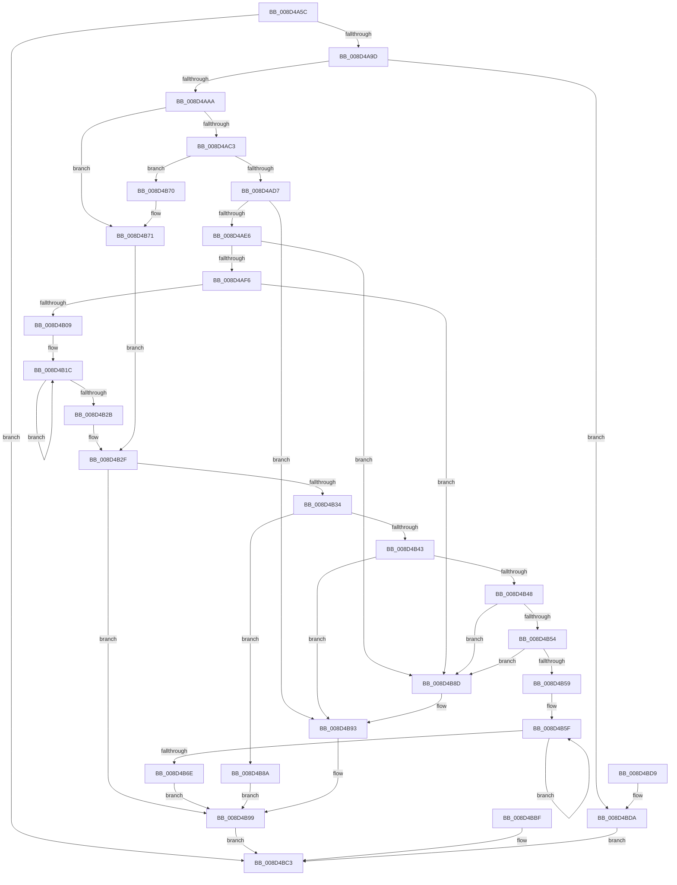

# RtlpWriteExtendedContext

- RVA: `0x008D4A5C`–`0x008D4BE1` (길이 `389` bytes)
- VA: `0x00000001408D4A5C`
- 실행 섹션: `PAGE`
- PDB 이름 있음: `예`; PDB Function 태그: `아니요`
- unwind 정보 RVA: `0x0008507C`
- 디코드: `110`개 명령, `389/389` bytes 표시
- 미해석 바이트: `0` (있으면 어셈블리에 `.byte`로 보존)

> 이 문서는 커널 이미지의 기계어와 PDB 기호를 분석해 생성했습니다. 4번과 5번은 함수 원형과 자료형을 바이너리 사용 방식에서 추정한 C 해석이며 원본 소스 복구 결과는 아닙니다.

## 1. Dependencies

- 직접 호출 지점: **5**; 고유 호출 대상: **5**
- 직접 호출자로 확인된 함수: **2**
- RIP 상대 이미지 참조: **0**

### Outgoing calls
- `0x008D4A8C` → [RtlpValidateContextFlags](../../text/49/RtlpValidateContextFlags_function_0049BF20.md) (function, `0x0049BF20`)
- `0x008D4AB4` → [RtlpGetLegacyContextLength](../../text/4B/RtlpGetLegacyContextLength_function_004B6060.md) (function, `0x004B6060`)
- `0x008D4B8D` → [ExRaiseAccessViolation](../8E/ExRaiseAccessViolation_function_008E9240.md) (function, `0x008E9240`)
- `0x008D4B93` → [ExRaiseDatatypeMisalignment](../89/ExRaiseDatatypeMisalignment_function_00899FD0.md) (function, `0x00899FD0`)
- `0x008D4BB4` → [RtlpCopyExtendedContext](../../text/3F/RtlpCopyExtendedContext_function_003F4DD0.md) (function, `0x003F4DD0`)

### Direct callers
- [PspGetContextThreadInternal](PspGetContextThreadInternal_function_008D4770.md) at `0x008D48DC`
- [PspWow64GetContextThread](../A1/PspWow64GetContextThread_function_00A11E90.md) at `0x00A1215E`

### Static image references
- 디코드된 RIP-relative 메모리 참조가 없습니다.

## 2. Other-region calls and transfers

- 다른 실행 섹션으로 향하는 call: **3**
  - `0x008D4A8C` → [RtlpValidateContextFlags](../../text/49/RtlpValidateContextFlags_function_0049BF20.md) (`PAGE` → `.text`)
  - `0x008D4AB4` → [RtlpGetLegacyContextLength](../../text/4B/RtlpGetLegacyContextLength_function_004B6060.md) (`PAGE` → `.text`)
  - `0x008D4BB4` → [RtlpCopyExtendedContext](../../text/3F/RtlpCopyExtendedContext_function_003F4DD0.md) (`PAGE` → `.text`)
- 별도 외부 분기/꼬리 이동을 확인하지 못했습니다.

## 3. Assembly (complete function range)

```asm
008D4A5C  48 8B C4                        mov rax, rsp
008D4A5F  48 89 58 10                     mov qword ptr [rax + 0x10], rbx
008D4A63  48 89 70 18                     mov qword ptr [rax + 0x18], rsi
008D4A67  48 89 78 20                     mov qword ptr [rax + 0x20], rdi
008D4A6B  88 48 08                        mov byte ptr [rax + 8], cl
008D4A6E  41 56                           push r14
008D4A70  48 83 EC 40                     sub rsp, 0x40
008D4A74  45 8B F1                        mov r14d, r9d
008D4A77  49 8B F8                        mov rdi, r8
008D4A7A  48 8B F2                        mov rsi, rdx
008D4A7D  83 60 08 00                     and dword ptr [rax + 8], 0
008D4A81  83 60 E8 00                     and dword ptr [rax - 0x18], 0
008D4A85  48 8D 50 08                     lea rdx, [rax + 8]
008D4A89  41 8B C9                        mov ecx, r9d
008D4A8C  E8 8F 74 BC FF                  call 0x14049bf20
008D4A91  89 44 24 34                     mov dword ptr [rsp + 0x34], eax
008D4A95  85 C0                           test eax, eax
008D4A97  0F 88 26 01 00 00               js 0x1408d4bc3
008D4A9D  8B 5C 24 50                     mov ebx, dword ptr [rsp + 0x50]
008D4AA1  F6 C3 04                        test bl, 4
008D4AA4  0F 85 30 01 00 00               jne 0x1408d4bda
008D4AAA  4C 8D 44 24 30                  lea r8, [rsp + 0x30]
008D4AAF  33 D2                           xor edx, edx
008D4AB1  41 8B CE                        mov ecx, r14d
008D4AB4  E8 A7 15 BE FF                  call 0x1404b6060
008D4AB9  90                              nop
008D4ABA  F6 C3 01                        test bl, 1
008D4ABD  0F 84 AE 00 00 00               je 0x1408d4b71
008D4AC3  44 8B 47 0C                     mov r8d, dword ptr [rdi + 0xc]
008D4AC7  48 63 57 08                     movsxd rdx, dword ptr [rdi + 8]
008D4ACB  48 03 D6                        add rdx, rsi
008D4ACE  4D 85 C0                        test r8, r8
008D4AD1  0F 84 99 00 00 00               je 0x1408d4b70
008D4AD7  8B 4C 24 30                     mov ecx, dword ptr [rsp + 0x30]
008D4ADB  FF C9                           dec ecx
008D4ADD  48 85 CA                        test rdx, rcx
008D4AE0  0F 85 AD 00 00 00               jne 0x1408d4b93
008D4AE6  49 8D 48 FF                     lea rcx, [r8 - 1]
008D4AEA  48 03 CA                        add rcx, rdx
008D4AED  48 3B D1                        cmp rdx, rcx
008D4AF0  0F 87 97 00 00 00               ja 0x1408d4b8d
008D4AF6  49 BA 00 00 FF FF FF 7F 00 00   movabs r10, 0x7fffffff0000
008D4B00  49 3B CA                        cmp rcx, r10
008D4B03  0F 83 84 00 00 00               jae 0x1408d4b8d
008D4B09  49 C7 C0 00 F0 FF FF            mov r8, 0xfffffffffffff000
008D4B10  49 23 C8                        and rcx, r8
008D4B13  41 B9 00 10 00 00               mov r9d, 0x1000
008D4B19  49 03 C9                        add rcx, r9
008D4B1C  8A 02                           mov al, byte ptr [rdx]
008D4B1E  88 02                           mov byte ptr [rdx], al
008D4B20  49 23 D0                        and rdx, r8
008D4B23  49 03 D1                        add rdx, r9
008D4B26  48 3B D1                        cmp rdx, rcx
008D4B29  75 F1                           jne 0x1408d4b1c
008D4B2B  8B 5C 24 50                     mov ebx, dword ptr [rsp + 0x50]
008D4B2F  F6 C3 02                        test bl, 2
008D4B32  74 65                           je 0x1408d4b99
008D4B34  8B 47 14                        mov eax, dword ptr [rdi + 0x14]
008D4B37  48 63 4F 10                     movsxd rcx, dword ptr [rdi + 0x10]
008D4B3B  48 03 CE                        add rcx, rsi
008D4B3E  48 85 C0                        test rax, rax
008D4B41  74 47                           je 0x1408d4b8a
008D4B43  F6 C1 3F                        test cl, 0x3f
008D4B46  75 4B                           jne 0x1408d4b93
008D4B48  48 8D 50 FF                     lea rdx, [rax - 1]
008D4B4C  48 03 D1                        add rdx, rcx
008D4B4F  48 3B CA                        cmp rcx, rdx
008D4B52  77 39                           ja 0x1408d4b8d
008D4B54  49 3B D2                        cmp rdx, r10
008D4B57  73 34                           jae 0x1408d4b8d
008D4B59  49 23 D0                        and rdx, r8
008D4B5C  49 03 D1                        add rdx, r9
008D4B5F  8A 01                           mov al, byte ptr [rcx]
008D4B61  88 01                           mov byte ptr [rcx], al
008D4B63  49 23 C8                        and rcx, r8
008D4B66  49 03 C9                        add rcx, r9
008D4B69  48 3B CA                        cmp rcx, rdx
008D4B6C  75 F1                           jne 0x1408d4b5f
008D4B6E  EB 29                           jmp 0x1408d4b99
008D4B70  90                              nop
008D4B71  41 B9 00 10 00 00               mov r9d, 0x1000
008D4B77  49 C7 C0 00 F0 FF FF            mov r8, 0xfffffffffffff000
008D4B7E  49 BA 00 00 FF FF FF 7F 00 00   movabs r10, 0x7fffffff0000
008D4B88  EB A5                           jmp 0x1408d4b2f
008D4B8A  90                              nop
008D4B8B  EB 0C                           jmp 0x1408d4b99
008D4B8D  E8 AE 46 01 00                  call 0x1408e9240
008D4B92  CC                              int3
008D4B93  E8 38 54 FC FF                  call 0x140899fd0
008D4B98  CC                              int3
008D4B99  48 83 64 24 28 00               and qword ptr [rsp + 0x28], 0
008D4B9F  48 8B 44 24 70                  mov rax, qword ptr [rsp + 0x70]
008D4BA4  48 89 44 24 20                  mov qword ptr [rsp + 0x20], rax
008D4BA9  45 8B CE                        mov r9d, r14d
008D4BAC  4C 8B C7                        mov r8, rdi
008D4BAF  48 8B D6                        mov rdx, rsi
008D4BB2  B1 01                           mov cl, 1
008D4BB4  E8 17 02 B2 FF                  call 0x1403f4dd0
008D4BB9  89 44 24 34                     mov dword ptr [rsp + 0x34], eax
008D4BBD  EB 04                           jmp 0x1408d4bc3
008D4BBF  89 44 24 34                     mov dword ptr [rsp + 0x34], eax
008D4BC3  48 8B 5C 24 58                  mov rbx, qword ptr [rsp + 0x58]
008D4BC8  48 8B 74 24 60                  mov rsi, qword ptr [rsp + 0x60]
008D4BCD  48 8B 7C 24 68                  mov rdi, qword ptr [rsp + 0x68]
008D4BD2  48 83 C4 40                     add rsp, 0x40
008D4BD6  41 5E                           pop r14
008D4BD8  C3                              ret
008D4BD9  CC                              int3
008D4BDA  B8 BB 00 00 C0                  mov eax, 0xc00000bb
008D4BDF  EB E2                           jmp 0x1408d4bc3
```

## 4. C-style interpretation (structured pseudocode)

```c
__int64 __fastcall RtlpWriteExtendedContext(unsigned __int8 a1, __int64 a2, __int64 a3, int a4, __int64 a5)
{
    __int64 result;
    __int64 v_rsp;
    unsigned int v_stack_m14;
    unsigned __int64 v_stack_m18;
    unsigned __int64 v_stack_m20;
    unsigned __int64 v_stack_m28;
    unsigned __int64 v_stack_p10;
    unsigned __int64 v_stack_p18;
    unsigned __int64 v_stack_p20;
    unsigned int v_stack_p8;

    *(unsigned __int64 *)(v_rsp + 16) = v_rbx;
    *(unsigned __int64 *)(v_rsp + 24) = v_rsi;
    *(unsigned __int64 *)(v_rsp + 32) = v_rdi;
    *(unsigned __int8 *)(v_rsp + 8) = a1;
    v_rsp = (v_rsp) - (64);
    result = RtlpValidateContextFlags((unsigned int)(a4), v_rsp + 8, a3, a4);
    v_stack_m14 = (unsigned int)(result);
    if (sign_flag) goto loc_008D4BC3;
    if ((((unsigned __int8)((unsigned int)(v_stack_p8))) & (4)) != 0) goto loc_008D4BDA;
    a2 = 0;
    result = RtlpGetLegacyContextLength((unsigned int)((unsigned int)((unsigned int)(a4))), a2, v_stack_m18, a4);
    if ((((unsigned __int8)((unsigned int)(v_stack_p8))) & (1)) == 0) goto loc_008D4B71;
    a2 = ((int)(*(unsigned int *)(a3 + 8))) + (0);
    if ((unsigned int)(*(unsigned int *)(a3 + 12)) == 0) goto loc_008D4B70;
    a1 = (unsigned int)(((unsigned int)(v_stack_m18)) - 1);
    if (((a2) & (a1)) != 0) goto loc_008D4B93;
    a1 = ((unsigned int)(*(unsigned int *)(a3 + 12)) - 1) + (a2);
    if (a2 > a1) goto loc_008D4B8D;
    if (a1 >= v_r10) goto loc_008D4B8D;
    a1 = (a1) & (0xFFFFFFFFFFFFF000ULL);
    a1 = (a1) + ((unsigned int)(0x1000ULL));
loc_008D4B1C:
    *(unsigned __int8 *)(a2) = (unsigned __int8)(*(unsigned __int8 *)(a2));
    a2 = (a2) & (0xFFFFFFFFFFFFF000ULL);
    a2 = (a2) + ((unsigned int)(0x1000ULL));
    if (a2 != a1) goto loc_008D4B1C;
loc_008D4B2F:
    if ((((unsigned __int8)((unsigned int)(v_stack_p8))) & (2)) == 0) goto loc_008D4B99;
    a1 = ((int)(*(unsigned int *)(a3 + 16))) + (a2);
    if ((unsigned int)(*(unsigned int *)(a3 + 20)) == 0) goto loc_008D4B8A;
    if (((a1) & (63)) != 0) goto loc_008D4B93;
    a2 = ((unsigned int)(*(unsigned int *)(a3 + 20)) - 1) + (a1);
    if (a1 > a2) goto loc_008D4B8D;
    if (a2 >= v_r10) goto loc_008D4B8D;
    a2 = (a2) & (0xFFFFFFFFFFFFF000ULL);
    a2 = (a2) + ((unsigned int)(0x1000ULL));
loc_008D4B5F:
    *(unsigned __int8 *)(a1) = (unsigned __int8)(*(unsigned __int8 *)(a1));
    a1 = (a1) & (0xFFFFFFFFFFFFF000ULL);
    a1 = (a1) + ((unsigned int)(0x1000ULL));
    if (a1 != a2) goto loc_008D4B5F;
    goto loc_008D4B99;
loc_008D4B70:
loc_008D4B71:
    goto loc_008D4B2F;
loc_008D4B8A:
    goto loc_008D4B99;
loc_008D4B8D:
    result = ExRaiseAccessViolation(a1, a2, 0xFFFFFFFFFFFFF000ULL, (unsigned int)(0x1000ULL));
loc_008D4B93:
    result = ExRaiseDatatypeMisalignment(a1, a2, 0xFFFFFFFFFFFFF000ULL, (unsigned int)(0x1000ULL));
loc_008D4B99:
    v_stack_m28 = a5;
    result = RtlpCopyExtendedContext(1, a2, a3, (unsigned int)((unsigned int)((unsigned int)(a4))));
    v_stack_m14 = (unsigned int)(result);
    goto loc_008D4BC3;
loc_008D4BC3:
    v_rsp = (v_rsp) + (64);
    return result;
loc_008D4BDA:
    goto loc_008D4BC3;
}
```

## 5. (Beta) C Style

```c
int64_t RtlpWriteExtendedContext(uint8_t Arg1, int64_t Arg2, void *Arg3, int32_t Arg4, int64_t Arg5)
{
    uint8_t *arg3 = (uint8_t *)Arg3;

    int64_t result;
    int64_t local_rsp;
    uint32_t v_stack_m14;
    uint64_t v_stack_m18;
    uint64_t v_stack_m20;
    uint64_t v_stack_m28;
    uint64_t v_stack_p10;
    uint64_t v_stack_p18;
    uint64_t v_stack_p20;
    uint32_t v_stack_p8;

    *(uint64_t *)(local_rsp + 0x10) = local_rbx;
    *(uint64_t *)(local_rsp + 0x18) = local_rsi;
    *(uint64_t *)(local_rsp + 0x20) = local_rdi;
    *(uint8_t *)(local_rsp + 0x8) = Arg1;
    local_rsp = (local_rsp) - (64);
    result = RtlpValidateContextFlags((uint32_t)(Arg4), local_rsp + 8, Arg3, Arg4);
    v_stack_m14 = (uint32_t)(result);
    if (sign_flag) goto loc_008D4BC3;
    if ((((uint8_t)((uint32_t)(v_stack_p8))) & (4)) != 0) goto loc_008D4BDA;
    Arg2 = 0;
    result = RtlpGetLegacyContextLength((uint32_t)((uint32_t)((uint32_t)(Arg4))), Arg2, v_stack_m18, Arg4);
    if ((((uint8_t)((uint32_t)(v_stack_p8))) & (1)) == 0) goto loc_008D4B71;
    Arg2 = ((int32_t)(*(uint32_t *)(arg3 + 0x8))) + (0);
    if ((uint32_t)(*(uint32_t *)(arg3 + 0xC)) == 0) goto loc_008D4B70;
    Arg1 = (uint32_t)(((uint32_t)(v_stack_m18)) - 1);
    if (((Arg2) & (Arg1)) != 0) goto loc_008D4B93;
    Arg1 = ((uint32_t)(*(uint32_t *)(arg3 + 0xC)) - 1) + (Arg2);
    if (Arg2 > Arg1) goto loc_008D4B8D;
    if (Arg1 >= local_r10) goto loc_008D4B8D;
    Arg1 = (Arg1) & (0xFFFFFFFFFFFFF000ULL);
    Arg1 = (Arg1) + ((uint32_t)(0x1000ULL));
loc_008D4B1C:
    *(uint8_t *)(Arg2) = (uint8_t)(*(uint8_t *)(Arg2));
    Arg2 = (Arg2) & (0xFFFFFFFFFFFFF000ULL);
    Arg2 = (Arg2) + ((uint32_t)(0x1000ULL));
    if (Arg2 != Arg1) goto loc_008D4B1C;
loc_008D4B2F:
    if ((((uint8_t)((uint32_t)(v_stack_p8))) & (2)) == 0) goto loc_008D4B99;
    Arg1 = ((int32_t)(*(uint32_t *)(arg3 + 0x10))) + (Arg2);
    if ((uint32_t)(*(uint32_t *)(arg3 + 0x14)) == 0) goto loc_008D4B8A;
    if (((Arg1) & (63)) != 0) goto loc_008D4B93;
    Arg2 = ((uint32_t)(*(uint32_t *)(arg3 + 0x14)) - 1) + (Arg1);
    if (Arg1 > Arg2) goto loc_008D4B8D;
    if (Arg2 >= local_r10) goto loc_008D4B8D;
    Arg2 = (Arg2) & (0xFFFFFFFFFFFFF000ULL);
    Arg2 = (Arg2) + ((uint32_t)(0x1000ULL));
loc_008D4B5F:
    *(uint8_t *)(Arg1) = (uint8_t)(*(uint8_t *)(Arg1));
    Arg1 = (Arg1) & (0xFFFFFFFFFFFFF000ULL);
    Arg1 = (Arg1) + ((uint32_t)(0x1000ULL));
    if (Arg1 != Arg2) goto loc_008D4B5F;
    goto loc_008D4B99;
loc_008D4B70:
loc_008D4B71:
    goto loc_008D4B2F;
loc_008D4B8A:
    goto loc_008D4B99;
loc_008D4B8D:
    result = ExRaiseAccessViolation(Arg1, Arg2, 0xFFFFFFFFFFFFF000ULL, (uint32_t)(0x1000ULL));
loc_008D4B93:
    result = ExRaiseDatatypeMisalignment(Arg1, Arg2, 0xFFFFFFFFFFFFF000ULL, (uint32_t)(0x1000ULL));
loc_008D4B99:
    v_stack_m28 = Arg5;
    result = RtlpCopyExtendedContext(1, Arg2, Arg3, (uint32_t)((uint32_t)((uint32_t)(Arg4))));
    v_stack_m14 = (uint32_t)(result);
    goto loc_008D4BC3;
loc_008D4BC3:
    local_rsp = (local_rsp) + (64);
    return result;
loc_008D4BDA:
    goto loc_008D4BC3;
}
```

### 관측된 메모리 오프셋

구조체 형식이 확인되지 않은 접근은 인자 기준의 오프셋으로만 기록했습니다.

| 기준 인자 | 오프셋 표현 | 폭 (bit) | 접근 |
|---|---:|---:|---|
| `Arg3` | `+ 0x8` | `32` | `R` |
| `Arg3` | `+ 0xC` | `32` | `R` |
| `Arg3` | `+ 0x10` | `32` | `R` |
| `Arg3` | `+ 0x14` | `32` | `R` |

## 6. Execution-region graph

[열기: 2D/3D 그래프와 함수 탐색 컨트롤 패널](../../../control-panel.html?section=page&rva=0x008D4A5C&view=graph)

- 2D 그래프는 위에서 아래로 흐르고, 3D 그래프는 빈 공간을 드래그해 회전합니다. Shift+드래그는 이동, 휠은 확대·축소, 함수 노드 선택은 대상 보고서 이동입니다.

### Static fallback


