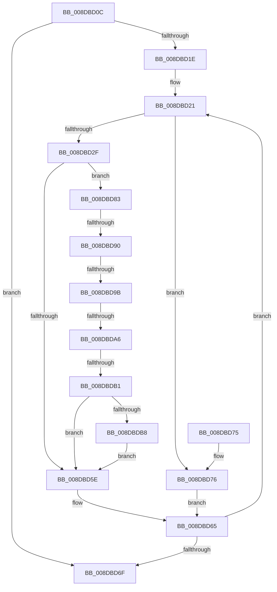

# SimplifyFilter

- RVA: `0x008DBD0C`–`0x008DBDC0` (길이 `180` bytes)
- VA: `0x00000001408DBD0C`
- 실행 섹션: `PAGE`
- PDB 이름 있음: `예`; PDB Function 태그: `예`
- unwind 정보 RVA: `0x00085878`
- 디코드: `50`개 명령, `180/180` bytes 표시
- 미해석 바이트: `0` (있으면 어셈블리에 `.byte`로 보존)

> 이 문서는 커널 이미지의 기계어와 PDB 기호를 분석해 생성했습니다. 4번과 5번은 함수 원형과 자료형을 바이너리 사용 방식에서 추정한 C 해석이며 원본 소스 복구 결과는 아닙니다.

## 1. Dependencies

- 직접 호출 지점: **0**; 고유 호출 대상: **0**
- 직접 호출자로 확인된 함수: **1**
- RIP 상대 이미지 참조: **0**

### Outgoing calls
- 직접 디코드된 call 명령이 없습니다.

### Direct callers
- [ConstraintEval](ConstraintEval_function_008DC1D0.md) at `0x008DC45D`

### Static image references
- 디코드된 RIP-relative 메모리 참조가 없습니다.

## 2. Other-region calls and transfers

- 다른 실행 섹션으로 향하는 call: **0**
- call이 아닌 외부 분기/꼬리 이동: **4**
  - `0x008DBD8A` → [sub_00B1C8B6 + 0x21](../B1/Unknown_function_00B1C8B6.md) (`tail-transfer`)
  - `0x008DBD95` → [sub_00B1C8B6 + 0x16](../B1/Unknown_function_00B1C8B6.md) (`tail-transfer`)
  - `0x008DBDA0` → [sub_00B1C8B6 + 0xB](../B1/Unknown_function_00B1C8B6.md) (`tail-transfer`)
  - `0x008DBDAB` → [sub_00B1C8B6](../B1/Unknown_function_00B1C8B6.md) (`tail-transfer`)

## 3. Assembly (complete function range)

```asm
008DBD0C  48 89 5C 24 08                  mov qword ptr [rsp + 8], rbx
008DBD11  45 33 D2                        xor r10d, r10d
008DBD14  49 8B D9                        mov rbx, r9
008DBD17  45 21 10                        and dword ptr [r8], r10d
008DBD1A  85 C9                           test ecx, ecx
008DBD1C  74 51                           je 0x1408dbd6f
008DBD1E  44 8B D9                        mov r11d, ecx
008DBD21  8B 02                           mov eax, dword ptr [rdx]
008DBD23  2D 00 00 50 00                  sub eax, 0x500000
008DBD28  A9 FF FF EF FF                  test eax, 0xffefffff
008DBD2D  74 47                           je 0x1408dbd76
008DBD2F  0F 10 02                        movups xmm0, xmmword ptr [rdx]
008DBD32  45 8B 08                        mov r9d, dword ptr [r8]
008DBD35  49 6B C9 38                     imul rcx, r9, 0x38
008DBD39  48 03 CB                        add rcx, rbx
008DBD3C  0F 11 01                        movups xmmword ptr [rcx], xmm0
008DBD3F  0F 10 4A 10                     movups xmm1, xmmword ptr [rdx + 0x10]
008DBD43  0F 11 49 10                     movups xmmword ptr [rcx + 0x10], xmm1
008DBD47  0F 10 42 20                     movups xmm0, xmmword ptr [rdx + 0x20]
008DBD4B  0F 11 41 20                     movups xmmword ptr [rcx + 0x20], xmm0
008DBD4F  F2 0F 10 4A 30                  movsd xmm1, qword ptr [rdx + 0x30]
008DBD54  F2 0F 11 49 30                  movsd qword ptr [rcx + 0x30], xmm1
008DBD59  45 85 D2                        test r10d, r10d
008DBD5C  75 25                           jne 0x1408dbd83
008DBD5E  41 8D 41 01                     lea eax, [r9 + 1]
008DBD62  41 89 00                        mov dword ptr [r8], eax
008DBD65  48 83 C2 38                     add rdx, 0x38
008DBD69  49 83 EB 01                     sub r11, 1
008DBD6D  75 B2                           jne 0x1408dbd21
008DBD6F  48 8B 5C 24 08                  mov rbx, qword ptr [rsp + 8]
008DBD74  C3                              ret
008DBD75  CC                              int3
008DBD76  33 C0                           xor eax, eax
008DBD78  45 85 D2                        test r10d, r10d
008DBD7B  0F 94 C0                        sete al
008DBD7E  44 8B D0                        mov r10d, eax
008DBD81  EB E2                           jmp 0x1408dbd65
008DBD83  8B 01                           mov eax, dword ptr [rcx]
008DBD85  A9 00 00 F0 0F                  test eax, 0xff00000
008DBD8A  0F 84 47 0B 24 00               je 0x140b1c8d7
008DBD90  3D 00 00 10 00                  cmp eax, 0x100000
008DBD95  0F 84 31 0B 24 00               je 0x140b1c8cc
008DBD9B  3D 00 00 20 00                  cmp eax, 0x200000
008DBDA0  0F 84 1B 0B 24 00               je 0x140b1c8c1
008DBDA6  3D 00 00 30 00                  cmp eax, 0x300000
008DBDAB  0F 84 05 0B 24 00               je 0x140b1c8b6
008DBDB1  3D 00 00 40 00                  cmp eax, 0x400000
008DBDB6  75 A6                           jne 0x1408dbd5e
008DBDB8  C7 01 00 00 20 00               mov dword ptr [rcx], 0x200000
008DBDBE  EB 9E                           jmp 0x1408dbd5e
```

## 4. C-style interpretation (structured pseudocode)

```c
__int64 __fastcall SimplifyFilter(int a1, __int64 a2, __int64 a3, __int64 a4)
{
    __int64 result;
    __int64 v_r10;
    __int64 v_r11;
    unsigned __int64 v_stack_p8;

    v_stack_p8 = v_rbx;
    v_r10 = 0;
    if (a1 == 0) goto loc_008DBD6F;
loc_008DBD21:
    result = (unsigned int)(((unsigned int)(*(unsigned int *)(a2))) - (0x500000ULL));
    if ((((unsigned int)(result)) & (0xFFEFFFFFULL)) == 0) goto loc_008DBD76;
    a1 = (a1) * ((unsigned int)(*(unsigned int *)(a3)));
    a1 = (a1) + (a4);
    *(unsigned __int64 *)(a1) = v_xmm0;
    *(unsigned __int64 *)(a1 + 16) = v_xmm1;
    *(unsigned __int64 *)(a1 + 32) = v_xmm0;
    *(unsigned __int64 *)(a1 + 48) = v_xmm1;
    if (0 != 0) goto loc_008DBD83;
loc_008DBD5E:
    *(unsigned int *)(a3) = (unsigned int)((unsigned int)(*(unsigned int *)(a3)) + 1);
loc_008DBD65:
    a2 = (a2) + (56);
    v_r11 = ((unsigned int)(a1)) - (1);
    if (condition_is_not_equal) goto loc_008DBD21;
loc_008DBD6F:
    return (unsigned int)(*(unsigned int *)(a3)) + 1;
loc_008DBD76:
    result = 0;
    result = (0 == 0) ? 1 : 0;
    goto loc_008DBD65;
loc_008DBD83:
    if (((unsigned int)((unsigned int)(*(unsigned int *)(a1)))) != 0x400000ULL) goto loc_008DBD5E;
    *(unsigned int *)(a1) = 0x200000ULL;
    goto loc_008DBD5E;
}
```

## 5. (Beta) C Style

```c
int64_t SimplifyFilter(int32_t Arg1, void *Arg2, void *Arg3, int64_t Arg4)
{
    uint8_t *arg2 = (uint8_t *)Arg2;
    uint8_t *arg3 = (uint8_t *)Arg3;

    int64_t result;
    int64_t local_r10;
    int64_t local_r11;
    uint64_t v_stack_p8;

    v_stack_p8 = local_rbx;
    local_r10 = 0;
    if (Arg1 == 0) goto loc_008DBD6F;
loc_008DBD21:
    result = (uint32_t)(((uint32_t)(*(uint32_t *)(arg2))) - (0x500000ULL));
    if ((((uint32_t)(result)) & (0xFFEFFFFFULL)) == 0) goto loc_008DBD76;
    Arg1 = (Arg1) * ((uint32_t)(*(uint32_t *)(arg3)));
    Arg1 = (Arg1) + (Arg4);
    *(uint64_t *)(Arg1) = v_xmm0;
    *(uint64_t *)(Arg1 + 0x10) = v_xmm1;
    *(uint64_t *)(Arg1 + 0x20) = v_xmm0;
    *(uint64_t *)(Arg1 + 0x30) = v_xmm1;
    if (0 != 0) goto loc_008DBD83;
loc_008DBD5E:
    *(uint32_t *)(arg3) = (uint32_t)((uint32_t)(*(uint32_t *)(arg3)) + 1);
loc_008DBD65:
    Arg2 = (Arg2) + (56);
    local_r11 = ((uint32_t)(Arg1)) - (1);
    if (condition_is_not_equal) goto loc_008DBD21;
loc_008DBD6F:
    return (uint32_t)(*(uint32_t *)(arg3)) + 1;
loc_008DBD76:
    result = 0;
    result = (0 == 0) ? 1 : 0;
    goto loc_008DBD65;
loc_008DBD83:
    if (((uint32_t)((uint32_t)(*(uint32_t *)(Arg1)))) != 0x400000ULL) goto loc_008DBD5E;
    *(uint32_t *)(Arg1) = 0x200000ULL;
    goto loc_008DBD5E;
}
```

### 관측된 메모리 오프셋

구조체 형식이 확인되지 않은 접근은 인자 기준의 오프셋으로만 기록했습니다.

| 기준 인자 | 오프셋 표현 | 폭 (bit) | 접근 |
|---|---:|---:|---|
| `Arg2` | `+ 0x0` | `32` | `R` |
| `Arg2` | `+ 0x0` | `128` | `R` |
| `Arg2` | `+ 0x10` | `128` | `R` |
| `Arg2` | `+ 0x20` | `128` | `R` |
| `Arg2` | `+ 0x30` | `64` | `R` |
| `Arg3` | `+ 0x0` | `32` | `R` |
| `Arg3` | `+ 0x0` | `32` | `R/W` |
| `Arg3` | `+ 0x0` | `32` | `W` |

## 6. Execution-region graph

[열기: 2D/3D 그래프와 함수 탐색 컨트롤 패널](../../../control-panel.html?section=page&rva=0x008DBD0C&view=graph)

- 2D 그래프는 위에서 아래로 흐르고, 3D 그래프는 빈 공간을 드래그해 회전합니다. Shift+드래그는 이동, 휠은 확대·축소, 함수 노드 선택은 대상 보고서 이동입니다.

### Static fallback


