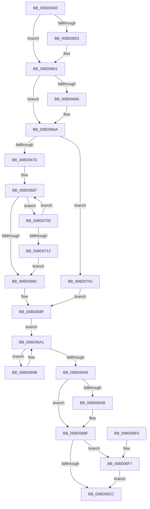

# sub_008D0600

- RVA: `0x008D0600`–`0x008D0717` (길이 `279` bytes)
- VA: `0x00000001408D0600`
- 실행 섹션: `PAGE`
- PDB 이름 있음: `아니요`; PDB Function 태그: `아니요`
- unwind 정보 RVA: `0x00084A84`
- 디코드: `80`개 명령, `279/279` bytes 표시
- 미해석 바이트: `0` (있으면 어셈블리에 `.byte`로 보존)

> 이 문서는 커널 이미지의 기계어와 PDB 기호를 분석해 생성했습니다. 4번과 5번은 함수 원형과 자료형을 바이너리 사용 방식에서 추정한 C 해석이며 원본 소스 복구 결과는 아닙니다.

## 1. Dependencies

- 직접 호출 지점: **6**; 고유 호출 대상: **6**
- 직접 호출자로 확인된 함수: **1**
- RIP 상대 이미지 참조: **0**

### Outgoing calls
- `0x008D0643` → [KeAbPreAcquire](../../text/21/KeAbPreAcquire_function_00210230.md) (function, `0x00210230`)
- `0x008D065C` → [ExfAcquirePushLockExclusiveEx](../../text/20/ExfAcquirePushLockExclusiveEx_function_0020FC90.md) (function, `0x0020FC90`)
- `0x008D06BA` → [memset](../../text/6C/memset_function_006C6C40.md) (function, `0x006C6C40`)
- `0x008D06CF` → [KeAbPostRelease](../../text/2E/KeAbPostRelease_function_002E1600.md) (function, `0x002E1600`)
- `0x008D06D4` → [KeLeaveGuardedRegion](../../text/2E/KeLeaveGuardedRegion_function_002E2C40.md) (function, `0x002E2C40`)
- `0x008D06FA` → [ExfTryToWakePushLock](../../text/26/ExfTryToWakePushLock_function_00265DD0.md) (function, `0x00265DD0`)

### Direct callers
- [sub_008D2420](Unknown_function_008D2420.md) at `0x008D24E6`

### Static image references
- 디코드된 RIP-relative 메모리 참조가 없습니다.

## 2. Other-region calls and transfers

- 다른 실행 섹션으로 향하는 call: **6**
  - `0x008D0643` → [KeAbPreAcquire](../../text/21/KeAbPreAcquire_function_00210230.md) (`PAGE` → `.text`)
  - `0x008D065C` → [ExfAcquirePushLockExclusiveEx](../../text/20/ExfAcquirePushLockExclusiveEx_function_0020FC90.md) (`PAGE` → `.text`)
  - `0x008D06BA` → [memset](../../text/6C/memset_function_006C6C40.md) (`PAGE` → `.text`)
  - `0x008D06CF` → [KeAbPostRelease](../../text/2E/KeAbPostRelease_function_002E1600.md) (`PAGE` → `.text`)
  - `0x008D06D4` → [KeLeaveGuardedRegion](../../text/2E/KeLeaveGuardedRegion_function_002E2C40.md) (`PAGE` → `.text`)
  - `0x008D06FA` → [ExfTryToWakePushLock](../../text/26/ExfTryToWakePushLock_function_00265DD0.md) (`PAGE` → `.text`)
- 별도 외부 분기/꼬리 이동을 확인하지 못했습니다.

## 3. Assembly (complete function range)

```asm
008D0600  48 8B C4                        mov rax, rsp
008D0603  48 89 58 08                     mov qword ptr [rax + 8], rbx
008D0607  48 89 68 10                     mov qword ptr [rax + 0x10], rbp
008D060B  48 89 70 18                     mov qword ptr [rax + 0x18], rsi
008D060F  48 89 78 20                     mov qword ptr [rax + 0x20], rdi
008D0613  41 56                           push r14
008D0615  48 83 EC 20                     sub rsp, 0x20
008D0619  65 48 8B 04 25 88 01 00 00      mov rax, qword ptr gs:[0x188]
008D0622  48 8D B1 30 04 00 00            lea rsi, [rcx + 0x430]
008D0629  48 8B FA                        mov rdi, rdx
008D062C  4C 8B F1                        mov r14, rcx
008D062F  48 83 CB FF                     or rbx, 0xffffffffffffffff
008D0633  45 33 C0                        xor r8d, r8d
008D0636  33 D2                           xor edx, edx
008D0638  48 8B CE                        mov rcx, rsi
008D063B  66 01 98 E6 01 00 00            add word ptr [rax + 0x1e6], bx
008D0642  90                              nop
008D0643  E8 E8 FB 93 FF                  call 0x140210230
008D0648  F0 48 0F BA 2E 00               lock bts qword ptr [rsi], 0
008D064E  48 8B E8                        mov rbp, rax
008D0651  73 0E                           jae 0x1408d0661
008D0653  4C 8B C6                        mov r8, rsi
008D0656  48 8B D0                        mov rdx, rax
008D0659  48 8B CE                        mov rcx, rsi
008D065C  E8 2F F6 93 FF                  call 0x14020fc90
008D0661  48 85 ED                        test rbp, rbp
008D0664  74 04                           je 0x1408d066a
008D0666  C6 45 0A 01                     mov byte ptr [rbp + 0xa], 1
008D066A  49 2B 7E 20                     sub rdi, qword ptr [r14 + 0x20]
008D066E  40 B5 02                        mov bpl, 2
008D0671  48 C1 EF 06                     shr rdi, 6
008D0675  85 FF                           test edi, edi
008D0677  0F 84 84 00 00 00               je 0x1408d0701
008D067D  8D 4F FF                        lea ecx, [rdi - 1]
008D0680  49 8D 46 2C                     lea rax, [r14 + 0x2c]
008D0684  48 03 C1                        add rax, rcx
008D0687  40 38 28                        cmp byte ptr [rax], bpl
008D068A  74 79                           je 0x1408d0705
008D068C  48 FF C1                        inc rcx
008D068F  44 8B C7                        mov r8d, edi
008D0692  49 8D 46 2C                     lea rax, [r14 + 0x2c]
008D0696  49 03 C0                        add rax, r8
008D0699  EB 06                           jmp 0x1408d06a1
008D069B  49 FF C0                        inc r8
008D069E  48 FF C0                        inc rax
008D06A1  40 38 28                        cmp byte ptr [rax], bpl
008D06A4  74 F5                           je 0x1408d069b
008D06A6  49 3B C8                        cmp rcx, r8
008D06A9  7F 14                           jg 0x1408d06bf
008D06AB  4C 2B C1                        sub r8, rcx
008D06AE  33 D2                           xor edx, edx
008D06B0  48 83 C1 2C                     add rcx, 0x2c
008D06B4  49 FF C0                        inc r8
008D06B7  49 03 CE                        add rcx, r14
008D06BA  E8 81 65 DF FF                  call 0x1406c6c40
008D06BF  F0 48 0F C1 1E                  lock xadd qword ptr [rsi], rbx
008D06C4  80 E3 06                        and bl, 6
008D06C7  40 3A DD                        cmp bl, bpl
008D06CA  74 2B                           je 0x1408d06f7
008D06CC  48 8B CE                        mov rcx, rsi
008D06CF  E8 2C 0F A1 FF                  call 0x1402e1600
008D06D4  E8 67 25 A1 FF                  call 0x1402e2c40
008D06D9  48 8B 5C 24 30                  mov rbx, qword ptr [rsp + 0x30]
008D06DE  33 C0                           xor eax, eax
008D06E0  48 8B 6C 24 38                  mov rbp, qword ptr [rsp + 0x38]
008D06E5  48 8B 74 24 40                  mov rsi, qword ptr [rsp + 0x40]
008D06EA  48 8B 7C 24 48                  mov rdi, qword ptr [rsp + 0x48]
008D06EF  48 83 C4 20                     add rsp, 0x20
008D06F3  41 5E                           pop r14
008D06F5  C3                              ret
008D06F6  CC                              int3
008D06F7  48 8B CE                        mov rcx, rsi
008D06FA  E8 D1 56 99 FF                  call 0x140265dd0
008D06FF  EB CB                           jmp 0x1408d06cc
008D0701  8B CF                           mov ecx, edi
008D0703  EB 8A                           jmp 0x1408d068f
008D0705  48 FF C8                        dec rax
008D0708  48 83 E9 01                     sub rcx, 1
008D070C  0F 89 75 FF FF FF               jns 0x1408d0687
008D0712  E9 75 FF FF FF                  jmp 0x1408d068c
```

## 4. C-style interpretation (structured pseudocode)

```c
__int64 __fastcall sub_008D0600(__int64 a1, __int64 a2, int a3)
{
    __int64 result;
    __int64 v_rbx;
    __int64 v_rdi;
    __int64 v_rsp;
    unsigned __int64 v_stack_p10;
    unsigned __int64 v_stack_p18;
    unsigned __int64 v_stack_p20;
    unsigned __int64 v_stack_p8;

    *(unsigned __int64 *)(v_rsp + 8) = v_rbx;
    *(unsigned __int64 *)(v_rsp + 16) = v_rbp;
    *(unsigned __int64 *)(v_rsp + 24) = v_rsi;
    *(unsigned __int64 *)(v_rsp + 32) = v_rdi;
    v_rsp = (v_rsp) - (32);
    v_rbx = (v_rbx) | (-1);
    a3 = 0;
    a2 = 0;
    result = KeAbPreAcquire(a1 + 1072, a2, a3, a4);
    if (!(condition_is_above_or_equal)) {
        a3 = a1 + 1072;
        a2 = result;
        a1 = a1 + 1072;
        result = ExfAcquirePushLockExclusiveEx(a1, a2, a3, a4);
    }
    if (result != 0) {
        *(unsigned __int8 *)(result + 10) = 1;
    }
    v_rdi = (a2) - (*(unsigned __int64 *)(a1 + 32));
    v_rdi = (v_rdi) >> (6);
    if ((unsigned int)(v_rdi) == 0) goto loc_008D0701;
    result = (a1 + 44) + (v_rdi - 1);
loc_008D0687:
    if ((*(unsigned __int8 *)(result)) == 2) goto loc_008D0705;
loc_008D068C:
    a1 = (v_rdi - 1) + 1;
loc_008D068F:
    result = (a1 + 44) + ((unsigned int)((unsigned int)(v_rdi)));
    goto loc_008D06A1;
loc_008D069B:
    a3 = ((unsigned int)((unsigned int)(v_rdi))) + 1;
    result = (result) + 1;
loc_008D06A1:
    if ((*(unsigned __int8 *)(result)) == 2) goto loc_008D069B;
    if (a1 <= a3) {
        a3 = (a3) - (a1);
        a2 = 0;
        a1 = (a1) + (44);
        a3 = (a3) + 1;
        a1 = (a1) + (a1);
        result = memset(a1, a2, a3, a4);
    }
    v_rbx = (unsigned __int8)((v_rbx) & (6));
    if (((unsigned __int8)(v_rbx)) == 2) goto loc_008D06F7;
loc_008D06CC:
    result = KeAbPostRelease(a1 + 1072, a2, a3, a4);
    result = KeLeaveGuardedRegion(a1 + 1072, a2, a3, a4);
    result = 0;
    v_rsp = (v_rsp) + (32);
    return result;
loc_008D06F7:
    result = ExfTryToWakePushLock(v_stack_p18, a2, a3, a4);
    goto loc_008D06CC;
loc_008D0701:
    goto loc_008D068F;
loc_008D0705:
    result = (result) - 1;
    a1 = ((unsigned int)((unsigned int)(v_stack_p20))) - (1);
    if (!sign_flag) goto loc_008D0687;
    goto loc_008D068C;
}
```

## 5. (Beta) C Style

```c
int64_t sub_008D0600(void *Arg1, int64_t Arg2, int32_t Arg3)
{
    uint8_t *arg1 = (uint8_t *)Arg1;

    int64_t result;
    int64_t local_rbx;
    int64_t local_rdi;
    int64_t local_rsp;
    uint64_t v_stack_p10;
    uint64_t v_stack_p18;
    uint64_t v_stack_p20;
    uint64_t v_stack_p8;

    *(uint64_t *)(local_rsp + 0x8) = local_rbx;
    *(uint64_t *)(local_rsp + 0x10) = local_rbp;
    *(uint64_t *)(local_rsp + 0x18) = local_rsi;
    *(uint64_t *)(local_rsp + 0x20) = local_rdi;
    local_rsp = (local_rsp) - (32);
    local_rbx = (local_rbx) | (-1);
    Arg3 = 0;
    Arg2 = 0;
    result = KeAbPreAcquire(Arg1 + 1072, Arg2, Arg3, a4);
    if (!(condition_is_above_or_equal)) {
        Arg3 = Arg1 + 1072;
        Arg2 = result;
        Arg1 = Arg1 + 1072;
        result = ExfAcquirePushLockExclusiveEx(Arg1, Arg2, Arg3, a4);
    }
    if (result != 0) {
        *(uint8_t *)(result + 0xA) = 1;
    }
    local_rdi = (Arg2) - (*(uint64_t *)(arg1 + 0x20));
    local_rdi = (local_rdi) >> (6);
    if ((uint32_t)(local_rdi) == 0) goto loc_008D0701;
    result = (Arg1 + 44) + (local_rdi - 1);
loc_008D0687:
    if ((*(uint8_t *)(result)) == 2) goto loc_008D0705;
loc_008D068C:
    Arg1 = (local_rdi - 1) + 1;
loc_008D068F:
    result = (Arg1 + 44) + ((uint32_t)((uint32_t)(local_rdi)));
    goto loc_008D06A1;
loc_008D069B:
    Arg3 = ((uint32_t)((uint32_t)(local_rdi))) + 1;
    result = (result) + 1;
loc_008D06A1:
    if ((*(uint8_t *)(result)) == 2) goto loc_008D069B;
    if (Arg1 <= Arg3) {
        Arg3 = (Arg3) - (Arg1);
        Arg2 = 0;
        Arg1 = (Arg1) + (44);
        Arg3 = (Arg3) + 1;
        Arg1 = (Arg1) + (Arg1);
        result = memset(Arg1, Arg2, Arg3, a4);
    }
    local_rbx = (uint8_t)((local_rbx) & (6));
    if (((uint8_t)(local_rbx)) == 2) goto loc_008D06F7;
loc_008D06CC:
    result = KeAbPostRelease(Arg1 + 1072, Arg2, Arg3, a4);
    result = KeLeaveGuardedRegion(Arg1 + 1072, Arg2, Arg3, a4);
    result = 0;
    local_rsp = (local_rsp) + (32);
    return result;
loc_008D06F7:
    result = ExfTryToWakePushLock(v_stack_p18, Arg2, Arg3, a4);
    goto loc_008D06CC;
loc_008D0701:
    goto loc_008D068F;
loc_008D0705:
    result = (result) - 1;
    Arg1 = ((uint32_t)((uint32_t)(v_stack_p20))) - (1);
    if (!sign_flag) goto loc_008D0687;
    goto loc_008D068C;
}
```

### 관측된 메모리 오프셋

구조체 형식이 확인되지 않은 접근은 인자 기준의 오프셋으로만 기록했습니다.

| 기준 인자 | 오프셋 표현 | 폭 (bit) | 접근 |
|---|---:|---:|---|
| `Arg1` | `+ 0x0` | `64` | `R/W` |
| `Arg1` | `+ 0x20` | `64` | `R` |
| `Arg1` | `+ 0x2C` | `64` | `R` |
| `Arg1` | `+ 0x430` | `64` | `R` |

## 6. Execution-region graph

[열기: 2D/3D 그래프와 함수 탐색 컨트롤 패널](../../../control-panel.html?section=page&rva=0x008D0600&view=graph)

- 2D 그래프는 위에서 아래로 흐르고, 3D 그래프는 빈 공간을 드래그해 회전합니다. Shift+드래그는 이동, 휠은 확대·축소, 함수 노드 선택은 대상 보고서 이동입니다.

### Static fallback


