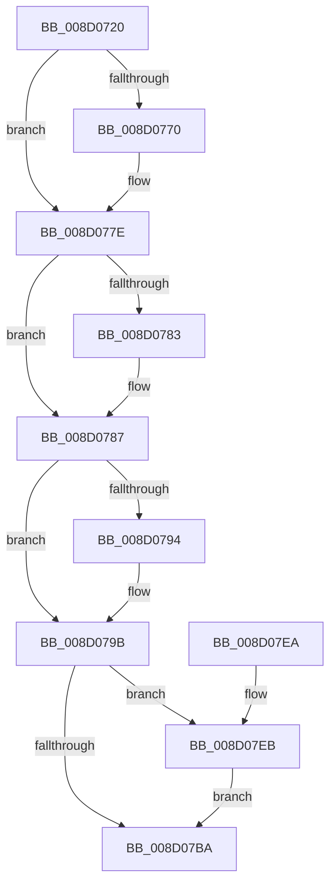

# sub_008D0720

- RVA: `0x008D0720`–`0x008D07F5` (길이 `213` bytes)
- VA: `0x00000001408D0720`
- 실행 섹션: `PAGE`
- PDB 이름 있음: `아니요`; PDB Function 태그: `아니요`
- unwind 정보 RVA: `0x000841B4`
- 디코드: `59`개 명령, `213/213` bytes 표시
- 미해석 바이트: `0` (있으면 어셈블리에 `.byte`로 보존)

> 이 문서는 커널 이미지의 기계어와 PDB 기호를 분석해 생성했습니다. 4번과 5번은 함수 원형과 자료형을 바이너리 사용 방식에서 추정한 C 해석이며 원본 소스 복구 결과는 아닙니다.

## 1. Dependencies

- 직접 호출 지점: **6**; 고유 호출 대상: **6**
- 직접 호출자로 확인된 함수: **1**
- RIP 상대 이미지 참조: **0**

### Outgoing calls
- `0x008D0760` → [KeAbPreAcquire](../../text/21/KeAbPreAcquire_function_00210230.md) (function, `0x00210230`)
- `0x008D0779` → [ExfAcquirePushLockExclusiveEx](../../text/20/ExfAcquirePushLockExclusiveEx_function_0020FC90.md) (function, `0x0020FC90`)
- `0x008D07BD` → [KeAbPostRelease](../../text/2E/KeAbPostRelease_function_002E1600.md) (function, `0x002E1600`)
- `0x008D07C2` → [KeLeaveGuardedRegion](../../text/2E/KeLeaveGuardedRegion_function_002E2C40.md) (function, `0x002E2C40`)
- `0x008D07CA` → [sub_008D4254](Unknown_function_008D4254.md) (function, `0x008D4254`)
- `0x008D07EE` → [ExfTryToWakePushLock](../../text/26/ExfTryToWakePushLock_function_00265DD0.md) (function, `0x00265DD0`)

### Direct callers
- [sub_008D18D4](Unknown_function_008D18D4.md) at `0x008D19AA`

### Static image references
- 디코드된 RIP-relative 메모리 참조가 없습니다.

## 2. Other-region calls and transfers

- 다른 실행 섹션으로 향하는 call: **5**
  - `0x008D0760` → [KeAbPreAcquire](../../text/21/KeAbPreAcquire_function_00210230.md) (`PAGE` → `.text`)
  - `0x008D0779` → [ExfAcquirePushLockExclusiveEx](../../text/20/ExfAcquirePushLockExclusiveEx_function_0020FC90.md) (`PAGE` → `.text`)
  - `0x008D07BD` → [KeAbPostRelease](../../text/2E/KeAbPostRelease_function_002E1600.md) (`PAGE` → `.text`)
  - `0x008D07C2` → [KeLeaveGuardedRegion](../../text/2E/KeLeaveGuardedRegion_function_002E2C40.md) (`PAGE` → `.text`)
  - `0x008D07EE` → [ExfTryToWakePushLock](../../text/26/ExfTryToWakePushLock_function_00265DD0.md) (`PAGE` → `.text`)
- 별도 외부 분기/꼬리 이동을 확인하지 못했습니다.

## 3. Assembly (complete function range)

```asm
008D0720  48 8B C4                        mov rax, rsp
008D0723  48 89 58 08                     mov qword ptr [rax + 8], rbx
008D0727  48 89 68 10                     mov qword ptr [rax + 0x10], rbp
008D072B  48 89 70 18                     mov qword ptr [rax + 0x18], rsi
008D072F  48 89 78 20                     mov qword ptr [rax + 0x20], rdi
008D0733  41 56                           push r14
008D0735  48 83 EC 20                     sub rsp, 0x20
008D0739  65 48 8B 04 25 88 01 00 00      mov rax, qword ptr gs:[0x188]
008D0742  48 8D 79 50                     lea rdi, [rcx + 0x50]
008D0746  48 8B F2                        mov rsi, rdx
008D0749  4C 8B F1                        mov r14, rcx
008D074C  48 83 CB FF                     or rbx, 0xffffffffffffffff
008D0750  45 33 C0                        xor r8d, r8d
008D0753  33 D2                           xor edx, edx
008D0755  48 8B CF                        mov rcx, rdi
008D0758  66 01 98 E6 01 00 00            add word ptr [rax + 0x1e6], bx
008D075F  90                              nop
008D0760  E8 CB FA 93 FF                  call 0x140210230
008D0765  F0 48 0F BA 2F 00               lock bts qword ptr [rdi], 0
008D076B  48 8B E8                        mov rbp, rax
008D076E  73 0E                           jae 0x1408d077e
008D0770  4C 8B C7                        mov r8, rdi
008D0773  48 8B D0                        mov rdx, rax
008D0776  48 8B CF                        mov rcx, rdi
008D0779  E8 12 F5 93 FF                  call 0x14020fc90
008D077E  48 85 ED                        test rbp, rbp
008D0781  74 04                           je 0x1408d0787
008D0783  C6 45 0A 01                     mov byte ptr [rbp + 0xa], 1
008D0787  49 8D 46 40                     lea rax, [r14 + 0x40]
008D078B  48 8B 48 08                     mov rcx, qword ptr [rax + 8]
008D078F  48 39 01                        cmp qword ptr [rcx], rax
008D0792  74 07                           je 0x1408d079b
008D0794  B9 03 00 00 00                  mov ecx, 3
008D0799  CD 29                           int 0x29
008D079B  48 89 06                        mov qword ptr [rsi], rax
008D079E  48 89 4E 08                     mov qword ptr [rsi + 8], rcx
008D07A2  48 89 31                        mov qword ptr [rcx], rsi
008D07A5  48 89 70 08                     mov qword ptr [rax + 8], rsi
008D07A9  83 4E 10 01                     or dword ptr [rsi + 0x10], 1
008D07AD  F0 48 0F C1 1F                  lock xadd qword ptr [rdi], rbx
008D07B2  80 E3 06                        and bl, 6
008D07B5  80 FB 02                        cmp bl, 2
008D07B8  74 31                           je 0x1408d07eb
008D07BA  48 8B CF                        mov rcx, rdi
008D07BD  E8 3E 0E A1 FF                  call 0x1402e1600
008D07C2  E8 79 24 A1 FF                  call 0x1402e2c40
008D07C7  48 8B CE                        mov rcx, rsi
008D07CA  E8 85 3A 00 00                  call 0x1408d4254
008D07CF  48 8B 5C 24 30                  mov rbx, qword ptr [rsp + 0x30]
008D07D4  48 8B 6C 24 38                  mov rbp, qword ptr [rsp + 0x38]
008D07D9  48 8B 74 24 40                  mov rsi, qword ptr [rsp + 0x40]
008D07DE  48 8B 7C 24 48                  mov rdi, qword ptr [rsp + 0x48]
008D07E3  48 83 C4 20                     add rsp, 0x20
008D07E7  41 5E                           pop r14
008D07E9  C3                              ret
008D07EA  CC                              int3
008D07EB  48 8B CF                        mov rcx, rdi
008D07EE  E8 DD 55 99 FF                  call 0x140265dd0
008D07F3  EB C5                           jmp 0x1408d07ba
```

## 4. C-style interpretation (structured pseudocode)

```c
__int64 __fastcall sub_008D0720(__int64 a1, __int64 a2, int a3)
{
    __int64 result;
    __int64 v_rbx;
    __int64 v_rsp;
    unsigned __int64 v_stack_p10;
    unsigned __int64 v_stack_p18;
    unsigned __int64 v_stack_p20;
    unsigned __int64 v_stack_p8;

    *(unsigned __int64 *)(v_rsp + 8) = v_rbx;
    *(unsigned __int64 *)(v_rsp + 16) = v_rbp;
    *(unsigned __int64 *)(v_rsp + 24) = v_rsi;
    *(unsigned __int64 *)(v_rsp + 32) = v_rdi;
    v_rsp = (v_rsp) - (32);
    v_rbx = (v_rbx) | (-1);
    a3 = 0;
    a2 = 0;
    result = KeAbPreAcquire(a1 + 80, a2, a3, a4);
    if (!(condition_is_above_or_equal)) {
        a3 = a1 + 80;
        a2 = result;
        a1 = a1 + 80;
        result = ExfAcquirePushLockExclusiveEx(a1, a2, a3, a4);
    }
    if (result != 0) {
        *(unsigned __int8 *)(result + 10) = 1;
    }
    if ((*(unsigned __int64 *)(*(unsigned __int64 *)(a1 + 64 + 8))) != (a1 + 64)) {
        a1 = 3;
    }
    *(unsigned __int64 *)(a2) = a1 + 64;
    *(unsigned __int64 *)(a2 + 8) = a1;
    *(unsigned __int64 *)(a1) = a2;
    *(unsigned __int64 *)(a1 + 64 + 8) = a2;
    v_rbx = (unsigned __int8)((v_rbx) & (6));
    if (((unsigned __int8)(v_rbx)) == 2) goto loc_008D07EB;
loc_008D07BA:
    result = KeAbPostRelease(a1 + 80, a2, a3, a4);
    result = KeLeaveGuardedRegion(a1 + 80, a2, a3, a4);
    result = sub_008D4254(a2, a2, a3, a4);
    v_rsp = (v_rsp) + (32);
    return result;
loc_008D07EB:
    result = ExfTryToWakePushLock(v_stack_p20, a2, a3, a4);
    goto loc_008D07BA;
}
```

## 5. (Beta) C Style

```c
int64_t sub_008D0720(void *Arg1, void *Arg2, int32_t Arg3)
{
    uint8_t *arg1 = (uint8_t *)Arg1;
    uint8_t *arg2 = (uint8_t *)Arg2;

    int64_t result;
    int64_t local_rbx;
    int64_t local_rsp;
    uint64_t v_stack_p10;
    uint64_t v_stack_p18;
    uint64_t v_stack_p20;
    uint64_t v_stack_p8;

    *(uint64_t *)(local_rsp + 0x8) = local_rbx;
    *(uint64_t *)(local_rsp + 0x10) = local_rbp;
    *(uint64_t *)(local_rsp + 0x18) = local_rsi;
    *(uint64_t *)(local_rsp + 0x20) = local_rdi;
    local_rsp = (local_rsp) - (32);
    local_rbx = (local_rbx) | (-1);
    Arg3 = 0;
    Arg2 = 0;
    result = KeAbPreAcquire(Arg1 + 80, Arg2, Arg3, a4);
    if (!(condition_is_above_or_equal)) {
        Arg3 = Arg1 + 80;
        Arg2 = result;
        Arg1 = Arg1 + 80;
        result = ExfAcquirePushLockExclusiveEx(Arg1, Arg2, Arg3, a4);
    }
    if (result != 0) {
        *(uint8_t *)(result + 0xA) = 1;
    }
    if ((*(uint64_t *)(*(uint64_t *)(arg1 + 0x40 + 0x8))) != (Arg1 + 64)) {
        Arg1 = 3;
    }
    *(void **)(arg2) = Arg1 + 64;
    *(void **)(arg2 + 0x8) = Arg1;
    *(void **)(arg1) = Arg2;
    *(void **)(arg1 + 0x40 + 0x8) = Arg2;
    local_rbx = (uint8_t)((local_rbx) & (6));
    if (((uint8_t)(local_rbx)) == 2) goto loc_008D07EB;
loc_008D07BA:
    result = KeAbPostRelease(Arg1 + 80, Arg2, Arg3, a4);
    result = KeLeaveGuardedRegion(Arg1 + 80, Arg2, Arg3, a4);
    result = sub_008D4254(Arg2, Arg2, Arg3, a4);
    local_rsp = (local_rsp) + (32);
    return result;
loc_008D07EB:
    result = ExfTryToWakePushLock(v_stack_p20, Arg2, Arg3, a4);
    goto loc_008D07BA;
}
```

### 관측된 메모리 오프셋

구조체 형식이 확인되지 않은 접근은 인자 기준의 오프셋으로만 기록했습니다.

| 기준 인자 | 오프셋 표현 | 폭 (bit) | 접근 |
|---|---:|---:|---|
| `Arg1` | `+ 0x0` | `64` | `R/W` |
| `Arg1` | `+ 0x8` | `64` | `R` |
| `Arg1` | `+ 0x8` | `64` | `W` |
| `Arg1` | `+ 0x40` | `64` | `R` |
| `Arg1` | `+ 0x50` | `64` | `R` |
| `Arg2` | `+ 0x0` | `64` | `W` |
| `Arg2` | `+ 0x8` | `64` | `W` |
| `Arg2` | `+ 0x10` | `32` | `R/W` |

## 6. Execution-region graph

[열기: 2D/3D 그래프와 함수 탐색 컨트롤 패널](../../../control-panel.html?section=page&rva=0x008D0720&view=graph)

- 2D 그래프는 위에서 아래로 흐르고, 3D 그래프는 빈 공간을 드래그해 회전합니다. Shift+드래그는 이동, 휠은 확대·축소, 함수 노드 선택은 대상 보고서 이동입니다.

### Static fallback


