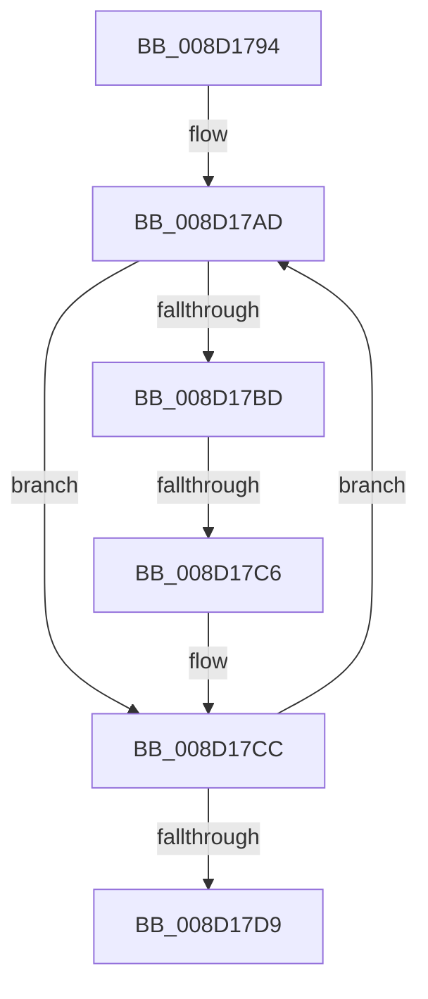

# sub_008D1794

- RVA: `0x008D1794`–`0x008D17E4` (길이 `80` bytes)
- VA: `0x00000001408D1794`
- 실행 섹션: `PAGE`
- PDB 이름 있음: `아니요`; PDB Function 태그: `아니요`
- unwind 정보 RVA: `0x00084B98`
- 디코드: `25`개 명령, `80/80` bytes 표시
- 미해석 바이트: `0` (있으면 어셈블리에 `.byte`로 보존)

> 이 문서는 커널 이미지의 기계어와 PDB 기호를 분석해 생성했습니다. 4번과 5번은 함수 원형과 자료형을 바이너리 사용 방식에서 추정한 C 해석이며 원본 소스 복구 결과는 아닙니다.

## 1. Dependencies

- 직접 호출 지점: **0**; 고유 호출 대상: **0**
- 직접 호출자로 확인된 함수: **0**
- RIP 상대 이미지 참조: **0**

### Outgoing calls
- 직접 디코드된 call 명령이 없습니다.

### Direct callers
- 이 함수 시작 RVA로 연결되는 직접 call은 확인되지 않았습니다. 간접 호출은 완전히 역산할 수 없습니다.

### Static image references
- 디코드된 RIP-relative 메모리 참조가 없습니다.

## 2. Other-region calls and transfers

- 다른 실행 섹션으로 향하는 call: **0**
- call이 아닌 외부 분기/꼬리 이동: **2**
  - `0x008D17C4` → [sub_008D1836](Unknown_function_008D1836.md) (`tail-transfer`)
  - `0x008D17E2` → [sub_008D17E4 + 0x11](Unknown_function_008D17E4.md) (`tail-transfer`)

## 3. Assembly (complete function range)

```asm
008D1794  4C 89 7C 24 50                  mov qword ptr [rsp + 0x50], r15
008D1799  44 8D 42 01                     lea r8d, [rdx + 1]
008D179D  44 8B FB                        mov r15d, ebx
008D17A0  8B FA                           mov edi, edx
008D17A2  44 0F AF FD                     imul r15d, ebp
008D17A6  44 8B F2                        mov r14d, edx
008D17A9  49 8B 6B 28                     mov rbp, qword ptr [r11 + 0x28]
008D17AD  41 8D 0C 3F                     lea ecx, [r15 + rdi]
008D17B1  48 0F A3 4D 00                  bt qword ptr [rbp], rcx
008D17B6  0F 92 C0                        setb al
008D17B9  84 C0                           test al, al
008D17BB  74 0F                           je 0x1408d17cc
008D17BD  49 8B 43 30                     mov rax, qword ptr [r11 + 0x30]
008D17C1  48 85 C0                        test rax, rax
008D17C4  74 70                           je 0x1408d1836
008D17C6  41 8B 0C 06                     mov ecx, dword ptr [r14 + rax]
008D17CA  0B D1                           or edx, ecx
008D17CC  FF C7                           inc edi
008D17CE  41 D1 C0                        rol r8d, 1
008D17D1  49 83 C6 04                     add r14, 4
008D17D5  3B FB                           cmp edi, ebx
008D17D7  72 D4                           jb 0x1408d17ad
008D17D9  4C 8B 7C 24 50                  mov r15, qword ptr [rsp + 0x50]
008D17DE  41 8B 41 08                     mov eax, dword ptr [r9 + 8]
008D17E2  EB 11                           jmp 0x1408d17f5
```

## 4. C-style interpretation (structured pseudocode)

```c
__int64 __fastcall sub_008D1794(__int64 a1, __int64 a2, __int64 a3, __int64 a4, __int64 a5, __int64 a6, __int64 a7, __int64 a8, __int64 a9, __int64 a10)
{
    __int64 result;
    __int64 v_r14;
    __int64 v_r15;
    __int64 v_rdi;
    unsigned __int64 v_stack_p50;

    v_stack_p50 = v_r15;
    v_r15 = (unsigned int)(((unsigned int)((unsigned int)(v_rbx))) * ((unsigned int)(v_rbp)));
loc_008D17AD:
    result = (condition_is_below) ? 1 : 0;
    if ((unsigned __int8)(result) == 0) goto loc_008D17CC;
    a2 = (unsigned int)((a2) | ((unsigned int)((unsigned int)(*(unsigned int *)((unsigned int)((unsigned int)(a2)) + *(unsigned __int64 *)(v_r11 + 48) * 1)))));
loc_008D17CC:
    v_rdi = (unsigned int)(((unsigned int)((unsigned int)(a2))) + 1);
    v_r14 = ((unsigned int)((unsigned int)(a2))) + (4);
    if (((unsigned int)(v_rdi)) < ((unsigned int)(v_rbx))) goto loc_008D17AD;
}
```

## 5. (Beta) C Style

```c
int64_t sub_008D1794(int64_t Arg1, void *Arg2, int64_t Arg3, void *Arg4, uint64_t Arg5, uint64_t Arg6, uint64_t Arg7, uint64_t Arg8, uint64_t Arg9, int64_t Arg10)
{
    uint8_t *arg2 = (uint8_t *)Arg2;
    uint8_t *arg4 = (uint8_t *)Arg4;

    int64_t result;
    int64_t local_r14;
    int64_t local_r15;
    int64_t local_rdi;
    uint64_t v_stack_p50;

    v_stack_p50 = local_r15;
    local_r15 = (uint32_t)(((uint32_t)((uint32_t)(local_rbx))) * ((uint32_t)(local_rbp)));
loc_008D17AD:
    result = (condition_is_below) ? 1 : 0;
    if ((uint8_t)(result) == 0) goto loc_008D17CC;
    Arg2 = (uint32_t)((Arg2) | ((uint32_t)((uint32_t)(*(uint32_t *)((uint32_t)((uint32_t)(arg2)) + *(uint64_t *)(local_r11 + 0x30) * 1)))));
loc_008D17CC:
    local_rdi = (uint32_t)(((uint32_t)((uint32_t)(Arg2))) + 1);
    local_r14 = ((uint32_t)((uint32_t)(Arg2))) + (4);
    if (((uint32_t)(local_rdi)) < ((uint32_t)(local_rbx))) goto loc_008D17AD;
}
```

### 관측된 메모리 오프셋

구조체 형식이 확인되지 않은 접근은 인자 기준의 오프셋으로만 기록했습니다.

| 기준 인자 | 오프셋 표현 | 폭 (bit) | 접근 |
|---|---:|---:|---|
| `Arg2` | `+ 0x0 + rax*1` | `32` | `R` |
| `Arg2` | `+ 0x1` | `32` | `R` |
| `Arg4` | `+ 0x8` | `32` | `R` |

## 6. Execution-region graph

[열기: 2D/3D 그래프와 함수 탐색 컨트롤 패널](../../../control-panel.html?section=page&rva=0x008D1794&view=graph)

- 2D 그래프는 위에서 아래로 흐르고, 3D 그래프는 빈 공간을 드래그해 회전합니다. Shift+드래그는 이동, 휠은 확대·축소, 함수 노드 선택은 대상 보고서 이동입니다.

### Static fallback


