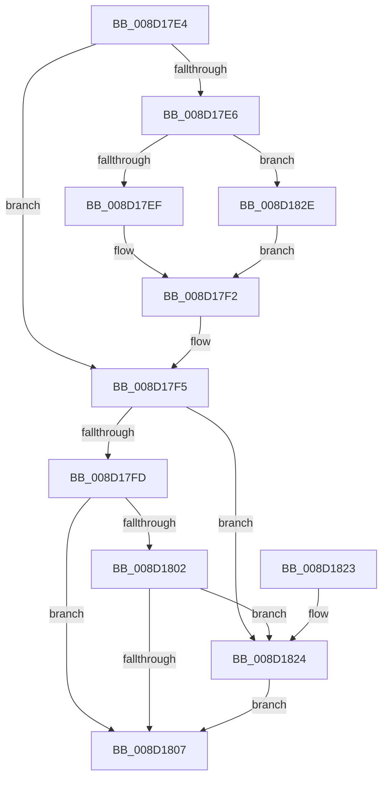

# sub_008D17E4

- RVA: `0x008D17E4`–`0x008D1836` (길이 `82` bytes)
- VA: `0x00000001408D17E4`
- 실행 섹션: `PAGE`
- PDB 이름 있음: `아니요`; PDB Function 태그: `아니요`
- unwind 정보 RVA: `0x00084BAC`
- 디코드: `28`개 명령, `82/82` bytes 표시
- 미해석 바이트: `0` (있으면 어셈블리에 `.byte`로 보존)

> 이 문서는 커널 이미지의 기계어와 PDB 기호를 분석해 생성했습니다. 4번과 5번은 함수 원형과 자료형을 바이너리 사용 방식에서 추정한 C 해석이며 원본 소스 복구 결과는 아닙니다.

## 1. Dependencies

- 직접 호출 지점: **1**; 고유 호출 대상: **1**
- 직접 호출자로 확인된 함수: **0**
- RIP 상대 이미지 참조: **0**

### Outgoing calls
- `0x008D1827` → [MiImageCfgEnumNextImageExtensionRva](MiImageCfgEnumNextImageExtensionRva_function_008D1860.md) (function, `0x008D1860`)

### Direct callers
- 이 함수 시작 RVA로 연결되는 직접 call은 확인되지 않았습니다. 간접 호출은 완전히 역산할 수 없습니다.

### Static image references
- 디코드된 RIP-relative 메모리 참조가 없습니다.

## 2. Other-region calls and transfers

- 다른 실행 섹션으로 향하는 call: **0**
- 별도 외부 분기/꼬리 이동을 확인하지 못했습니다.

## 3. Assembly (complete function range)

```asm
008D17E4  75 0F                           jne 0x1408d17f5
008D17E6  4D 8B 43 30                     mov r8, qword ptr [r11 + 0x30]
008D17EA  4D 85 C0                        test r8, r8
008D17ED  74 3F                           je 0x1408d182e
008D17EF  45 8B 00                        mov r8d, dword ptr [r8]
008D17F2  41 8B D0                        mov edx, r8d
008D17F5  41 89 14 24                     mov dword ptr [r12], edx
008D17F9  85 C0                           test eax, eax
008D17FB  74 27                           je 0x1408d1824
008D17FD  41 3B C2                        cmp eax, r10d
008D1800  72 05                           jb 0x1408d1807
008D1802  45 85 D2                        test r10d, r10d
008D1805  75 1D                           jne 0x1408d1824
008D1807  48 8B 5C 24 58                  mov rbx, qword ptr [rsp + 0x58]
008D180C  48 8B 6C 24 60                  mov rbp, qword ptr [rsp + 0x60]
008D1811  48 8B 74 24 68                  mov rsi, qword ptr [rsp + 0x68]
008D1816  41 89 01                        mov dword ptr [r9], eax
008D1819  48 83 C4 30                     add rsp, 0x30
008D181D  41 5E                           pop r14
008D181F  41 5C                           pop r12
008D1821  5F                              pop rdi
008D1822  C3                              ret
008D1823  CC                              int3
008D1824  49 8B C9                        mov rcx, r9
008D1827  E8 34 00 00 00                  call 0x1408d1860
008D182C  EB D9                           jmp 0x1408d1807
008D182E  41 B8 01 00 00 00               mov r8d, 1
008D1834  EB BC                           jmp 0x1408d17f2
```

## 4. C-style interpretation (structured pseudocode)

```c
__int64 __fastcall sub_008D17E4(__int64 a1, __int64 a2, __int64 a3, __int64 a4, __int64 a5, __int64 a6, __int64 a7, __int64 a8, __int64 a9, __int64 a10, __int64 a11, __int64 a12, __int64 a13)
{
    __int64 result;
    __int64 v_rsp;

    if (condition_is_not_equal) goto loc_008D17F5;
    if (*(unsigned __int64 *)(v_r11 + 48) == 0) goto loc_008D182E;
loc_008D17F2:
loc_008D17F5:
    *(unsigned int *)(v_r12) = (unsigned int)((unsigned int)((unsigned int)((unsigned int)(*(unsigned int *)(*(unsigned __int64 *)(v_r11 + 48))))));
    if ((unsigned int)(result) == 0) goto loc_008D1824;
    if (((unsigned int)(result)) < ((unsigned int)(v_r10))) goto loc_008D1807;
    if ((unsigned int)(v_r10) != 0) goto loc_008D1824;
loc_008D1807:
    *(unsigned int *)(a4) = (unsigned int)(result);
    v_rsp = (v_rsp) + (48);
    return result;
loc_008D1824:
    result = MiImageCfgEnumNextImageExtensionRva(a4, (unsigned int)((unsigned int)((unsigned int)(*(unsigned int *)(*(unsigned __int64 *)(v_r11 + 48))))), (unsigned int)(*(unsigned int *)(*(unsigned __int64 *)(v_r11 + 48))), a4);
    goto loc_008D1807;
loc_008D182E:
    goto loc_008D17F2;
}
```

## 5. (Beta) C Style

```c
int64_t sub_008D17E4(int64_t Arg1, int64_t Arg2, int64_t Arg3, int64_t Arg4, uint64_t Arg5, uint64_t Arg6, uint64_t Arg7, uint64_t Arg8, uint64_t Arg9, uint64_t Arg10, int64_t Arg11, int64_t Arg12, int64_t Arg13)
{
    int64_t result;
    int64_t local_rsp;

    if (condition_is_not_equal) goto loc_008D17F5;
    if (*(uint64_t *)(local_r11 + 0x30) == 0) goto loc_008D182E;
loc_008D17F2:
loc_008D17F5:
    *(uint32_t *)(local_r12) = (uint32_t)((uint32_t)((uint32_t)((uint32_t)(*(uint32_t *)(*(uint64_t *)(local_r11 + 0x30))))));
    if ((uint32_t)(result) == 0) goto loc_008D1824;
    if (((uint32_t)(result)) < ((uint32_t)(local_r10))) goto loc_008D1807;
    if ((uint32_t)(local_r10) != 0) goto loc_008D1824;
loc_008D1807:
    *(uint32_t *)(Arg4) = (uint32_t)(result);
    local_rsp = (local_rsp) + (48);
    return result;
loc_008D1824:
    result = MiImageCfgEnumNextImageExtensionRva(Arg4, (uint32_t)((uint32_t)((uint32_t)(*(uint32_t *)(*(uint64_t *)(local_r11 + 0x30))))), (uint32_t)(*(uint32_t *)(*(uint64_t *)(local_r11 + 0x30))), Arg4);
    goto loc_008D1807;
loc_008D182E:
    goto loc_008D17F2;
}
```

## 6. Execution-region graph

[열기: 2D/3D 그래프와 함수 탐색 컨트롤 패널](../../../control-panel.html?section=page&rva=0x008D17E4&view=graph)

- 2D 그래프는 위에서 아래로 흐르고, 3D 그래프는 빈 공간을 드래그해 회전합니다. Shift+드래그는 이동, 휠은 확대·축소, 함수 노드 선택은 대상 보고서 이동입니다.

### Static fallback


