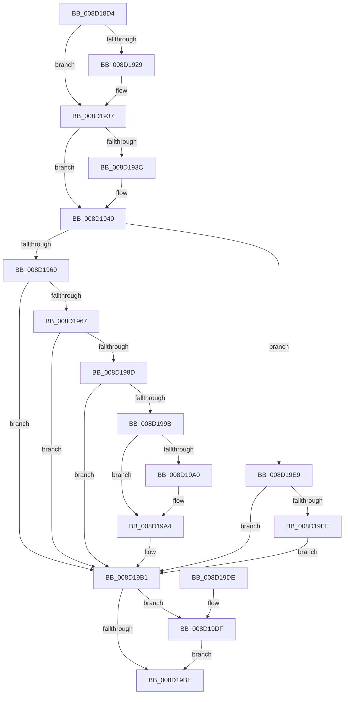

# sub_008D18D4

- RVA: `0x008D18D4`–`0x008D19F8` (길이 `292` bytes)
- VA: `0x00000001408D18D4`
- 실행 섹션: `PAGE`
- PDB 이름 있음: `아니요`; PDB Function 태그: `아니요`
- unwind 정보 RVA: `0x00084BF8`
- 디코드: `88`개 명령, `292/292` bytes 표시
- 미해석 바이트: `0` (있으면 어셈블리에 `.byte`로 보존)

> 이 문서는 커널 이미지의 기계어와 PDB 기호를 분석해 생성했습니다. 4번과 5번은 함수 원형과 자료형을 바이너리 사용 방식에서 추정한 C 해석이며 원본 소스 복구 결과는 아닙니다.

## 1. Dependencies

- 직접 호출 지점: **9**; 고유 호출 대상: **9**
- 직접 호출자로 확인된 함수: **1**
- RIP 상대 이미지 참조: **0**

### Outgoing calls
- `0x008D1919` → [KeAbPreAcquire](../../text/21/KeAbPreAcquire_function_00210230.md) (function, `0x00210230`)
- `0x008D1932` → [ExfAcquirePushLockExclusiveEx](../../text/20/ExfAcquirePushLockExclusiveEx_function_0020FC90.md) (function, `0x0020FC90`)
- `0x008D1951` → [sub_008D32D4](Unknown_function_008D32D4.md) (function, `0x008D32D4`)
- `0x008D1982` → [sub_008D0970](Unknown_function_008D0970.md) (function, `0x008D0970`)
- `0x008D1990` → [sub_008D4254](Unknown_function_008D4254.md) (function, `0x008D4254`)
- `0x008D19AA` → [sub_008D0720](Unknown_function_008D0720.md) (function, `0x008D0720`)
- `0x008D19C1` → [KeAbPostRelease](../../text/2E/KeAbPostRelease_function_002E1600.md) (function, `0x002E1600`)
- `0x008D19C6` → [KeLeaveGuardedRegion](../../text/2E/KeLeaveGuardedRegion_function_002E2C40.md) (function, `0x002E2C40`)
- `0x008D19E2` → [ExfTryToWakePushLock](../../text/26/ExfTryToWakePushLock_function_00265DD0.md) (function, `0x00265DD0`)

### Direct callers
- [sub_008D2F2C](Unknown_function_008D2F2C.md) at `0x008D325B`

### Static image references
- 디코드된 RIP-relative 메모리 참조가 없습니다.

## 2. Other-region calls and transfers

- 다른 실행 섹션으로 향하는 call: **5**
  - `0x008D1919` → [KeAbPreAcquire](../../text/21/KeAbPreAcquire_function_00210230.md) (`PAGE` → `.text`)
  - `0x008D1932` → [ExfAcquirePushLockExclusiveEx](../../text/20/ExfAcquirePushLockExclusiveEx_function_0020FC90.md) (`PAGE` → `.text`)
  - `0x008D19C1` → [KeAbPostRelease](../../text/2E/KeAbPostRelease_function_002E1600.md) (`PAGE` → `.text`)
  - `0x008D19C6` → [KeLeaveGuardedRegion](../../text/2E/KeLeaveGuardedRegion_function_002E2C40.md) (`PAGE` → `.text`)
  - `0x008D19E2` → [ExfTryToWakePushLock](../../text/26/ExfTryToWakePushLock_function_00265DD0.md) (`PAGE` → `.text`)
- 별도 외부 분기/꼬리 이동을 확인하지 못했습니다.

## 3. Assembly (complete function range)

```asm
008D18D4  48 89 5C 24 10                  mov qword ptr [rsp + 0x10], rbx
008D18D9  55                              push rbp
008D18DA  56                              push rsi
008D18DB  57                              push rdi
008D18DC  41 56                           push r14
008D18DE  41 57                           push r15
008D18E0  48 83 EC 30                     sub rsp, 0x30
008D18E4  65 48 8B 04 25 88 01 00 00      mov rax, qword ptr gs:[0x188]
008D18ED  48 8D 71 30                     lea rsi, [rcx + 0x30]
008D18F1  83 64 24 60 00                  and dword ptr [rsp + 0x60], 0
008D18F6  4D 8B F0                        mov r14, r8
008D18F9  48 83 64 24 78 00               and qword ptr [rsp + 0x78], 0
008D18FF  48 8B EA                        mov rbp, rdx
008D1902  4C 8B F9                        mov r15, rcx
008D1905  48 83 CB FF                     or rbx, 0xffffffffffffffff
008D1909  66 01 98 E6 01 00 00            add word ptr [rax + 0x1e6], bx
008D1910  45 33 C0                        xor r8d, r8d
008D1913  33 D2                           xor edx, edx
008D1915  48 8B CE                        mov rcx, rsi
008D1918  90                              nop
008D1919  E8 12 E9 93 FF                  call 0x140210230
008D191E  F0 48 0F BA 2E 00               lock bts qword ptr [rsi], 0
008D1924  48 8B F8                        mov rdi, rax
008D1927  73 0E                           jae 0x1408d1937
008D1929  4C 8B C6                        mov r8, rsi
008D192C  48 8B D0                        mov rdx, rax
008D192F  48 8B CE                        mov rcx, rsi
008D1932  E8 59 E3 93 FF                  call 0x14020fc90
008D1937  48 85 FF                        test rdi, rdi
008D193A  74 04                           je 0x1408d1940
008D193C  C6 47 0A 01                     mov byte ptr [rdi + 0xa], 1
008D1940  48 8B 55 30                     mov rdx, qword ptr [rbp + 0x30]
008D1944  4C 8D 4C 24 60                  lea r9, [rsp + 0x60]
008D1949  4C 8D 44 24 78                  lea r8, [rsp + 0x78]
008D194E  49 8B CF                        mov rcx, r15
008D1951  E8 7E 19 00 00                  call 0x1408d32d4
008D1956  8B F8                           mov edi, eax
008D1958  85 C0                           test eax, eax
008D195A  0F 89 89 00 00 00               jns 0x1408d19e9
008D1960  3D 72 02 00 C0                  cmp eax, 0xc0000272
008D1965  75 4A                           jne 0x1408d19b1
008D1967  8B 44 24 60                     mov eax, dword ptr [rsp + 0x60]
008D196B  49 8D 4F 08                     lea rcx, [r15 + 8]
008D196F  4C 8B 4D 30                     mov r9, qword ptr [rbp + 0x30]
008D1973  48 8B D5                        mov rdx, rbp
008D1976  89 44 24 28                     mov dword ptr [rsp + 0x28], eax
008D197A  C7 44 24 20 08 00 00 00         mov dword ptr [rsp + 0x20], 8
008D1982  E8 E9 EF FF FF                  call 0x1408d0970
008D1987  8B F8                           mov edi, eax
008D1989  85 C0                           test eax, eax
008D198B  78 24                           js 0x1408d19b1
008D198D  48 8B CD                        mov rcx, rbp
008D1990  E8 BF 28 00 00                  call 0x1408d4254
008D1995  8B F8                           mov edi, eax
008D1997  85 C0                           test eax, eax
008D1999  78 16                           js 0x1408d19b1
008D199B  4D 85 F6                        test r14, r14
008D199E  74 04                           je 0x1408d19a4
008D19A0  49 83 26 00                     and qword ptr [r14], 0
008D19A4  48 8B D5                        mov rdx, rbp
008D19A7  49 8B CF                        mov rcx, r15
008D19AA  E8 71 ED FF FF                  call 0x1408d0720
008D19AF  8B F8                           mov edi, eax
008D19B1  F0 48 0F C1 1E                  lock xadd qword ptr [rsi], rbx
008D19B6  80 E3 06                        and bl, 6
008D19B9  80 FB 02                        cmp bl, 2
008D19BC  74 21                           je 0x1408d19df
008D19BE  48 8B CE                        mov rcx, rsi
008D19C1  E8 3A FC A0 FF                  call 0x1402e1600
008D19C6  E8 75 12 A1 FF                  call 0x1402e2c40
008D19CB  48 8B 5C 24 68                  mov rbx, qword ptr [rsp + 0x68]
008D19D0  8B C7                           mov eax, edi
008D19D2  48 83 C4 30                     add rsp, 0x30
008D19D6  41 5F                           pop r15
008D19D8  41 5E                           pop r14
008D19DA  5F                              pop rdi
008D19DB  5E                              pop rsi
008D19DC  5D                              pop rbp
008D19DD  C3                              ret
008D19DE  CC                              int3
008D19DF  48 8B CE                        mov rcx, rsi
008D19E2  E8 E9 43 99 FF                  call 0x140265dd0
008D19E7  EB D5                           jmp 0x1408d19be
008D19E9  4D 85 F6                        test r14, r14
008D19EC  74 C3                           je 0x1408d19b1
008D19EE  48 8B 4C 24 78                  mov rcx, qword ptr [rsp + 0x78]
008D19F3  49 89 0E                        mov qword ptr [r14], rcx
008D19F6  EB B9                           jmp 0x1408d19b1
```

## 4. C-style interpretation (structured pseudocode)

```c
__int64 __fastcall sub_008D18D4(__int64 a1, __int64 a2, __int64 a3)
{
    __int64 result;
    __int64 v_rbx;
    __int64 v_rsp;
    unsigned int v_stack_m30;
    unsigned int v_stack_m38;
    unsigned __int64 v_stack_p10;
    unsigned __int64 v_stack_p20;
    unsigned __int64 v_stack_p78;
    unsigned int v_stack_p8;

    v_stack_p10 = v_rbx;
    v_rsp = (v_rsp) - (48);
    v_rbx = (v_rbx) | (-1);
    a3 = 0;
    a2 = 0;
    result = KeAbPreAcquire(a1 + 48, a2, a3, a4);
    if (!(condition_is_above_or_equal)) {
        a3 = a1 + 48;
        a2 = result;
        a1 = a1 + 48;
        result = ExfAcquirePushLockExclusiveEx(a1, a2, a3, a4);
    }
    if (result != 0) {
        *(unsigned __int8 *)(result + 10) = 1;
    }
    result = sub_008D32D4(a1, *(unsigned __int64 *)(a2 + 48), v_stack_p20, v_stack_p8);
    if (!sign_flag) goto loc_008D19E9;
    if (((unsigned int)(result)) != 0xC0000272ULL) goto loc_008D19B1;
    v_stack_m30 = (unsigned int)((unsigned int)(v_stack_p8));
    v_stack_m38 = 8;
    result = sub_008D0970(a1 + 8, a2, v_stack_p20, *(unsigned __int64 *)(a2 + 48));
    if (sign_flag) goto loc_008D19B1;
    result = sub_008D4254(a2, a2, v_stack_p20, *(unsigned __int64 *)(a2 + 48));
    if (sign_flag) goto loc_008D19B1;
    if (a3 != 0) {
    }
    result = sub_008D0720(a1, a2, v_stack_p20, *(unsigned __int64 *)(a2 + 48));
loc_008D19B1:
    v_rbx = (unsigned __int8)((v_rbx) & (6));
    if (((unsigned __int8)(v_rbx)) == 2) goto loc_008D19DF;
loc_008D19BE:
    result = KeAbPostRelease(a1 + 48, a2, v_stack_p20, *(unsigned __int64 *)(a2 + 48));
    result = KeLeaveGuardedRegion(a1 + 48, a2, v_stack_p20, *(unsigned __int64 *)(a2 + 48));
    v_rsp = (v_rsp) + (48);
    return (unsigned int)((unsigned int)((unsigned int)((unsigned int)(result))));
loc_008D19DF:
    result = ExfTryToWakePushLock(a1 + 48, a2, v_stack_p20, *(unsigned __int64 *)(a2 + 48));
    goto loc_008D19BE;
loc_008D19E9:
    if (a3 == 0) goto loc_008D19B1;
    *(unsigned __int64 *)(a3) = v_stack_p78;
    goto loc_008D19B1;
}
```

## 5. (Beta) C Style

```c
int64_t sub_008D18D4(void *Arg1, void *Arg2, int64_t Arg3)
{
    uint8_t *arg1 = (uint8_t *)Arg1;
    uint8_t *arg2 = (uint8_t *)Arg2;

    int64_t result;
    int64_t local_rbx;
    int64_t local_rsp;
    uint32_t v_stack_m30;
    uint32_t v_stack_m38;
    uint64_t v_stack_p10;
    uint64_t v_stack_p20;
    uint64_t v_stack_p78;
    uint32_t v_stack_p8;

    v_stack_p10 = local_rbx;
    local_rsp = (local_rsp) - (48);
    local_rbx = (local_rbx) | (-1);
    Arg3 = 0;
    Arg2 = 0;
    result = KeAbPreAcquire(Arg1 + 48, Arg2, Arg3, a4);
    if (!(condition_is_above_or_equal)) {
        Arg3 = Arg1 + 48;
        Arg2 = result;
        Arg1 = Arg1 + 48;
        result = ExfAcquirePushLockExclusiveEx(Arg1, Arg2, Arg3, a4);
    }
    if (result != 0) {
        *(uint8_t *)(result + 0xA) = 1;
    }
    result = sub_008D32D4(Arg1, *(uint64_t *)(arg2 + 0x30), v_stack_p20, v_stack_p8);
    if (!sign_flag) goto loc_008D19E9;
    if (((uint32_t)(result)) != 0xC0000272ULL) goto loc_008D19B1;
    v_stack_m30 = (uint32_t)((uint32_t)(v_stack_p8));
    v_stack_m38 = 8;
    result = sub_008D0970(Arg1 + 8, Arg2, v_stack_p20, *(uint64_t *)(arg2 + 0x30));
    if (sign_flag) goto loc_008D19B1;
    result = sub_008D4254(Arg2, Arg2, v_stack_p20, *(uint64_t *)(arg2 + 0x30));
    if (sign_flag) goto loc_008D19B1;
    if (Arg3 != 0) {
    }
    result = sub_008D0720(Arg1, Arg2, v_stack_p20, *(uint64_t *)(arg2 + 0x30));
loc_008D19B1:
    local_rbx = (uint8_t)((local_rbx) & (6));
    if (((uint8_t)(local_rbx)) == 2) goto loc_008D19DF;
loc_008D19BE:
    result = KeAbPostRelease(Arg1 + 48, Arg2, v_stack_p20, *(uint64_t *)(arg2 + 0x30));
    result = KeLeaveGuardedRegion(Arg1 + 48, Arg2, v_stack_p20, *(uint64_t *)(arg2 + 0x30));
    local_rsp = (local_rsp) + (48);
    return (uint32_t)((uint32_t)((uint32_t)((uint32_t)(result))));
loc_008D19DF:
    result = ExfTryToWakePushLock(Arg1 + 48, Arg2, v_stack_p20, *(uint64_t *)(arg2 + 0x30));
    goto loc_008D19BE;
loc_008D19E9:
    if (Arg3 == 0) goto loc_008D19B1;
    *(uint64_t *)(Arg3) = v_stack_p78;
    goto loc_008D19B1;
}
```

### 관측된 메모리 오프셋

구조체 형식이 확인되지 않은 접근은 인자 기준의 오프셋으로만 기록했습니다.

| 기준 인자 | 오프셋 표현 | 폭 (bit) | 접근 |
|---|---:|---:|---|
| `Arg1` | `+ 0x0` | `64` | `R/W` |
| `Arg1` | `+ 0x8` | `64` | `R` |
| `Arg1` | `+ 0x30` | `64` | `R` |
| `Arg2` | `+ 0x30` | `64` | `R` |

## 6. Execution-region graph

[열기: 2D/3D 그래프와 함수 탐색 컨트롤 패널](../../../control-panel.html?section=page&rva=0x008D18D4&view=graph)

- 2D 그래프는 위에서 아래로 흐르고, 3D 그래프는 빈 공간을 드래그해 회전합니다. Shift+드래그는 이동, 휠은 확대·축소, 함수 노드 선택은 대상 보고서 이동입니다.

### Static fallback


