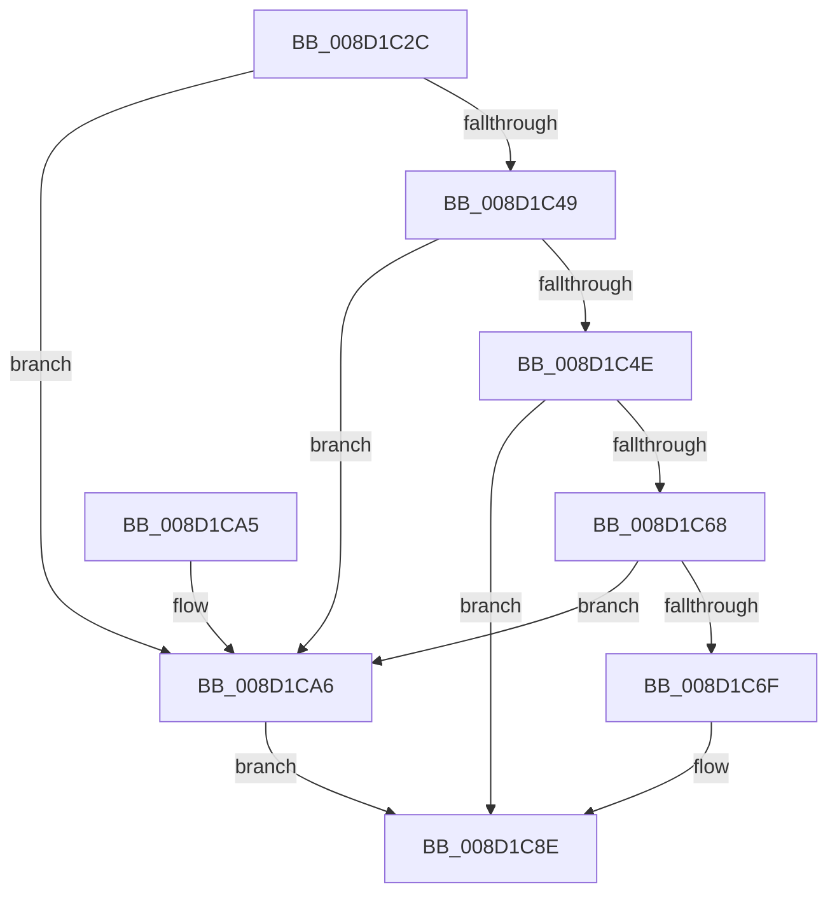

# sub_008D1C2C

- RVA: `0x008D1C2C`–`0x008D1CAD` (길이 `129` bytes)
- VA: `0x00000001408D1C2C`
- 실행 섹션: `PAGE`
- PDB 이름 있음: `아니요`; PDB Function 태그: `아니요`
- unwind 정보 RVA: `0x00084C2C`
- 디코드: `38`개 명령, `129/129` bytes 표시
- 미해석 바이트: `0` (있으면 어셈블리에 `.byte`로 보존)

> 이 문서는 커널 이미지의 기계어와 PDB 기호를 분석해 생성했습니다. 4번과 5번은 함수 원형과 자료형을 바이너리 사용 방식에서 추정한 C 해석이며 원본 소스 복구 결과는 아닙니다.

## 1. Dependencies

- 직접 호출 지점: **3**; 고유 호출 대상: **3**
- 직접 호출자로 확인된 함수: **3**
- RIP 상대 이미지 참조: **0**

### Outgoing calls
- `0x008D1C5D` → [sub_008D1E14](Unknown_function_008D1E14.md) (function, `0x008D1E14`)
- `0x008D1C7D` → [RtlCompareMemory](../../text/6B/RtlCompareMemory_function_006BA670.md) (function, `0x006BA670`)
- `0x008D1C93` → [PdcCloseEvent](PdcCloseEvent_function_008D2404.md) (function, `0x008D2404`)

### Direct callers
- [WbCreateHeapExecutedBlock](WbCreateHeapExecutedBlock_function_008D4BE8.md) at `0x008D4CE4`
- [sub_0099FE78](../99/Unknown_function_0099FE78.md) at `0x0099FF89`
- [sub_00B1B9DE](../B1/Unknown_function_00B1B9DE.md) at `0x00B1B9EB`

### Static image references
- 디코드된 RIP-relative 메모리 참조가 없습니다.

## 2. Other-region calls and transfers

- 다른 실행 섹션으로 향하는 call: **1**
  - `0x008D1C7D` → [RtlCompareMemory](../../text/6B/RtlCompareMemory_function_006BA670.md) (`PAGE` → `.text`)
- 별도 외부 분기/꼬리 이동을 확인하지 못했습니다.

## 3. Assembly (complete function range)

```asm
008D1C2C  48 8B C4                        mov rax, rsp
008D1C2F  48 89 58 10                     mov qword ptr [rax + 0x10], rbx
008D1C33  57                              push rdi
008D1C34  48 83 EC 20                     sub rsp, 0x20
008D1C38  48 83 60 18 00                  and qword ptr [rax + 0x18], 0
008D1C3D  48 8B F9                        mov rdi, rcx
008D1C40  83 60 08 00                     and dword ptr [rax + 8], 0
008D1C44  48 85 C9                        test rcx, rcx
008D1C47  74 5D                           je 0x1408d1ca6
008D1C49  83 FA 20                        cmp edx, 0x20
008D1C4C  76 58                           jbe 0x1408d1ca6
008D1C4E  83 C2 E0                        add edx, -0x20
008D1C51  4C 8D 48 08                     lea r9, [rax + 8]
008D1C55  48 83 C1 20                     add rcx, 0x20
008D1C59  4C 8D 40 18                     lea r8, [rax + 0x18]
008D1C5D  E8 B2 01 00 00                  call 0x1408d1e14
008D1C62  8B D8                           mov ebx, eax
008D1C64  85 C0                           test eax, eax
008D1C66  78 26                           js 0x1408d1c8e
008D1C68  83 7C 24 30 20                  cmp dword ptr [rsp + 0x30], 0x20
008D1C6D  75 37                           jne 0x1408d1ca6
008D1C6F  48 8B 54 24 40                  mov rdx, qword ptr [rsp + 0x40]
008D1C74  41 B8 20 00 00 00               mov r8d, 0x20
008D1C7A  48 8B CF                        mov rcx, rdi
008D1C7D  E8 EE 89 DE FF                  call 0x1406ba670
008D1C82  48 83 F8 20                     cmp rax, 0x20
008D1C86  B9 28 04 00 C0                  mov ecx, 0xc0000428
008D1C8B  0F 45 D9                        cmovne ebx, ecx
008D1C8E  48 8B 4C 24 40                  mov rcx, qword ptr [rsp + 0x40]
008D1C93  E8 6C 07 00 00                  call 0x1408d2404
008D1C98  8B C3                           mov eax, ebx
008D1C9A  48 8B 5C 24 38                  mov rbx, qword ptr [rsp + 0x38]
008D1C9F  48 83 C4 20                     add rsp, 0x20
008D1CA3  5F                              pop rdi
008D1CA4  C3                              ret
008D1CA5  CC                              int3
008D1CA6  BB 0D 00 00 C0                  mov ebx, 0xc000000d
008D1CAB  EB E1                           jmp 0x1408d1c8e
```

## 4. C-style interpretation (structured pseudocode)

```c
__int64 __fastcall sub_008D1C2C(__int64 a1, int a2)
{
    __int64 result;
    __int64 v_rbx;
    __int64 v_rsp;
    unsigned __int64 v_stack_p10;
    unsigned __int64 v_stack_p18;
    unsigned int v_stack_p8;

    *(unsigned __int64 *)(v_rsp + 16) = v_rbx;
    v_rsp = (v_rsp) - (32);
    if (a1 == 0) goto loc_008D1CA6;
    if (a2 <= 32) goto loc_008D1CA6;
    a2 = (unsigned int)((a2) + (-32));
    a1 = (a1) + (32);
    result = sub_008D1E14(a1, a2, v_rsp + 24, v_rsp + 8);
    if (sign_flag) goto loc_008D1C8E;
    if (v_stack_p8 != 32) goto loc_008D1CA6;
    result = RtlCompareMemory(a1, v_stack_p18, 32, v_rsp + 8);
    v_rbx = (unsigned int)((unsigned int)(result));
    if (result != 32) { v_rbx = (unsigned int)((unsigned int)(0xC0000428ULL)); }
loc_008D1C8E:
    result = PdcCloseEvent(v_stack_p18, v_stack_p18, 32, v_rsp + 8);
    v_rsp = (v_rsp) + (32);
    return (unsigned int)((unsigned int)(v_rbx));
loc_008D1CA6:
    goto loc_008D1C8E;
}
```

## 5. (Beta) C Style

```c
int64_t sub_008D1C2C(int64_t Arg1, int32_t Arg2)
{
    int64_t result;
    int64_t local_rbx;
    int64_t local_rsp;
    uint64_t v_stack_p10;
    uint64_t v_stack_p18;
    uint32_t v_stack_p8;

    *(uint64_t *)(local_rsp + 0x10) = local_rbx;
    local_rsp = (local_rsp) - (32);
    if (Arg1 == 0) goto loc_008D1CA6;
    if (Arg2 <= 32) goto loc_008D1CA6;
    Arg2 = (uint32_t)((Arg2) + (-32));
    Arg1 = (Arg1) + (32);
    result = sub_008D1E14(Arg1, Arg2, local_rsp + 24, local_rsp + 8);
    if (sign_flag) goto loc_008D1C8E;
    if (v_stack_p8 != 32) goto loc_008D1CA6;
    result = RtlCompareMemory(Arg1, v_stack_p18, 32, local_rsp + 8);
    local_rbx = (uint32_t)((uint32_t)(result));
    if (result != 32) { local_rbx = (uint32_t)((uint32_t)(0xC0000428ULL)); }
loc_008D1C8E:
    result = PdcCloseEvent(v_stack_p18, v_stack_p18, 32, local_rsp + 8);
    local_rsp = (local_rsp) + (32);
    return (uint32_t)((uint32_t)(local_rbx));
loc_008D1CA6:
    goto loc_008D1C8E;
}
```

## 6. Execution-region graph

[열기: 2D/3D 그래프와 함수 탐색 컨트롤 패널](../../../control-panel.html?section=page&rva=0x008D1C2C&view=graph)

- 2D 그래프는 위에서 아래로 흐르고, 3D 그래프는 빈 공간을 드래그해 회전합니다. Shift+드래그는 이동, 휠은 확대·축소, 함수 노드 선택은 대상 보고서 이동입니다.

### Static fallback


