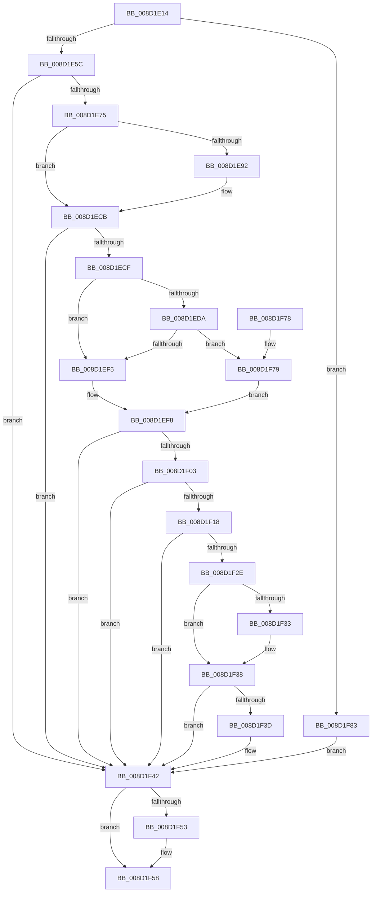

# sub_008D1E14

- RVA: `0x008D1E14`–`0x008D1F8A` (길이 `374` bytes)
- VA: `0x00000001408D1E14`
- 실행 섹션: `PAGE`
- PDB 이름 있음: `아니요`; PDB Function 태그: `아니요`
- unwind 정보 RVA: `0x00084C3C`
- 디코드: `109`개 명령, `374/374` bytes 표시
- 미해석 바이트: `0` (있으면 어셈블리에 `.byte`로 보존)

> 이 문서는 커널 이미지의 기계어와 PDB 기호를 분석해 생성했습니다. 4번과 5번은 함수 원형과 자료형을 바이너리 사용 방식에서 추정한 C 해석이며 원본 소스 복구 결과는 아닙니다.

## 1. Dependencies

- 직접 호출 지점: **10**; 고유 호출 대상: **9**
- 직접 호출자로 확인된 함수: **1**
- RIP 상대 이미지 참조: **3**

### Outgoing calls
- `0x008D1E66` → [BCryptCreateHash](BCryptCreateHash_function_008D1D80.md) (function, `0x008D1D80`)
- `0x008D1E88` → [ExGetExtensionTable](../../text/42/ExGetExtensionTable_function_00428814.md) (function, `0x00428814`)
- `0x008D1EB8` → [guard_dispatch_icall](../../text/6B/guard_dispatch_icall_function_006BAAD0.md) (function, `0x006BAAD0`)
- `0x008D1EC6` → [ExReleaseExtensionTable](../../text/45/ExReleaseExtensionTable_function_00456DC0.md) (function, `0x00456DC0`)
- `0x008D1EE7` → [ExAllocatePool2](../../poolcode/B8/ExAllocatePool2_function_00B820F0.md) (function, `0x00B820F0`)
- `0x008D1EFA` → [PdcCloseEvent](PdcCloseEvent_function_008D2404.md) (function, `0x008D2404`)
- `0x008D1F0D` → [BCryptHashData](BCryptHashData_function_008D1CB4.md) (function, `0x008D1CB4`)
- `0x008D1F23` → [BCryptFinishHash](BCryptFinishHash_function_008D1BB8.md) (function, `0x008D1BB8`)
- `0x008D1F45` → [PdcCloseEvent](PdcCloseEvent_function_008D2404.md) (function, `0x008D2404`)
- `0x008D1F53` → [BCryptDestroyHash](BCryptDestroyHash_function_008D1D2C.md) (function, `0x008D1D2C`)

### Direct callers
- [sub_008D1C2C](Unknown_function_008D1C2C.md) at `0x008D1C5D`

### Static image references
- `0x008D1E46` → RVA `0x00E3EA78` (`.data`; read)
- `0x008D1E75` → RVA `0x00F04E30` (`.data`; read)
- `0x008D1EB1` → RVA `0x000113E8` (`.rdata`; read)

## 2. Other-region calls and transfers

- 다른 실행 섹션으로 향하는 call: **4**
  - `0x008D1E88` → [ExGetExtensionTable](../../text/42/ExGetExtensionTable_function_00428814.md) (`PAGE` → `.text`)
  - `0x008D1EB8` → [guard_dispatch_icall](../../text/6B/guard_dispatch_icall_function_006BAAD0.md) (`PAGE` → `.text`)
  - `0x008D1EC6` → [ExReleaseExtensionTable](../../text/45/ExReleaseExtensionTable_function_00456DC0.md) (`PAGE` → `.text`)
  - `0x008D1EE7` → [ExAllocatePool2](../../poolcode/B8/ExAllocatePool2_function_00B820F0.md) (`PAGE` → `POOLCODE`)
- 별도 외부 분기/꼬리 이동을 확인하지 못했습니다.

## 3. Assembly (complete function range)

```asm
008D1E14  48 89 5C 24 08                  mov qword ptr [rsp + 8], rbx
008D1E19  48 89 74 24 10                  mov qword ptr [rsp + 0x10], rsi
008D1E1E  48 89 7C 24 18                  mov qword ptr [rsp + 0x18], rdi
008D1E23  55                              push rbp
008D1E24  41 54                           push r12
008D1E26  41 55                           push r13
008D1E28  41 56                           push r14
008D1E2A  41 57                           push r15
008D1E2C  48 8B EC                        mov rbp, rsp
008D1E2F  48 83 EC 50                     sub rsp, 0x50
008D1E33  48 83 65 F8 00                  and qword ptr [rbp - 8], 0
008D1E38  33 FF                           xor edi, edi
008D1E3A  21 7D F0                        and dword ptr [rbp - 0x10], edi
008D1E3D  4C 8B E9                        mov r13, rcx
008D1E40  21 7D F4                        and dword ptr [rbp - 0xc], edi
008D1E43  49 8B F1                        mov rsi, r9
008D1E46  48 8B 0D 2B CC 56 00            mov rcx, qword ptr [rip + 0x56cc2b]
008D1E4D  4D 8B F0                        mov r14, r8
008D1E50  44 8B E2                        mov r12d, edx
008D1E53  48 85 C9                        test rcx, rcx
008D1E56  0F 84 27 01 00 00               je 0x1408d1f83
008D1E5C  45 33 C9                        xor r9d, r9d
008D1E5F  48 8D 55 F8                     lea rdx, [rbp - 8]
008D1E63  45 33 C0                        xor r8d, r8d
008D1E66  E8 15 FF FF FF                  call 0x1408d1d80
008D1E6B  8B D8                           mov ebx, eax
008D1E6D  85 C0                           test eax, eax
008D1E6F  0F 88 CD 00 00 00               js 0x1408d1f42
008D1E75  48 8B 0D B4 2F 63 00            mov rcx, qword ptr [rip + 0x632fb4]
008D1E7C  BB 02 00 00 C0                  mov ebx, 0xc0000002
008D1E81  4C 8B 3D F0 CB 56 00            mov r15, qword ptr [rip + 0x56cbf0]
008D1E88  E8 87 69 B5 FF                  call 0x140428814
008D1E8D  48 85 C0                        test rax, rax
008D1E90  74 39                           je 0x1408d1ecb
008D1E92  21 7C 24 28                     and dword ptr [rsp + 0x28], edi
008D1E96  48 8D 4D F4                     lea rcx, [rbp - 0xc]
008D1E9A  48 8B 80 A8 00 00 00            mov rax, qword ptr [rax + 0xa8]
008D1EA1  44 8D 4F 04                     lea r9d, [rdi + 4]
008D1EA5  48 89 4C 24 20                  mov qword ptr [rsp + 0x20], rcx
008D1EAA  4C 8D 45 F0                     lea r8, [rbp - 0x10]
008D1EAE  49 8B CF                        mov rcx, r15
008D1EB1  48 8D 15 30 F5 73 FF            lea rdx, [rip - 0x8c0ad0]
008D1EB8  E8 13 8C DE FF                  call 0x1406baad0
008D1EBD  48 8B 0D 6C 2F 63 00            mov rcx, qword ptr [rip + 0x632f6c]
008D1EC4  8B D8                           mov ebx, eax
008D1EC6  E8 F5 4E B8 FF                  call 0x140456dc0
008D1ECB  85 DB                           test ebx, ebx
008D1ECD  78 73                           js 0x1408d1f42
008D1ECF  8B 4D F0                        mov ecx, dword ptr [rbp - 0x10]
008D1ED2  33 C0                           xor eax, eax
008D1ED4  33 DB                           xor ebx, ebx
008D1ED6  85 C9                           test ecx, ecx
008D1ED8  74 1B                           je 0x1408d1ef5
008D1EDA  8B D1                           mov edx, ecx
008D1EDC  41 B8 57 41 52 42               mov r8d, 0x42524157
008D1EE2  B9 00 01 00 00                  mov ecx, 0x100
008D1EE7  E8 04 02 2B 00                  call 0x140b820f0
008D1EEC  48 85 C0                        test rax, rax
008D1EEF  0F 84 84 00 00 00               je 0x1408d1f79
008D1EF5  48 8B F8                        mov rdi, rax
008D1EF8  33 C9                           xor ecx, ecx
008D1EFA  E8 05 05 00 00                  call 0x1408d2404
008D1EFF  85 DB                           test ebx, ebx
008D1F01  78 3F                           js 0x1408d1f42
008D1F03  48 8B 4D F8                     mov rcx, qword ptr [rbp - 8]
008D1F07  45 8B C4                        mov r8d, r12d
008D1F0A  49 8B D5                        mov rdx, r13
008D1F0D  E8 A2 FD FF FF                  call 0x1408d1cb4
008D1F12  8B D8                           mov ebx, eax
008D1F14  85 C0                           test eax, eax
008D1F16  78 2A                           js 0x1408d1f42
008D1F18  44 8B 45 F0                     mov r8d, dword ptr [rbp - 0x10]
008D1F1C  48 8B D7                        mov rdx, rdi
008D1F1F  48 8B 4D F8                     mov rcx, qword ptr [rbp - 8]
008D1F23  E8 90 FC FF FF                  call 0x1408d1bb8
008D1F28  8B D8                           mov ebx, eax
008D1F2A  85 C0                           test eax, eax
008D1F2C  78 14                           js 0x1408d1f42
008D1F2E  4D 85 F6                        test r14, r14
008D1F31  74 05                           je 0x1408d1f38
008D1F33  49 89 3E                        mov qword ptr [r14], rdi
008D1F36  33 FF                           xor edi, edi
008D1F38  48 85 F6                        test rsi, rsi
008D1F3B  74 05                           je 0x1408d1f42
008D1F3D  8B 45 F0                        mov eax, dword ptr [rbp - 0x10]
008D1F40  89 06                           mov dword ptr [rsi], eax
008D1F42  48 8B CF                        mov rcx, rdi
008D1F45  E8 BA 04 00 00                  call 0x1408d2404
008D1F4A  48 8B 4D F8                     mov rcx, qword ptr [rbp - 8]
008D1F4E  48 85 C9                        test rcx, rcx
008D1F51  74 05                           je 0x1408d1f58
008D1F53  E8 D4 FD FF FF                  call 0x1408d1d2c
008D1F58  4C 8D 5C 24 50                  lea r11, [rsp + 0x50]
008D1F5D  8B C3                           mov eax, ebx
008D1F5F  49 8B 5B 30                     mov rbx, qword ptr [r11 + 0x30]
008D1F63  49 8B 73 38                     mov rsi, qword ptr [r11 + 0x38]
008D1F67  49 8B 7B 40                     mov rdi, qword ptr [r11 + 0x40]
008D1F6B  49 8B E3                        mov rsp, r11
008D1F6E  41 5F                           pop r15
008D1F70  41 5E                           pop r14
008D1F72  41 5D                           pop r13
008D1F74  41 5C                           pop r12
008D1F76  5D                              pop rbp
008D1F77  C3                              ret
008D1F78  CC                              int3
008D1F79  BB 17 00 00 C0                  mov ebx, 0xc0000017
008D1F7E  E9 75 FF FF FF                  jmp 0x1408d1ef8
008D1F83  BB 0D 00 00 C0                  mov ebx, 0xc000000d
008D1F88  EB B8                           jmp 0x1408d1f42
```

## 4. C-style interpretation (structured pseudocode)

```c
__int64 __fastcall sub_008D1E14(__int64 a1, int a2, __int64 a3, __int64 a4)
{
    __int64 result;
    __int64 v_rbx;
    __int64 v_rdi;
    __int64 v_rsp;
    unsigned __int64 v_stack_m28;
    unsigned __int64 v_stack_m30;
    unsigned int v_stack_m34;
    unsigned int v_stack_m38;
    unsigned int v_stack_m50;
    unsigned __int64 v_stack_m58;
    unsigned __int64 v_stack_p10;
    unsigned __int64 v_stack_p18;
    unsigned __int64 v_stack_p8;

    v_stack_p8 = v_rbx;
    v_stack_p10 = v_rsi;
    v_stack_p18 = v_rdi;
    v_rsp = (v_rsp) - (80);
    v_rdi = 0;
    if (*(unsigned __int64 *)(v_rip + 5688363) == 0) goto loc_008D1F83;
    a4 = 0;
    a3 = 0;
    result = BCryptCreateHash(*(unsigned __int64 *)(v_rip + 5688363), v_stack_m30, a3, a4);
    if (sign_flag) goto loc_008D1F42;
    result = ExGetExtensionTable(*(unsigned __int64 *)(v_rip + 6500276), v_stack_m30, a3, a4);
    v_rbx = (unsigned int)(0xC0000002ULL);
    if (result != 0) {
        a1 = v_stack_m34;
        result = *(unsigned __int64 *)(result + 168);
        a4 = v_rdi + 4;
        v_stack_m58 = a1;
        a3 = v_stack_m38;
        a1 = *(unsigned __int64 *)(v_rip + 5688304);
        a2 = v_rip - 9177808;
        result = guard_dispatch_icall(a1, a2, a3, a4);
        a1 = *(unsigned __int64 *)(v_rip + 6500204);
        v_rbx = (unsigned int)(result);
        result = ExReleaseExtensionTable(a1, a2, a3, a4);
    }
    if (sign_flag) goto loc_008D1F42;
    result = 0;
    v_rbx = 0;
    if ((unsigned int)((unsigned int)(v_stack_m38)) == 0) goto loc_008D1EF5;
    result = ExAllocatePool2(256, (unsigned int)((unsigned int)((unsigned int)(v_stack_m38))), (unsigned int)(0x42524157ULL), a4);
    if (result == 0) goto loc_008D1F79;
loc_008D1EF5:
loc_008D1EF8:
    a1 = 0;
    result = PdcCloseEvent(a1, (unsigned int)((unsigned int)((unsigned int)(v_stack_m38))), (unsigned int)(0x42524157ULL), a4);
    if (sign_flag) goto loc_008D1F42;
    result = BCryptHashData(v_stack_m30, 0, (unsigned int)((unsigned int)((unsigned int)(a2))), a4);
    if (sign_flag) goto loc_008D1F42;
    result = BCryptFinishHash(v_stack_m30, result, (unsigned int)(v_stack_m38), a4);
    if (sign_flag) goto loc_008D1F42;
    v_rdi = result;
    if (a3 != 0) {
        *(unsigned __int64 *)(a3) = result;
        v_rdi = 0;
    }
    if (a4 != 0) {
        result = v_stack_m38;
        *(unsigned int *)(a4) = (unsigned int)(result);
    }
    result = PdcCloseEvent(0, result, (unsigned int)(v_stack_m38), a4);
    if (v_stack_m30 != 0) {
        result = BCryptDestroyHash(v_stack_m30, result, (unsigned int)(v_stack_m38), a4);
    }
    return (unsigned int)((unsigned int)((unsigned int)((unsigned int)(result))));
loc_008D1F79:
    goto loc_008D1EF8;
loc_008D1F83:
    goto loc_008D1F42;
}
```

## 5. (Beta) C Style

```c
int64_t sub_008D1E14(int64_t Arg1, int32_t Arg2, int64_t Arg3, int64_t Arg4)
{
    int64_t result;
    int64_t local_rbx;
    int64_t local_rdi;
    int64_t local_rsp;
    uint64_t v_stack_m28;
    uint64_t v_stack_m30;
    uint32_t v_stack_m34;
    uint32_t v_stack_m38;
    uint32_t v_stack_m50;
    uint64_t v_stack_m58;
    uint64_t v_stack_p10;
    uint64_t v_stack_p18;
    uint64_t v_stack_p8;

    v_stack_p8 = local_rbx;
    v_stack_p10 = local_rsi;
    v_stack_p18 = local_rdi;
    local_rsp = (local_rsp) - (80);
    local_rdi = 0;
    if (*(uint64_t *)(v_rip + 0x56CC2B) == 0) goto loc_008D1F83;
    Arg4 = 0;
    Arg3 = 0;
    result = BCryptCreateHash(*(uint64_t *)(v_rip + 0x56CC2B), v_stack_m30, Arg3, Arg4);
    if (sign_flag) goto loc_008D1F42;
    result = ExGetExtensionTable(*(uint64_t *)(v_rip + 0x632FB4), v_stack_m30, Arg3, Arg4);
    local_rbx = (uint32_t)(0xC0000002ULL);
    if (result != 0) {
        Arg1 = v_stack_m34;
        result = *(uint64_t *)(result + 0xA8);
        Arg4 = local_rdi + 4;
        v_stack_m58 = Arg1;
        Arg3 = v_stack_m38;
        Arg1 = *(uint64_t *)(v_rip + 0x56CBF0);
        Arg2 = v_rip - 9177808;
        result = guard_dispatch_icall(Arg1, Arg2, Arg3, Arg4);
        Arg1 = *(uint64_t *)(v_rip + 0x632F6C);
        local_rbx = (uint32_t)(result);
        result = ExReleaseExtensionTable(Arg1, Arg2, Arg3, Arg4);
    }
    if (sign_flag) goto loc_008D1F42;
    result = 0;
    local_rbx = 0;
    if ((uint32_t)((uint32_t)(v_stack_m38)) == 0) goto loc_008D1EF5;
    result = ExAllocatePool2(256, (uint32_t)((uint32_t)((uint32_t)(v_stack_m38))), (uint32_t)(0x42524157ULL), Arg4);
    if (result == 0) goto loc_008D1F79;
loc_008D1EF5:
loc_008D1EF8:
    Arg1 = 0;
    result = PdcCloseEvent(Arg1, (uint32_t)((uint32_t)((uint32_t)(v_stack_m38))), (uint32_t)(0x42524157ULL), Arg4);
    if (sign_flag) goto loc_008D1F42;
    result = BCryptHashData(v_stack_m30, 0, (uint32_t)((uint32_t)((uint32_t)(Arg2))), Arg4);
    if (sign_flag) goto loc_008D1F42;
    result = BCryptFinishHash(v_stack_m30, result, (uint32_t)(v_stack_m38), Arg4);
    if (sign_flag) goto loc_008D1F42;
    local_rdi = result;
    if (Arg3 != 0) {
        *(uint64_t *)(Arg3) = result;
        local_rdi = 0;
    }
    if (Arg4 != 0) {
        result = v_stack_m38;
        *(uint32_t *)(Arg4) = (uint32_t)(result);
    }
    result = PdcCloseEvent(0, result, (uint32_t)(v_stack_m38), Arg4);
    if (v_stack_m30 != 0) {
        result = BCryptDestroyHash(v_stack_m30, result, (uint32_t)(v_stack_m38), Arg4);
    }
    return (uint32_t)((uint32_t)((uint32_t)((uint32_t)(result))));
loc_008D1F79:
    goto loc_008D1EF8;
loc_008D1F83:
    goto loc_008D1F42;
}
```

## 6. Execution-region graph

[열기: 2D/3D 그래프와 함수 탐색 컨트롤 패널](../../../control-panel.html?section=page&rva=0x008D1E14&view=graph)

- 2D 그래프는 위에서 아래로 흐르고, 3D 그래프는 빈 공간을 드래그해 회전합니다. Shift+드래그는 이동, 휠은 확대·축소, 함수 노드 선택은 대상 보고서 이동입니다.

### Static fallback


